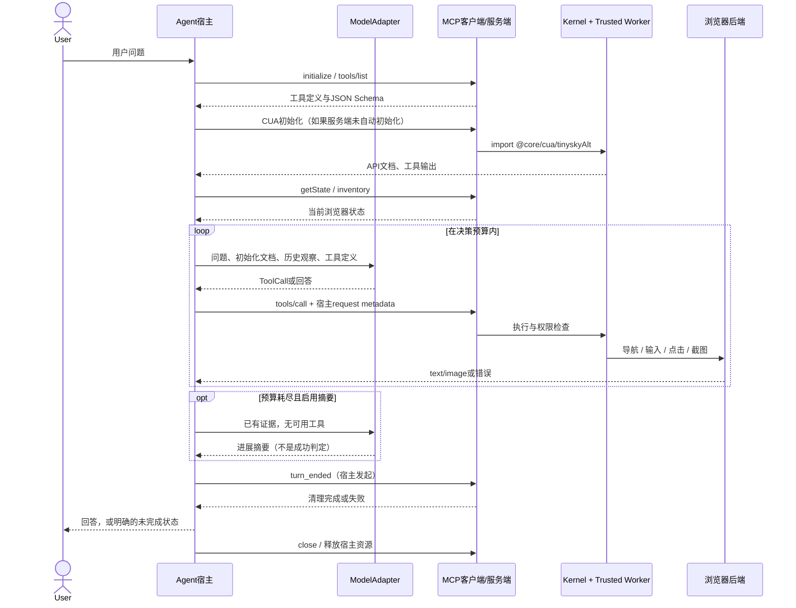

# 可替换的调用侧：MCP Client + AgentLoop

当前入口使用 `packages/agent-loop`，公共类型见
[`contracts.ts`](../packages/agent-loop/src/contracts.ts)。根目录 Agent API 已转接共享实现；默认 `demo` 和 `mcp` 均连接还原运行时。
QuickJS 原型仅保留在显式的 `demo:legacy` / `mcp:legacy` 命令。

模型、AgentLoop、MCP 客户端和浏览器执行层可以分别替换。模型凭证只交给
ModelAdapter，不能传入 MCP 子进程、worker 环境或网页。

## 协议与生命周期



| 边界 | 当前契约 | 接入要求 |
|---|---|---|
| ModelAdapter | `decide({system,messages,tools,signal})` | 返回文本或带 ID、名称、JSON 参数的 toolCalls |
| ToolClient | `listTools / callTool / endTurn? / close` | 保留 text/image、isError，按顺序执行动作 |
| MCP | stdio `tools/list`、`tools/call`、form elicitation | stdout 只承载协议，stderr 承载诊断 |
| 会话元数据 | `_meta["x-codex-turn-metadata"]` | session_id/turn_id 由宿主维护，不由模型参数授权 |
| 生命周期 | `NodeReplTurnClient` | 从模型工具表隐藏 turn_ended；成功、失败、取消都清理 |
| 浏览器 | 扩展、临时 CDP、明确 endpoint 的已有 CDP | 以真实 inventory 为准；不要把接口存在当作能力可用 |

### 初始化输出必须进入模型上下文

显式导入 `@core/cua/tinyskyAlt` 时会立即输出核心 API 文档，随后会缓存文档。
只把后续 `getState()` 输出交给模型会漏掉这份文档。把初始化调用及其完整结果
作为匹配 callId 的 assistant/tool 消息保留，再添加后续观察。本项目可用
`AgentRunOptions.initialMessages` 传入这些消息。

独立 supervisor 将 worker 的 `output`、`named_outputs`、媒体内容映射成 MCP
content。不要丢掉带标签的文本：CUA 的文档和页面状态使用这一通道。图片保持
独立 image 内容，不能只保留终端显示的截图路径。当前 ToolClient 支持 text/image；
其他内容类型显式报错，不静默忽略。

页面和工具文本属于不可信证据。初始化 API 文档描述调用方式，但网页文字不能
授予权限或改变宿主约束。终端的展示截断也不等于模型上下文截断。

### 授权、错误和清理

只有具备真实确认 UI 的客户端才声明 elicitation capability。非交互运行不能
自动接受新的 origin 请求；当前 demo 会报告此限制。`endTurn()` 不继承已经取消
的动作 signal，以便完成清理；动作失败和清理失败同时出现时保留两个错误。

默认预算 12 轮。通用 AgentLoop 默认耗尽即抛 `AgentStepBudgetError`。demo 启用
`summarizeOnExhaustion`，至多增加一轮禁用工具的摘要请求，仍以未完成、非零状态
退出。`partialSummary` 是模型生成的文字，不是可靠的完成判定。

## 运行与验收

本地 `.env` 配置 `DEEPSEEK_API_KEY`，不提交 GitHub。运行当前 demo：

```sh
npm run demo:deepseek -- --cdp-browser '打开 https://example.com 并概括页面'
```

扩展模式的普通 prompt 入口在连接目录存在但为空时，会请求 macOS 打开 Google Chrome，并最多等待 15 秒以发现扩展宿主；超时后给出明确诊断，不自动换用另一浏览器的登录环境。`--check-browser` 仍仅检查，不启动浏览器。发现描述文件只是第一步，后续仍需 MCP 浏览器预检通过。

扩展模式省略 `--cdp-browser`；接管已暴露调试端口的现有浏览器使用
`--cdp-endpoint <本地浏览器WebSocket地址>`。这些模式默认使用重建版 Rust supervisor，
需要与安装版比较时显式设置 `CUA_RUNTIME_SUPERVISOR=installed`。完整后端边界见 [README](../README.md)。

独立 supervisor 的受控实机验收：

```sh
npm run test:sandbox
# 可选：消耗真实 DeepSeek API 配额，使用本地 .env
CUA_TEST_MACOS_SANDBOX=1 CUA_LIVE_DEEPSEEK_TEST=1 node --import tsx --test reconstruction/runtime-cdp-sandbox.test.ts
```

第二条运行真实模型 → 独立 MCP supervisor → OS 沙箱内还原 workers → Chromium，
模型自行填写随机查询、提交、截图并读取仅在结果页出现的随机标记。HTTP 服务端
独立确认实际提交值。当前一次验收为 4 轮、0 工具错误；这不证明所有任务稳定，
也不代表外部网站认证、原生桌面权限、独立 supervisor 默认部署已完成。

日志留在本地 `artifacts/debug/`，凭证脱敏、图片不写入 base64，文件和 `.env`
均被 Git 忽略。日志可能包含页面内容，不自动上传。替换 Agent 时仍需自行制定
上下文/图片预算、结果验收和人工确认界面。


## 选择 Rust supervisor（浏览器实验入口）

```sh
npm run build:rust-runtime
CUA_RUNTIME_SUPERVISOR=rust npm run demo:deepseek -- --cdp-browser --check-browser
CUA_RUNTIME_SUPERVISOR=rust npm run demo:deepseek -- --cdp-browser '打开 https://example.com 并概括页面'
```

本地 `.env` 继续提供 DeepSeek 凭证。Rust 选项绕过安装包 supervisor；未设置时默认
仍为 installed。CDP 模式启动独立浏览器，不共享日常 Chrome 登录态，也不是原厂
缺扩展时的自动回退方案。来源授权仍通过已有确认流程处理。

受控 Rust + DeepSeek 端到端验收：

```sh
CUA_TEST_MACOS_SANDBOX=1 CUA_TEST_RUST_RUNTIME=1 CUA_LIVE_DEEPSEEK_TEST=1 node --import tsx --test reconstruction/runtime-cdp-sandbox.test.ts
```

此测试使用隔离 Chromium 和本地随机表单，验证输入、提交、结果及截图。本次通过
为 5 轮、0 工具错误。任意外部网站、日常 Chrome 扩展和原生 App 尚未由此验收。


Rust 浏览器回归入口（临时配置，不操作日常 Chrome）：

```sh
npm run test:rust-browser
# 可选：使用本地 .env，消耗真实模型 API 配额
CUA_LIVE_DEEPSEEK_TEST=1 npm run test:rust-browser
```

包含隔离 CDP、Native Messaging 扩展、完整打包扩展三种部署。扩展场景用随机
结果和本地服务端点击记录双重核验；最近真实模型测试曾先误用 accessibility
点击，收到不支持提示后改用 Playwright 完成。任务成功不代表没有工具调用错误。


浏览器输入能力：原版 `bind_tab` 会保留 `click` 等包装方法，即使底层 `tab.ax`
不可用。因此方法存在不代表支持 AX 输入，`getAXState()` 也可能仅返回 DOM
快照。调用侧现在明确提示检查能力与真实索引、缺少 AX 时使用 Playwright。
这是 demo 提示，不修改还原 API；实际模型仍可能选错方法并从错误中恢复。

### Tool-provider initialization guidance reaches AgentLoop

`ToolClient` now has optional `getInstructions(): string | undefined`, a provider-neutral string contract. `McpToolClient` reads it from the upstream SDK's initialize result; NodeREPL-turn and debug adapters preserve it. AgentLoop snapshots this guidance once per run and includes it in normal model context and optional exhausted-budget summaries alongside host context. Tool results remain in the evidence messages and cannot become system guidance through this path. Existing clients without the optional method keep their previous behavior; invalid values fail before a model request while still running turn cleanup.

Twenty caller regression tests pass. The real MCP stdio + local mock-model integration checks that initialization instructions appear in both actual model HTTP requests. Additional tests cover adapter forwarding, guidance snapshotting, exclusion of tool/page text from system context, summary tools staying disabled, and cleanup after invalid metadata. This changes independently authored caller integration, not a reconstruction claim about the original Codex agent.

The native `NODE_REPL_JS_COMPLETION_SUMMARY` contract remains unfinished. Its source instruction requires a separate js call containing only `completion_summary` after the observed CUA outcome; this must not be conflated with AgentLoop's optional budget-exhaustion summary or host `turn_ended` cleanup.


### Completion reports on the Rust runtime

When the source launcher supplies `NODE_REPL_JS_COMPLETION_SUMMARY`, the Rust tool schema exposes a summary-only branch of `js`. After observing the final task outcome, follow the advertised guidance and submit `{ "completion_summary": "Reviewed search results" }` as a separate call with no code/title/timeout. It reports completion without executing JavaScript or clearing bindings. The field is non-blank, at most 80 Unicode characters. Do not confuse this with `turn_ended` or the demo's budget-exhaustion handling. The server accepts repeated reports; the caller must follow the source instruction to report once. Without the configuration, the field is not advertised.


### Independent supervisor deployment

Set `CUA_RUNTIME_SUPERVISOR=rust` for the independent native supervisor. The previous `independent` value is retained as an alias for Rust; it no longer launches a TypeScript supervisor. `npm run demo:deepseek` builds the Rust runtime for either value. Direct programmatic/demo entry users must build with `npm run build:rust-runtime` first. A missing Rust build fails with that instruction and does not fall back to TS. Explicit `CUA_RUNTIME_SUPERVISOR=installed` uses the verified installed native supervisor for comparisons. The computer CLI modes (`--computer`, `--check-computer`, and alias `--swift-computer`) select Rust plus the Swift service and override stale surface/backend settings. Browser mode defaults to Rust; direct programmatic configuration still separates backend and supervisor selection.


The turn lifecycle adapter adds a default JS timeout only to code-execution requests. It forwards completion reports unchanged; adding `timeout_ms`, `title` or `code` to that branch violates the native protocol.


## Direct desktop deployment migration

The direct restored-demo entry defaults the computer surface to `CORE_CUA_NATIVE_BACKEND=swift` and selects Rust when the supervisor is unspecified. The old native backend name `independent` aliases `swift`; it no longer replaces the original Sky service with the legacy TS adapter. Explicit `installed` plus Swift is rejected before any launch. For an installed-service comparison, explicitly choose backend `vendor` and supervisor `installed`. Browser-only entries default to Rust; generic JS entries retain their installed default. Direct callers must build reconstruction, Swift and Rust first; the npm CLI handles these builds. These are independently authored deployment choices, not evidence that the original application exposes the same selectors.

A real subprocess test sets an invalid installed supervisor path and successfully performs native inventory through the legacy backend alias, without model credentials or App actions. Run it with `CUA_TEST_NATIVE_SKY_IPC=1 node --import tsx --test reconstruction/runtime-selection.test.ts` after building; it also participates in `npm run test:native-ipc`.


Runtime staging now excludes the retired `@core/native-macos` adapter. The original Sky binding remains in the deployed package graph. Explicitly staging custom sources is still a caller capability; the normal deployment no longer installs the old service as a hidden alternative.


## Public agent library and root compatibility exports

`@core/agent-loop` now exports built ESM plus declarations, usable by plain Node without a TS loader. Run `npm run build:agent` (also part of root build/check and reconstruction build). Source imports remain extensionless; generated declarations use Node-compatible suffixes. `npm run build -w @core/agent-loop` is also supported.

Existing root `@vicksiyi/cua-kit/agent/loop`, `/agent/mcp-client`, and `/agent/contracts` paths delegate to this package. Their consumers now receive current server initialization guidance, optional endTurn cleanup, MCP metadata/elicitation/media support and the same agent-neutral contracts. The old internal chat-model path also delegates to the shared provider. Default root demo and MCP now use the restored runtime. Explicit `demo:legacy` / `mcp:legacy` and root CUA SDK exports still use the prototype server/API; caller compatibility does not establish native feature parity.


## Agent-neutral stdio MCP entry

Build once before connecting (build output must not share the MCP protocol stream):

```sh
npm run build:reconstruction
npm run build:native
npm run build:rust-runtime
```

For the macOS computer surface, configure your MCP client with working directory set to this repository:

```json
{
  "command": "node",
  "args": ["--import", "tsx", "packages/agent-loop/src/restored-mcp.ts"],
  "env": {
    "CUA_MCP_ENV": "{\"CUA_REPL_ENABLED_SURFACES\":\"computer\",\"NODE_REPL_DISABLE_ANALYTICS\":\"1\"}"
  }
}
```

The equivalent process command is `npm run --silent mcp`; silent mode prevents npm banners from entering protocol stdout. No model token is needed; this server does not read project `.env`. Supply native app policy through `CORE_CUA_APP_POLICY` and handle original form elicitation in the host for App actions. Inventory alone does not authorize an App. Browser deployments require their explicit backend connection configuration; this entry does not invent an automatic CDP fallback.

The server and demo share `prepareRestoredRuntime`: source launcher instructions/banner/completion configuration, runtime selection, dependency staging and disposal. Model clients provide request metadata and end turns through the observed `turn_ended` protocol (the provided `NodeReplTurnClient` hides this lifecycle tool from the model). The stdio entry forwards signals to the native supervisor and removes staged deployment files when it exits. SIGTERM/SIGINT during package staging are now covered by a real process gate: it observes the owned staging directory before a native supervisor exists, interrupts preparation, and verifies exit codes plus cleanup. Staging checks an AbortSignal during file copying; signals received during earlier setup are checked before allocating the deployment. This does not guarantee cleanup after SIGKILL or a host crash.

The old QuickJS entry is explicitly named `npm run --silent mcp:legacy`. Its `CUA_ALLOWED_ORIGINS` configuration is not the new native App policy.


## Default demo and model selection

`npm run demo -- "your prompt"` now uses the restored runtime launcher, including surface/backend flags, local `.env`, tool logs and the shared preflight. The old QuickJS demo is explicitly `npm run demo:legacy`. The browser default selects the reconstructed Rust supervisor; computer selects Rust/Sky/Swift. Explicit `CUA_RUNTIME_SUPERVISOR=installed` remains available for browser comparisons.

`npm run demo:deepseek -- "your prompt"` explicitly selects DeepSeek regardless of a stale provider setting. The generic demo uses `CUA_MODEL_PROVIDER` (default `deepseek`). For another compatible provider set `CUA_MODEL_PROVIDER=openai-compatible`, `CUA_MODEL_API_KEY`, `CUA_MODEL`, and `CUA_MODEL_ENDPOINT` in the private environment. Its credential prompt requests the matching provider key; it does not accept a DeepSeek key in place of the generic provider key. Check modes require neither key. Invalid provider names fail before native builds.

Validation entry for the root demo with a deterministic local model and owned real Chromium (build reconstruction and Rust first):

```sh
CUA_TEST_ROOT_DEMO=1 CUA_TEST_MACOS_SANDBOX=1 node --import tsx --test reconstruction/independent-demo-runtime.test.ts
```

This tests five model decisions, actual open/click/read, completion reporting and the observed final marker. It does not make a paid provider request or use the daily Chrome profile.


## Restored CUA API versus the legacy host SDK

The installed package exposes two different contracts: its root exports a lower-level `cua` object with `initialize`, `computer`, `browsers`, and `documentation`; `tinyskyAlt` reads `nodeRepl.env.CUA_REPL_ENABLED_SURFACES`, awaits setup and installs the convenience API as `globalThis.cua`. It aliases `initialize` to `getState`. This latter entry supplies `cua.getTab`, `cua.getApp`, and related methods inside the configured kernel. It is not an ordinary host-side `Cua.launch` constructor.

New hosts should connect the restored MCP runtime and call the documented CUA API inside its `js` tool. They should not import the legacy root class and assume it represents the restored source. Existing root Cua/createCua and MacApp/MacProvider declarations are now marked deprecated; explicit `@vicksiyi/cua-kit/legacy`, `/legacy/native`, and `/legacy/extension` paths identify remaining prototype consumers. Existing root paths remain compatible while those consumers migrate; this is not full legacy removal.

`reconstruction/public-api-boundary.json` records installed artifact hashes and this distinction. The original/restored `tinyskyAlt` entry differential test covers eight initialization cases with setup stubbed, without touching a browser or App. Entry parity is not proof of complete CUA or native behavior parity.


### Terminal tool dispositions

`ToolResult.stopReason` is optional host-adapter metadata (`{kind: "authorization", message: string}`). The MCP client does not copy this field from wire content. The NodeREPL turn adapter emits it only for error results whose text starts with the observed browser security rejection/unavailable prefix. Successful page text and ordinary JS/argument errors do not trigger it. This conservative text classification is an independently authored caller policy, not a new native protocol or recovered Codex behavior.

When a tool result has this disposition, AgentLoop stops the remaining batch and, by default, further model calls, records the tool error and host-authored response, and returns `status: "blocked"` with the existing answer/messages fields. Turn cleanup still runs. Normal model answers return `status: "completed"`; that status describes loop termination, not external verification of task success. The demo prints blocked responses and exits with code 1; debug logs include the status and original error. No automatic approval, retry, or alternate route is performed.

### Local extension wire diagnostics

To reproduce a daily-Chrome failure with transport-level metadata in addition to the existing AgentLoop log:

```sh
CUA_RUNTIME_SUPERVISOR=rust node scripts/trace-deepseek.mjs "访问百度，搜索 deepseek，返回第一条自然结果的标题和链接"
# Read-only connection check; no model request:
CUA_RUNTIME_SUPERVISOR=rust node scripts/trace-deepseek.mjs --check-browser
```

Build the project first using the normal demo setup. The diagnostic launcher selects one existing Core extension endpoint and proxies unchanged framed bytes. Multiple endpoints require an explicit `CORE_CUA_ENDPOINT_FILES` selection. Backend-changing flags are rejected; this does not trace managed Chromium or CDP deployments. Configure endpoint selection outside `CUA_MCP_ENV` for this launcher. Normal origin approval and runtime gates remain in force.

The printed `artifacts/debug/wire-*/wire.jsonl` contains time, connection number, numeric request ID, RPC/CDP method, tab IDs, error code and a fixed error category (detached-during-command, debugger-unattached, method-not-found or other). Transport records additionally identify connection/end/error/close events and whether close followed a socket error. It excludes authentication messages, tokens, URLs, expressions, response bodies and error text. Correlate numeric IDs and timestamps with the existing private AgentLoop log. Categories are diagnostic text matches, not authority to retry or evidence of the initiating detach cause. The current extension forwards the debugger source in onCDPDetach, not Chrome's detach reason; this trace cannot recover a reason absent from that wire message. Protocol errors are not necessarily task errors: for example, an unsupported cached-expression RPC can trigger the documented ordinary-CDP fallback.

Logs stay in the ignored `artifacts/` directory. Each trace directory is mode 0700 and its metadata file mode 0600. A short private temporary socket directory holds the capability descriptor during the run and is removed on normal completion or handled SIGINT/SIGTERM. Abrupt process termination such as SIGKILL can leave temporary files; do not publish them. The proxy can affect timing, so a successful traced run alone does not disprove an intermittent failure without the proxy.

To trace the owned-page acceptance harness through the same proxy (build first):

```sh
# Fixed API sequence, including cross-origin iframe and JS-error recovery:
node scripts/trace-deepseek.mjs --owned-fixture
# Real model chooses actions on the owned page; requires configured model credentials:
CUA_LIVE_DEEPSEEK_TEST=1 node scripts/trace-deepseek.mjs --owned-fixture
```

The fixture approves only its two temporary local origins, never public sites. The live-model branch checks form submission, observed result, screenshot and cleanup; the fixed branch additionally checks iframe and rejected-JS recovery. Existing endpoint selection and metadata privacy rules apply. `--owned-fixture` is a diagnostic/test mode, not an alternative implementation of the CUA API.

To exercise recovery after a deliberately missing selector (fixed fixture sequence only):

```sh
CUA_TEST_SELECTOR_TIMEOUT=1 node scripts/trace-deepseek.mjs --owned-fixture
```

This expects a selector timeout, then requires subsequent actions in the same tab/session to succeed. It does not deliberately time out a low-level CDP command, whose debugger-retirement behavior is a separate contract.


### Text-only report after a blocked turn

`AgentRunOptions.summarizeOnBlocked` defaults to false for library callers. The DeepSeek demo
explicitly enables it: after an authorization stop the loop may issue exactly one extra model
request with no tools (`tool_choice: none` in the chat-completions adapter). It summarizes only
previously observed evidence and explains the unresolved/denied work. No blocked operation is
retried, no subsequent queued tool is executed, and no alternative observation channel is opened.

Pending tool-call IDs receive explicit host-generated “Not executed” results before this request,
so multi-call conversations remain valid for model APIs. The final answer always begins with the
host's stop message and the return status remains `blocked`; the demo still exits with code 1.
Model text is a report, not proof of completion. A summary error, empty response, or attempted tool
call falls back to the host stop message and exposes `summaryError` for diagnostics; the demo
records it locally as `run.blocked-summary.error`. Cancellation still propagates and turn cleanup
still runs. Existing evidence may be included in this extra model request, just as in ordinary
loop decisions; it is not uploaded to GitHub.

This is demo/AgentLoop behavior, not a claim that Codex's proprietary agent loop was recovered.
The browser's policy gate and original input/observation protocols are unchanged.

Validation: `agent-loop-blocked-summary.test.ts` covers the actual HTTP request shape, complete
batch transcript, skipped-call non-execution, summary failures, cancellation and stable blocked
status. Policy-stop, budget and turn-lifecycle regressions are run alongside it.

For ordinary REPL execution failures, the model guidance now explicitly warns that failed variable
initialization does not establish a usable binding and may still have side effects. It should inspect
documented inventory before recovery. This is guidance, not a deterministic recovery algorithm or
permission to retry denied actions.


### Login and human-verification handoff

The demo's model guidance distinguishes existing-account sign-in from account registration and
password reset. Filling a password field does not set a password. When the user requests an
arbitrary new password while asking to sign in, the model must clarify the intended flow before
submitting credentials. It must not print generated passwords in tool output or final prose.
This guidance does not retroactively redact existing local logs and is not a deterministic
credential filter.

Human-verification challenges require user takeover. The model should stop challenge interaction,
use the documented markHandoff capability where available, and explain what remains unfinished
without submitting completion_summary. Website-access approval does not complete a CAPTCHA.
The loop's existing `completed` status means model conversation termination, not verified login
success; applications must not translate it into “login successful”. Structured handoff status and
interactive resume remain separate work, not implemented by this guidance change.


### Native app versus website selection

The demo now supplies actual enabled surface flags to model context. A request to open a local
application must not silently become a website visit. If computer access is disabled, the model
should explain that limitation and the `--computer` entry. A disabled surface is not evidence that
an application is uninstalled. This is model guidance, not a deterministic natural-language router
or proof of successful app launch.

Source evidence: the installed `cua/.../tinysky_alt/create_tinysky_alt.js` independently initializes
browser and computer with Promise.all, conditionally attaches browser APIs and listApps/getApp,
and routes macOS getApp to get_app_state with disableDiff:true. This API module does not classify
natural-language prompts. The reconstructed `create_tinysky_alt.ts` retains that composition.

The CLI now offers `--unified`, which enables browser and computer together. The default remains
browser-only. In unified mode existing configured browser connections are discovered without eagerly
launching Chrome; missing host directories or no live endpoints produce an explicit empty browser
allowlist. Invalid permissions, malformed endpoints and authentication errors remain fatal. With no
browser host configuration, unified mode explicitly selects the empty allowlist. Native helper and
Rust supervisor builds follow the existing computer entry.

```bash
npm run demo:deepseek -- --unified "只检查本机应用列表里是否存在 Multica；不要打开应用，不要访问网站。"
```

A real DeepSeek run of this prompt identified Multica (`ai.multica.desktop`) as running from the
native app inventory, then returned a completion summary and final answer. No webpage or app window
operation was requested or performed. This demonstrates the model receives native app evidence in
a dual-surface run even with zero browser connections, not general app-operation acceptance.
The local transcript is ignored by Git and is not part of published artifacts.

Still pending: browser launch after model selection and daily-Chrome acceptance. Dynamic discovery
now supports a browser registering after startup when unified mode is configured with an existing
private host directory. Explicit endpoint-file configurations remain fixed. Actual Multica opening,
screenshot and input acceptance remain pending.

#### Explicit zero-browser runtime

The trusted host now accepts an explicitly configured empty endpoint allowlist (`CORE_CUA_ENDPOINT_FILES`
set to `[]`) and produces `BROWSER_USE_BACKEND_PATHS` set to the empty string. Missing configuration
is not equivalent to this explicit empty configuration. The bridge rejects every socket in this
state. It does not search ambient host directories. Endpoint parsing remains nonempty by default;
only the runtime composition sites opt into empty lists.

This matches the installed browser-service discovery function Xle: non-null explicit paths are
split, empty entries removed, and an empty array returned without calling directory discovery.
The independent Rust deployment retains both browser and Sky services with no browser pipes.
For combined browser/computer runs, demo preflight now observes `cua.getState()` once and preserves
its per-surface errors instead of requiring both inventories to be nonempty. Tool errors and
policy stops still prevent model execution. Single-surface explicit check commands retain their
existing readiness checks. This does not recover an unavailable native service at kernel creation.

Validation: `unified-empty-browser.test.ts` compares the installed Xle function in isolation,
checks empty-allowlist socket rejection, and runs a real Rust supervisor + Swift helper + MCP
session with both surfaces enabled and zero browser endpoints. Both API entry points are present,
app inventory is nonempty, browser inventory is empty, and the inventory has no service errors.
This test observes inventory only; it does not prove app launch, screen capture, clicking, DeepSeek
selection, or late browser reconnection. Existing host/connector/preflight tests also pass.

Two older source-comparison harnesses (`browser-desktop-discovery.test.ts` and the pipe-inventory
case in `browser-service-discovery.test.ts`) currently fail because their pinned minified symbol
bindings no longer match the installed build (`p` / `dt` undefined). They were not counted as
passing or rewritten as part of this change. The focused Xle comparison uses the installed symbol.

The unified test suite additionally exercises the CLI through a local model-compatible HTTP endpoint,
verifies that both surface flags and unified inventory reach the model, and checks that no eager
Chrome startup occurs. A separate test confirms missing connections are tolerated only in combined
mode while unsafe directories still fail. These tests do not replace the real DeepSeek observation
or prove success for native window actions.


#### Browser registration after unified startup

With both surfaces enabled and `CORE_CUA_HOST_DIRECTORY` configured (without an explicit endpoint
file list), the adapter validates the private directory and passes its canonical path as a scoped
registration root to the Rust supervisor. The trusted browser service refreshes descriptors on each
browser discovery call. It retains the restored discovery/handshake/selection machinery and supplies
a deployment-specific `listPipes` callback; it does not introduce a natural-language router.

New transport connections are authorized by Rust only for sockets directly inside a `core-cua-*`
child of that host-configured root, with a matching private `endpoint.json`, valid version/token
shape, and current-user ownership. Symlinks, shared permissions, oversized/malformed descriptors,
paths outside the root, and missing registrations are rejected. Authentication still occurs in the
trusted connector; structural registration is not authentication. Each new connection revalidates
registration, while established connections keep their existing lifecycle. The trusted worker gets
read access to the installation directory; the untrusted kernel does not. Static endpoint deployment
continues to use its explicit socket allowlist. Missing directories at startup remain zero-browser
static deployments; the runtime does not create a browser installation or grant a new scope later.

These are independently implemented Core deployment responsibilities, not a claim that vendor Rust
source or its app-launch protocol was recovered. The source browser discovery supports refreshing
its pipe list; original source selection, browser authorization, and page operations stay unchanged.

Validation: three Rust registration tests cover late sockets, unconfigured roots, malformed or
oversized descriptors, removal, shared permissions and symlinks. `unified-late-browser.test.ts`
starts the real Rust + Swift + MCP runtime with zero connections, registers a Rust native host with
a controlled extension-protocol peer after startup, observes one browser, shuts down that host, and
observes zero browsers again, all in the same MCP session with app inventory retained. This verifies
registration/discovery/transport/handshake together; it does not open actual Chrome or perform a page
operation. Chrome launch-on-selection remains separate work.


#### Native UI readiness versus app inventory

The standalone Rust/Swift demo now runs the selected helper with `--permissions` before the model
request. This checks permissions without displaying a system authorization prompt. Exit 2 means a
successful probe reporting missing grants; other exit failures or malformed output do not become
valid readiness evidence. Both boolean flags reach terminal diagnostics, local debug metadata, and
model runtime context. Programmatic library callers are not forced to run this demo-only probe.

The demo also supplies the actual standalone App-policy context and reports when no App is allowed.
Source policy error wording mentioning an organization is preserved, but does not establish that
this standalone installation is organization-managed. No policy is changed, no approval is silently
accepted, and missing macOS grants are not worked around. Local App policy, both macOS permissions,
and interactive approval are jointly required for the current native observation implementation.

On this host, the helper probe reported Accessibility=false and ScreenRecording=false. A real
DeepSeek request to open/read Multica reached the source getApp policy path and was denied with an
empty local allowlist; it obtained no window state and performed no UI input. The revised context
made the final explanation identify local policy rather than assume an organization administrator.
The model still attempted getApp despite readiness guidance; guidance is not a deterministic action
filter. The policy gate actually stopped the attempt. Model prose is also not authoritative evidence
of which prerequisites have been satisfied.

To request macOS grants interactively, the user can run the existing helper command in their local
terminal after reviewing the requested permissions:

```bash
native/macos/.build/debug/cua-helper --request-permissions
native/macos/.build/debug/cua-helper --permissions
```

The first command intentionally requests system prompts; the demo's automatic check only uses the
second. Granting system permissions does not configure `CORE_CUA_APP_POLICY` or complete native App
acceptance. A successful inventory or a model final answer likewise does not prove getApp, screenshot,
or click success. Native action acceptance remains pending.

Validation: the permission probe tests cover strict evidence, helper exit statuses, missing executables,
malformed output, and the actual Swift permission query. The unified CLI HTTP integration verifies
both permission facts and local policy context reach the model. Real DeepSeek transcripts remain in
ignored local artifacts and are not published.
