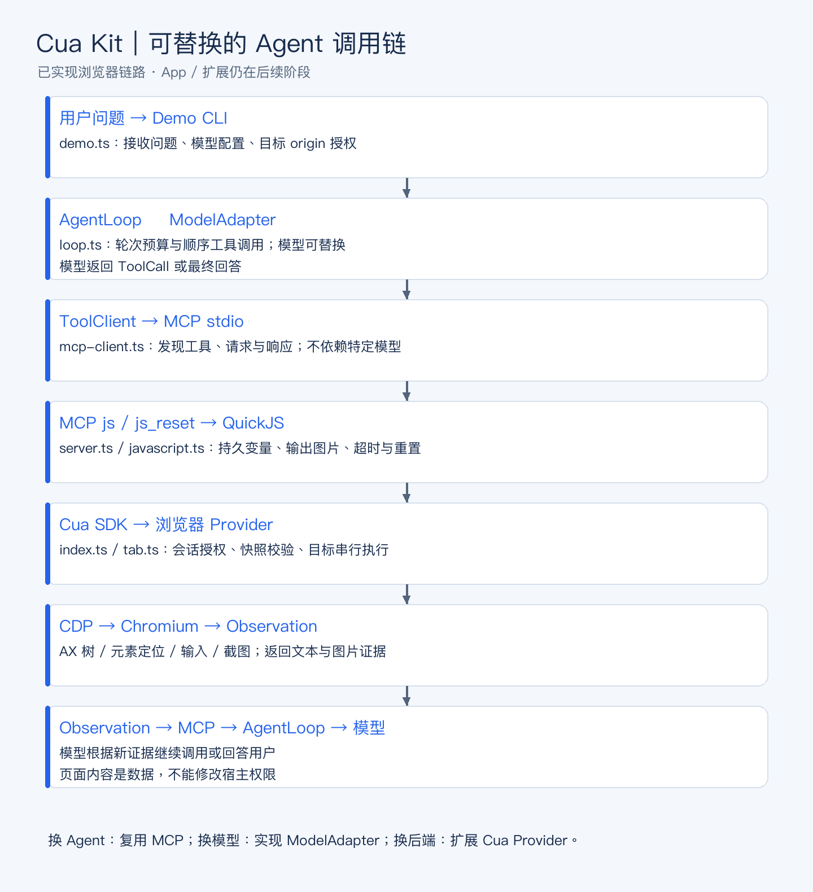

# 可替换的调用侧：MCP Client + Agent Loop

Demo 是一个独立消费者。CUA 的浏览器执行层不导入模型 SDK，不持有模型密钥，也不依赖本项目 AgentLoop。



```mermaid
sequenceDiagram
    actor User
    participant Loop as AgentLoop
    participant Model as ModelAdapter
    participant Client as ToolClient (MCP)
    participant Server as CUA MCP / QuickJS
    participant SDK as Cua / Provider
    participant Browser as Chromium
    User->>Loop: 问题
    Loop->>Client: listTools
    Client-->>Loop: js / js_reset + JSON Schema
    loop 直到最终回答或轮次预算耗尽
      Loop->>Model: 对话 + 工具定义 + 观察证据
      Model-->>Loop: ToolCall 或最终回答
      Loop->>Client: callTool(name, arguments)
      Client->>Server: MCP tools/call
      Server->>SDK: cua.getTab / observe / click 等
      SDK->>SDK: 授权、会话、快照与目标校验
      SDK->>Browser: CDP AX / DOM / Input / Screenshot
      Browser-->>SDK: 状态或动作结果
      SDK-->>Server: 结构化 Observation / error
      Server-->>Client: 文本 + image/png 内容
      Client-->>Loop: ToolResult
    end
    Loop-->>User: 基于观察的回答
```

## 接口边界

| 层 | 契约 | 可替换部分 |
|---|---|---|
| ModelAdapter | decide({system,messages,tools,signal}) → {text,toolCalls} | 任意 LLM 或确定性测试模型 |
| ToolClient | listTools / callTool / close | stdio MCP、未来 HTTP MCP、嵌入式适配器 |
| AgentLoop | run(question, {maxSteps,signal,onMessage}) | 第三方 Agent 可完全替换这一层 |
| MCP | tools/list / tools/call，JSON Schema，text/image 内容 | 任意兼容 MCP 的宿主 |
| Cua SDK | 目标、Observation、ElementRef、授权回调 | 浏览器实现与后续 macOS 实现 |

公共调用侧类型在 `src/agent/contracts.ts`。工具结果保持 text/image 联合类型；MCP 资源和音频内容目前显式报不支持。一个工具批次按顺序执行，避免同一页面 observe/click 竞态。循环默认 12 步；预算耗尽抛错，不伪造最终答案。

自带 `ChatCompletionsModel` 是示例适配器，参照 [Chat API 文档](https://developers.openai.com/api/reference/resources/chat)。它只负责协议转换：工具调用 ID、JSON 参数和截图编码。图片通过后续用户 evidence 消息交给视觉模型；模型需支持工具调用及图像。其他 Agent 可以直接连接 `dist/mcp/stdio.js`，无需使用这个模型适配器或循环。

## 运行真实模型 demo

```bash
npm ci
npx playwright install chromium
npm run build
export CUA_ALLOWED_ORIGINS='https://example.com'
export CUA_MODEL='your-tool-and-vision-capable-model'
# 在本地安全设置 CUA_MODEL_API_KEY；不要提交到仓库。
# 可选 CUA_MODEL_ENDPOINT，默认 https://api.openai.com/v1/chat/completions
npm run demo -- '打开 https://example.com，分析网页的主要内容'
```

服务端独立启动：`CUA_ALLOWED_ORIGINS=https://example.com npm run mcp`。stdio stdout 仅输出 MCP；诊断走 stderr。每个 MCP 子进程拥有一个 QuickJS 会话与独立浏览器 context；客户端关闭 stdin 会释放浏览器。模型密钥不传给 MCP 子进程。

当前 origin 校验是 SDK 动作/读取权限门，不是网络防火墙：页面子资源、重定向和弹窗网络访问尚未全面隔离。原生 App 仍未实现，不能把网页 demo 当作 App 验收。

## 验证与限制

`npm test` 会构建 TypeScript，并运行真实 Chromium SDK、QuickJS 和 MCP 集成测试。调用侧集成测试启动本地 HTTP 模型 fixture 和页面，真实执行：用户问题 → HTTP 模型适配器 → stdio MCP → QuickJS → Chromium AX/截图 → fixture 根据观察返回回答。它验证协议、传输与执行链，**没有验证真实 LLM 的任务推理效果**，也没有消耗模型 API 配额。

QuickJS 无 host process/require/fs/fetch；内存与输出有限额。顶层 let/const 转为 REPL globals，不承诺原生模块词法语义；顶层解构暂不支持。超时后必须 js_reset，防止继续使用不确定状态；已开始的浏览器动作未必可撤回。关闭、重置和取消仍需要进一步压力测试，现阶段不声明可安全托管任意不可信租户。

后续协议演进：补充 capability 描述、明确 ActionResult outcome、将 request/session/target/snapshot 标识贯穿追踪，提供上下文压缩/图像预算策略。接入方不应依赖当前实验性内部对象布局。

For managed-browser real paste on macOS, the demo forwards `CUA_HEADLESS=false` and `CUA_NATIVE_HELPER_PATH`. Clipboard implementation remains a host SDK adapter, not an AgentLoop dependency; see [clipboard boundary and sequence](CLIPBOARD.md).
