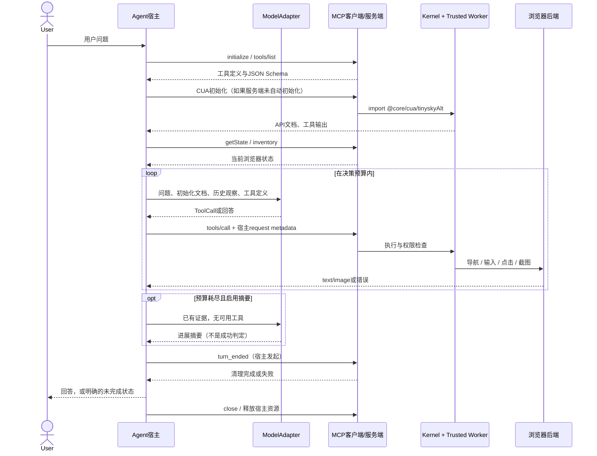

# 可替换的调用侧：MCP Client + AgentLoop

当前入口使用 `packages/agent-loop`，公共类型见
[`contracts.ts`](../packages/agent-loop/src/contracts.ts)。旧 `src/agent`、QuickJS
和 `npm run demo` 是早期独立实现，不代表当前还原的 CUA 运行路径。

模型、AgentLoop、MCP 客户端和浏览器执行层可以分别替换。模型凭证只交给
ModelAdapter，不能传入 MCP 子进程、worker 环境或网页。

## 协议与生命周期



| 边界 | 当前契约 | 接入要求 |
|---|---|---|
| ModelAdapter | `decide({system,messages,tools,signal})` | 返回文本或带 ID、名称、JSON 参数的 toolCalls |
| ToolClient | `listTools / callTool / endTurn? / close` | 保留 text/image、isError，按顺序执行动作 |
| MCP | stdio `tools/list`、`tools/call`、form elicitation | stdout 只承载协议，stderr 承载诊断 |
| 会话元数据 | `_meta["x-codex-turn-metadata"]` | session_id/turn_id 由宿主维护，不由模型参数授权 |
| 生命周期 | `NodeReplTurnClient` | 从模型工具表隐藏 turn_ended；成功、失败、取消都清理 |
| 浏览器 | 扩展、临时 CDP、明确 endpoint 的已有 CDP | 以真实 inventory 为准；不要把接口存在当作能力可用 |

### 初始化输出必须进入模型上下文

显式导入 `@core/cua/tinyskyAlt` 时会立即输出核心 API 文档，随后会缓存文档。
只把后续 `getState()` 输出交给模型会漏掉这份文档。把初始化调用及其完整结果
作为匹配 callId 的 assistant/tool 消息保留，再添加后续观察。本项目可用
`AgentRunOptions.initialMessages` 传入这些消息。

独立 supervisor 将 worker 的 `output`、`named_outputs`、媒体内容映射成 MCP
content。不要丢掉带标签的文本：CUA 的文档和页面状态使用这一通道。图片保持
独立 image 内容，不能只保留终端显示的截图路径。当前 ToolClient 支持 text/image；
其他内容类型显式报错，不静默忽略。

页面和工具文本属于不可信证据。初始化 API 文档描述调用方式，但网页文字不能
授予权限或改变宿主约束。终端的展示截断也不等于模型上下文截断。

### 授权、错误和清理

只有具备真实确认 UI 的客户端才声明 elicitation capability。非交互运行不能
自动接受新的 origin 请求；当前 demo 会报告此限制。`endTurn()` 不继承已经取消
的动作 signal，以便完成清理；动作失败和清理失败同时出现时保留两个错误。

默认预算 12 轮。通用 AgentLoop 默认耗尽即抛 `AgentStepBudgetError`。demo 启用
`summarizeOnExhaustion`，至多增加一轮禁用工具的摘要请求，仍以未完成、非零状态
退出。`partialSummary` 是模型生成的文字，不是可靠的完成判定。

## 运行与验收

本地 `.env` 配置 `DEEPSEEK_API_KEY`，不提交 GitHub。运行当前 demo：

```sh
npm run demo:deepseek -- --cdp-browser '打开 https://example.com 并概括页面'
```

扩展模式省略 `--cdp-browser`；接管已暴露调试端口的现有浏览器使用
`--cdp-endpoint <本地浏览器WebSocket地址>`。这些模式默认仍使用安装包 supervisor，
不是独立 supervisor 的部署入口。完整后端边界见 [README](../README.md)。

独立 supervisor 的受控实机验收：

```sh
npm run test:sandbox
# 可选：消耗真实 DeepSeek API 配额，使用本地 .env
CUA_TEST_MACOS_SANDBOX=1 CUA_LIVE_DEEPSEEK_TEST=1 node --import tsx --test reconstruction/runtime-cdp-sandbox.test.ts
```

第二条运行真实模型 → 独立 MCP supervisor → OS 沙箱内还原 workers → Chromium，
模型自行填写随机查询、提交、截图并读取仅在结果页出现的随机标记。HTTP 服务端
独立确认实际提交值。当前一次验收为 4 轮、0 工具错误；这不证明所有任务稳定，
也不代表外部网站认证、原生桌面权限、独立 supervisor 默认部署已完成。

日志留在本地 `artifacts/debug/`，凭证脱敏、图片不写入 base64，文件和 `.env`
均被 Git 忽略。日志可能包含页面内容，不自动上传。替换 Agent 时仍需自行制定
上下文/图片预算、结果验收和人工确认界面。
