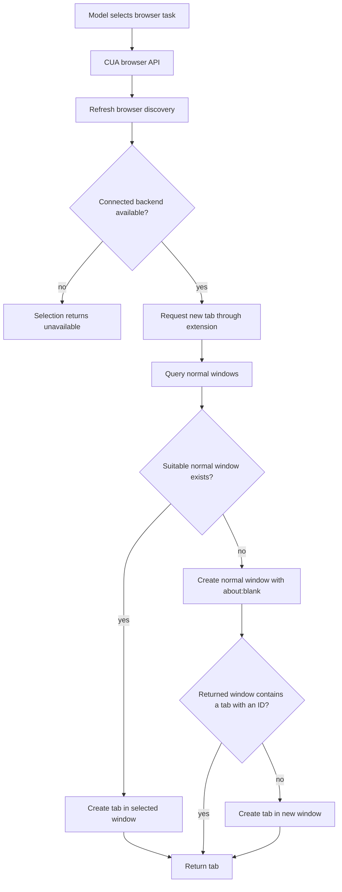

# Browser window creation versus browser process launch

The installed JavaScript establishes two different behaviors. They must not be collapsed into an
unconditional “getBrowser launches Chrome” requirement.

| Observed state | Verified behavior | Boundary |
| --- | --- | --- |
| Browser/extension connected, normal window exists | Create a tab in the selected window | Extension Chrome API |
| Browser/extension connected, no normal window | Create a normal window containing about:blank; use its tab, or create a tab in it if necessary | Extension Chrome API |
| Discovery returns no browsers | get(chrome), getDefault and getForUrl reject with unavailable errors | Browser service selection |
| Chrome process truly terminated, no extension connection | The inspected selection methods do not launch a process | Parent host/application lifecycle remains separate |

The second row can look like “Chrome was not open and the agent opened it”, even while Chrome and
its extension were running. It is one possible explanation of that observation, not a claim about
which process state the user actually had.

## Source evidence and tests

- `packages/browser-extension/src/tab_runtime.ts`: restored selectWindow/createTab/createWindowAndTab
  behavior. Window creation requests focused:false, type:normal, url:about:blank. Preferred-window
  disappearance has a narrow retry boundary; unrelated failures are not arbitrary restart triggers.
- `reconstruction/extension-tab-runtime.test.ts`: compares installed extension bindings
  vE/yt/Id/Ad/za/bE/wi/Jr against the restoration, including zero normal windows, returned/missing
  initial tabs, vanished preferred windows, and errors. It uses controlled Chrome API responses,
  not a real user browser process.
- `reconstruction/browser-empty-selection-source.test.ts`: locates the installed directory class by
  its method surface and evaluates its get/getDefault/getForUrl methods with inspected selectors.
  Empty inventory rejects for Chrome, default, public URL and localhost URL. The oracle executes
  only these methods and pure selectors; no original service/bootstrap process is launched.
- `reconstruction/browser-desktop-discovery.test.ts` and the pipe-inventory/error-formatting case in
  `browser-service-discovery.test.ts` now bind the installed build's actual symbols. Their previous
  ReferenceErrors were stale test bindings, not evidence of broken application behavior. Catalog,
  profile paths, pipe enumeration and formatting comparisons pass. This does not assert all other
  old source-comparison tests are current or passing.

Installed source hashes checked for this analysis:

- Browser service: `396d4bcd890e8e41e336469eb1a050bafd36bb2d91152b75bb22b70b56622021`
- Extension background: `3ccdc7a853700c9fdd8acf8356db33ef18615d17c8a6d2b0054cafe65eb6c7b9`

## Current standalone deployment

The demo's browser-only `discoverOrStartChrome` is a separately authored host lifecycle adapter. It
checks extension/native-host installation, starts the chosen profile if needed, and waits for a
connection before the model request. It is not recovered behavior of getBrowser itself.

Unified mode exposes both surfaces and can discover late registrations in a configured private host
directory. It does not eagerly launch Chrome and does not yet start a terminated Chrome process
when the model chooses a browser. A future implementation must account for that host lifecycle
without rewriting the source browser selection methods to claim a nonexistent built-in launcher.
The tested no-window extension path is already restored. A separate opt-in test now passes
against an already running daily Chrome for new-tab navigation, observation, click, returned screenshot
and owned-tab cleanup. It does not cover zero-window or terminated-process startup. App getApp has its own policy, approval and macOS permission requirements.

The inspected methods establish their own boundaries only. They do not prove where every Codex/
ChatGPT parent-host browser activation occurs, nor rule out launch behavior outside these modules.

## Outer plugin troubleshooting workflow

The installed bundled browser plugin `26.1027.30824` also contains a separate documented workflow
in `docs/chrome-troubleshooting.md`: try an extension-backed operation, wait two seconds and retry
once, then inspect process/browser installation/extension/native-host state. For a stopped browser
or a requested profile window, that workflow invokes `scripts/open-chrome-window.js` after user
authorization. This is evidence of a plugin orchestration path outside getBrowser, not proof that
every current unified-computer-use activation executes it. The existing standalone startup adapter
already restores portions of these profile/launch rules; unified invocation still needs integration.

The script supports Chrome/Edge families, profile-root/preference overrides, and dry-run command
output. Core's present launcher scope remains macOS Chrome and its own extension/host registration.
Do not equate this narrower deployment support with complete cross-browser/source parity.
