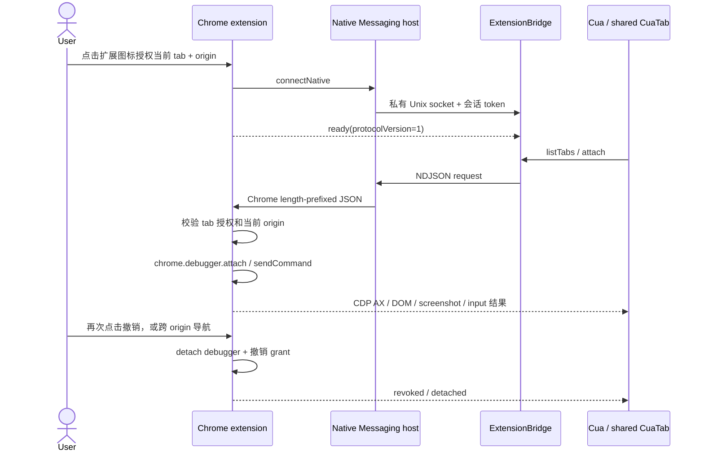

# 现有 Chrome 标签页：扩展与 Native Messaging

实现包含可读 TypeScript 扩展、Native Messaging host、本机桥接、ExtensionDriver 与 ExtensionProvider。ExtensionDriver 实现共享 BrowserDriver 契约，因此 `CuaTab` 的 AX、引用、截图与输入代码同时用于受控 Chromium 和已授权 Chrome 标签。



## 使用

先 `npm ci && npx playwright install chromium && npm run build`。输出扩展目录为 `dist/chrome-extension`。

在 Chrome 扩展管理页打开开发者模式，加载此目录。固定扩展 ID 来自 manifest 公钥，记录在 `extensions/chrome/identity.json`；公钥不包含私钥。扩展要求 debugger/tabs/nativeMessaging/activeTab 权限，Chrome 会显示其调试提示。

MCP 宿主配置（macOS/Linux，本版尚未实现 Windows 注册）：

```bash
export CUA_ALLOWED_ORIGINS='https://example.com'
# 填 Chrome 用户数据根目录，而不是 Default / Profile 1 子目录。
export CUA_EXTENSION_PROFILE='/absolute/path/to/Chrome/User Data'
node dist/mcp/stdio.js
```

服务在指定根目录的 NativeMessagingHosts 下创建本会话注册，若同名注册已存在则拒绝覆盖。正常关闭时仅移除自己创建、且内容仍属于自己的注册。异常退出可能留下失效注册；应先确认旧进程已结束，再移除该 Cua Kit 注册并重新启动。注册中的可执行路径指向本会话的私有临时目录，不能复用到另一个服务器实例。

打开目标 HTTP(S) 页面，点击扩展图标；ON 徽标表示已授权。随后调用 `cua.listTabs({browser:'chrome-extension'})`，用返回的 `ext:<tabId>` 执行 `cua.getTab(id)`。再次点击撤销。JS/MCP 与 SDK 均使用相同接口，截图以图片内容返回。

SDK 直接嵌入可调用 `ExtensionBridge.listen(extensionId)`、`installHost(profileRoot, nativeHostScript)`，再将 bridge 传入 `createCua({extensionBridge,authorize})`。宿主负责最终 bridge.close；Cua.endSession 释放自己持有的 debugger，不关闭已有用户标签页。只有显式 tab.close 才关闭标签。

## 授权与协议边界

扩展保存当前进程内的 tab+顶层 origin 授权，顶层跨 origin 导航自动撤销。CDP 导航也在扩展侧检查目标 origin。iframe 属于该已授权标签的页面内容，不额外声称逐 iframe origin 授权。SDK authorize 仍是第二道宿主策略，MCP 用 CUA_ALLOWED_ORIGINS 配置。

扩展只返回已授权标签；新建标签暂不支持自动授权，需用户在浏览器创建并点击扩展。未实现 Chrome 会话命名/显示偏好或 IAB/MCP Apps 私有桥。

Native Messaging 按 [Chrome 官方协议](https://developer.chrome.com/docs/extensions/develop/concepts/native-messaging)使用长度前缀 UTF-8 JSON；本机侧转为 NDJSON。私有目录权限 0700，连接 token 绑定会话且不写日志。目标调用使用 [chrome.debugger](https://developer.chrome.com/docs/extensions/reference/api/debugger)；CDP 域与子 session 受限，未开放任意其他 tab attach。

这不是恶意同用户进程的隔离边界，也不是网页网络防火墙。通道超时返回结果未知，禁止盲目重放动作。原生 helper 的 TCC 权限与 Chrome debugger 授权是两套机制，不能互相替代。

## 验证

`tests/extension.test.ts` 在一次性 user-data-dir 里加载真实扩展和真实 Native Messaging host；通过扩展 worker DevTools 调用同一个 grant/revoke 回调（没有自动点击 Chrome 工具栏 UI）。验证真实 AX、PNG、共享 CuaTab 点击、拒绝未授权 tab/跨 origin 导航、用户跨 origin 导航撤销，以及 SDK 结束后用户页面仍存活。测试不修改用户现有 profile。

当前全套 12 passed、1 原生 fixture skipped。扩展版本的复杂 OOP frame、完整键盘布局、断连/并发压力和实际用户安装流程仍需进一步验证。现有扩展 keyboard 映射只覆盖常用按键；缺失键显式 UNSUPPORTED_CAPABILITY。不要把受控浏览器的全套测试外推为扩展全部兼容。
