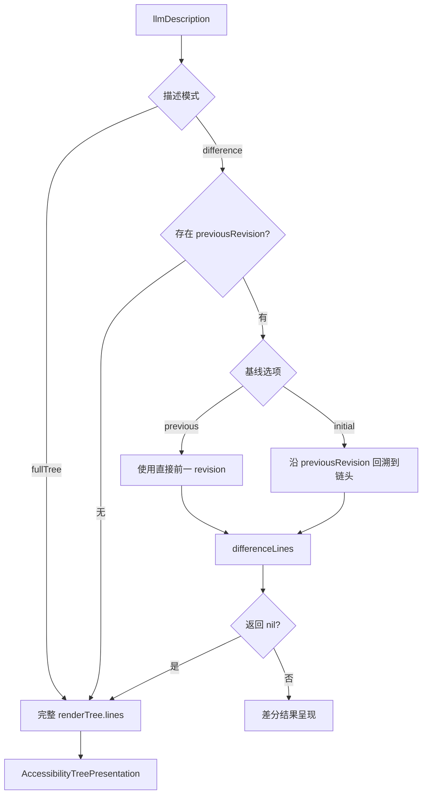

# 原生 AX 增量树：当前可证实的边界

本页基于本机安装包的静态 Swift 导出符号及局部 ARM64 指令证据，尚未恢复完整原生函数体。
运行 `python3 scripts/audit-desktop-diff.py --check` 可复核固定版本；
完整证据保存在 `reconstruction/desktop-diff-evidence.json`。不启动原厂服务。

## 已找到的接口

| 层级 | 原构建符号体现的职责 |
| --- | --- |
| ComputerUseAppController | 保存 lastAXTree；初始化接收 isAXTreeDiffingEnabled；updateSkyshot 接收 treeCache、disableAXDiffing、skipScreenshot |
| SkyshotOperation | capture/captureAXTree 接收 continuingFrom: UIElementTreeRevision?；同时存在 TreeCache 与 accessibility enablement 参数 |
| RefetchableSkyshotAXTree | 保存 SystemSelection，关联 UIElementTreeInvalidationMonitor，并提供 refetchTree |
| ComputerUseCore.UIElementTreeRevision | previousRevision、lineageRootRevision、renderTree、focusTree、focusRenderTree、renderTreeSnapshot |
| AccessibilitySupport 对 Revision 的扩展 | root 和 appending 接收树、可选 focusTree、inout UIElementTransformationContext |
| Revision.differenceLines | 接收基线 revision、渲染选项、summarizesRemovedElementIDs、ignoreDifferenceLineBudget 和预算超限回调；返回可选字符串行数组 |
| SystemSelection | llmDescription/eventStreamDescription 接收描述模式和渲染行选项；后者还有 ignoreDifferenceLineBudget |

这些签名支持“Swift 中存在树版本、缓存、增量描述及行预算”的结论。
无法仅凭签名确认：版本创建顺序、ID 分配/复用、焦点变化如何影响基线、差分规则、
预算数值、nil 的含义、回退条件或最终文本格式。浏览器 WASM 的差分行为也不能自动视为桌面算法。

## 与现仓库的差距

当前 Swift `SkyIPC.swift` 仅检查 disableDiff 的类型，未传入 `SkyAppState.get`；
`SkyAppState.get` 没有该参数，也没有对应的 revision/lineage/differenceLines 实现。
现有完整观察文本不能冒充原构建的增量树输出。

后续实现需继续取得函数行为证据，并在 Swift 层处理版本状态、缓存失效和渲染；
JS/TS 只保留原有调用参数及结果绑定。不能只在 TS 对上次/本次字符串做差就称为对齐。
需要覆盖首次观察、重复观察、树变化、显式 disableDiff、应用/窗口切换、焦点变化及动作后观察。
这些是待验证场景，不是已恢复的原厂规则。

本机 helper 的 Accessibility/Screen Recording 当前均为 false，真实 UI 差分尚无法验收。
本次工作未改变权限、未启动原厂服务，也没有把缺失算法填成自拟实现。

## JS/TS 到 IPC 的联合验证

`reconstruction/sky-observation-chain.test.ts` 将实际 `bind_mac_app` →
`get_app_state` → 审批策略 → `MacComputerUseClient` 串起来，以本机原 JS 模块为对照；
仅替换 native transport 的端点响应，不启动原厂原生服务。

三个观察 API 各覆盖 omitted/false/true，共九组：
- getAXState 和 getAXStateAndScreenshot 将 disableDiffing 转成 disableDiff，显式 false 不丢失。
- 参数省略时，最终 IPC payload 不携带 disableDiff。
- getScreenshot 只发 app；即使动态调用传入 disableDiffing，也不转发，和原 JS 一致。
- 策略检查使用请求的应用名称，观察请求使用审批解析后的 appPath。
- 另覆盖一次拒绝审批：只有 policy 请求，没有 skyshot 请求。

原 JS 与还原 TS 的请求、审批参数和返回值逐项一致。本次因此没有改动上层传参逻辑；
已确认的断点仍在 Swift IPC 接收后，不能把“参数正确到达 transport”当作差分算法已经实现。


## 从符号推进到函数体证据

审计脚本现使用 Mach-O 的 LC_FUNCTION_STARTS 确定函数范围，不能把“下一个导出符号”当作函数结束：中间可能有未导出的函数。
本版本 differenceLines 的区间为 `[0x100629630, 0x10062b8dc)`，共 2,219 条 ARM64 指令。
脚本检查指令地址连续性、每条机器码与文件字节一致，并记录函数体 SHA256。

已经直接核实：

- `0x1006298a8` 和 `0x1006298fc` 两个 BL 指令都指向导出的 `renderTreeSnapshot()`；这是函数体调用证据，超过仅看到 API 名称的证据强度。
- 两处调用后检查 x21；异常分支最终到达清零返回寄存器的共同出口。结合 Swift throwing ABI 和 `[String]?` 返回类型，可推断“渲染快照失败时返回 nil”的路径存在。这是静态推断，尚未运行原函数验证，也不表示所有 nil 都来自这条路径。
- 函数末段通过 ADRP/ADD 引用实际字面量 `Removed element IDs: `。脚本通过 Mach-O segment 映射读取字符串，保留对应指令。尚不能据此断言 ID 排序、分隔符和何时启用该摘要。

通用反汇编器在此文件中给地址附上的最近符号名称可能误导（例如把本函数标成 sqlite3_config_log 的偏移）。审计输出因此去掉这些标签，仅用真实导出地址解析已确认的调用目标。

完整遍历、比较结果的枚举语义、预算判断、ID 生命周期及调用者如何处理 nil 仍需继续恢复。
此轮未将局部推断接入生产 Swift，避免制造貌似可用但与原行为不同的差分实现。

## 预算回调类型与分支

已进一步读取 Swift nominal type descriptor 和 field descriptor，恢复出原构建类型：

```swift
enum AccessibilityDifferenceLineBudgetExceeded: Equatable {
    case difference(fullTreeLineCount: Int)
    case removedElementSummary(fullTreeLineCount: Int)
}
```

字段记录的 payload mangling 均为 `Si17fullTreeLineCount_t`；用
`xcrun swift-demangle --compact '$sSi17fullTreeLineCount_tD'` 得到
`(fullTreeLineCount: Swift.Int)`。等价性遵循此前导出的 `__derived_enum_equals` 证据。
该类型现保留为 Swift 文件；尚未用于 SkyAppState，不能把类型恢复当作差分功能接通。

当前函数体还有以下可复核的静态路径：

- 参数 w3 保存到 `[x19,#0x70]`，随后在 `0x10062a358` 用位测试控制是否跳过一段差分预算计算。结合函数签名，这是 ignoreDifferenceLineBudget 的一条路径；不能扩大为“所有预算分支都会被跳过”。
- `0x10062b7b4..0x10062b7c0` 给回调传入保存的完整树计数与判别值 0，之后返回 nil。
- `0x10062ad40..0x10062ad4c` 给同一回调传入计数与判别值 1，随后也跳往 nil 出口。
- 结合枚举字段顺序及 ABI，两个判别值分别对应 difference / removedElementSummary。这是静态 ABI 推断；尚未用原原生服务做运行时对照。

因此预算失败并非简单截断字符串后返回；至少存在“通知调用者并返回 nil”的路径。
计数的完整累积规则、各比较结果如何扣减、调用者回退策略仍未恢复。本轮不引入猜测的固定行数限制。

## 调用者的基线选择与完整树回退

现在已追踪 `SystemSelection.llmDescription(_:lineOptions:)` 的实际函数体，范围
`[0x100238b88, 0x1002394a4)`。以下为固定构建的静态还原证据，并非当前 helper 已实现。

Swift 反射元数据确定：
- `LLMDescriptionMode`：`difference(from: DifferenceBaseline)`、`fullTree`。
- `DifferenceBaseline`：`initial`、`previous`。
- payload 的类型引用含 4 字节相对地址，内部可能含零；审计按符号引用解码，不能当作普通零结尾字符串读取。

结合指令与类型布局，调用流程为：



关键位置：
- `0x100238ed4..0x100238edc`：fullTree 模式直接转完整树路径。
- `0x100238f48`：没有前一 revision 时转完整树；`0x100238f58..0x100238fb8` 分流直接前一版本与沿链回溯。
- `previousRevision` 导出 getter 在 `0x100654a6c`，取类元数据偏移 `0x98` 对应字段，与上面回溯指令一致。
- `0x100238fe0` 调用 differenceLines；w2 来源是 `axTreeDiffingRemovedElementIDRanges` feature flag，w3 为 0（本调用不忽略差分预算）。
- `0x100239004` 检查保存的返回值，为 nil 时转 `0x1002391f8`，随后 `0x10023926c` 调用完整树 `UIElementRenderTree.lines`。
- 非 nil 后还有单独的数组长度检查 `0x100239028..0x10023902c`：空数组与 nil 不是同一分支，不能统一成“没有差分就回退完整树”。

这补上了此前缺失的调用者回退证据。图仅省略选择文本、焦点元素、窗口标题和最终文本拼接；
树比较算法、revision 创建/失效和这些呈现细节仍未恢复，不能直接把该图当作完整实现。
