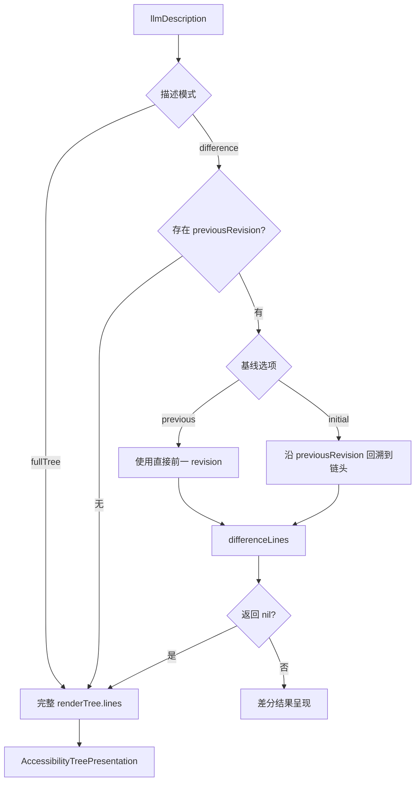
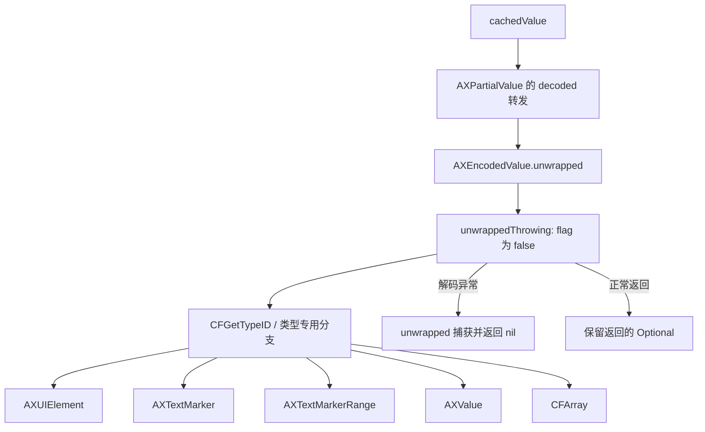

# 原生 AX 增量树：当前可证实的边界

本页基于本机安装包的静态 Swift 导出符号及局部 ARM64 指令证据，尚未恢复完整原生函数体。
运行 `python3 scripts/audit-desktop-diff.py --check` 可复核固定版本；
完整证据保存在 `reconstruction/desktop-diff-evidence.json`。不启动原厂服务。

## 已找到的接口

| 层级 | 原构建符号体现的职责 |
| --- | --- |
| ComputerUseAppController | 保存 lastAXTree；初始化接收 isAXTreeDiffingEnabled；updateSkyshot 接收 treeCache、disableAXDiffing、skipScreenshot |
| SkyshotOperation | capture/captureAXTree 接收 continuingFrom: UIElementTreeRevision?；同时存在 TreeCache 与 accessibility enablement 参数 |
| RefetchableSkyshotAXTree | 保存 SystemSelection，关联 UIElementTreeInvalidationMonitor，并提供 refetchTree |
| ComputerUseCore.UIElementTreeRevision | previousRevision、lineageRootRevision、renderTree、focusTree、focusRenderTree、renderTreeSnapshot |
| AccessibilitySupport 对 Revision 的扩展 | root 和 appending 接收树、可选 focusTree、inout UIElementTransformationContext |
| Revision.differenceLines | 接收基线 revision、渲染选项、summarizesRemovedElementIDs、ignoreDifferenceLineBudget 和预算超限回调；返回可选字符串行数组 |
| SystemSelection | llmDescription/eventStreamDescription 接收描述模式和渲染行选项；后者还有 ignoreDifferenceLineBudget |

这些签名支持“Swift 中存在树版本、缓存、增量描述及行预算”的结论。
无法仅凭签名确认：版本创建顺序、ID 分配/复用、焦点变化如何影响基线、差分规则、
预算数值、nil 的含义、回退条件或最终文本格式。浏览器 WASM 的差分行为也不能自动视为桌面算法。

## 与现仓库的差距

当前 Swift `SkyIPC.swift` 仅检查 disableDiff 的类型，未传入 `SkyAppState.get`；
`SkyAppState.get` 没有该参数，也没有对应的 revision/lineage/differenceLines 实现。
现有完整观察文本不能冒充原构建的增量树输出。

后续实现需继续取得函数行为证据，并在 Swift 层处理版本状态、缓存失效和渲染；
JS/TS 只保留原有调用参数及结果绑定。不能只在 TS 对上次/本次字符串做差就称为对齐。
需要覆盖首次观察、重复观察、树变化、显式 disableDiff、应用/窗口切换、焦点变化及动作后观察。
这些是待验证场景，不是已恢复的原厂规则。

本机 helper 的 Accessibility/Screen Recording 当前均为 false，真实 UI 差分尚无法验收。
本次工作未改变权限、未启动原厂服务，也没有把缺失算法填成自拟实现。

## JS/TS 到 IPC 的联合验证

`reconstruction/sky-observation-chain.test.ts` 将实际 `bind_mac_app` →
`get_app_state` → 审批策略 → `MacComputerUseClient` 串起来，以本机原 JS 模块为对照；
仅替换 native transport 的端点响应，不启动原厂原生服务。

三个观察 API 各覆盖 omitted/false/true，共九组：
- getAXState 和 getAXStateAndScreenshot 将 disableDiffing 转成 disableDiff，显式 false 不丢失。
- 参数省略时，最终 IPC payload 不携带 disableDiff。
- getScreenshot 只发 app；即使动态调用传入 disableDiffing，也不转发，和原 JS 一致。
- 策略检查使用请求的应用名称，观察请求使用审批解析后的 appPath。
- 另覆盖一次拒绝审批：只有 policy 请求，没有 skyshot 请求。

原 JS 与还原 TS 的请求、审批参数和返回值逐项一致。本次因此没有改动上层传参逻辑；
已确认的断点仍在 Swift IPC 接收后，不能把“参数正确到达 transport”当作差分算法已经实现。


## 从符号推进到函数体证据

审计脚本现使用 Mach-O 的 LC_FUNCTION_STARTS 确定函数范围，不能把“下一个导出符号”当作函数结束：中间可能有未导出的函数。
本版本 differenceLines 的区间为 `[0x100629630, 0x10062b8dc)`，共 2,219 条 ARM64 指令。
脚本检查指令地址连续性、每条机器码与文件字节一致，并记录函数体 SHA256。

已经直接核实：

- `0x1006298a8` 和 `0x1006298fc` 两个 BL 指令都指向导出的 `renderTreeSnapshot()`；这是函数体调用证据，超过仅看到 API 名称的证据强度。
- 两处调用后检查 x21；异常分支最终到达清零返回寄存器的共同出口。结合 Swift throwing ABI 和 `[String]?` 返回类型，可推断“渲染快照失败时返回 nil”的路径存在。这是静态推断，尚未运行原函数验证，也不表示所有 nil 都来自这条路径。
- 函数末段通过 ADRP/ADD 引用实际字面量 `Removed element IDs: `。脚本通过 Mach-O segment 映射读取字符串，保留对应指令。尚不能据此断言 ID 排序、分隔符和何时启用该摘要。

通用反汇编器在此文件中给地址附上的最近符号名称可能误导（例如把本函数标成 sqlite3_config_log 的偏移）。审计输出因此去掉这些标签，仅用真实导出地址解析已确认的调用目标。

完整遍历、比较结果的枚举语义、预算判断、ID 生命周期及调用者如何处理 nil 仍需继续恢复。
此轮未将局部推断接入生产 Swift，避免制造貌似可用但与原行为不同的差分实现。

## 预算回调类型与分支

已进一步读取 Swift nominal type descriptor 和 field descriptor，恢复出原构建类型：

```swift
enum AccessibilityDifferenceLineBudgetExceeded: Equatable {
    case difference(fullTreeLineCount: Int)
    case removedElementSummary(fullTreeLineCount: Int)
}
```

字段记录的 payload mangling 均为 `Si17fullTreeLineCount_t`；用
`xcrun swift-demangle --compact '$sSi17fullTreeLineCount_tD'` 得到
`(fullTreeLineCount: Swift.Int)`。等价性遵循此前导出的 `__derived_enum_equals` 证据。
该类型现保留为 Swift 文件；尚未用于 SkyAppState，不能把类型恢复当作差分功能接通。

当前函数体还有以下可复核的静态路径：

- 参数 w3 保存到 `[x19,#0x70]`，随后在 `0x10062a358` 用位测试控制是否跳过一段差分预算计算。结合函数签名，这是 ignoreDifferenceLineBudget 的一条路径；不能扩大为“所有预算分支都会被跳过”。
- `0x10062b7b4..0x10062b7c0` 给回调传入保存的完整树计数与判别值 0，之后返回 nil。
- `0x10062ad40..0x10062ad4c` 给同一回调传入计数与判别值 1，随后也跳往 nil 出口。
- 结合枚举字段顺序及 ABI，两个判别值分别对应 difference / removedElementSummary。这是静态 ABI 推断；尚未用原原生服务做运行时对照。

因此预算失败并非简单截断字符串后返回；至少存在“通知调用者并返回 nil”的路径。
计数的完整累积规则、各比较结果如何扣减、调用者回退策略仍未恢复。本轮不引入猜测的固定行数限制。

## 调用者的基线选择与完整树回退

现在已追踪 `SystemSelection.llmDescription(_:lineOptions:)` 的实际函数体，范围
`[0x100238b88, 0x1002394a4)`。以下为固定构建的静态还原证据，并非当前 helper 已实现。

Swift 反射元数据确定：
- `LLMDescriptionMode`：`difference(from: DifferenceBaseline)`、`fullTree`。
- `DifferenceBaseline`：`initial`、`previous`。
- payload 的类型引用含 4 字节相对地址，内部可能含零；审计按符号引用解码，不能当作普通零结尾字符串读取。

结合指令与类型布局，调用流程为：



关键位置：
- `0x100238ed4..0x100238edc`：fullTree 模式直接转完整树路径。
- `0x100238f48`：没有前一 revision 时转完整树；`0x100238f58..0x100238fb8` 分流直接前一版本与沿链回溯。
- `previousRevision` 导出 getter 在 `0x100654a6c`，取类元数据偏移 `0x98` 对应字段，与上面回溯指令一致。
- `0x100238fe0` 调用 differenceLines；w2 来源是 `axTreeDiffingRemovedElementIDRanges` feature flag，w3 为 0（本调用不忽略差分预算）。
- `0x100239004` 检查保存的返回值，为 nil 时转 `0x1002391f8`，随后 `0x10023926c` 调用完整树 `UIElementRenderTree.lines`。
- 非 nil 后还有单独的数组长度检查 `0x100239028..0x10023902c`：空数组与 nil 不是同一分支，不能统一成“没有差分就回退完整树”。

这补上了此前缺失的调用者回退证据。图仅省略选择文本、焦点元素、窗口标题和最终文本拼接；
树比较算法、revision 创建/失效和这些呈现细节仍未恢复，不能直接把该图当作完整实现。

## Swift 观察文本构造器已还原

新增 `native/macos/Sources/CuaHelper/AccessibilityTreePresentation.swift`，恢复两个构造器及
text/focusedElement/selectedText/selectedElements 字段。依据是固定原生构建的三个实际函数体：
`0x100637128`（body 入口）、`0x100637170`（窗口/树行入口）、`0x100637438`（共享实现）。
审计记录函数边界、机器码哈希、字符串地址与三个优先级分支位置。

恢复的行为：

1. 窗口入口生成 `Window: "<title>", App: <name>.\n`，随后是用换行拼接的树行与末尾换行；标题中的引号不额外转义。
2. selectedText 非 nil 时追加 fenced text 和原构建的 selectedContentNote，即使文本为空也走此分支。
3. 否则 selectedElements 非空时追加 `Selected:` 和逐行元素，以及同一提示；包含一个空字符串的数组仍算非空。
4. 否则 focusedElement 非 nil 时追加焦点说明，不追加选择提示；空焦点字符串仍保留说明前缀。
5. 保存全部原始字段；呈现的优先级不删除未展示的焦点/选择数据。

原生 Swift 测试覆盖上述优先级、nil/空值区别、嵌入代码围栏、多行文本、中文标题、空树与精确换行。
入口：`node --import tsx --test reconstruction/native-ax-presentation.test.ts`。
该测试编译并运行 Swift 格式化器，不需 UI 权限；预期输出来自已审阅指令，不是原厂原生服务的运行时 oracle。

尚未将格式化器接入 SkyAppState：目前 AX 树采集、选择/焦点映射和 revision 仍是独立实现，
不能为接入新格式而伪造这些输入。整体 helper 的观察输出因此尚未变化。

## 选择文本读取：空值后的 marker fallback

已读取 `AccessibilitySupport.UIElementProtocol.selectedText` 的实际函数体
`[0x10078e7f0, 0x10078e994)`，并追踪 selectedTextMarkerRange 属性和参数化读取：

1. 读取 AXSelectedText；非空则直接返回，不再读取 marker。
2. 缺失或空字符串都会尝试 selectedTextMarkerRange。
3. marker 不存在则返回 nil；存在则调用 AXStringForTextMarkerRange。
4. 参数化读取抛错、返回 nil 或空字符串均返回 nil；非空结果保留，不 trim 空白。

新增 `SelectedText.swift` 将上述逻辑留在 Swift。三个闭包是原 typed AX accessor 尚未还原时的接入边界，
不冒充原 UIElementProtocol 的完整接口；尚未对真实 AXUIElement 自动发起新读取。
测试使用受控 marker 值验证调用顺序、首选路径短路、空/缺失区别、错误处理、多语言及空白文本。
另有一例将空选择结果接入恢复的 presentation，确认显示焦点而不是空 selected-text 围栏。

这也解释了两层空值语义为何不同：presentation 对显式非 nil 的空字符串照常呈现；
原 selection getter 则过滤空内容并回退。不能把其中一层的规则覆盖到另一层。

当前独立 Target.collect 只导出选择范围等信息，尚未具备原 SystemSelection 的 focusTree、
类型化 marker 及选中元素映射，因此此轮仍未把上述 reader 挂到整棵树上批量读取。
入口：`node --import tsx --test reconstruction/native-selected-text.test.ts`，包含 10 组 Swift 行为检查。

## Typed AX accessor 的缓存边界

继续沿 selectedText / selectedTextMarkerRange 的调用追踪，发现它们通过
`0x1007a7600` 的 typed accessor 读取，不能等同于每次直接执行 AXUIElementCopyAttributeValue。
该分流函数先调用 `cachedValue(for:)`，只在返回 Optional.none 时调用
`uncachedValue(for:ignoringTypeMismatch:)`，并原样传递 ignoringTypeMismatch。
缓存中的空字符串、false、0 都不是 miss。

`UIElementAttributeValue.swift` 恢复了这一层 Swift 分流；底层缓存存储、AXPartialValue 类型解码
及类型不匹配处理仍由待还原的 accessor 提供。此函数不新增缓存写入或失效策略。
8 组 Swift 检查覆盖值/缺失、标志透传、嵌套 Optional 和 selectedText 组合。
特别地：缓存命中空字符串不重读普通 AX 属性，而是由 selection getter 转入 marker fallback。

同时确认 UITextMarkerRange 的原生包装构造器与 UITextMarker 共用一个直接 return 的入口，
它接收的已是类型化 AXTextMarkerRangeRef；不能从该函数没有校验推导出“任意 CFTypeRef 都可接受”。
类型验证位于更下层解码链，尚未恢复。因此本轮没有用 AnyObject 别名冒充完整 marker 类型。

入口：`node --import tsx --test reconstruction/native-attribute-value.test.ts`。
当前 helper 的实际观察链仍未接入该缓存分流，验收范围仅为恢复的内部逻辑及静态证据。

## AXPartialValue / AXEncodedValue 解码边界

已追踪缓存值进一步解码的路径：



`AXPartialValue` 的转发只有三条指令，取其 encoded value 后跳至 `unwrapped()`；
后者以 false 调用 throwing 版本，检查 Swift error register，并在错误分支写入 Optional.none。
这不等于 throwing 版本在 false 时永远不抛错，更不等于所有原生读取错误都可以任意忽略。

审计工具现在读取 Mach-O indirect symbol table，并解码每条 ARM64 BL 的目标，确认调用：
CFGetTypeID、AXUIElementGetTypeID、AXTextMarkerGetTypeID、AXTextMarkerRangeGetTypeID、
AXValueGetTypeID、CFArrayGetTypeID。这样能把原来反汇编中显示为无关符号偏移的调用还原为真实 C API。
记录保存在 desktop-diff-evidence.json 的 decodingEvidence，包含函数边界、代码哈希和调用位置。

这说明普通 `as? String` 或 `String(describing:)` 无法代表整个原生 decoder。
各种类型的转换规则、AX 错误值、类型不匹配和数组子集描述仍需逐支恢复；本轮不以一个宽松的
AnyObject 强转实现替代它。图只列出已确认的类型判断，不声称枚举了所有转换分支。

此外 uncachedValue 的外层会捕获内部 throwing reader 的错误、通过 os.Logger 记录并返回 nil；
这一层与原始 AX API 以及 parameterizedValue 的错误行为要分别处理，不能统一改为全抛出或全吞掉。

## 原生错误类型恢复

`UIElementError.swift` 按 Swift enum field metadata 恢复五个 case，遵循原构建的 Error conformance：

```swift
enum UIElementError: Error {
    case axError(AXError)
    case unexpectedAttributeValueType(expected: Any.Type, actual: Any.Type)
    case failedToUnwrapAttributeValue(Any.Type)
    case failedInit(String)
    case failedToWrapAXValue
}
```

payload 类型保留 AXError、Swift metatype 和 String，而不是统一包装成文字。
`ypXp8expected_ypXp6actualt` 经 swift-demangle 明确得到 `(expected: Any.Type, actual: Any.Type)`。
首个 case 的 symbolic typeref 指向名为 AXError 的 descriptor，最后一个 case 没有 payload。

在 unwrappedThrowing 中还找到与 -25212 比较后返回 Optional.none 的路径；
本机 macOS SDK 的 AXError.h 确认 -25212 是 kAXErrorNoValue。
该证据针对这一解码分支，不表示所有 API 返回 noValue 都由同一层处理。
另一个共享失败处理块 `0x1006e9d38` 根据布尔参数选择抛出已有错误或返回 nil，
也不能据此概括整个 decoder 在 false 时绝不抛错。

尚未恢复错误构造条件的全部分支，也未把这些 Error case 接到 SkyIPC 的错误码映射。
本轮只补齐可确定的原生类型和审计证据；Swift 构建用于验证类型声明，不将构建成功当成错误链路验收。

## AXValue 具体值解包

恢复 `0x1006ea098..0x1006ea28c` 的原生 Swift helper，实现在
`native/macos/Sources/CuaHelper/AXValueUnpacking.swift`。以 AXValueGetType 分派，
直接复用系统 AXValueGetValue，返回 CGPoint、CGSize、CGRect、CFRange 或 AXError。
每个读取失败分支返回 nil；未知类型抛出 `.failedToUnwrapAttributeValue(AXValue.self)`。
AXError.noValue 在这一层仍为 AXError；其 nil 策略由外层 decoder 决定。

审计记录 `axValueUnpackingEvidence` 固定函数边界、代码哈希和六处系统调用位置。
真实 macOS AXValueCreate 生成的值覆盖五类系统值（AXError 额外覆盖 noValue），
注入失败覆盖五个读取失败分支，未知类型检查保证不尝试读取内存，共 12 个案例。
这些测试执行独立恢复代码与系统 API，不执行原厂服务，也不冒充原厂运行时对照测试。

测试曾暴露 Swift 泛型推断造成的内存破坏：在 `Any?` 返回上下文直接返回泛型
`read(CGRect.zero)` 时，泛型 Value 被推断成 Any，C API 写入 existential 容器，
覆盖其元数据。现先显式声明具体类型的 Optional，再擦除到 Any，确保传给 C API
的缓冲区类型正确。真实 CGRect roundtrip 是该崩溃的回归覆盖。

此 helper 尚未接入完整 AXEncodedValue decoder；缓存、数组解码、类型不匹配策略和
原生观察差量仍有未恢复部分，不能据此声称原生观察链路整体一致。

## AXValue 分支的泛型转换与错误顺序

`AXValueDecoding.swift` 继续恢复 `unwrappedThrowing` 的 AXValue 专用分支，复用上节解包器。
这不是完整 AXEncodedValue 的替代实现，尚未连接 UIElement/marker/array 的其它分支。

关键顺序来自 `0x1006e9548` 到 `0x1006e9bbc` 的控制流：

1. 调用具体解包器；其抛错直接传播，不受外层失败标志影响。
2. 将 **Optional<Any>** 动态转换为调用者请求的泛型类型，成功即返回。
3. 转换失败后再尝试 AXError：noValue 返回 nil；其它错误在标志为 true 时抛出
   `.axError(error)`，false 时返回 nil。
4. 其它转换失败在 true 时抛出 `.failedToUnwrapAttributeValue(请求类型)`，false 时返回 nil。

类型源不是猜测：`0x101193410` 的相对 typeref 为 `ypSg`（Optional<Any>），
`0x1006e9890` 的目标 stub 经 Mach-O indirect symbols 确认为 `_swift_dynamicCast`。
后续 AXError fallback 位于 `0x1006e9a74`，顺序不能交换。

这意味着请求 AXError 或 Any 时，`.noValue` 本身可以成功返回；只有请求类型转换失败
才进入 noValue → nil 分支。同样，对 Optional 类型的成功转换可能返回 `.some(.none)`，
不能先用 guard let 去掉空值。原分支也没有为 AXError.success 添加特殊豁免。

22 个 Swift 案例覆盖实际系统值的具体/Any 转换、两种失败标志、noValue 的目标类型差异、
嵌套 Optional、普通 AXError（含 success）以及底层解包异常不被标志吞掉。
审计记录 `axValueDecodingEvidence` 固定 typeref、动态转换 stub 和关键跳转指令。
测试是恢复代码与系统值的行为验证，尚没有原厂服务运行时 oracle；不能外推为整个原生
属性读取或桌面观察链路已经对齐。

## AXUIElement 原生解码入口接入

恢复 `AXEncodedValue.unwrappedAXUIElementThrowing`（`0x1006e9d90..0x1006e9e50`）
为 `unwrapAXUIElement`：先比较 CFGetTypeID 与 AXUIElementGetTypeID，匹配才强制转换，
返回同一个系统元素引用；不匹配时 false 返回 nil，true 抛出
`.failedToUnwrapAttributeValue(AXUIElement.self)`。这一专用入口不套用 AXValue 的 noValue 策略。

Input.keyboardInput、Paste.pasteEditor、WindowSelection.focusedCaptureWindow 的重复
类型检查已接入该 helper。调用方继续使用 false，再分别保留原有“无焦点元素”错误或
无窗口时返回 nil；PID 所属校验、快照验证和输入授权仍在原位置。

14 个系统类型案例验证 system-wide / 本进程 AX 引用的身份保留，以及 NSString、NSNumber、
NSArray、NSDictionary、AXValue 的拒绝与错误类型。创建 AX 引用不读取应用 UI、不操作桌面；
这组测试与 Swift 构建不能替代真实键盘、粘贴、截图端到端验收。
审计记录 axUIElementDecodingEvidence 包含函数边界、机器码哈希、类型检查与强转调用。
泛型 UIElementProtocol 包装器构造与其余 decoder 分支仍单独待恢复。

## 单属性与参数化属性的底层读取边界

继续核查 `AXUIElement.value(for:)` 与 `parameterizedValue(for:parameter:)`，确认不能
把二者统一实现为“系统 API 失败就 nil”。

| 路径 | 原构建直接调用系统 API 后的行为 |
| --- | --- |
| 单属性 `value(for:)` | 返回 `(error: AXError, value: AXPartialValue?)`，独立保留状态与返回值是否存在 |
| 参数化属性 | 非零状态抛出 `UIElementError.axError`；成功时根据输出指针决定返回值或 nil |

单属性调用点 `0x1006f6144` 之后没有基于状态码清空值的判断：状态单独存于
`0x1006f6254`，输出存在性在 `0x1006f6214` 判断。参数化调用点 `0x1006f7098`
则在 `0x1006f70a8` 检查状态，非零进入错误构造。这是两个不同的契约。
这里的状态码不能与前面 AXValue 载荷中的 AXError 混为一谈。

此外，两条入口都有可选的协议分派路径；反射描述符 `0x1012cc62c` 的名称是
**MockProvider**，不能将其误称为另一个生产浏览器/桌面后端。直接系统路径之前还比较
getpid 与目标进程信息，存在另一执行分支；其线程/调度条件现已进一步确认，见下文“同进程读取的主队列分派”；
PID 查询辅助入口和 MockProvider 路径需继续核查；缓存尚未证实。

main.swift 的便利 attribute helper 仍只在 success 时返回值；底层现在由
readRawAXAttribute 独立保留状态与值，根节点检查也复用该入口。上层仍有
捕获、日志与忽略类型不匹配策略。因此接入完整原生属性读取时必须逐层恢复，不能仅把
新增解码函数塞进这个 helper 就声称对齐。审计记录 rawAttributeEvidence 固定两个函数
边界/哈希、系统调用位置和 MockProvider 名称。本轮为静态证据补全，没有改变运行时
属性读取策略，也没有执行原厂服务。

## 数组子集与文本截断描述符

Swift reflection 确认 AXPartialValue 包含 value、arraySubsetDescriptor、
textTruncationDescriptor 三个字段；后两者的值类型恢复在 `AXValueDescriptors.swift`：

- ComputerUseCore.AXArraySubsetDescriptor：`count: Int`、`availableRanges: [Range<Int>]?`。
- AccessibilitySupport.AXTruncationDescriptor：`count: Int`、`availableRange: Range<Int>?`。

保留 Swift 半开区间、Optional、可变属性和结构化 Equatable；不把 nil 压成空数组，
也不引入合并/排序区间或其它原构建未体现的标准化。
`AXArraySubsetDescriptor.isComplete` 的原函数只有三条指令，直接判断 optional 数组
指针是否为零。因此 **nil 表示 complete；空数组或覆盖全部 count 的 ranges 都仍非 complete**。
不能通过区间覆盖量重新计算这个属性。

12 个 Swift 案例覆盖 nil/空数组/全覆盖/分段覆盖、顺序敏感的相等性、属性修改、半开区间。
原构建结构字段及 getter 指令记录于 valueDescriptorEvidence。尚未恢复子集选择和文本截断
生成算法，也尚未把这些描述符附加到现有观察输出；只恢复元数据不证明截断链路完成。

## AXPartialValue 数组解码结果组合

恢复 `decodedArray`（`0x1006fac44..0x1006facb8`）的结果组合逻辑：先调用 encoded
value 的非抛错 `unwrapped<[Element]>()`，返回 nil 时整项失败；返回数组时原样附带
已存储的 arraySubsetDescriptor。空数组是有效成功值，不根据 count、区间覆盖或数组
长度重新切片、填充、排序或标准化描述符。

`AXPartialArrayDecoding.swift` 的闭包明确表示尚未完整恢复的底层 generic decoder，
并不以 Swift 简单强转代替其 CFArray/元素转换过程。12 个组合案例覆盖 nil、空数组、
重复值/顺序与四种子集描述符。此 helper 和此前的描述符均尚未接入完整观察链路。

另核实相邻 decodedThrowing 转发（`0x1006fac24..0x1006fac44`）将标志固定为 true，
与 decoded → nonthrowing wrapper 的 false/catch 路径不同。审计 partialArrayEvidence
保存函数哈希及解码调用、nil 分支、描述符读取和该 true 参数的机器指令。

## CFArray 分支的元素转换：确认使用 compactMap

底层数组转换 `0x1006ea28c..0x1006ea328` 通过 TypeErasedArray 的关联元素类型，
调用 Swift 标准库 `Sequence.compactMap`；回调 `0x1006ea758..0x1006ea7b4` 对每个
encoded value 调用非抛错 `unwrapped`。因此解码为 nil 的元素会被跳过，成功元素顺序及
重复值保留。不能把“保留失败占位”或“一个失败导致整个数组失败”作为原行为。

这次使用更完整的符号解析：indirect symbol table 将 `0x101150c18` 标为 LOCAL ABSOLUTE，
但其 ARM64 stub 加载 GOT `0x1014665a8`，`dyld_info -fixups` 明确该槽绑定到
`libswiftCore/_$sSTsE10compactMapySayqd__Gqd__Sg7ElementQzKXEKlF`。
仅看 objdump 最近符号或 indirect table 会遗漏这个真实调用目标。

`AXArrayElementDecoding.swift` 直接复用 Swift compactMap。测试将真实 CGPoint、CGSize、
AXError 系统值接到已恢复的类型解码，确认不匹配/缺值被跳过，同时验证顺序、重复值、
空数组、数值零和嵌套 Optional，以及和部分数组描述符的组合。

前一节 decodedArray 的“原样返回数组”描述的是**底层转换之后**的结果组合层；
它仍保留原始 subsetDescriptor，不因底层过滤而重算 count/ranges。两层行为不同。
完整 CFArray bridging、目标协议检查、最终数组类型转换仍待恢复，当前 helper 不替代它们。

## 数组目标协议与最终转换

恢复原生 `TypeErasedArray`：只有一个关联类型 **ElementType**，没有方法要求；Swift.Array
通过 `typealias ElementType = Element` 遵循该协议。协议描述符为 `0x1012cc42c`，
关联类型字符串和 requirement kind 7 均从反射读取。conformance `0x101193450` 的间接
类型引用指向 GOT `0x1014667e8`，dyld 明确绑定 Swift.Array nominal descriptor `$sSaMn`。
这不是根据名字推测“任意集合都可用”；当前只确认这一 Array conformance。

数组转换后还有两个步骤：`0x1006e9c38` 经 GOT `0x101467748` 调用 Swift
`_arrayForceCast`，目标元数据为 Any；随后 `0x1006e9c78` 动态转换到调用者请求类型。
最终转换失败时原构建构造 `unexpectedAttributeValueType(expected: target, actual: target)`，
两个 metatype 均来自同一寄存器，然后进入按标志抛错/返回 nil 的共享路径。此处看起来
重复的错误 payload 不能擅自“修正”为另一个类型。

新增 TypeErasedArray.swift 仅恢复协议和标准数组 conformance，Swift 构建验证成立；
底层 CFArray bridging 和完整泛型 decoder 尚未接入，不能以该协议声明证明数组观察可用。
arrayTargetEvidence 保存协议布局、conformance 和 dyld binding 证据。

## 将逐元素解码接入 AXChildren 遍历

`Target.collect` 原先通过 `as? [AXUIElement]` 转换完整 AXChildren 数组。这不能替代
原构建已确认的逐元素 compactMap 和 CF 类型检查，尤其不能将 Swift 对 opaque CF
对象的条件转换视为底层类型验证。

现在实际遍历调用 `unwrapAXUIElementArray`：先验证 CFArray 类型，再通过 NSArray
桥接取得元素，复用已还原的 `decodeAXArrayElements` 与 `unwrapAXUIElement`。
有效 AXUIElement 保留引用身份和顺序，重复引用仍保留；非 AXUIElement 元素被跳过，
嵌套数组不展开。遍历自身既有的 visited 集合仍负责去重，未改变节点预算或 ID 分配。

这是原生 Swift 观察路径对已证实解码规则的具体接入。NSArray 桥接为当前具体适配，
并非宣称完整恢复原构建 generic AXEncodedValue / TypeErasedArray 分派、错误映射或
所有 AX 属性类型。完整增量树、disableDiff 接收后的实现仍未完成。

验证包括真实 CF/AX 引用构造下的非数组、空数组、全无效、混合类型、嵌套数组、重复
引用和顺序；三项相关 Swift 编译执行测试通过，完整 cua-helper 构建通过，固定原构建
191 项签名/局部函数证据检查通过。这些测试不读取应用 UI，不能替代有系统权限后的
真实应用树验收。

## 将 AXValue 解码接入几何和文本选区

`AXTypedAttributeDecoding.swift` 提供具体的非抛错属性适配：先验证 CF 类型为 AXValue，
再调用已还原的 `decodeAXValue` / `unpackAXValue`。应用节点和焦点窗口的 CGPoint / CGSize，
以及观察输出、粘贴前校验的 CFRange 均已使用该路径。焦点窗口复用同一几何读取函数。
现在 helper 中底层 AXValueGetValue 读取集中在 AXValueUnpacking.swift。

这消除了生产路径与已还原解码规则各自维护的情况，并不意味着完整原厂树渲染已接入。
几何有限值/正尺寸、进程身份、文本 UTF-16 选区和安全字段校验仍由相应消费者负责；
解码器不擅自修正负数范围或越界值，也不会将 AXError 当作点或选区返回。

验证：真实 AXValue 的点、尺寸、范围、错误载荷与错误目标类型，以及普通 NSString、
NSNumber、数组、字典、AXUIElement 输入；6 项相关测试通过（包括原解包/类型转换和
粘贴协议回归），完整 Swift helper 构建、UTF-16 粘贴替换自检通过。粘贴协议回归使用
模拟 transport；本轮没有对用户应用执行粘贴或宣称真实 App UI 已验收。


## 同进程读取的主队列分派

进一步解析原构建两条属性读取路径：
- 目标 PID 缺失或不同于 getpid()：直接调用。
- 目标 PID 等于 getpid() 且当前是主线程：直接调用。
- 目标 PID 等于 getpid() 且不在主线程：DispatchQueue.main.sync 执行读取。

证据不依赖反汇编器的最近符号标签：`0x10151ed40` 绑定 NSThread，selector 地址
`0x10136b018` 为 isMainThread；`0x101469058` / `0x101469068` 分别绑定 Swift
DispatchQueue.main 和 sync(execute:)。普通属性分派调用在 `0x1006f61d8`，参数化属性
在 `0x1006f7168`。审计新增 sameProcessScheduling，固定绑定和八条条件分支机器码。

`AXAttributeReading.swift` 将此规则用于实际普通属性读取；main.swift 的属性便利入口
及根节点连通性检查均已接入。底层 rawAXAttributeResult 将 AXError 与 CF 输出分别
保留，包括“错误状态但有值”和“成功但空值”；便利入口仍保留既有 success-only 策略，
没有擅自推断上层错误忽略/缓存规则。目标 PID 当前直接调用系统 API 查询，不假设尚未证实的 PID 缓存；
参数化读取只完成静态分派证据，尚未新增其生产调用路径。

测试覆盖四种状态 × 两种值存在性，以及主线程、后台同进程、未知 PID、其它进程。
同进程后台案例真实执行 GCD main.sync，并由主 RunLoop 泵送，未用同步回调模拟主线程。
Swift 测试和完整 helper 构建通过。这仍不是原厂服务运行时对照或真实用户应用验收。


## PID 结果契约与缓存假设修正

继续追踪线程分派调用的 `0x1006fa0d4`，确认它调用导出的
`AXUIElementRef.actualPID.getter`（`0x1006f9f30`），失败时记录日志并返回 Optional.nil。
actualPID 的直接查询路径将 Int32 输出初始化为 -1；状态非零构造 UIElementError.axError，
成功则原样返回输出，没有额外的“PID 必须大于零”条件。查询经 `0x100256028` 的间接
函数包装器进入；该包装器的一次性初始化不能证明缓存了每个 AX 元素的 PID。
此前“原厂 PID 缓存仍待恢复”的措辞预设了尚未证实的缓存，现已修正，不添加猜测缓存。

`AXProcessID.swift` 恢复上述直接结果契约，并接入 readRawAXAttribute 的线程选择。
原构建 MockProvider、混淆函数解析和日志输出仍未复刻；系统调用使用 macOS SDK
AXUIElementGetPid，不执行原厂服务。失败输出即使写入数字也不能作为有效 PID；
成功输出保留 -1、0 等数值，由实际调用者处理，不自行发明过滤规则。

两项测试通过：注入系统状态验证初始化值/成功值/错误值与可选失败，以及真实创建
本进程 AX 引用后查询 PID；原有主队列调度测试和完整 helper 构建也通过。审计新增
processIdentity，固定实际导出符号、三个函数边界/哈希和关键返回分支机器码。

## 参数化属性直接读取的 Swift 实现

`AXAttributeReading.swift` 现在补上 `rawAXParameterizedAttributeResult` 与
`readRawAXParameterizedAttribute`，依据上述固定构建的直接系统调用分支实现：
初始化空输出，调用 `AXUIElementCopyParameterizedAttributeValue`，非 success
抛出 `UIElementError.axError`，success 则原样返回可空输出。即使失败时系统提供了
非空输出也不能将它当作成功结果。普通 attribute 的 `(error,value)` 契约保持不变。

线程分派 helper 改为 `rethrows`，保留同进程非主线程使用 main.sync 的条件，且让
参数化读取的错误穿过主队列同步调用原样传播。Swift 测试覆盖四种状态 × 输出有无，
并在真实后台线程/主 RunLoop 上验证错误传播；完整 helper 构建和 193 项原构建
签名审计通过。测试不需要也不改变系统权限。

这是直接读取层的恢复。现有 UI 观察还未调用参数化读取入口；MockProvider、
AXPartialValue 元数据、typed 参数编码与 text marker 包装仍需还原，不能据此
宣称 selectedText fallback、增量树或真实应用窗口操作已完成。

## Marker 类型转换与 range 构造的原生边界

继续检查 `unwrappedThrowing` 的 marker 两个分支，新增
`markerDecodingEvidence` 固定七个导入调用、分支指令、共享失败调用和 range
构造函数机器码哈希。具体流程如下：

1. 先分别比较 AXTextMarkerGetTypeID / AXTextMarkerRangeGetTypeID；匹配后才调用
   Swift 的强制 C 引用类型转换。不能从后面的 unconditional cast 推断它接受任意对象。
2. 使用不同的 Swift wrapper metadata：UITextMarker 位于 `0x10149fe80`，
   UITextMarkerRange 位于 `0x10149fea8`，再动态转换为调用者请求的泛型类型。
3. wrapper 转换失败时，构造 `failedToUnwrapAttributeValue(requestedType)`，通过
   `0x1006e94f4` / `0x1006e9664` 调用共享失败处理 `0x1006e9d38`，传入原 throwing 标志。
   这不是“CF 类型正确就一定可以当作任意请求类型使用”。
4. `UITextMarkerRange.init(start:end:)` 的 `[0x1007c1c54,0x1007c1ca4)` 调用
   `AXTextMarkerRangeCreate(nil,start,end)`，释放输入所有权并返回结果；该局部函数没有
   单独的 nil/error 分支。此处不能自行补上与原函数不同的错误或空值策略。

这份证据缩小了后续实现范围：需要保留两个独立的 Swift wrapper 及其 C 引用类型，
然后恢复泛型转换和参数编码；不是把所有 marker 都声明为 AnyObject，也不是把 marker
内容转换成字符串。尚未确定私有 C 声明/导入方式和完整参数编码，未新增伪兼容 wrapper，
也没有把这一静态审计宣称为真实 selectedText 回退验收。

## 使用系统 SDK 实现 marker 包装与转换

上节留下的 C 类型导入问题现已核实：本机 SDK 的
`ApplicationServices.framework/Frameworks/HIServices.framework/Headers/AXUIElement.h`
已声明 AXTextMarkerRef、AXTextMarkerRangeRef、type-ID、Create 和 range 端点接口。
Swift 直接 `import ApplicationServices` 即可使用 AXTextMarker / AXTextMarkerRange，
无需把它们当作 AnyObject 存储，也无需自行声明私有 C 函数或引入替代库。

`AXTextMarkers.swift` 新增两个独立 Swift wrapper，保留原生 CF 引用；range 构造
调用 `AXTextMarkerRangeCreate(nil,start.marker,end.marker)`。两条 decoder 分支先
构造 wrapper 再转换请求类型，不会直接返回 raw CF 引用；不匹配时按原标志返回 nil
或抛出 failedToUnwrapAttributeValue(requestedType)。外层具体属性适配器在强转前
比较 CFGetTypeID，不冒充完整 AXEncodedValue dispatcher。

使用真实 AXTextMarkerCreate / AXTextMarkerRangeCreate 测试 CF 引用身份、范围
两端原始字节、Any 与 Optional 请求类型、裸 C 引用请求拒绝、错误请求类型的 nil/throw
以及字符串/数组/AXUIElement 的类型检查。字节是仅用于对象测试的 opaque fixture，
不能作为真实文档位置发送到应用。测试不需要辅助功能权限，也未操作任何应用窗口。
完整 Swift helper 构建通过。

这一实现替代了上节“尚未确认导入方式/未实现 wrapper”的待办，但尚未补齐 typed
参数编码和缓存/观察集成；现有 selectedText reader 仍未自动在真实 UI 上启用 marker
回退，也不证明原生增量树已完成。

## 原生参数编码及选择范围接入

沿 typed parameterized read `0x1007aecec` 继续追踪，确认其顺序为：先调用参数编码
`0x1006ea3e4`，再调用底层 `parameterizedValue`，输出存在时调用 `decodedThrowing`。
编码错误阻止系统读取；读取错误原样往外传播。此处不同于普通属性的 nonthrowing 便利访问。
新增 parameterEncodingEvidence 固定两个函数哈希、五个调用点及十三条分支/常量指令。

`AXParameterEncoding.swift` 实现已核实的具体分支：UITextMarker / UITextMarkerRange
取其 CF 引用；CFRange / CGPoint / CGRect / CGSize 通过 AXValueCreate 的类型
4 / 1 / 3 / 2 包装，创建失败抛 failedToWrapAXValue。保持具体类型缓冲区，不能先擦除成
Any 再把地址交给系统函数。编码不做坐标规范化或范围校验，这属于调用层职责。

`Input.swift` 的 selectText 现在调用恢复的范围编码入口，不再维护另一套 AXValueCreate
逻辑。外层仍将编码失败映射为既有 PROVIDER_DISCONNECTED 响应；该映射是独立 helper
的协议，不冒充原厂 IPC 错误映射。已有目标、权限、快照及文本匹配限制保持执行。

专项测试使用真实 AXValueGetValue 检查四类值往返、marker/range 引用身份，并注入
创建失败验证 typed buffer 与错误 case。输入 self-test 新增 Unicode 选区及前后光标
范围的编码往返检查，不发送输入事件。完整 helper 构建、self-test 和固定构建审计通过。

这里恢复的是具体参数分支；UIElement wrapper 的提取、通用 Any bridge fallback、
完整 typed attribute dispatcher 和结果 decoder 尚未全部恢复。生产文本范围动作
已接入编码，但观察中的 marker 选择回退仍未接通，不能合并为“原生观察完成”。

## 普通对象返回值解码及观察标量接入

`unwrappedThrowing` 在处理 AXUIElement / marker / AXValue / CFArray 之后，才于
`0x1006e97c8` 进入普通对象分支。该分支对原对象执行 requested-type dynamic cast；
成功保留结果，失败构造 failedToUnwrapAttributeValue(requestedType)，按原 throwing
标志进入共享处理。不能把 NSNumber 的文本描述、空字符串或 false 当作另一种缺失值。
ordinaryValueDecodingEvidence 固定该分支两个代码块、转换与失败调用和六条关键指令。

`AXOrdinaryValueDecoding.swift` 恢复此具体分支。`decodedAXScalarAttribute` 是独立
collector 的适配入口：只接收 CFString / CFNumber / CFBoolean，再使用恢复的转换；
AXValue、marker、数组等不能由它代替专用 decoder。main.swift 的 scalar helper 已接入，
现有 secure-field 限制保持在调用侧。完整通用 decoder 仍未组合完成。

测试覆盖 NSString→String、NSNumber→数字/布尔、AnyObject 引用身份、嵌套 Optional、
空字符串、错误请求类型的 nil/throw，以及观察适配器拒绝 AXValue / AXUIElement / 数组。
Swift 构建、专项测试和 observation-text self-test 通过；这是受控类型与格式验证，
不是应用 UI 观察验收。marker 回退的完整 typed result dispatch、缓存和选择来源映射
仍需继续恢复。

## SelectedText 与真实 marker 组件的组合验证

此前 selectedText getter 的 10 组检查使用整数模拟 marker；现在另外增加 10 组组合
检查，用系统 AXTextMarkerCreate / AXTextMarkerRangeCreate 生成真实 CF 对象，依次
经过已恢复的 marker 解码、参数编码、raw 参数化读取状态处理、普通字符串结果解码和
selectedText / presentation。仅系统读取的响应由 fixture 提供，不读取应用 UI。

组合检查覆盖非空/空白直接文本短路、缺失/空直接文本回退、marker 缺失/类型错误、
带非空输出的原生失败、成功但 nil 输出、空字符串及错误返回类型。特别验证原生失败时
不会继续解码，即使 output 指针非空；结果为空时 presentation 显示焦点，不生成伪选中文本。
Unicode 文本进入实际 presentation 时保留内容。普通返回类型 fixture 限于 NSString /
NSNumber，不把它外推到尚未完整组合的特殊 CF 类型 decoder。

20 组 Swift 行为检查通过。这证明已恢复组件在受控响应边界可组合，不代表缓存、
AXParameterAttribute 协议分派或生产选择来源已经接通；不会因此自动给真实应用读取
选区，也不是原厂服务的运行时 oracle。

## 数组最终目标转换接入 AXChildren

`AXArrayTargetConversion.swift` 实现已审计的最终阶段：将已解码数组擦除成 `[Any]`，
再转换到通过 TypeErasedArray 约束的请求目标。失败时 false 返回 nil；true 抛出
unexpectedAttributeValueType(expected: target, actual: target)，保留原构建两个相同
metatype 的载荷，不自行替换为源数组类型。

`unwrapAXUIElementArray` 在既有 compactMap 后调用此阶段。CFArray 输入检查、元素
AXUIElement type-ID 检查及过滤规则不变，遍历的 visited 去重仍在上层执行。该接入
没有新增数组递归展开，也不规范化 Optional 或重排引用。

真实 Swift/CF 测试覆盖元素顺序与重复、空数组跨元素类型转换、包含 nil 的 Optional
数组、Any 元素、AX 引用身份、类型不匹配以及自定义 TypeErasedArray 目标失败。AXChildren
回归测试和完整 Swift helper 构建通过，固定原构建审计通过。初次测试命令因新增编译文件
路径拼接错误失败，已改为独立路径并通过重跑；不是被忽略的产品错误。

这只补齐数组解码的最终阶段。CFArray 到中间表示的原厂桥接、动态目标协议检查及完整
逐元素 generic decoder 仍不等于现有具体 AXChildren 适配器，不能宣称整体原生类型分派完成。

## CFArray 桥接目标与初始资格错误

进一步读取原生类型引用，确认 `0x101193d10` 的 mangled type 为 `SayyXlG`，即
`[AnyObject]`；`0x101193400` 为 `SayypG`，即 `[Any]`。前者用于 CFArray 动态桥接，
后者是目标未遵循 TypeErasedArray 时的 expected metatype。审计新增这两个精确
类型引用、桥接调用及五条分支/错误构造指令。

AXChildren 现在直接使用 `as? [AnyObject]`，替换先强转 NSArray 再逐项 as AnyObject
的独立适配。前置 CFArray type-ID 检查、后续 compactMap 与最终目标转换均保留。

新增 `resolvedAXArrayTarget` 恢复初始资格判断：符合协议返回其 metatype；不符合时
false 返回 nil，true 抛 unexpectedAttributeValueType(expected: [Any].self,
actual: requested)。这与最终转换失败的 target/target 载荷不同。String、Any 和
Optional<Array<Int>> 都不能绕过初始协议检查；自定义 conformance 可以通过初始检查，
但最终仍可能转换失败。该动态检查 helper 尚未被完整 generic dispatcher 调用；
AXChildren 的请求目标固定为 `[AXUIElement]`，由编译期协议约束确定。

数组转换与 AXChildren 两项编译执行回归、完整 helper 构建和固定原生审计通过。
这不等于完整泛型数组解码已接通；各元素的通用类型分派仍是剩余工作。

## UIElement 包装层包含上下文相关缓存

静态反射确认 `AccessibilitySupport.UIElement` 是两个字段的 struct：`axElement` 与
`cache`。`UIElementCache` 的三个字段为 `supportedAttributes`、`attributes`、
`transactionAttributes`。这不同于前面只持有一个系统引用的 UITextMarker wrapper。
不能把 UIElement 简化为 AXUIElement 的别名，再宣称完整 generic decoder 已恢复。

`UIElement.init(element:)` 在 `0x1007213dc` 跳转至共享初始化器 `0x10072187c`。
该初始化器和 `UIElementCache.init` 都调用 `0x1011537e0`。此 stub 在 indirect table
中只显示 LOCAL ABSOLUTE；实际 ARM64 stub 读取 GOT `0x1014698a8`，dyld fixup
明确绑定到 Swift Concurrency 的 `TaskLocal.get()`。有上下文时提取其组成部分；缺失
时传三个零值给 `0x10076589c` 的缓存构造 helper。没有执行原厂服务。

新增 elementStorageEvidence 固定字段布局、四个函数边界/哈希、TaskLocal binding、
分支指令及初始化调用。审计通过。这是“初始化依赖 TaskLocal 上下文”的证据，不是
“所有缓存都全局共享”或“按 PID 缓存”的证据，也不能仅由字段名称推断事务生命周期。

下一层需要恢复该上下文的 payload、缓存填充/失效和 transactionAttributes 的使用方式，
之后才能将 UIElementProtocol 分派接入完整 decoder。当前 Target 的 UUID snapshot
机制是独立实现，不能替代原构建的缓存与 tree revision。此次仅补充静态证据与实施边界，
未增加空缓存/global dictionary 占位，也未改变生产观察或权限行为。

## TaskLocal 的具体事务类型与工作作用域

前一节中的 TaskLocal 已进一步解析为 `TaskLocal<UIElementTreeTransaction?>`：
类型引用 `0x101195770` 的 14 字节 symbolic typeref 指向 Swift TaskLocal nominal
GOT `0x1014698c8` 和事务 descriptor `0x1012cceb4`，尾部 `SgG` 表示 Optional 泛型参数。
`UIElementTreeTransaction` 的三个存储字段是 element、cache、roleFrequencyTable。
初始化器 `0x10076ccfc` 使用 nil 初始值，静态 current 存储位于 `0x1015ca8b8`。

`perform(work:)` 于 `0x10076c99c` 调用同步 `TaskLocal.withValue`，并通过
`0x10076d9bc` 的闭包转发执行传入 work。其 stub `0x1011537ec` 的 GOT
`0x1014698b0` 已由 dyld fixup 精确解析；不是一个异步任务调度或全局缓存写入函数。
因此后续恢复必须保留有作用域的事务绑定及 Swift TaskLocal 行为，不能把 current
改成进程级可变全局变量，也不能将原来的同步 work 改成无等待的后台任务。

transactionScopeEvidence 固定该类型引用、字段布局、四个函数哈希、nil 初始化和
work 转发指令；同时审计清单加入事务公开方法。仍未由此恢复事务创建/预取策略、cache
填充与失效、roleFrequencyTable 算法或 tree revision。此轮为静态证据补全，没有创建
假的事务对象或改动生产观察，也没有运行原厂服务。

## 事务角色频率表的 Swift 实现

事务的 roleFrequencyTable 类型引用指向 `FrequencyTable<UIElementRole>`。反射确认
FrequencyTable 是只保存 `metricToFrequency: [Metric: Int]` 的 struct（typeref
`SDyxSiG`），不是同步容器。其原生函数体已逐一读取：初始化、increment、subscript、
isUnique；审计新增对应字段、四个函数哈希和九条分支/计数指令。

`FrequencyTable.swift` 直接使用 Swift Dictionary，实现原行为：缺失读数为 0；
首次 increment 写入 1，之后使用有溢出检查的 Int 加法；isUnique 只接受已存在且
计数恰好为 1 的项。没有出现的角色不算唯一，不能用 count <= 1 代替。保留 struct
值语义，不新增共享可变全局表或字符串大小写标准化。

编译执行测试覆盖缺失/首次/重复计数、不同角色、大小写区别、复制后独立修改，以及
相同 hash 但不同键的字典行为。Swift helper 完整构建和扩展后的固定构建审计通过。
目前该组件尚未接入事务的角色采集，不能据此声称完整角色分析或 tree transaction
已恢复。

另外查明事务 Cache 存储的三个字段是 attributeTable、requestedAttributes、
fallbackElements；prefetchEnabled 的 TaskLocal 初始化值为 true。这些观察用于后续
追踪，并不证明属性表填充、fallbackElements 容器或失效算法已经实现。


## 事务 Cache 的实际容器和锁（2026-11-06）

对固定构建的 Swift field descriptor 与 symbolic typeref、dyld fixup 联合解析，确认 UIElementTreeTransaction.Cache（nominal `0x1012ccef8`，字段描述 `0x101323b98`）有以下存储：

| 字段 | 原构建类型 | typeref |
| --- | --- | --- |
| attributeTable | `[AXUIElement: [UIElementAttribute: AXPartialValue]]` | `0x10129f1a0` |
| requestedAttributes | `Set<UIElementAttribute>` | `0x10129f0ee` |
| fallbackElements | `OSAllocatedUnfairLock<[AXUIElement: UIElementCache]>` | `0x10129f1b8` |

间接类型引用分别解析到 AXUIElement、UIElementAttribute、AXPartialValue、UIElementCache 的 nominal descriptor；锁类型经 GOT `0x101469ae8` 绑定到 `libswiftos/_$s2os21OSAllocatedUnfairLockVMn`。因此回退表使用系统 Swift os 锁，不应自行实现一套 TS 锁或用全局缓存替代。

审计脚本新增 transactionCacheEvidence：校验字段布局、完整 symbolic typeref 字节和终止符、间接引用目标名称、系统锁绑定。这个证据补全了此前“Cache 字段类型未解码”的缺口。

局限：容器类型不能证明初始化内容、锁临界区、缓存更新或失效顺序。本轮未创建猜测版 UIElementCache，也未将孤立的 TaskLocal scope 冒充完整事务。下一步需要还原 Cache 构造/访问，以及 UIElementAttribute、UIElementCache 的实际行为，再接入生产观察器。


## 单元素缓存与回退读取临界区（2026-11-06）

进一步解码 UIElementCache 的三个字段：supportedAttributes 为 `Set<UIElementAttribute>`，attributes 为 `[UIElementAttribute: AXPartialValue]`，transactionAttributes 为 `Set<UIElementAttribute>?`。最后一个字段有 Optional 层，不能把“无事务集合”合并成“事务集合为空”。这些与上一节事务级 Cache 是不同层次。

构造 helper `0x10076589c` 在 `0x100765b28` 调用系统 `_os_unfair_lock_lock`，在 `0x100765b38` 调用回退字典读取 helper `0x100764c94`，在 `0x100765b40` 调用 `_os_unfair_lock_unlock`。读取 helper 检查字典是否为空并按 AX 元素查找，命中时取三字段存储，未命中返回空结果。该 helper 的边界和机器码哈希、两处真实锁符号绑定及调用指令均已加入 elementCacheEvidence 校验。

这只确定一个读取临界区，不证明所有缓存读写均采用相同锁，也不证明完整构造或失效顺序。仍需继续恢复构造器后半段、属性采集策略和写入路径，之后才能实现完整缓存并替代当前独立观察器。


## 回退缓存写入与并发边界（2026-11-06）

原构造器继续追踪到第二个临界区：`0x100766144` lock → `0x10076615c` 调用写入 wrapper `0x100765048` → `0x100766164` unlock。它与前述读取锁分离，属性收集不在这两个锁之间持续持锁。存储时 `x4=0`，结合已确认的三字段布局，写入缓存的 transactionAttributes 为 nil。

写入 wrapper 调用 `0x100704910` 的专用 Dictionary 更新逻辑：命中既有键时替换三个存储字段并释放旧值，未命中时插入。它不是 double-check 后保留先写入者结果，也不能据此声称每个元素仅构造一次。Swift Dictionary 的 copy-on-write 与引用管理应交给标准库，不能把反汇编中的 retain/release 手写成业务逻辑。

已验证的控制骨架（仅解释，不是完整实现）：

```text
有事务回退表时：加锁读取当前 AX 元素对应缓存，随后解锁
若命中：返回已有缓存
否则：执行尚未完整恢复的 supportedAttributes / attributes 构建
有事务回退表时：再次加锁，插入或替换当前元素缓存，随后解锁
返回新缓存（transactionAttributes 为 nil）
```

该骨架只描述 fallback 分支；更早的 transaction attributeTable 命中分支仍需单独恢复。新增 elementCacheEvidence.fallbackWrite 校验锁符号、写入参数、调用点、替换/插入指令和函数边界哈希。没有将此骨架接到独立观察器，也未把缓存写入证据扩展为完整 UI 语义的证明。


## 支持属性名称的原始系统读取（2026-11-06）

构造器调用 `0x1006f5b8c` 获取属性名称。其真实系统分支先初始化 nil 输出，在 `0x1006f5d04` 调用 AXUIElementCopyAttributeNames；随后丢弃 AXError 返回值，继续消费输出。不能套用参数化属性读取“非 success 就抛错”的规则。PID 与当前线程分支沿用已还原的同进程主线程调度。

`AXAttributeReading.swift` 新增 rawAXAttributeNamesResult / readRawAXAttributeNames，保留原始 CFArray 输出，包括空数组、顺序和重复项。它不负责后续桥接与 UIElementAttribute 包装，也不把原始数组提前去重成 Set。MockProvider、完整支持属性转换和缓存装配仍是后续工作；本轮没有替换生产观察器。

原生测试新增 4 种 AX status × nil/空/非空数组的 12 项组合，验证原始输出对象身份与单次调用；已有真实主线程调度及普通/参数化错误语义测试一并运行。attributeNamesEvidence 固定源函数边界、系统绑定、nil 初始化和返回状态丢弃分支。


## 属性名称数组桥接（2026-11-06）

支持属性 getter 的桥接调用 `0x1006f5e28` 经 stub `0x101150e10` / GOT `0x101463828` 绑定 Foundation `Array._conditionallyBridgeFromObjectiveC`。传入的元素元数据 `0x10149aa58` 经 dyld rebase 到 nominal `0x1012cc2c8`（CFString），确认目标为 `[CFString]`；桥接输出为空时使用 Swift 空数组。

新增 decodedAXAttributeNames，直接复用 Foundation 的整数组桥接，保留顺序、重复项和空字符串。不能替换成逐项 `compactMap` 或 CFGetTypeID 筛选：CFString 属于 foreign reference，系统桥接对人为混合数组未必按业务直觉拒绝 NSNumber，手写严格过滤会改变原行为。测试同时覆盖 nil、空数组、重复项、Unicode 和与系统桥接一致的混合 fixture；正常系统 AX 名称仍由系统契约提供。

此处完成的是 CFArray 到 CFString 数组边界。UIElementAttribute 包装、Set 构建、MockProvider 与完整缓存装配尚未完成，未接入当前生产观察器。


## UIElementAttribute 键与名称包装（2026-11-06）

已确认 UIElementAttribute nominal `0x1012cd3ec` / field descriptor `0x101324044` 仅存储 `name: CFString`。CFString 构造器 `0x100009888` 直接返回引用；String 构造器 `0x1006ea804` 调用 Foundation 的 String→NSString 桥接。hash(into:) `0x1006ebdf8` 委托 CoreFoundation `_CFObject.hash`；Equatable conformance 的 witness `0x10079cd20` 委托 `_CFObject.==`。不是指针比较、Swift String 规范化比较或自定义哈希。

新增 UIElementAttribute.swift，恢复 CFString/String 构造、CF 系统 equality/hash，并把已恢复的名称数组桥接连接到有序属性包装。支持属性数组随后可按原构造器进入 Set；不能在数组阶段提前去重。新增原生测试覆盖引用保持、不同 CFString 实例作为相等键、大小写、Unicode、与系统哈希一致、数组顺序/重复项、Set 合并及 Dictionary 同键覆盖。

范围仍有限：完整静态属性常量目录、AppKit 特有构造重载、MockProvider 和生产缓存装配尚未恢复；本次类型核心不能代表 UIElementAttribute 全部 API 已对齐。


## AXEncodedValue / AXPartialValue 存储类型（2026-11-06）

新增 AXStoredValue.swift，按 field reflection 恢复 `AXEncodedValue.value: AnyObject` 和 `AXPartialValue` 的 value、arraySubsetDescriptor、textTruncationDescriptor。四个存储字段的反射 flags 均为 0（不可变）；描述符本身仍保留此前恢复的值语义。memberwise 构造仅接受已经编码的原始对象，不替代原 `init(wrapping: Any)`：原构造器 `0x1006e8f88` 确实调用参数编码器 `0x1006ea3e4`，需要完整分派后才能恢复该接口。

恢复 valueIsString getter：在 `0x1006e5860/5868` 调用 CFGetTypeID / CFStringGetTypeID 后比较，不能用 String(describing:) 或字符串可转换性代替。测试覆盖 NSString/NSMutableString、数字/布尔、数组、NSAttributedString、AXValue 和 AXUIElement；并组合既有 partial-array 结果 helper 验证原始对象身份、重复值、描述符 nil/空范围和副本修改隔离。该组合测试使用普通字符串数组解码，不代表完整泛型 CF decoder 已恢复。

完整 wrapping/unwrapping、截断生成与缓存生产接线仍未完成。新存储结构没有伪造成功路径或以宽松强转替代尚未恢复的 decoder。


## Any 动态参数分派与 wrapping 构造（2026-11-06）

新增 UIElementStorage.swift，恢复 UIElement 的 axElement/cache 与 UIElementCache 的 supportedAttributes/attributes/transactionAttributes 不可变字段。memberwise 构造要求调用者显式提供缓存，不伪造默认缓存，也没有冒充原本依赖 TaskLocal 的 AX-element 构造器。

新增 AXDynamicParameterEncoding.swift，按原函数的动态判定顺序执行：UIElement → UITextMarker → UITextMarkerRange → CFRange → CGPoint → CGRect → CGSize → Swift Any-to-Objective-C bridge。前三者提取原始引用，几何/范围复用既有 AXValueCreate 分支；最后一项经 GOT `0x101467f88` 绑定 `_bridgeAnythingToObjectiveC`，因此不递归遍历数组编码其元素。AXEncodedValue.init(wrapping:) 现在调用该完整编码分派，并传播错误。

新原生组合测试覆盖 UIElement/raw AX 引用、真实 marker/range 引用、四种 AXValue 类型和几何值回读、字符串/数字/对象桥接、以及数组内几何不被递归转为 AXValue。marker 的人工字节只作不透明对象编码测试，不用于实际应用文本位置。现有具体编码及创建失败测试一并通过；完整 helper 构建及输入 self-test 验证新增 Any 重载未破坏原范围输入编码。

剩余：UIElement 的原始 AX-element 构造器、事务缓存构建/预取、泛型 unwrapping/属性读取和生产观察器接线。本次完整的是参数编码分派，不是整个 UIElement API 或应用操作链路。


## 事务预取命中分支（2026-11-06）

新增 prefetchedUIElementCache，从原构造器 `0x10076589c` 提取事务 attributeTable 命中路径。`0x1007658fc` 查找 AX 元素，未命中才进入后续回退；命中时保存该属性字典，取其 keys 构造 supportedAttributes，并把事务 requestedAttributes 原样放入 transactionAttributes。原字典为空时经 `0x100765928` 到 `0x100766220` 构造空集合，仍然返回有效缓存。

不能把空字典判为缓存未命中，也不能把 requestedAttributes 填进 supportedAttributes 或用它过滤已有属性。新 helper 的 nil 仅表示本分支未提供缓存，完整调用方还需走原构造器的锁内回退读取和属性收集路径；它不声称恢复全部构造器。

原生测试覆盖无元素/空表、有元素但空字典、空请求集合、等价 AX 引用查找、不同 AX 目标隔离、未返回请求属性、未请求但已存在属性、partial 元数据与对象身份保留及字典值复制。测试不访问真实应用 UI。源指令记录在 elementCacheEvidence.prefetchedHit。


## 回退缓存系统锁读写实现（2026-11-06）

新增 FallbackUIElementCache.swift，直接使用原字段类型 `OSAllocatedUnfairLock<[AXUIElement: UIElementCache]>`。读取和存储分离：读取返回已有值或 nil，不插入默认缓存；存储按源构造器调用点写入 supportedAttributes、attributes 和 nil transactionAttributes，同键可覆盖。锁由调用方事务持有，没有新增全局缓存、TS 锁或单次构建策略。

测试使用真实系统锁和 CF AX 引用键，覆盖等价引用查找、不同目标隔离、缺失读取不插入、空缓存替换、已返回快照的值语义、锁值复制后共享同一分配，以及 48 个独立键各 20 次并发读写。并发 fixture 仅构造 AX 引用，不查询或操作对应 PID 的应用。另一把独立锁保持独立状态。

原生读写和预取命中测试通过；完整属性构建与事务生命周期尚未接到这些 helper，不能把局部锁测试视为生产观察稳定性验收。来源仍为 elementCacheEvidence 的 fallbackLookup/fallbackWrite 及 transactionCacheEvidence 的系统锁元数据。


## 系统批量属性读取与有序结果映射（2026-11-06）

恢复非 MockProvider 的系统分支：属性名数组 → AXUIElementCopyMultipleAttributeValues（options=0）→ 原始状态检查 → AXPartialValue 字典。沿用原 PID/主线程调度。原函数范围分别为 0x1006f77bc、0x1006f798c、0x1006fa640、0x1006fb558，指令和系统符号固定于 multipleAttributeEvidence。

批量读取不能用逐项读取替代：系统返回非 success 时丢弃输出数组；成功但 nil 输出在上层抛 failedToWrapAXValue。上层虽允许 noValue/attributeUnsupported 状态继续，但原始读取已把其输出清空，因此同样进入缺失输出错误。数组中的 AXValue(.axError) 则另行处理：success/noValue/attributeUnsupported 保留原始对象，其它错误删除对应键；重复属性按顺序处理，后来的错误可能删除之前已有值。NSNull 和普通对象保留，新增 partial 值的两个描述符均为 nil。

源映射按请求属性数索引，短输出触发边界失败，额外输出忽略；没有改成 zip 或静默补值。原生测试覆盖 15 项总体状态/输出组合、逐值错误、重复键覆盖/删除、NSNull、额外输出、空请求及短数组失败；既有单属性读取测试和 helper 构建通过。测试使用注入结果，不查询真实应用 UI。

本次恢复系统读取管线，不包含 MockProvider、截断生成、完整缓存构造或生产观察器接线。现有生产遍历仍是独立实现，不能据此宣称 Multica 或完整事务观察已验收。

## 冷缓存构造：属性策略和失败写入边界（2026-11-07）

静态核查进一步定位原构造器的未命中路径。`0x100765b80` 读取支持属性名称，随后构造集合；`0x100765be8` 调用两个集合的组合函数。基准集合的初始化器 `0x100764678` 写入 `0x1015ca8a8`，其 20 个成员已通过实际静态属性符号逐一核实：role、subrole、roleDescription、title、description、value、valueDescription、placeholderValue、numberOfCharacters、help、identifier、selected、focused、enabled、disclosing、url、traits、servesAsTitleForUIElements、rowIndexRange、columnIndexRange。

这不是可以直接用于生产的最终请求清单。构造器还遍历 `0x1015ca8b0` 的额外规则，读取进程/应用标识相关信息，并在 `0x100765fd8`、`0x100765ff4` 生成额外属性列表，经 `0x100765844` 处理候选集合。完整应用相关规则和后续补充策略尚未解码；不能省略它们或把所有 supportedAttributes 都预读。

已明确另一个重要控制流：`0x100766098` 批量读取成功时经 `0x100766198` 可进入事务回退缓存写入；失败时释放错误并生成空属性字典，经 `0x1007660e4` 直接到返回路径，保留支持属性集合但跳过回退写入。请求集合为空的路径则允许写入空缓存。因此“成功但无值”和“读取失败”不可统一缓存，否则后续同事务重读行为会改变。

审计新增 elementCacheEvidence.coldConstruction：固定六个函数边界/机器码哈希、20 个成员加载指令及静态符号、关键调用/失败分支指令。此次是来源证据推进，未宣称完整冷缓存构造已实现，也未修改生产观察器。

## 冷缓存属性选择实现及插入语义更正（2026-11-07）

继续跟踪 `0x1006ed930` 发现：缺失成员时调用插入路径并返回 true，已有成员时返回已有引用及 false。因此上一节初次记录的“移除策略”判断不成立，已更正为补充属性；不能据初步函数标签推断集合操作。`0x100765844` 逐项调用该插入 helper。

完整选择规则已提取到 ColdCacheAttributeSelection.swift：支持属性与 20 项基准集合取交集；仅当支持 AXDOMClassList 且应用 bundleIdentifier 精确等于 com.kishanbagaria.jack 时插入它；随后加入所有受支持的 visibleRows/visibleChildren 和 selectedRows/selectedCells/selectedChildren。两个组不是择一策略。基准中的 AXTraits 与 AXDOMClassList 字符串分别由原初始化器 0x10079cb08 / 0x10079c688 确认。

额外规则是特定 bundle ID 的匹配，不是所有浏览器或 Electron 应用的通用能力规则。原静态数组中的标识经 dyld rebase 定位到 0x101256260；系统身份路径使用 NSRunningApplication.runningApplicationWithProcessIdentifier: 与 bundleIdentifier。模型不能把这条底层属性选择规则当作应用/浏览器路由。

新 helper 注入延迟身份读取 closure，仅支持 DOMClassList 时调用；不在 helper 内替代原 MockProvider 或进程身份路径。测试验证基准交集、不支持属性排除、两组属性的全部 32 种支持组合、nil/空/大小写/前缀不匹配和精确应用匹配、以及没有 DOM 属性时零身份读取。测试通过，尚未连接完整冷缓存构造或生产观察器。

## 元素缓存构造链路组合（2026-11-07）

新增 UIElementTransactionCache，按源事务 Cache 字段保存 attributeTable、requestedAttributes 和 OSAllocatedUnfairLock 回退表。新增 constructUIElementCache，把已经恢复的分支按 0x10076589c 的顺序组合：预取命中（包括空字典）→ 独立锁内回退读取 → 支持名称集合 → 冷属性选择 → 非空请求的批量读取 → 成功结果的回退存储。失败返回支持集合加空属性，不写回退；空请求跳过系统 batch 调用但允许缓存。冷结果的 transactionAttributes 为 nil，事务 requestedAttributes 只用于预取命中结果。

构造器依赖显式的名称读取、身份读取和批量读取函数，避免伪造 MockProvider。constructSystemUIElementCache 将真实系统 AX 名称/批量读取及 NSRunningApplication bundleIdentifier 接到该构造器；事务快照由调用方提供，没有新增全局缓存或单次构建锁。身份只在选择阶段实际需要时读取。

组合测试验证预取优先于已存在回退（包括空预取）、失败后同事务重试、成功后跳过读取、无事务时重复读取、不同事务隔离、保留未请求但支持的属性、空请求不调用 batch、非空请求的成功空结果仍可缓存。测试使用注入系统边界，不访问实际应用 UI；原 batch 结果映射测试同时通过，helper 构建通过。

生产 Target.collect 尚未切换；TaskLocal 事务获取、完整预取生命周期、MockProvider、泛型解码及树差异仍待接入。这里完成的是显式事务快照驱动的元素缓存构造及系统入口，不是完整 UIElement 初始化或真实应用验收。

## 事务字段与角色身份（2026-11-07）

进一步固定事务三个字段的 symbolic type references：element 是 any UIElementProtocol，cache 是 UIElementTreeTransaction.Cache，roleFrequencyTable 是 FrequencyTable<UIElementRole>，三个字段均不可变。current TaskLocal 保存完整事务；不能用 TaskLocal<缓存字典?> 冒充，也不能以原始 AX 引用代替协议根元素。

恢复 UIElementRole 的核心值类型：name 为 CFString，CFString 构造保持引用，String 构造使用 Foundation 桥接，equality/hash 使用 CoreFoundation 实现，rawValue 桥接回 String。其构造和哈希与 UIElementAttribute 共享原始函数，但必须保持不同的 Swift 类型。rawValue getter 0x1007b94e8 直接跳到字符串桥接入口；角色不是封闭枚举，也不应按展示标签进行计数。

新增组合测试验证同内容不同 CF 引用的角色计数合并、大小写区别、自定义 Unicode 角色、系统哈希一致、唯一性变化与 FrequencyTable 值复制隔离。测试与 helper 构建通过。该实现不包含静态角色目录、presentationKind 映射、角色发现或完整 UIElementProtocol，因此本次没有用简化事务结构提前替换原 TaskLocal 路径。

## UIElementProtocol 协议约束核查（2026-11-07）

直接解析协议 descriptor 0x1012cd46c：4 条泛型签名约束，12 个 witness requirement（含 2 个继承项）。继承 ComputerUseCore.AccessibilityNode 与 Swift.Hashable；两条 same-type 约束分别固定 ID == AXUIElement、Role == UIElementRole。ID 的 symbolic reference 0x10129e284 经 GOT 0x101462198 指向 AXUIElement nominal 0x1012cc16c；Role 经 0x101460d50 指向 0x1012cd598。它不是以展示文本、数组位置或 UUID 作为协议原生身份。

具体 UIElement witness table 为 0x10149ed40。目前已逐项跟踪四个直接要求：静态 role 对通用 UIElement 返回 nil；axElement getter 返回原引用；cache getter 返回三字段缓存；init(element:) 转发至已核查的 0x10072187c。其余六个直接要求的完整名称/语义，以及父协议 AccessibilityNode 仍待解码。大量 UIElementProtocol extension（截图之外的动作、文本、子树等）不能仅因导出符号存在就都算成协议直接要求。

这约束后续接线：原生节点身份层应保留 AX 元素引用；当前生产观察器的展示 ID 若继续存在，必须明确是外部映射，不能冒充原协议 ID。事务根元素也不能先用 Any 或空 marker protocol 占位，再宣称完整协议已经恢复。本轮新增 protocolContract 审计证据，未修改生产观察器或创建不完整同名协议。

## 属性“已知不支持”判定（2026-11-07）

静态读取 `UIElementProtocol.attributeIsKnownUnsupported` 的完整函数体
`0x1007b0854..0x1007b0958`，cache witness 位于 `+0x28`，Set 查询经
`0x1007209a4 → 0x100716c64 → 0x100716c68`，后者通过哈希桶与 CFEqual 查询成员。

还原分支：先读取 transactionAttributes；非 nil 且不包含目标时返回 false。
若 transactionAttributes 为 nil，则再次获取 cache，supportedAttributes 为空也返回 false。
其余情况再次获取 cache，返回 supportedAttributes 不包含目标。这里 false 包含“不知道”，
不能把缓存 value 缺失直接判为不支持。nil 和空事务请求集合不同，协议 getter 的重复读取顺序也保留。

新增 Swift `UIElementAttributeSupport.swift`，提供原分支函数与现有具体 UIElement 的方法。
测试覆盖 12 个支持集合/事务集合组合、读取次数，以及 getter 在连续调用中改变的情况。
这不是完整 UIElementProtocol 或生产读取器接线；没有用它绕过尚未完成的 decoder/事务构造。

## subrole 协议 witness（2026-11-07）

继续追踪第五个直接要求：`0x10149ed78 → 0x1007aff6c → 0x1007289b0`。
具体 witness 从 UIElement 的 `+0x10` 取 cache.attributes，查询 AXSubrole；
公开 `UIElementProtocol.subrole`（`0x1007a8690`）经共享 getter `0x1007ab5dc`
执行同一缓存查询，缓存由 `+0x28` witness 获取。

两条路径在缺少缓存值时直接返回 nil，不发起 AX 重新读取。存在值时，取 AXPartialValue
里的编码对象，以 throwingOnFailure=false 调用 `0x100710b44`；解码错误也返回 nil。
该 decoder 首先检查 CF 类型并分派，不是直接做 `as? String`。

协议直接要求中已确认五项，尚余五项和父协议需要恢复。这里只固化调用与分支证据；
专门的 String decoder 尚未完整实现，因此没有用普通类型转换冒充，也没有接入生产观察器。

## String 专用解码与缓存 subrole 实现（2026-11-07）

完成上一节留下的 String 专用路径：目标元数据 GOT `0x1014664b8` 绑定 Swift.String，
完整机器码范围 `0x100710b44..0x1007111c8`。按原顺序区分 AXUIElement、文本标记、
标记范围、AXValue、CFArray、普通对象。String 不能接收 UIElement/标记包装/数组，
因此这些分支保持原来的空值或类型错误；AXValue 复用已恢复的 unpack/AXError 处理。
普通对象才执行 Foundation 字符串桥接，没有 description/stringification 回退。

新增 `AXStringDecoding.swift`，并为具体 UIElement 接入缓存 subrole getter。
此 getter 只读取 AXSubrole 的编码值，缺失或解码错误返回 nil；不重新访问应用，
也不依赖 supportedAttributes 或 transactionAttributes 推断字符串。

验证使用本地创建的真实 CF/AX 对象，覆盖空串、Unicode、内嵌 NUL、元素、文本标记及范围、
数组、数字、NSNull、字典、点和四类 AXError，校验严格模式的错误类型及非严格模式的空值。
Swift 测试与 helper 构建通过。没有执行原厂服务；完整泛型 decoder、协议和生产观察器接线仍待恢复。

## 缓存查找与 typed fallback 组合（2026-11-07）

恢复 `cachedValue` 的查找边界：`0x1007af0d0` 通过 cache witness 读取一次缓存，
空字典或缺失键直接返回 nil；命中则保留完整 AXPartialValue（编码对象、数组子集、文本截断），
由 `0x1007aeea4` 继续调用部分值解码，不提前丢弃描述信息。

新增 `UIElementCachedValue.swift`。具体 String 分支接入已恢复的 decoder，subrole 复用它；
泛型部分值解码仍是显式依赖，不冒充完整 decoder。与现有 typed attribute dispatch 组合验证：
缺失键不调用 decoder，解码失败才 fallback，ignoringTypeMismatch 原样传递；对于 Optional 目标，
解码得到 some(nil) 仍是缓存命中，不能把双层 Optional 压平后重新读取应用。

两个 Swift 测试通过，覆盖描述信息原样传递、编码对象身份、getter 次数和 fallback 顺序；
helper 构建通过。未连接生产观察器，也没有用此辅助方法替代完整原生协议。

## 未缓存读取的支持门槛与错误顺序（2026-11-07）

恢复 `uncachedValue` 内层 throwing body `0x1007ad658..0x1007ad938`。
先调用 attributeIsKnownUnsupported；已知不支持直接返回 nil，连 axElement getter 都不调用。
否则读取原始 (AXError, AXPartialValue?)。状态先于数据判断：只允许 success、noValue、
attributeUnsupported（常量 -25212/-25205 固定在 0x101570d18），其它状态无论有无值都抛 AXError。
允许状态下 nil 返回 nil；存在值时 ignoringTypeMismatch 选择非抛错或抛错部分值 decoder。

`UIElementUncachedValue.swift` 保留这段组合逻辑，read/decode 仍为显式依赖，不捏造 MockProvider。
40 个支持门槛/状态/存在性/策略组合及严格 decoder 错误传播测试覆盖执行顺序与跳过条件。
外层日志记录后返回 nil 的 accessor、完整泛型 decoder 与生产观察器接线仍待恢复。

## String 读取组合与外层错误收敛（2026-11-07）

依据 `0x1007ae414..0x1007ae5f8` 补齐 outer accessor：成功直接返回；
异常进入 logger 路径后返回 nil，不重试。实现保留显式 reportError 依赖，未宣称原 OS logger
类别、级别和格式已经还原。

具体 UIElement.stringValue 组合缓存 String 解码、attributeIsKnownUnsupported、
原始部分值读取、宽松/严格解码和外层报告。读取提供者仍由调用方提供；不把裸 AX 输出
伪装成原 MockProvider 的完整部分值，也没有自动接入当前生产遍历器。

扩展组合测试验证：缓存命中完全跳过 read；已知不支持不读取；缓存类型错误可回退到新值；
严格解码异常只报告一次并返回 nil；宽松类型不匹配不报告；底层 AXError 不因宽松标志而被吞掉，
仍先进入统一报告边界。原 40 个内部状态组合继续通过。

## role 的缓存获取与未知角色回退（2026-11-07）

`UIElementProtocol.role` 的 getter `0x1007a80f0..0x1007a8298` 只解码缓存中的 AXRole，
使用同一 String 专用 decoder；成功字符串经 Foundation 桥接成为 UIElementRole。
缺失/失败时返回静态 unknown。其初始化器 `0x1007b9798` 的小字符串立即数明确为 AXUnknown。
空字符串与自定义角色都保持原值，不以展示名称、静态 role witness 或系统重新读取替代。

新增 `UIElementCachedRole.swift` 与 UIElementRole.unknown，复用缓存 String 解码。
测试涵盖标准角色、自定义/Unicode 角色、空串、缺失、数字、NSNull 和数组；Swift 测试通过。
完整角色目录、presentationKind 映射和生产树观察接线仍待完成。

## 动作 witness 与展开/折叠补充动作（2026-11-07）

新增确认两个 concrete witness：0x10149ed88 指向 0x1007925f4（actions），
0x10149ed90 指向 0x100792600（动作描述映射）。前者调用 0x100790b88：
系统 AX actions 成功后还会调用 0x100793f94 计算补充动作，再组合数组；后者映射该组合列表。
因此不能直接用 AXUIElementCopyActionNames 的输出冒充最终 actions。

补充动作检查 AXDisclosing：事务请求集合为空缺（nil）或包含该属性时使用缓存支持集合；
事务未请求时会重新枚举支持属性。只有支持且 isAttributeSettable 成功为 true，才继续读取
缓存里的 disclosing 值。Bool 为 true 选择 collapse；false、缺失或解码错误选择 expand。
原生动作读取失败走日志路径并返回空数组，不等同于成功的空动作数组。

已固定 witness、分支与补充动作机器码证据。尚需恢复完整 Bool decoder、动作数据类型、
描述映射与数组组合的细节，未提前安装简化的动作实现。直接协议要求中已确认七项语义，
剩余三项及父协议仍待核查。

## Bool 专用解码（2026-11-07）

补齐展开/折叠判断所依赖的 `0x10070fc2c..0x1007102c8`。GOT 0x101466880
绑定 Swift.Bool；普通对象路径调用 Swift dynamic cast，Optional nil 标签为 2。
保留 AXUIElement、marker、marker range、AXValue、CFArray、普通对象的类型分派顺序，
复用已有解码组件。不能替换成 NSNumber.boolValue 或“非空字符串就是真”的规则。

新增 AXBoolDecoding.swift。测试使用实际 NSNumber（0/1/2/-1/0.5）、布尔对象、字符串、
空值、字典、数组、元素、文本标记及 AXError，检查 Foundation 转换和严格模式错误类型。
测试通过；动作数据类型与补充动作接线仍未完成，本次未伪造可操作动作。


## 展开/折叠补充动作 Swift 实现（2026-11-07）

静态字段描述 0x1012cd3b4 → 0x101324000 确认 UIElementAction 保存一个不可变
Swift.String `name`；不是 CFString 属性包装。数据区 0x101575898/0x1015758a8
确认两个可变静态动作是 `SAIExpand`、`SAICollapse`，不能猜成 AXExpand/AXCollapse。
审计校验字段、类型引用和完整 16 字节小字符串表示。

新增 UIElementAction.swift 和 uiElementDisclosureActions，按已固定的
0x100793f94 分支使用缓存/重新读取支持集合，随后才检查属性可写性；失败返回空数组。
使用缓存 AXPartialValue 及现有 Bool decoder：true 返回 collapse，其余返回 expand。
测试覆盖 240 种事务集合/支持集合/可写性/缓存值组合，验证懒调用次数和可写性错误吞并，
另验证合成动作字符串、Swift.String 相等/哈希和静态动作替换行为。

这仍是补充动作组件，尚未接入完整 actions getter。其它静态动作、系统 provider 接线、
动作数组组合与描述映射待继续恢复，不宣称真实应用展开/折叠操作已经验收。


## 系统动作与补充动作组合（2026-11-07）

核查 0x10076d304..0x10076d3f4：读取源/目标数组长度，按 16 字节 UIElementAction
步长在目标尾部调用 swift_arrayInitWithCopy，再更新长度。调用者先保存系统动作数组，
计算补充动作后将其追加。此边界不排序、不去重；不能把整组结果转成 Set。

新增 UIElementActions.swift，将原生读取 → 补充动作 → 追加接起来。
原生读取抛错时调用显式错误报告器并返回空数组，不继续计算补充动作；成功的空数组
仍然继续补充。UIElement 的注入式方法接入既有缓存与 disclosure helper。
测试覆盖顺序、重复 SAIExpand 保留、读取错误只报告一次且跳过后续系统查询、空数组成功。

进一步发现原生 AX actions getter 内部另有 MockProvider 分派，以及 String 数组转换和
Algorithms.UniquedSequence 路径。它与外层追加是不同边界，仍需恢复，不能将原始
AXUIElementCopyActionNames 数组直接视为本 helper 的完整上游实现。
当前错误报告器保持原错误对象，但原版日志类别/格式、原生 provider、动作描述与生产观察器
接线尚未完成；这些测试不证明真实应用的动作展示/执行已经完整对齐。


## 系统动作名称读取与 Swift Algorithms（2026-11-07）

原分支 0x1006f94a8 调用 AXUIElementCopyActionNames，仅 success 继续；即使输出
数组非空，任何其它 AXError 也先抛出 UIElementError.axError。nil 或整个 NSArray 到
[String] 的条件桥接失败返回空数组，而不是过滤非法元素后保留部分名称。

0x1006f9694 调用 Algorithms.UniquedSequence.Iterator.init；投影 0x1006fb4d8
复制并 retain 原 String，确认按字符串自身去重。新增 AXActionReading.swift，使用
Swift Algorithms 的 uniqued()，保留首次出现顺序、大小写区别和 Swift.String Unicode
相等语义，然后包装 UIElementAction。没有重写第三方去重算法。

Package.swift 引入并锁定 swift-algorithms 1.2.1；这是明确选择的重建依赖版本，尚无证据
证明安装包使用同一版本。其间接依赖 swift-numerics 由 Package.resolved 锁定。
API/保序依据：[官方 Unique.swift](https://github.com/apple/swift-algorithms/blob/1.2.1/Sources/Algorithms/Unique.swift)。

测试先用 SwiftPM 构建真实依赖，再链接 Algorithms/RealModule 对象运行独立 Swift 程序，
使用实际 Foundation 数组桥接、重复字符串和 Unicode 不同编码、
混合类型、nil/空数组、错误状态与非空输出组合验证。readSystemAXActions 是显式系统分支，
未冒充原版 TaskLocal MockProvider 分派，也未接入完整动作描述/生产观察器。


## 系统动作描述读取（2026-11-07）

新增 Swift `AXActionDescriptionReading.swift`，对应原版
`AXUIElementRef.description(for:)` 的系统分支 0x1006f9904–0x1006f99e0。
0x1006f9924 调用 AXUIElementCopyActionDescription；0x1006f9934 仅允许 success，
其余状态（包括 noValue/actionUnsupported）抛出原始 UIElementError.axError。
成功但输出 nil 返回 nil；空字符串仍是有效描述，不替换成动作名。
NSString 类引用 0x10151efe8 已通过 Mach-O fixups 核查。Swift 实现使用系统 API
规定的 CFString 输出桥接；不通过不安全指针伪造违反 API 契约的其它对象。

独立 Swift 测试覆盖 nil、空/中文/组合 Unicode/换行描述，以及七种错误状态与
有/无输出的组合；验证调用次数和错误原样传播。测试和 SwiftPM 构建通过。
这些测试验证状态处理，不代表已在真实应用上验收动作描述。

同时确认外层映射 0x10079716c 调用描述解析器 0x100793768，nil 时才回退动作名。
该解析器先调用自定义描述函数 0x100794cec，再请求系统描述；目前没有猜测自定义
文本或将这一层提前接入生产。TaskLocal MockProvider 分派、完整描述解析与
页面状态输出的接线仍待恢复。


## 自定义动作描述与回退顺序（2026-11-07）

继续恢复 `UIElementActionDescription.swift`，不是仅为 expand/collapse 补两个字符串。
原函数 0x100794cec–0x1007953b4 顺序比较 18 个可变静态动作，返回 Press、Pick、
Increment、Decrement、Confirm、Cancel、Show Default UI、Show Alternate UI、Raise、
Show Menu、Scroll to Visible、Scroll Left/Right/Up/Down、Delete、Expand、Collapse。
已补齐 UIElementAction 对应的静态名称；展开/折叠仍是 SAIExpand/SAICollapse。
原顺序影响可变常量碰撞时的结果，不能换成固定名称字典或重复键字典。

未匹配动作进入 0x1007953b4–0x100795494：Swift.String.hasPrefix("Name:")，
创建 Foundation.NSScanner(initWithString:)，scanString("Name:")，然后
scanUpToString("\n")。fixups 0x101466488/0x101463988/0x101463990 和
0x10151f068 分别确认这些真实依赖。实现直接用 Foundation.Scanner，保留默认
跳过空白语义；例如 Name: 后换行再有 Next，会读到 Next，不等同于简单按首行切分。

解析器 0x100793768 先自定义、后系统读取；系统异常记录后返回 nil（0x100793b5c）。
映射回调 0x10079716c 对 nil 回退原动作名，空字符串则原样保留。
已恢复此策略的可注入函数，验证全部内置动作绕过系统读取、扫描边界、nil/空/有效系统
描述、错误传播至记录回调及一次调用，以及 press/pick 常量碰撞时先匹配 press。
本地 Swift 测试和构建通过；不代表真实应用或完整页面状态输出已经验收。

仍待：原角色感知日志格式、TaskLocal provider 分派、描述列表到生产页面状态的完整接线。


## 动作描述实体与列表映射（2026-11-07）

原 `UIElementActionDescription` descriptor 0x1012cd3d0 指向两个不可变字段：
`action: UIElementAction`、`description: String`，不是 name/description 元组。
类型引用的间接槽 0x101460d90 指向 UIElementAction descriptor 0x1012cd3b4。
现已将临时返回元组替换为对应 Swift Equatable 结构，保留原 init(_:description:)。

`_actionDescriptions` 0x100792570 在 witness +0x48 读取一次动作列表，交给
0x100790690 顺序映射。映射每次读取 16 字节动作、写入 32 字节描述；没有过滤、
排序或再次去重。新增 uiElementActionDescriptions 组合已恢复的逐项描述解析器。

测试验证：混合内置/自定义动作保持原顺序和重复项；单项系统描述抛错只回退该项，
后续项继续读取；空列表不读取描述；动作 getter 仅调用一次；描述实体的等价比较同时
使用 action 和 description（包括 Swift.String Unicode 相等语义）。测试和构建通过。
这是已恢复描述层之间的组合，尚未接入完整生产页面状态或原版协议分派。

## 系统动作读取接入生产路径（2026-11-07）

Target.collect 和 Target.action 的 secondary 分支此前仍直接调用
AXUIElementCopyActionNames，忽略返回状态。现统一使用 readSystemAXActions，
接受 success 且完整桥接成功的数组，使用原版 Algorithms 唯一化语义。
读取失败不再可能把错误调用附带的输出当作有效动作；当前调用方仍降级为空列表，
secondary 保持原有“不在已广告列表则拒绝”的行为。

本次没有改变页面文本协议，也没有把仅有描述的 synthetic 动作广告为可执行能力。
完整 UIElement 缓存/transaction、MockProvider 分派、synthetic 动作执行、
描述文本呈现与角色日志尚未整合；主采集器依旧是重建中的简化树遍历。

验证：SwiftPM 构建、原生 observation-text 自检、系统动作读取测试和 native client
回归共 18 项通过。真实 owned-App 验收再次执行，在宿主权限预检失败：
accessibility=false、screenRecording=false；未启动测试 App、未执行 UI 操作。
这是当前 agent 宿主的检查结果，不能推断用户其它终端的权限或宣称真实应用验收成功。
原始本机验收日志不提交仓库。


## 属性可写性系统分支（2026-11-07）

恢复 `AXAttributeSettable.swift`，对应 isAttributeSettable 系统分支
0x1006f7434–0x1006f7490。输出 Boolean 初始为零，调用
AXUIElementIsAttributeSettable 后只有 success 才读取结果；其它错误原样包装为
UIElementError.axError，不将 noValue/attributeUnsupported 简化成 false。
原分支直接调用系统 API，没有普通属性读取中的 PID/主线程切换。

Target.action 的 setValue 入口已复用该实现，调用方仍按原有策略将非 true 结果
拒绝为不可写，不扩大权限、不执行额外写入。辅助函数以 UIElementAttribute 保留
CFString 名称边界。Swift 测试验证输出未写入、false/true 和七种错误与输出位组合，
确认一次调用和原始 AXError；构建通过。

原 TaskLocal MockProvider 前置分派及展开/折叠的生产执行仍待恢复。权限阻塞未改变，
本轮不重复运行真实应用验收，也没有调用模型。


## 普通动作执行与合成动作分流（2026-11-07）

恢复 `AXActionPerforming.swift` 的系统分支。0x1006f9bb8 调用
AXUIElementPerformAction；0x101570e00 的两个 Int32 常量是 -25204/-25205，
即 cannotComplete/attributeUnsupported。原版对 success 及这两种状态不抛异常，
其它状态抛 UIElementError.axError，无自动重试。测试覆盖三种容忍状态与其余
13 种 AXError，核查一次调用、错误原样传播。Swift 构建与测试通过。

原版先查询 PID，仅同进程且当前非主线程时同步切到主队列；重建复用已恢复的
onAXAttributeReadThread 通用同步逻辑。测试本轮只验证错误策略，不声称完成真实
应用操作或本轮独立验证线程分流。原 TaskLocal MockProvider 选择仍待恢复。

重要执行边界：UIElementProtocol.perform(action:) 不等于直接 AX perform。
0x100791d78–0x100791e14 对 expand/collapse 都调用 toggleDisclosure；后者
0x1007b0148 先读取 protocol witness +0xa8 的条件，再读取 +0xb0 的 Bool，
取反后通过 setValue witness 写 AXDisclosing。尚需核对这些 getter 的完整定义，
不能直接按动作名分别写 true/false。perform 另含菜单祖先处理、滚动条优先路径。

因此本轮未将底层“容忍错误”接到当前生产 action 的成功结果：非抛错不保证可见效果，
完整执行分派、结果观察与调用方语义需一起恢复。现有生产拒绝/结果未知行为未更改。


## 展开状态与 toggleDisclosure 控制逻辑（2026-11-07）

新增 UIElementDisclosure.swift：toggle 先调用 isDisclosable，false 时无操作，
不读取状态或写属性；true 才读取 isDisclosing，取反并调用 setter 一次。setter
抛错原样向外传播，不吞掉错误或重试。源码 0x1007b0148–0x1007b0214。
两种合成动作共用此 toggle，因此不能把名称理解为幂等的固定状态写入。

进一步核对默认 getters：isDisclosable 0x1007ac3b8 经 0x1007ac56c 进入
isAttributeSupportedAndSettable；isDisclosing 0x1007ac3d4 经 0x1007ac3f0
只读 cache.attributes 中 AXDisclosing 的 AXPartialValue，使用非严格 Bool 解码，
缺失/类型不匹配/解码异常均为 false，不触发新系统读取。
已恢复此缓存 getter，并让动作广告复用它。

测试增加条件短路、false/true 的取反写入、调用顺序、setter 错误不重试，以及
缓存状态与 supported/transaction 集合独立的行为；原 240 组合与动作组合测试保持。
测试与 Swift 构建通过。toggle 当前通过闭包承接 getter/setter，尚未冒充完整协议
分派；生产采集器仍不广告或执行 synthetic 动作。真实 UI 验收等待宿主权限。


## 属性支持/可写性组合与具体元素 toggle（2026-11-07）

恢复 isAttributeSupported 的完整惰性读取：0x1007a7d78 首次读 cache 的
transactionAttributes；nil 或包含目标属性时再次调用 cache getter 取得 supportedAttributes，
否则读取 uncachedSupportedAttributes。不能在通用协议实现中把两次 cache 读取合并。
随后 isAttributeSupportedAndSettable 在不支持时短路，不查询系统可写性；
可写性查询错误在此上层转为 false，区别于底层保留并抛 AXError。

UIElementDisclosureActions 已复用此组合；具体 UIElement.toggleDisclosure 也连接到
同一支持/可写性判断和已恢复的缓存 isDisclosing，再由注入 setter 执行取反写入。
测试增加动态 cache getter（两次返回不同值）、新鲜读取分支调用次数、具体元素
toggle 组合及查询错误不写入；原 240 组合测试保持通过。Swift 构建通过。

目前仍需要原版编码值 setter、完整 provider/protocol 分派与生产观察器整合，
不把注入 setter 的测试视作真实应用执行。期间未调用模型或重复尝试缺权限的 UI 验收。


## 编码属性值的系统写入（2026-11-07）

恢复 AXAttributeWriting.swift：原系统分支 0x1006f75dc–0x1006f7748 将
AXEncodedValue.value 与 UIElementAttribute.name 原样传给 AXUIElementSetAttributeValue。
同进程且非主线程时同步切主队列；其闭包 0x1006f7760–0x1006f77bc 同样只有
success 不抛错。所有非 success（包括 cannotComplete/attributeUnsupported）均抛
UIElementError.axError，不能复用普通动作 perform 的错误容忍策略。

测试验证多种 Foundation/AX 编码对象及属性引用身份原样传递，全部 15 个标准
非 success AXError 原样抛出，且仅一次调用、无重试。Swift 测试和构建通过。
生产 setValue 已接入此系统写入边界；捕获 AXError 后仍执行原来的快照失效和
传输错误映射，未把失败误当成功。此处字符串本身已是系统对象，无需几何等重编码。

剩余：UIElementProtocol 的通用编码 setter、MockProvider 分派及合成动作生产执行。
本轮未运行真实 UI 操作；线程分流复用既有函数，测试不声称完成真实系统写入验收。


## 通用元素 setter 接线（2026-11-07）

UIElementProtocol.setValue(_:forAttribute:) 的 0x1007a7cd4–0x1007a7d78
先调用动态编码器，编码失败直接返回，不读取 axElement；成功才调用 axElement
witness +0x20，再调用底层写入一次。此层不附加支持/可写性查询，不修改缓存。

新增 UIElementSetValue.swift，使用已恢复 AXEncodedValue(wrapping:) 编码器，
支持注入写入边界；具体 UIElement.setSystemValue 明确选择系统实现。
生产 Target.action 的 setValue 也已使用通用编码组合，仍保留原有外层可写性检查、
快照失效和错误映射。测试验证编码失败不解析 AX、不写入，写入失败无重试，
Boolean 的 CFBoolean 类型和 CGPoint 的真实 AXValue 编码；测试和 Swift 构建通过。

剩余原 provider 分派、合成动作及观察器整合仍未完成。注入测试未执行真实属性写入，
本轮没有调用模型或操作用户界面。

## 展开/折叠元素级写入链整合（2026-11-07）

新增 UIElementSystemDisclosure.swift，将已恢复的支持判断、缓存 Bool 状态、
toggle 取反、通用值编码、系统属性写入串起来。toggleDisclosureWritingValue 保留
可注入的 provider 写入边界；toggleSystemDisclosure 使用实际系统属性列表/可写性/
写入 API。调用方必须提供真实 UIElementCache，不在方法内部构造空缓存。

已有 240 组合测试扩展到完整元素级编码链：每个组合同时验证动作广告结果与预期
写入次数/值，确认值为 CFBoolean、目标 AX 引用和 AXDisclosing 属性均保持。
另验证不能完成的写入错误穿透系统结果处理、通用 setter 和 toggle，且不重试、
不把缓存状态提前更新为成功。Swift 测试与构建通过。

测试只替换最后的外部写入边界，没有执行系统 UI 写入；真实 UI 验收仍未通过。
生产简化采集器尚未获得原版完整缓存，因此未调用此入口或广告 synthetic 动作。
下一步仍需缓存/provider/动作分派整体整合，而不是在现有树里伪造缓存绕过缺口。


## 元素初始化与缓存组合（2026-11-07）

原 UIElement.init(element:) 与其它元素共享 0x1007213dc 入口，跳到
0x10072187c；只读取一次 UIElementTreeTransaction.current，提取其 cache 或 nil，
调用 0x10076589c 构造缓存，最后返回原 AX 引用与该缓存。

恢复可注入 transaction 解析器的 UIElement 初始化组合，并提供显式
init(systemElement:transaction:) 系统路径。传 nil 意味着执行已恢复的冷缓存构造，
并非创建空缓存；完整原 TaskLocal transaction 类型尚未接入，故不添加隐式默认。
测试验证 transaction → cache 顺序、AX/缓存值身份保持，以及系统初始化路径直接
命中真实预取缓存。使用不存在的 PID 仍保留缓存内容，未执行用户界面操作。
缓存构造及属性支持测试、Swift 构建通过。

生产遍历和原版 transaction 生命周期仍待接线。此构造器解决元素级链路所需的真实
缓存入口，但不能据此声称完整观察器或合成动作的用户体验已经完成。

## 原生动作/缓存接入状态复核（2026-11-07）

对最近的相互依赖改动统一验证，9 个测试文件共 10 项测试通过，覆盖系统动作读取、
动作描述、动作执行错误策略、可写性、编码属性写入、通用 setter、disclosure 组合、
缓存构造和属性支持。这里的数量是测试用例，不是端到端成功率或项目完成比例。

纠正机器审计中 6 处历史 limitations：此前仍将已恢复的动作常量、描述映射、数组
组合和显式缓存初始化列为未完成。现在明确区分：

| 边界 | 当前状态 | 还需完成 |
|---|---|---|
| 系统动作名读取 | 已接 Target.collect 和 secondary 检查 | 原动态 provider 分派 |
| setValue | 通用编码→系统写入已接生产 | 原 provider 分派及其它属性写入路径整合 |
| 展开/折叠 | 元素级判断→编码→写入组合已恢复 | 生产动作广告、完整动作分派和真实 UI 验收 |
| 动作描述 | 类型、18 项映射、Scanner、自定义/系统回退及列表已恢复 | 原角色日志和页面状态输出整合 |
| UIElement 初始化 | 显式 transaction/cache 构造已恢复 | 隐式 TaskLocal.current 与原遍历生命周期 |
| transaction.perform | 静态确认同步 TaskLocal.withValue，work 在作用域内执行 | 原 element existential、完整 transaction 创建与预取执行 |

不能为了提前接入 production 而将 transaction.current 简化为 process-global cache，
或把 TaskLocal 的完整 transaction 替换成仅包含缓存的对象。应先恢复该 transaction
依赖的 UIElementProtocol/AccessibilityNode 类型边界及其 element/cache/roleFrequencyTable
字段，再连接原构造与 perform。当前系统入口显式接收 transaction，保留这一缺口。

真实应用验收仍受当前宿主辅助功能/录屏权限阻塞；模型驱动多窗口验收仍有此前
HTTP 402 未解决。本轮没有重试这两个已知外部阻塞，也没有把它们当作整个项目
无法推进的理由。代码整合与静态审计继续进行。

## 原动作分发后半段与滚动回退（2026-11-07）

静态核对 0x100728f34..<0x1007290bc：按可变动作常量依次比较 up、down、left、right，
返回对应方向；scrollToVisible 和其它动作不进入此映射。常量别名冲突时先匹配者优先。
恢复 UIElementScrollDirection 及 dispatchUIElementActionAfterMenuPreparation，保持原
0x100791d78..<0x100791f24 分支顺序：

1. expand/collapse 都调用 toggleDisclosure，直接返回；不按动作名强制设置 Bool。
2. 四个翻页滚动动作先调用 scrollUsingScrollBar；true 直接返回，false 才执行原 AX 动作。
3. 滚动条调用抛错时直接传播，不再执行 AX 回退；其它普通动作直接执行 AX。

测试覆盖四方向的 handled/unhandled 路径、普通动作透传、三个执行分支的错误传播、
可变动作常量冲突及 disclosure 优先级。系统动作错误策略与新增分发测试均通过。

这是原 perform 的后半段，函数名显式要求先完成菜单祖先准备。尚未恢复的菜单祖先
准备、滚动条读写算法、完整协议/provider 分派没有用空实现顶替，也未将此函数直接
接入现有 production 入口。因此本次没有宣称原生滚动或完整 perform 已端到端恢复。
没有启动原服务、调用模型或执行用户界面操作。

## 滚动条翻页执行控制流（2026-11-07）

完整静态检查 scrollUsingScrollBar(direction:) 0x1007287d0..<0x10072897c
及方向选择函数 0x10072897c..<0x1007289b0，确认本路径不计算或写入滚动条数值：
上下获取 verticalScrollBar，左右获取 horizontalScrollBar；上/左获取 decrementPageButton，
下/右获取 incrementPageButton。任一对象缺失返回 false，存在按钮时读取可变 .press
动作常量并通过按钮 perform witness 执行，正常返回 true，错误原样传播。

恢复 UIElementScrollUsingScrollBar.swift，使用泛型 getter/perform 边界保留原类型
尚未接线的部分。组合测试直接调用已恢复的动作分发尾部，覆盖 4 个方向 × 滚动条
存在/缺失 × 按钮存在/缺失 × 执行成功/抛错，共 32 组；断言只读取对应轴和按钮、
仅缺失时 AX 回退、按按钮抛错不重复回退，并验证 .press 常量修改后的行为。
系统动作错误策略、分发和滚动条组合共 3 项测试通过。

垂直/水平 getter 已追踪到 0x100728690 调用 value<ScrollBarUIElement>(for:,
ignoringTypeMismatch:false)。增页按钮 getter 从 AXChildren 开始，但其完整子节点筛选
和减页按钮 getter 尚未恢复。这里没有将任意 children 首项当作翻页按钮，也未以
直接改 AXValue 或坐标滚轮代替原路径。生产接入仍需具体 ScrollBarUIElement、完整
value 解码/按钮发现、菜单祖先准备及协议/provider；真实 UI 滚动效果尚未验收。
本轮未调用模型或执行 UI 操作。
