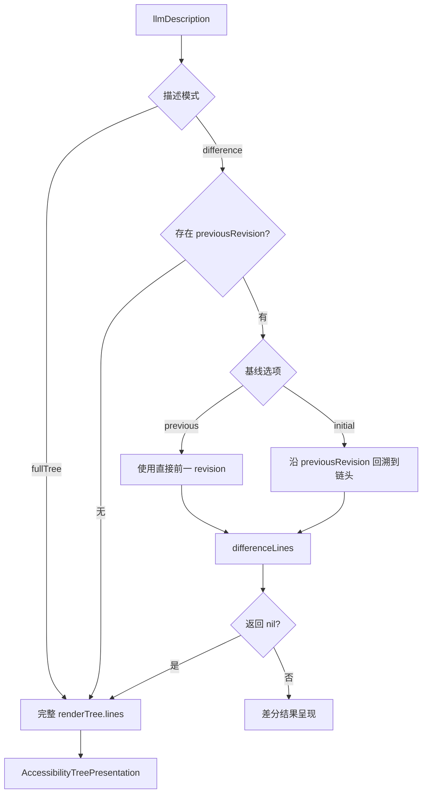
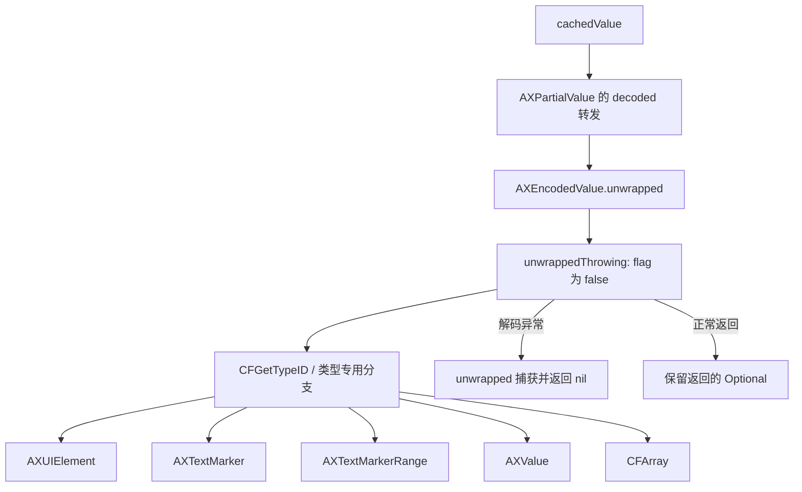
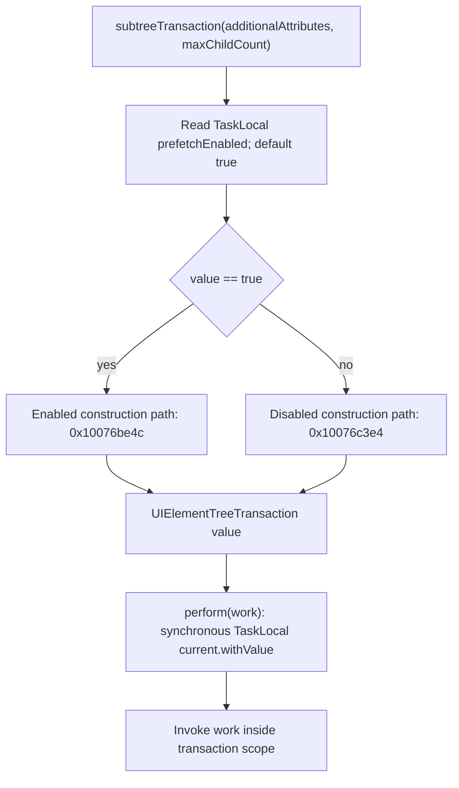

# 原生 AX 增量树：当前可证实的边界

> 2026-11-08 最新状态：本文较早“无 revision/未传 disableDiff/权限均 false”段落为历史
> 记录。当前已有内部 revision/diff、提取与输入接线；disableDiff 已传至实际提取。
> 尚缺原版公开增量描述/预算回退和解锁实机验收；当前文本仍是完整 observation
> adapter。准确边界以 CURRENT-ACCEPTANCE.md 与最新事故记录为准。

本页基于本机安装包的静态 Swift 导出符号及局部 ARM64 指令证据，尚未恢复完整原生函数体。
运行 `python3 scripts/audit-desktop-diff.py --check` 可复核固定版本；
完整证据保存在 `reconstruction/desktop-diff-evidence.json`。不启动原厂服务。

## 已找到的接口

| 层级 | 原构建符号体现的职责 |
| --- | --- |
| ComputerUseAppController | 保存 lastAXTree；初始化接收 isAXTreeDiffingEnabled；updateSkyshot 接收 treeCache、disableAXDiffing、skipScreenshot |
| SkyshotOperation | capture/captureAXTree 接收 continuingFrom: UIElementTreeRevision?；同时存在 TreeCache 与 accessibility enablement 参数 |
| RefetchableSkyshotAXTree | 保存 SystemSelection，关联 UIElementTreeInvalidationMonitor，并提供 refetchTree |
| ComputerUseCore.UIElementTreeRevision | previousRevision、lineageRootRevision、renderTree、focusTree、focusRenderTree、renderTreeSnapshot |
| AccessibilitySupport 对 Revision 的扩展 | root 和 appending 接收树、可选 focusTree、inout UIElementTransformationContext |
| Revision.differenceLines | 接收基线 revision、渲染选项、summarizesRemovedElementIDs、ignoreDifferenceLineBudget 和预算超限回调；返回可选字符串行数组 |
| SystemSelection | llmDescription/eventStreamDescription 接收描述模式和渲染行选项；后者还有 ignoreDifferenceLineBudget |

这些签名支持“Swift 中存在树版本、缓存、增量描述及行预算”的结论。
无法仅凭签名确认：版本创建顺序、ID 分配/复用、焦点变化如何影响基线、差分规则、
预算数值、nil 的含义、回退条件或最终文本格式。浏览器 WASM 的差分行为也不能自动视为桌面算法。

## 与现仓库的差距

当前 Swift `SkyIPC.swift` 仅检查 disableDiff 的类型，未传入 `SkyAppState.get`；
`SkyAppState.get` 没有该参数，也没有对应的 revision/lineage/differenceLines 实现。
现有完整观察文本不能冒充原构建的增量树输出。

后续实现需继续取得函数行为证据，并在 Swift 层处理版本状态、缓存失效和渲染；
JS/TS 只保留原有调用参数及结果绑定。不能只在 TS 对上次/本次字符串做差就称为对齐。
需要覆盖首次观察、重复观察、树变化、显式 disableDiff、应用/窗口切换、焦点变化及动作后观察。
这些是待验证场景，不是已恢复的原厂规则。

本机 helper 的 Accessibility/Screen Recording 当前均为 false，真实 UI 差分尚无法验收。
本次工作未改变权限、未启动原厂服务，也没有把缺失算法填成自拟实现。

## JS/TS 到 IPC 的联合验证

`reconstruction/sky-observation-chain.test.ts` 将实际 `bind_mac_app` →
`get_app_state` → 审批策略 → `MacComputerUseClient` 串起来，以本机原 JS 模块为对照；
仅替换 native transport 的端点响应，不启动原厂原生服务。

三个观察 API 各覆盖 omitted/false/true，共九组：
- getAXState 和 getAXStateAndScreenshot 将 disableDiffing 转成 disableDiff，显式 false 不丢失。
- 参数省略时，最终 IPC payload 不携带 disableDiff。
- getScreenshot 只发 app；即使动态调用传入 disableDiffing，也不转发，和原 JS 一致。
- 策略检查使用请求的应用名称，观察请求使用审批解析后的 appPath。
- 另覆盖一次拒绝审批：只有 policy 请求，没有 skyshot 请求。

原 JS 与还原 TS 的请求、审批参数和返回值逐项一致。本次因此没有改动上层传参逻辑；
已确认的断点仍在 Swift IPC 接收后，不能把“参数正确到达 transport”当作差分算法已经实现。


## 从符号推进到函数体证据

审计脚本现使用 Mach-O 的 LC_FUNCTION_STARTS 确定函数范围，不能把“下一个导出符号”当作函数结束：中间可能有未导出的函数。
本版本 differenceLines 的区间为 `[0x100629630, 0x10062b8dc)`，共 2,219 条 ARM64 指令。
脚本检查指令地址连续性、每条机器码与文件字节一致，并记录函数体 SHA256。

已经直接核实：

- `0x1006298a8` 和 `0x1006298fc` 两个 BL 指令都指向导出的 `renderTreeSnapshot()`；这是函数体调用证据，超过仅看到 API 名称的证据强度。
- 两处调用后检查 x21；异常分支最终到达清零返回寄存器的共同出口。结合 Swift throwing ABI 和 `[String]?` 返回类型，可推断“渲染快照失败时返回 nil”的路径存在。这是静态推断，尚未运行原函数验证，也不表示所有 nil 都来自这条路径。
- 函数末段通过 ADRP/ADD 引用实际字面量 `Removed element IDs: `。脚本通过 Mach-O segment 映射读取字符串，保留对应指令。尚不能据此断言 ID 排序、分隔符和何时启用该摘要。

通用反汇编器在此文件中给地址附上的最近符号名称可能误导（例如把本函数标成 sqlite3_config_log 的偏移）。审计输出因此去掉这些标签，仅用真实导出地址解析已确认的调用目标。

完整遍历、比较结果的枚举语义、预算判断、ID 生命周期及调用者如何处理 nil 仍需继续恢复。
此轮未将局部推断接入生产 Swift，避免制造貌似可用但与原行为不同的差分实现。

## 预算回调类型与分支

已进一步读取 Swift nominal type descriptor 和 field descriptor，恢复出原构建类型：

```swift
enum AccessibilityDifferenceLineBudgetExceeded: Equatable {
    case difference(fullTreeLineCount: Int)
    case removedElementSummary(fullTreeLineCount: Int)
}
```

字段记录的 payload mangling 均为 `Si17fullTreeLineCount_t`；用
`xcrun swift-demangle --compact '$sSi17fullTreeLineCount_tD'` 得到
`(fullTreeLineCount: Swift.Int)`。等价性遵循此前导出的 `__derived_enum_equals` 证据。
该类型现保留为 Swift 文件；尚未用于 SkyAppState，不能把类型恢复当作差分功能接通。

当前函数体还有以下可复核的静态路径：

- 参数 w3 保存到 `[x19,#0x70]`，随后在 `0x10062a358` 用位测试控制是否跳过一段差分预算计算。结合函数签名，这是 ignoreDifferenceLineBudget 的一条路径；不能扩大为“所有预算分支都会被跳过”。
- `0x10062b7b4..0x10062b7c0` 给回调传入保存的完整树计数与判别值 0，之后返回 nil。
- `0x10062ad40..0x10062ad4c` 给同一回调传入计数与判别值 1，随后也跳往 nil 出口。
- 结合枚举字段顺序及 ABI，两个判别值分别对应 difference / removedElementSummary。这是静态 ABI 推断；尚未用原原生服务做运行时对照。

因此预算失败并非简单截断字符串后返回；至少存在“通知调用者并返回 nil”的路径。
计数的完整累积规则、各比较结果如何扣减、调用者回退策略仍未恢复。本轮不引入猜测的固定行数限制。

## 调用者的基线选择与完整树回退

现在已追踪 `SystemSelection.llmDescription(_:lineOptions:)` 的实际函数体，范围
`[0x100238b88, 0x1002394a4)`。以下为固定构建的静态还原证据，并非当前 helper 已实现。

Swift 反射元数据确定：
- `LLMDescriptionMode`：`difference(from: DifferenceBaseline)`、`fullTree`。
- `DifferenceBaseline`：`initial`、`previous`。
- payload 的类型引用含 4 字节相对地址，内部可能含零；审计按符号引用解码，不能当作普通零结尾字符串读取。

结合指令与类型布局，调用流程为：



关键位置：
- `0x100238ed4..0x100238edc`：fullTree 模式直接转完整树路径。
- `0x100238f48`：没有前一 revision 时转完整树；`0x100238f58..0x100238fb8` 分流直接前一版本与沿链回溯。
- `previousRevision` 导出 getter 在 `0x100654a6c`，取类元数据偏移 `0x98` 对应字段，与上面回溯指令一致。
- `0x100238fe0` 调用 differenceLines；w2 来源是 `axTreeDiffingRemovedElementIDRanges` feature flag，w3 为 0（本调用不忽略差分预算）。
- `0x100239004` 检查保存的返回值，为 nil 时转 `0x1002391f8`，随后 `0x10023926c` 调用完整树 `UIElementRenderTree.lines`。
- 非 nil 后还有单独的数组长度检查 `0x100239028..0x10023902c`：空数组与 nil 不是同一分支，不能统一成“没有差分就回退完整树”。

这补上了此前缺失的调用者回退证据。图仅省略选择文本、焦点元素、窗口标题和最终文本拼接；
树比较算法、revision 创建/失效和这些呈现细节仍未恢复，不能直接把该图当作完整实现。

## Swift 观察文本构造器已还原

新增 `native/macos/Sources/CuaHelper/AccessibilityTreePresentation.swift`，恢复两个构造器及
text/focusedElement/selectedText/selectedElements 字段。依据是固定原生构建的三个实际函数体：
`0x100637128`（body 入口）、`0x100637170`（窗口/树行入口）、`0x100637438`（共享实现）。
审计记录函数边界、机器码哈希、字符串地址与三个优先级分支位置。

恢复的行为：

1. 窗口入口生成 `Window: "<title>", App: <name>.\n`，随后是用换行拼接的树行与末尾换行；标题中的引号不额外转义。
2. selectedText 非 nil 时追加 fenced text 和原构建的 selectedContentNote，即使文本为空也走此分支。
3. 否则 selectedElements 非空时追加 `Selected:` 和逐行元素，以及同一提示；包含一个空字符串的数组仍算非空。
4. 否则 focusedElement 非 nil 时追加焦点说明，不追加选择提示；空焦点字符串仍保留说明前缀。
5. 保存全部原始字段；呈现的优先级不删除未展示的焦点/选择数据。

原生 Swift 测试覆盖上述优先级、nil/空值区别、嵌入代码围栏、多行文本、中文标题、空树与精确换行。
入口：`node --import tsx --test reconstruction/native-ax-presentation.test.ts`。
该测试编译并运行 Swift 格式化器，不需 UI 权限；预期输出来自已审阅指令，不是原厂原生服务的运行时 oracle。

尚未将格式化器接入 SkyAppState：目前 AX 树采集、选择/焦点映射和 revision 仍是独立实现，
不能为接入新格式而伪造这些输入。整体 helper 的观察输出因此尚未变化。

## 选择文本读取：空值后的 marker fallback

已读取 `AccessibilitySupport.UIElementProtocol.selectedText` 的实际函数体
`[0x10078e7f0, 0x10078e994)`，并追踪 selectedTextMarkerRange 属性和参数化读取：

1. 读取 AXSelectedText；非空则直接返回，不再读取 marker。
2. 缺失或空字符串都会尝试 selectedTextMarkerRange。
3. marker 不存在则返回 nil；存在则调用 AXStringForTextMarkerRange。
4. 参数化读取抛错、返回 nil 或空字符串均返回 nil；非空结果保留，不 trim 空白。

新增 `SelectedText.swift` 将上述逻辑留在 Swift。三个闭包是原 typed AX accessor 尚未还原时的接入边界，
不冒充原 UIElementProtocol 的完整接口；尚未对真实 AXUIElement 自动发起新读取。
测试使用受控 marker 值验证调用顺序、首选路径短路、空/缺失区别、错误处理、多语言及空白文本。
另有一例将空选择结果接入恢复的 presentation，确认显示焦点而不是空 selected-text 围栏。

这也解释了两层空值语义为何不同：presentation 对显式非 nil 的空字符串照常呈现；
原 selection getter 则过滤空内容并回退。不能把其中一层的规则覆盖到另一层。

当前独立 Target.collect 只导出选择范围等信息，尚未具备原 SystemSelection 的 focusTree、
类型化 marker 及选中元素映射，因此此轮仍未把上述 reader 挂到整棵树上批量读取。
入口：`node --import tsx --test reconstruction/native-selected-text.test.ts`，包含 10 组 Swift 行为检查。

## Typed AX accessor 的缓存边界

继续沿 selectedText / selectedTextMarkerRange 的调用追踪，发现它们通过
`0x1007a7600` 的 typed accessor 读取，不能等同于每次直接执行 AXUIElementCopyAttributeValue。
该分流函数先调用 `cachedValue(for:)`，只在返回 Optional.none 时调用
`uncachedValue(for:ignoringTypeMismatch:)`，并原样传递 ignoringTypeMismatch。
缓存中的空字符串、false、0 都不是 miss。

`UIElementAttributeValue.swift` 恢复了这一层 Swift 分流；底层缓存存储、AXPartialValue 类型解码
及类型不匹配处理仍由待还原的 accessor 提供。此函数不新增缓存写入或失效策略。
8 组 Swift 检查覆盖值/缺失、标志透传、嵌套 Optional 和 selectedText 组合。
特别地：缓存命中空字符串不重读普通 AX 属性，而是由 selection getter 转入 marker fallback。

同时确认 UITextMarkerRange 的原生包装构造器与 UITextMarker 共用一个直接 return 的入口，
它接收的已是类型化 AXTextMarkerRangeRef；不能从该函数没有校验推导出“任意 CFTypeRef 都可接受”。
类型验证位于更下层解码链，尚未恢复。因此本轮没有用 AnyObject 别名冒充完整 marker 类型。

入口：`node --import tsx --test reconstruction/native-attribute-value.test.ts`。
当前 helper 的实际观察链仍未接入该缓存分流，验收范围仅为恢复的内部逻辑及静态证据。

## AXPartialValue / AXEncodedValue 解码边界

已追踪缓存值进一步解码的路径：



`AXPartialValue` 的转发只有三条指令，取其 encoded value 后跳至 `unwrapped()`；
后者以 false 调用 throwing 版本，检查 Swift error register，并在错误分支写入 Optional.none。
这不等于 throwing 版本在 false 时永远不抛错，更不等于所有原生读取错误都可以任意忽略。

审计工具现在读取 Mach-O indirect symbol table，并解码每条 ARM64 BL 的目标，确认调用：
CFGetTypeID、AXUIElementGetTypeID、AXTextMarkerGetTypeID、AXTextMarkerRangeGetTypeID、
AXValueGetTypeID、CFArrayGetTypeID。这样能把原来反汇编中显示为无关符号偏移的调用还原为真实 C API。
记录保存在 desktop-diff-evidence.json 的 decodingEvidence，包含函数边界、代码哈希和调用位置。

这说明普通 `as? String` 或 `String(describing:)` 无法代表整个原生 decoder。
各种类型的转换规则、AX 错误值、类型不匹配和数组子集描述仍需逐支恢复；本轮不以一个宽松的
AnyObject 强转实现替代它。图只列出已确认的类型判断，不声称枚举了所有转换分支。

此外 uncachedValue 的外层会捕获内部 throwing reader 的错误、通过 os.Logger 记录并返回 nil；
这一层与原始 AX API 以及 parameterizedValue 的错误行为要分别处理，不能统一改为全抛出或全吞掉。

## 原生错误类型恢复

`UIElementError.swift` 按 Swift enum field metadata 恢复五个 case，遵循原构建的 Error conformance：

```swift
enum UIElementError: Error {
    case axError(AXError)
    case unexpectedAttributeValueType(expected: Any.Type, actual: Any.Type)
    case failedToUnwrapAttributeValue(Any.Type)
    case failedInit(String)
    case failedToWrapAXValue
}
```

payload 类型保留 AXError、Swift metatype 和 String，而不是统一包装成文字。
`ypXp8expected_ypXp6actualt` 经 swift-demangle 明确得到 `(expected: Any.Type, actual: Any.Type)`。
首个 case 的 symbolic typeref 指向名为 AXError 的 descriptor，最后一个 case 没有 payload。

在 unwrappedThrowing 中还找到与 -25212 比较后返回 Optional.none 的路径；
本机 macOS SDK 的 AXError.h 确认 -25212 是 kAXErrorNoValue。
该证据针对这一解码分支，不表示所有 API 返回 noValue 都由同一层处理。
另一个共享失败处理块 `0x1006e9d38` 根据布尔参数选择抛出已有错误或返回 nil，
也不能据此概括整个 decoder 在 false 时绝不抛错。

尚未恢复错误构造条件的全部分支，也未把这些 Error case 接到 SkyIPC 的错误码映射。
本轮只补齐可确定的原生类型和审计证据；Swift 构建用于验证类型声明，不将构建成功当成错误链路验收。

## AXValue 具体值解包

恢复 `0x1006ea098..0x1006ea28c` 的原生 Swift helper，实现在
`native/macos/Sources/CuaHelper/AXValueUnpacking.swift`。以 AXValueGetType 分派，
直接复用系统 AXValueGetValue，返回 CGPoint、CGSize、CGRect、CFRange 或 AXError。
每个读取失败分支返回 nil；未知类型抛出 `.failedToUnwrapAttributeValue(AXValue.self)`。
AXError.noValue 在这一层仍为 AXError；其 nil 策略由外层 decoder 决定。

审计记录 `axValueUnpackingEvidence` 固定函数边界、代码哈希和六处系统调用位置。
真实 macOS AXValueCreate 生成的值覆盖五类系统值（AXError 额外覆盖 noValue），
注入失败覆盖五个读取失败分支，未知类型检查保证不尝试读取内存，共 12 个案例。
这些测试执行独立恢复代码与系统 API，不执行原厂服务，也不冒充原厂运行时对照测试。

测试曾暴露 Swift 泛型推断造成的内存破坏：在 `Any?` 返回上下文直接返回泛型
`read(CGRect.zero)` 时，泛型 Value 被推断成 Any，C API 写入 existential 容器，
覆盖其元数据。现先显式声明具体类型的 Optional，再擦除到 Any，确保传给 C API
的缓冲区类型正确。真实 CGRect roundtrip 是该崩溃的回归覆盖。

此 helper 尚未接入完整 AXEncodedValue decoder；缓存、数组解码、类型不匹配策略和
原生观察差量仍有未恢复部分，不能据此声称原生观察链路整体一致。

## AXValue 分支的泛型转换与错误顺序

`AXValueDecoding.swift` 继续恢复 `unwrappedThrowing` 的 AXValue 专用分支，复用上节解包器。
这不是完整 AXEncodedValue 的替代实现，尚未连接 UIElement/marker/array 的其它分支。

关键顺序来自 `0x1006e9548` 到 `0x1006e9bbc` 的控制流：

1. 调用具体解包器；其抛错直接传播，不受外层失败标志影响。
2. 将 **Optional<Any>** 动态转换为调用者请求的泛型类型，成功即返回。
3. 转换失败后再尝试 AXError：noValue 返回 nil；其它错误在标志为 true 时抛出
   `.axError(error)`，false 时返回 nil。
4. 其它转换失败在 true 时抛出 `.failedToUnwrapAttributeValue(请求类型)`，false 时返回 nil。

类型源不是猜测：`0x101193410` 的相对 typeref 为 `ypSg`（Optional<Any>），
`0x1006e9890` 的目标 stub 经 Mach-O indirect symbols 确认为 `_swift_dynamicCast`。
后续 AXError fallback 位于 `0x1006e9a74`，顺序不能交换。

这意味着请求 AXError 或 Any 时，`.noValue` 本身可以成功返回；只有请求类型转换失败
才进入 noValue → nil 分支。同样，对 Optional 类型的成功转换可能返回 `.some(.none)`，
不能先用 guard let 去掉空值。原分支也没有为 AXError.success 添加特殊豁免。

22 个 Swift 案例覆盖实际系统值的具体/Any 转换、两种失败标志、noValue 的目标类型差异、
嵌套 Optional、普通 AXError（含 success）以及底层解包异常不被标志吞掉。
审计记录 `axValueDecodingEvidence` 固定 typeref、动态转换 stub 和关键跳转指令。
测试是恢复代码与系统值的行为验证，尚没有原厂服务运行时 oracle；不能外推为整个原生
属性读取或桌面观察链路已经对齐。

## AXUIElement 原生解码入口接入

恢复 `AXEncodedValue.unwrappedAXUIElementThrowing`（`0x1006e9d90..0x1006e9e50`）
为 `unwrapAXUIElement`：先比较 CFGetTypeID 与 AXUIElementGetTypeID，匹配才强制转换，
返回同一个系统元素引用；不匹配时 false 返回 nil，true 抛出
`.failedToUnwrapAttributeValue(AXUIElement.self)`。这一专用入口不套用 AXValue 的 noValue 策略。

Input.keyboardInput、Paste.pasteEditor、WindowSelection.focusedCaptureWindow 的重复
类型检查已接入该 helper。调用方继续使用 false，再分别保留原有“无焦点元素”错误或
无窗口时返回 nil；PID 所属校验、快照验证和输入授权仍在原位置。

14 个系统类型案例验证 system-wide / 本进程 AX 引用的身份保留，以及 NSString、NSNumber、
NSArray、NSDictionary、AXValue 的拒绝与错误类型。创建 AX 引用不读取应用 UI、不操作桌面；
这组测试与 Swift 构建不能替代真实键盘、粘贴、截图端到端验收。
审计记录 axUIElementDecodingEvidence 包含函数边界、机器码哈希、类型检查与强转调用。
泛型 UIElementProtocol 包装器构造与其余 decoder 分支仍单独待恢复。

## 单属性与参数化属性的底层读取边界

继续核查 `AXUIElement.value(for:)` 与 `parameterizedValue(for:parameter:)`，确认不能
把二者统一实现为“系统 API 失败就 nil”。

| 路径 | 原构建直接调用系统 API 后的行为 |
| --- | --- |
| 单属性 `value(for:)` | 返回 `(error: AXError, value: AXPartialValue?)`，独立保留状态与返回值是否存在 |
| 参数化属性 | 非零状态抛出 `UIElementError.axError`；成功时根据输出指针决定返回值或 nil |

单属性调用点 `0x1006f6144` 之后没有基于状态码清空值的判断：状态单独存于
`0x1006f6254`，输出存在性在 `0x1006f6214` 判断。参数化调用点 `0x1006f7098`
则在 `0x1006f70a8` 检查状态，非零进入错误构造。这是两个不同的契约。
这里的状态码不能与前面 AXValue 载荷中的 AXError 混为一谈。

此外，两条入口都有可选的协议分派路径；反射描述符 `0x1012cc62c` 的名称是
**MockProvider**，不能将其误称为另一个生产浏览器/桌面后端。直接系统路径之前还比较
getpid 与目标进程信息，存在另一执行分支；其线程/调度条件现已进一步确认，见下文“同进程读取的主队列分派”；
PID 查询辅助入口和 MockProvider 路径需继续核查；缓存尚未证实。

main.swift 的便利 attribute helper 仍只在 success 时返回值；底层现在由
readRawAXAttribute 独立保留状态与值，根节点检查也复用该入口。上层仍有
捕获、日志与忽略类型不匹配策略。因此接入完整原生属性读取时必须逐层恢复，不能仅把
新增解码函数塞进这个 helper 就声称对齐。审计记录 rawAttributeEvidence 固定两个函数
边界/哈希、系统调用位置和 MockProvider 名称。本轮为静态证据补全，没有改变运行时
属性读取策略，也没有执行原厂服务。

## 数组子集与文本截断描述符

Swift reflection 确认 AXPartialValue 包含 value、arraySubsetDescriptor、
textTruncationDescriptor 三个字段；后两者的值类型恢复在 `AXValueDescriptors.swift`：

- ComputerUseCore.AXArraySubsetDescriptor：`count: Int`、`availableRanges: [Range<Int>]?`。
- AccessibilitySupport.AXTruncationDescriptor：`count: Int`、`availableRange: Range<Int>?`。

保留 Swift 半开区间、Optional、可变属性和结构化 Equatable；不把 nil 压成空数组，
也不引入合并/排序区间或其它原构建未体现的标准化。
`AXArraySubsetDescriptor.isComplete` 的原函数只有三条指令，直接判断 optional 数组
指针是否为零。因此 **nil 表示 complete；空数组或覆盖全部 count 的 ranges 都仍非 complete**。
不能通过区间覆盖量重新计算这个属性。

12 个 Swift 案例覆盖 nil/空数组/全覆盖/分段覆盖、顺序敏感的相等性、属性修改、半开区间。
原构建结构字段及 getter 指令记录于 valueDescriptorEvidence。尚未恢复子集选择和文本截断
生成算法，也尚未把这些描述符附加到现有观察输出；只恢复元数据不证明截断链路完成。

## AXPartialValue 数组解码结果组合

恢复 `decodedArray`（`0x1006fac44..0x1006facb8`）的结果组合逻辑：先调用 encoded
value 的非抛错 `unwrapped<[Element]>()`，返回 nil 时整项失败；返回数组时原样附带
已存储的 arraySubsetDescriptor。空数组是有效成功值，不根据 count、区间覆盖或数组
长度重新切片、填充、排序或标准化描述符。

`AXPartialArrayDecoding.swift` 的闭包明确表示尚未完整恢复的底层 generic decoder，
并不以 Swift 简单强转代替其 CFArray/元素转换过程。12 个组合案例覆盖 nil、空数组、
重复值/顺序与四种子集描述符。此 helper 和此前的描述符均尚未接入完整观察链路。

另核实相邻 decodedThrowing 转发（`0x1006fac24..0x1006fac44`）将标志固定为 true，
与 decoded → nonthrowing wrapper 的 false/catch 路径不同。审计 partialArrayEvidence
保存函数哈希及解码调用、nil 分支、描述符读取和该 true 参数的机器指令。

## CFArray 分支的元素转换：确认使用 compactMap

底层数组转换 `0x1006ea28c..0x1006ea328` 通过 TypeErasedArray 的关联元素类型，
调用 Swift 标准库 `Sequence.compactMap`；回调 `0x1006ea758..0x1006ea7b4` 对每个
encoded value 调用非抛错 `unwrapped`。因此解码为 nil 的元素会被跳过，成功元素顺序及
重复值保留。不能把“保留失败占位”或“一个失败导致整个数组失败”作为原行为。

这次使用更完整的符号解析：indirect symbol table 将 `0x101150c18` 标为 LOCAL ABSOLUTE，
但其 ARM64 stub 加载 GOT `0x1014665a8`，`dyld_info -fixups` 明确该槽绑定到
`libswiftCore/_$sSTsE10compactMapySayqd__Gqd__Sg7ElementQzKXEKlF`。
仅看 objdump 最近符号或 indirect table 会遗漏这个真实调用目标。

`AXArrayElementDecoding.swift` 直接复用 Swift compactMap。测试将真实 CGPoint、CGSize、
AXError 系统值接到已恢复的类型解码，确认不匹配/缺值被跳过，同时验证顺序、重复值、
空数组、数值零和嵌套 Optional，以及和部分数组描述符的组合。

前一节 decodedArray 的“原样返回数组”描述的是**底层转换之后**的结果组合层；
它仍保留原始 subsetDescriptor，不因底层过滤而重算 count/ranges。两层行为不同。
完整 CFArray bridging、目标协议检查、最终数组类型转换仍待恢复，当前 helper 不替代它们。

## 数组目标协议与最终转换

恢复原生 `TypeErasedArray`：只有一个关联类型 **ElementType**，没有方法要求；Swift.Array
通过 `typealias ElementType = Element` 遵循该协议。协议描述符为 `0x1012cc42c`，
关联类型字符串和 requirement kind 7 均从反射读取。conformance `0x101193450` 的间接
类型引用指向 GOT `0x1014667e8`，dyld 明确绑定 Swift.Array nominal descriptor `$sSaMn`。
这不是根据名字推测“任意集合都可用”；当前只确认这一 Array conformance。

数组转换后还有两个步骤：`0x1006e9c38` 经 GOT `0x101467748` 调用 Swift
`_arrayForceCast`，目标元数据为 Any；随后 `0x1006e9c78` 动态转换到调用者请求类型。
最终转换失败时原构建构造 `unexpectedAttributeValueType(expected: target, actual: target)`，
两个 metatype 均来自同一寄存器，然后进入按标志抛错/返回 nil 的共享路径。此处看起来
重复的错误 payload 不能擅自“修正”为另一个类型。

新增 TypeErasedArray.swift 仅恢复协议和标准数组 conformance，Swift 构建验证成立；
底层 CFArray bridging 和完整泛型 decoder 尚未接入，不能以该协议声明证明数组观察可用。
arrayTargetEvidence 保存协议布局、conformance 和 dyld binding 证据。

## 将逐元素解码接入 AXChildren 遍历

`Target.collect` 原先通过 `as? [AXUIElement]` 转换完整 AXChildren 数组。这不能替代
原构建已确认的逐元素 compactMap 和 CF 类型检查，尤其不能将 Swift 对 opaque CF
对象的条件转换视为底层类型验证。

现在实际遍历调用 `unwrapAXUIElementArray`：先验证 CFArray 类型，再通过 NSArray
桥接取得元素，复用已还原的 `decodeAXArrayElements` 与 `unwrapAXUIElement`。
有效 AXUIElement 保留引用身份和顺序，重复引用仍保留；非 AXUIElement 元素被跳过，
嵌套数组不展开。遍历自身既有的 visited 集合仍负责去重，未改变节点预算或 ID 分配。

这是原生 Swift 观察路径对已证实解码规则的具体接入。NSArray 桥接为当前具体适配，
并非宣称完整恢复原构建 generic AXEncodedValue / TypeErasedArray 分派、错误映射或
所有 AX 属性类型。完整增量树、disableDiff 接收后的实现仍未完成。

验证包括真实 CF/AX 引用构造下的非数组、空数组、全无效、混合类型、嵌套数组、重复
引用和顺序；三项相关 Swift 编译执行测试通过，完整 cua-helper 构建通过，固定原构建
191 项签名/局部函数证据检查通过。这些测试不读取应用 UI，不能替代有系统权限后的
真实应用树验收。

## 将 AXValue 解码接入几何和文本选区

`AXTypedAttributeDecoding.swift` 提供具体的非抛错属性适配：先验证 CF 类型为 AXValue，
再调用已还原的 `decodeAXValue` / `unpackAXValue`。应用节点和焦点窗口的 CGPoint / CGSize，
以及观察输出、粘贴前校验的 CFRange 均已使用该路径。焦点窗口复用同一几何读取函数。
现在 helper 中底层 AXValueGetValue 读取集中在 AXValueUnpacking.swift。

这消除了生产路径与已还原解码规则各自维护的情况，并不意味着完整原厂树渲染已接入。
几何有限值/正尺寸、进程身份、文本 UTF-16 选区和安全字段校验仍由相应消费者负责；
解码器不擅自修正负数范围或越界值，也不会将 AXError 当作点或选区返回。

验证：真实 AXValue 的点、尺寸、范围、错误载荷与错误目标类型，以及普通 NSString、
NSNumber、数组、字典、AXUIElement 输入；6 项相关测试通过（包括原解包/类型转换和
粘贴协议回归），完整 Swift helper 构建、UTF-16 粘贴替换自检通过。粘贴协议回归使用
模拟 transport；本轮没有对用户应用执行粘贴或宣称真实 App UI 已验收。


## 同进程读取的主队列分派

进一步解析原构建两条属性读取路径：
- 目标 PID 缺失或不同于 getpid()：直接调用。
- 目标 PID 等于 getpid() 且当前是主线程：直接调用。
- 目标 PID 等于 getpid() 且不在主线程：DispatchQueue.main.sync 执行读取。

证据不依赖反汇编器的最近符号标签：`0x10151ed40` 绑定 NSThread，selector 地址
`0x10136b018` 为 isMainThread；`0x101469058` / `0x101469068` 分别绑定 Swift
DispatchQueue.main 和 sync(execute:)。普通属性分派调用在 `0x1006f61d8`，参数化属性
在 `0x1006f7168`。审计新增 sameProcessScheduling，固定绑定和八条条件分支机器码。

`AXAttributeReading.swift` 将此规则用于实际普通属性读取；main.swift 的属性便利入口
及根节点连通性检查均已接入。底层 rawAXAttributeResult 将 AXError 与 CF 输出分别
保留，包括“错误状态但有值”和“成功但空值”；便利入口仍保留既有 success-only 策略，
没有擅自推断上层错误忽略/缓存规则。目标 PID 当前直接调用系统 API 查询，不假设尚未证实的 PID 缓存；
参数化读取只完成静态分派证据，尚未新增其生产调用路径。

测试覆盖四种状态 × 两种值存在性，以及主线程、后台同进程、未知 PID、其它进程。
同进程后台案例真实执行 GCD main.sync，并由主 RunLoop 泵送，未用同步回调模拟主线程。
Swift 测试和完整 helper 构建通过。这仍不是原厂服务运行时对照或真实用户应用验收。


## PID 结果契约与缓存假设修正

继续追踪线程分派调用的 `0x1006fa0d4`，确认它调用导出的
`AXUIElementRef.actualPID.getter`（`0x1006f9f30`），失败时记录日志并返回 Optional.nil。
actualPID 的直接查询路径将 Int32 输出初始化为 -1；状态非零构造 UIElementError.axError，
成功则原样返回输出，没有额外的“PID 必须大于零”条件。查询经 `0x100256028` 的间接
函数包装器进入；该包装器的一次性初始化不能证明缓存了每个 AX 元素的 PID。
此前“原厂 PID 缓存仍待恢复”的措辞预设了尚未证实的缓存，现已修正，不添加猜测缓存。

`AXProcessID.swift` 恢复上述直接结果契约，并接入 readRawAXAttribute 的线程选择。
原构建 MockProvider、混淆函数解析和日志输出仍未复刻；系统调用使用 macOS SDK
AXUIElementGetPid，不执行原厂服务。失败输出即使写入数字也不能作为有效 PID；
成功输出保留 -1、0 等数值，由实际调用者处理，不自行发明过滤规则。

两项测试通过：注入系统状态验证初始化值/成功值/错误值与可选失败，以及真实创建
本进程 AX 引用后查询 PID；原有主队列调度测试和完整 helper 构建也通过。审计新增
processIdentity，固定实际导出符号、三个函数边界/哈希和关键返回分支机器码。

## 参数化属性直接读取的 Swift 实现

`AXAttributeReading.swift` 现在补上 `rawAXParameterizedAttributeResult` 与
`readRawAXParameterizedAttribute`，依据上述固定构建的直接系统调用分支实现：
初始化空输出，调用 `AXUIElementCopyParameterizedAttributeValue`，非 success
抛出 `UIElementError.axError`，success 则原样返回可空输出。即使失败时系统提供了
非空输出也不能将它当作成功结果。普通 attribute 的 `(error,value)` 契约保持不变。

线程分派 helper 改为 `rethrows`，保留同进程非主线程使用 main.sync 的条件，且让
参数化读取的错误穿过主队列同步调用原样传播。Swift 测试覆盖四种状态 × 输出有无，
并在真实后台线程/主 RunLoop 上验证错误传播；完整 helper 构建和 193 项原构建
签名审计通过。测试不需要也不改变系统权限。

这是直接读取层的恢复。现有 UI 观察还未调用参数化读取入口；MockProvider、
AXPartialValue 元数据、typed 参数编码与 text marker 包装仍需还原，不能据此
宣称 selectedText fallback、增量树或真实应用窗口操作已完成。

## Marker 类型转换与 range 构造的原生边界

继续检查 `unwrappedThrowing` 的 marker 两个分支，新增
`markerDecodingEvidence` 固定七个导入调用、分支指令、共享失败调用和 range
构造函数机器码哈希。具体流程如下：

1. 先分别比较 AXTextMarkerGetTypeID / AXTextMarkerRangeGetTypeID；匹配后才调用
   Swift 的强制 C 引用类型转换。不能从后面的 unconditional cast 推断它接受任意对象。
2. 使用不同的 Swift wrapper metadata：UITextMarker 位于 `0x10149fe80`，
   UITextMarkerRange 位于 `0x10149fea8`，再动态转换为调用者请求的泛型类型。
3. wrapper 转换失败时，构造 `failedToUnwrapAttributeValue(requestedType)`，通过
   `0x1006e94f4` / `0x1006e9664` 调用共享失败处理 `0x1006e9d38`，传入原 throwing 标志。
   这不是“CF 类型正确就一定可以当作任意请求类型使用”。
4. `UITextMarkerRange.init(start:end:)` 的 `[0x1007c1c54,0x1007c1ca4)` 调用
   `AXTextMarkerRangeCreate(nil,start,end)`，释放输入所有权并返回结果；该局部函数没有
   单独的 nil/error 分支。此处不能自行补上与原函数不同的错误或空值策略。

这份证据缩小了后续实现范围：需要保留两个独立的 Swift wrapper 及其 C 引用类型，
然后恢复泛型转换和参数编码；不是把所有 marker 都声明为 AnyObject，也不是把 marker
内容转换成字符串。尚未确定私有 C 声明/导入方式和完整参数编码，未新增伪兼容 wrapper，
也没有把这一静态审计宣称为真实 selectedText 回退验收。

## 使用系统 SDK 实现 marker 包装与转换

上节留下的 C 类型导入问题现已核实：本机 SDK 的
`ApplicationServices.framework/Frameworks/HIServices.framework/Headers/AXUIElement.h`
已声明 AXTextMarkerRef、AXTextMarkerRangeRef、type-ID、Create 和 range 端点接口。
Swift 直接 `import ApplicationServices` 即可使用 AXTextMarker / AXTextMarkerRange，
无需把它们当作 AnyObject 存储，也无需自行声明私有 C 函数或引入替代库。

`AXTextMarkers.swift` 新增两个独立 Swift wrapper，保留原生 CF 引用；range 构造
调用 `AXTextMarkerRangeCreate(nil,start.marker,end.marker)`。两条 decoder 分支先
构造 wrapper 再转换请求类型，不会直接返回 raw CF 引用；不匹配时按原标志返回 nil
或抛出 failedToUnwrapAttributeValue(requestedType)。外层具体属性适配器在强转前
比较 CFGetTypeID，不冒充完整 AXEncodedValue dispatcher。

使用真实 AXTextMarkerCreate / AXTextMarkerRangeCreate 测试 CF 引用身份、范围
两端原始字节、Any 与 Optional 请求类型、裸 C 引用请求拒绝、错误请求类型的 nil/throw
以及字符串/数组/AXUIElement 的类型检查。字节是仅用于对象测试的 opaque fixture，
不能作为真实文档位置发送到应用。测试不需要辅助功能权限，也未操作任何应用窗口。
完整 Swift helper 构建通过。

这一实现替代了上节“尚未确认导入方式/未实现 wrapper”的待办，但尚未补齐 typed
参数编码和缓存/观察集成；现有 selectedText reader 仍未自动在真实 UI 上启用 marker
回退，也不证明原生增量树已完成。

## 原生参数编码及选择范围接入

沿 typed parameterized read `0x1007aecec` 继续追踪，确认其顺序为：先调用参数编码
`0x1006ea3e4`，再调用底层 `parameterizedValue`，输出存在时调用 `decodedThrowing`。
编码错误阻止系统读取；读取错误原样往外传播。此处不同于普通属性的 nonthrowing 便利访问。
新增 parameterEncodingEvidence 固定两个函数哈希、五个调用点及十三条分支/常量指令。

`AXParameterEncoding.swift` 实现已核实的具体分支：UITextMarker / UITextMarkerRange
取其 CF 引用；CFRange / CGPoint / CGRect / CGSize 通过 AXValueCreate 的类型
4 / 1 / 3 / 2 包装，创建失败抛 failedToWrapAXValue。保持具体类型缓冲区，不能先擦除成
Any 再把地址交给系统函数。编码不做坐标规范化或范围校验，这属于调用层职责。

`Input.swift` 的 selectText 现在调用恢复的范围编码入口，不再维护另一套 AXValueCreate
逻辑。外层仍将编码失败映射为既有 PROVIDER_DISCONNECTED 响应；该映射是独立 helper
的协议，不冒充原厂 IPC 错误映射。已有目标、权限、快照及文本匹配限制保持执行。

专项测试使用真实 AXValueGetValue 检查四类值往返、marker/range 引用身份，并注入
创建失败验证 typed buffer 与错误 case。输入 self-test 新增 Unicode 选区及前后光标
范围的编码往返检查，不发送输入事件。完整 helper 构建、self-test 和固定构建审计通过。

这里恢复的是具体参数分支；UIElement wrapper 的提取、通用 Any bridge fallback、
完整 typed attribute dispatcher 和结果 decoder 尚未全部恢复。生产文本范围动作
已接入编码，但观察中的 marker 选择回退仍未接通，不能合并为“原生观察完成”。

## 普通对象返回值解码及观察标量接入

`unwrappedThrowing` 在处理 AXUIElement / marker / AXValue / CFArray 之后，才于
`0x1006e97c8` 进入普通对象分支。该分支对原对象执行 requested-type dynamic cast；
成功保留结果，失败构造 failedToUnwrapAttributeValue(requestedType)，按原 throwing
标志进入共享处理。不能把 NSNumber 的文本描述、空字符串或 false 当作另一种缺失值。
ordinaryValueDecodingEvidence 固定该分支两个代码块、转换与失败调用和六条关键指令。

`AXOrdinaryValueDecoding.swift` 恢复此具体分支。`decodedAXScalarAttribute` 是独立
collector 的适配入口：只接收 CFString / CFNumber / CFBoolean，再使用恢复的转换；
AXValue、marker、数组等不能由它代替专用 decoder。main.swift 的 scalar helper 已接入，
现有 secure-field 限制保持在调用侧。完整通用 decoder 仍未组合完成。

测试覆盖 NSString→String、NSNumber→数字/布尔、AnyObject 引用身份、嵌套 Optional、
空字符串、错误请求类型的 nil/throw，以及观察适配器拒绝 AXValue / AXUIElement / 数组。
Swift 构建、专项测试和 observation-text self-test 通过；这是受控类型与格式验证，
不是应用 UI 观察验收。marker 回退的完整 typed result dispatch、缓存和选择来源映射
仍需继续恢复。

## SelectedText 与真实 marker 组件的组合验证

此前 selectedText getter 的 10 组检查使用整数模拟 marker；现在另外增加 10 组组合
检查，用系统 AXTextMarkerCreate / AXTextMarkerRangeCreate 生成真实 CF 对象，依次
经过已恢复的 marker 解码、参数编码、raw 参数化读取状态处理、普通字符串结果解码和
selectedText / presentation。仅系统读取的响应由 fixture 提供，不读取应用 UI。

组合检查覆盖非空/空白直接文本短路、缺失/空直接文本回退、marker 缺失/类型错误、
带非空输出的原生失败、成功但 nil 输出、空字符串及错误返回类型。特别验证原生失败时
不会继续解码，即使 output 指针非空；结果为空时 presentation 显示焦点，不生成伪选中文本。
Unicode 文本进入实际 presentation 时保留内容。普通返回类型 fixture 限于 NSString /
NSNumber，不把它外推到尚未完整组合的特殊 CF 类型 decoder。

20 组 Swift 行为检查通过。这证明已恢复组件在受控响应边界可组合，不代表缓存、
AXParameterAttribute 协议分派或生产选择来源已经接通；不会因此自动给真实应用读取
选区，也不是原厂服务的运行时 oracle。

## 数组最终目标转换接入 AXChildren

`AXArrayTargetConversion.swift` 实现已审计的最终阶段：将已解码数组擦除成 `[Any]`，
再转换到通过 TypeErasedArray 约束的请求目标。失败时 false 返回 nil；true 抛出
unexpectedAttributeValueType(expected: target, actual: target)，保留原构建两个相同
metatype 的载荷，不自行替换为源数组类型。

`unwrapAXUIElementArray` 在既有 compactMap 后调用此阶段。CFArray 输入检查、元素
AXUIElement type-ID 检查及过滤规则不变，遍历的 visited 去重仍在上层执行。该接入
没有新增数组递归展开，也不规范化 Optional 或重排引用。

真实 Swift/CF 测试覆盖元素顺序与重复、空数组跨元素类型转换、包含 nil 的 Optional
数组、Any 元素、AX 引用身份、类型不匹配以及自定义 TypeErasedArray 目标失败。AXChildren
回归测试和完整 Swift helper 构建通过，固定原构建审计通过。初次测试命令因新增编译文件
路径拼接错误失败，已改为独立路径并通过重跑；不是被忽略的产品错误。

这只补齐数组解码的最终阶段。CFArray 到中间表示的原厂桥接、动态目标协议检查及完整
逐元素 generic decoder 仍不等于现有具体 AXChildren 适配器，不能宣称整体原生类型分派完成。

## CFArray 桥接目标与初始资格错误

进一步读取原生类型引用，确认 `0x101193d10` 的 mangled type 为 `SayyXlG`，即
`[AnyObject]`；`0x101193400` 为 `SayypG`，即 `[Any]`。前者用于 CFArray 动态桥接，
后者是目标未遵循 TypeErasedArray 时的 expected metatype。审计新增这两个精确
类型引用、桥接调用及五条分支/错误构造指令。

AXChildren 现在直接使用 `as? [AnyObject]`，替换先强转 NSArray 再逐项 as AnyObject
的独立适配。前置 CFArray type-ID 检查、后续 compactMap 与最终目标转换均保留。

新增 `resolvedAXArrayTarget` 恢复初始资格判断：符合协议返回其 metatype；不符合时
false 返回 nil，true 抛 unexpectedAttributeValueType(expected: [Any].self,
actual: requested)。这与最终转换失败的 target/target 载荷不同。String、Any 和
Optional<Array<Int>> 都不能绕过初始协议检查；自定义 conformance 可以通过初始检查，
但最终仍可能转换失败。该动态检查 helper 尚未被完整 generic dispatcher 调用；
AXChildren 的请求目标固定为 `[AXUIElement]`，由编译期协议约束确定。

数组转换与 AXChildren 两项编译执行回归、完整 helper 构建和固定原生审计通过。
这不等于完整泛型数组解码已接通；各元素的通用类型分派仍是剩余工作。

## UIElement 包装层包含上下文相关缓存

静态反射确认 `AccessibilitySupport.UIElement` 是两个字段的 struct：`axElement` 与
`cache`。`UIElementCache` 的三个字段为 `supportedAttributes`、`attributes`、
`transactionAttributes`。这不同于前面只持有一个系统引用的 UITextMarker wrapper。
不能把 UIElement 简化为 AXUIElement 的别名，再宣称完整 generic decoder 已恢复。

`UIElement.init(element:)` 在 `0x1007213dc` 跳转至共享初始化器 `0x10072187c`。
该初始化器和 `UIElementCache.init` 都调用 `0x1011537e0`。此 stub 在 indirect table
中只显示 LOCAL ABSOLUTE；实际 ARM64 stub 读取 GOT `0x1014698a8`，dyld fixup
明确绑定到 Swift Concurrency 的 `TaskLocal.get()`。有上下文时提取其组成部分；缺失
时传三个零值给 `0x10076589c` 的缓存构造 helper。没有执行原厂服务。

新增 elementStorageEvidence 固定字段布局、四个函数边界/哈希、TaskLocal binding、
分支指令及初始化调用。审计通过。这是“初始化依赖 TaskLocal 上下文”的证据，不是
“所有缓存都全局共享”或“按 PID 缓存”的证据，也不能仅由字段名称推断事务生命周期。

下一层需要恢复该上下文的 payload、缓存填充/失效和 transactionAttributes 的使用方式，
之后才能将 UIElementProtocol 分派接入完整 decoder。当前 Target 的 UUID snapshot
机制是独立实现，不能替代原构建的缓存与 tree revision。此次仅补充静态证据与实施边界，
未增加空缓存/global dictionary 占位，也未改变生产观察或权限行为。

## TaskLocal 的具体事务类型与工作作用域

前一节中的 TaskLocal 已进一步解析为 `TaskLocal<UIElementTreeTransaction?>`：
类型引用 `0x101195770` 的 14 字节 symbolic typeref 指向 Swift TaskLocal nominal
GOT `0x1014698c8` 和事务 descriptor `0x1012cceb4`，尾部 `SgG` 表示 Optional 泛型参数。
`UIElementTreeTransaction` 的三个存储字段是 element、cache、roleFrequencyTable。
初始化器 `0x10076ccfc` 使用 nil 初始值，静态 current 存储位于 `0x1015ca8b8`。

`perform(work:)` 于 `0x10076c99c` 调用同步 `TaskLocal.withValue`，并通过
`0x10076d9bc` 的闭包转发执行传入 work。其 stub `0x1011537ec` 的 GOT
`0x1014698b0` 已由 dyld fixup 精确解析；不是一个异步任务调度或全局缓存写入函数。
因此后续恢复必须保留有作用域的事务绑定及 Swift TaskLocal 行为，不能把 current
改成进程级可变全局变量，也不能将原来的同步 work 改成无等待的后台任务。

transactionScopeEvidence 固定该类型引用、字段布局、四个函数哈希、nil 初始化和
work 转发指令；同时审计清单加入事务公开方法。仍未由此恢复事务创建/预取策略、cache
填充与失效、roleFrequencyTable 算法或 tree revision。此轮为静态证据补全，没有创建
假的事务对象或改动生产观察，也没有运行原厂服务。

## 事务角色频率表的 Swift 实现

事务的 roleFrequencyTable 类型引用指向 `FrequencyTable<UIElementRole>`。反射确认
FrequencyTable 是只保存 `metricToFrequency: [Metric: Int]` 的 struct（typeref
`SDyxSiG`），不是同步容器。其原生函数体已逐一读取：初始化、increment、subscript、
isUnique；审计新增对应字段、四个函数哈希和九条分支/计数指令。

`FrequencyTable.swift` 直接使用 Swift Dictionary，实现原行为：缺失读数为 0；
首次 increment 写入 1，之后使用有溢出检查的 Int 加法；isUnique 只接受已存在且
计数恰好为 1 的项。没有出现的角色不算唯一，不能用 count <= 1 代替。保留 struct
值语义，不新增共享可变全局表或字符串大小写标准化。

编译执行测试覆盖缺失/首次/重复计数、不同角色、大小写区别、复制后独立修改，以及
相同 hash 但不同键的字典行为。Swift helper 完整构建和扩展后的固定构建审计通过。
目前该组件尚未接入事务的角色采集，不能据此声称完整角色分析或 tree transaction
已恢复。

另外查明事务 Cache 存储的三个字段是 attributeTable、requestedAttributes、
fallbackElements；prefetchEnabled 的 TaskLocal 初始化值为 true。这些观察用于后续
追踪，并不证明属性表填充、fallbackElements 容器或失效算法已经实现。


## 事务 Cache 的实际容器和锁（2026-11-06）

对固定构建的 Swift field descriptor 与 symbolic typeref、dyld fixup 联合解析，确认 UIElementTreeTransaction.Cache（nominal `0x1012ccef8`，字段描述 `0x101323b98`）有以下存储：

| 字段 | 原构建类型 | typeref |
| --- | --- | --- |
| attributeTable | `[AXUIElement: [UIElementAttribute: AXPartialValue]]` | `0x10129f1a0` |
| requestedAttributes | `Set<UIElementAttribute>` | `0x10129f0ee` |
| fallbackElements | `OSAllocatedUnfairLock<[AXUIElement: UIElementCache]>` | `0x10129f1b8` |

间接类型引用分别解析到 AXUIElement、UIElementAttribute、AXPartialValue、UIElementCache 的 nominal descriptor；锁类型经 GOT `0x101469ae8` 绑定到 `libswiftos/_$s2os21OSAllocatedUnfairLockVMn`。因此回退表使用系统 Swift os 锁，不应自行实现一套 TS 锁或用全局缓存替代。

审计脚本新增 transactionCacheEvidence：校验字段布局、完整 symbolic typeref 字节和终止符、间接引用目标名称、系统锁绑定。这个证据补全了此前“Cache 字段类型未解码”的缺口。

局限：容器类型不能证明初始化内容、锁临界区、缓存更新或失效顺序。本轮未创建猜测版 UIElementCache，也未将孤立的 TaskLocal scope 冒充完整事务。下一步需要还原 Cache 构造/访问，以及 UIElementAttribute、UIElementCache 的实际行为，再接入生产观察器。


## 单元素缓存与回退读取临界区（2026-11-06）

进一步解码 UIElementCache 的三个字段：supportedAttributes 为 `Set<UIElementAttribute>`，attributes 为 `[UIElementAttribute: AXPartialValue]`，transactionAttributes 为 `Set<UIElementAttribute>?`。最后一个字段有 Optional 层，不能把“无事务集合”合并成“事务集合为空”。这些与上一节事务级 Cache 是不同层次。

构造 helper `0x10076589c` 在 `0x100765b28` 调用系统 `_os_unfair_lock_lock`，在 `0x100765b38` 调用回退字典读取 helper `0x100764c94`，在 `0x100765b40` 调用 `_os_unfair_lock_unlock`。读取 helper 检查字典是否为空并按 AX 元素查找，命中时取三字段存储，未命中返回空结果。该 helper 的边界和机器码哈希、两处真实锁符号绑定及调用指令均已加入 elementCacheEvidence 校验。

这只确定一个读取临界区，不证明所有缓存读写均采用相同锁，也不证明完整构造或失效顺序。仍需继续恢复构造器后半段、属性采集策略和写入路径，之后才能实现完整缓存并替代当前独立观察器。


## 回退缓存写入与并发边界（2026-11-06）

原构造器继续追踪到第二个临界区：`0x100766144` lock → `0x10076615c` 调用写入 wrapper `0x100765048` → `0x100766164` unlock。它与前述读取锁分离，属性收集不在这两个锁之间持续持锁。存储时 `x4=0`，结合已确认的三字段布局，写入缓存的 transactionAttributes 为 nil。

写入 wrapper 调用 `0x100704910` 的专用 Dictionary 更新逻辑：命中既有键时替换三个存储字段并释放旧值，未命中时插入。它不是 double-check 后保留先写入者结果，也不能据此声称每个元素仅构造一次。Swift Dictionary 的 copy-on-write 与引用管理应交给标准库，不能把反汇编中的 retain/release 手写成业务逻辑。

已验证的控制骨架（仅解释，不是完整实现）：

```text
有事务回退表时：加锁读取当前 AX 元素对应缓存，随后解锁
若命中：返回已有缓存
否则：执行尚未完整恢复的 supportedAttributes / attributes 构建
有事务回退表时：再次加锁，插入或替换当前元素缓存，随后解锁
返回新缓存（transactionAttributes 为 nil）
```

该骨架只描述 fallback 分支；更早的 transaction attributeTable 命中分支仍需单独恢复。新增 elementCacheEvidence.fallbackWrite 校验锁符号、写入参数、调用点、替换/插入指令和函数边界哈希。没有将此骨架接到独立观察器，也未把缓存写入证据扩展为完整 UI 语义的证明。


## 支持属性名称的原始系统读取（2026-11-06）

构造器调用 `0x1006f5b8c` 获取属性名称。其真实系统分支先初始化 nil 输出，在 `0x1006f5d04` 调用 AXUIElementCopyAttributeNames；随后丢弃 AXError 返回值，继续消费输出。不能套用参数化属性读取“非 success 就抛错”的规则。PID 与当前线程分支沿用已还原的同进程主线程调度。

`AXAttributeReading.swift` 新增 rawAXAttributeNamesResult / readRawAXAttributeNames，保留原始 CFArray 输出，包括空数组、顺序和重复项。它不负责后续桥接与 UIElementAttribute 包装，也不把原始数组提前去重成 Set。MockProvider、完整支持属性转换和缓存装配仍是后续工作；本轮没有替换生产观察器。

原生测试新增 4 种 AX status × nil/空/非空数组的 12 项组合，验证原始输出对象身份与单次调用；已有真实主线程调度及普通/参数化错误语义测试一并运行。attributeNamesEvidence 固定源函数边界、系统绑定、nil 初始化和返回状态丢弃分支。


## 属性名称数组桥接（2026-11-06）

支持属性 getter 的桥接调用 `0x1006f5e28` 经 stub `0x101150e10` / GOT `0x101463828` 绑定 Foundation `Array._conditionallyBridgeFromObjectiveC`。传入的元素元数据 `0x10149aa58` 经 dyld rebase 到 nominal `0x1012cc2c8`（CFString），确认目标为 `[CFString]`；桥接输出为空时使用 Swift 空数组。

新增 decodedAXAttributeNames，直接复用 Foundation 的整数组桥接，保留顺序、重复项和空字符串。不能替换成逐项 `compactMap` 或 CFGetTypeID 筛选：CFString 属于 foreign reference，系统桥接对人为混合数组未必按业务直觉拒绝 NSNumber，手写严格过滤会改变原行为。测试同时覆盖 nil、空数组、重复项、Unicode 和与系统桥接一致的混合 fixture；正常系统 AX 名称仍由系统契约提供。

此处完成的是 CFArray 到 CFString 数组边界。UIElementAttribute 包装、Set 构建、MockProvider 与完整缓存装配尚未完成，未接入当前生产观察器。


## UIElementAttribute 键与名称包装（2026-11-06）

已确认 UIElementAttribute nominal `0x1012cd3ec` / field descriptor `0x101324044` 仅存储 `name: CFString`。CFString 构造器 `0x100009888` 直接返回引用；String 构造器 `0x1006ea804` 调用 Foundation 的 String→NSString 桥接。hash(into:) `0x1006ebdf8` 委托 CoreFoundation `_CFObject.hash`；Equatable conformance 的 witness `0x10079cd20` 委托 `_CFObject.==`。不是指针比较、Swift String 规范化比较或自定义哈希。

新增 UIElementAttribute.swift，恢复 CFString/String 构造、CF 系统 equality/hash，并把已恢复的名称数组桥接连接到有序属性包装。支持属性数组随后可按原构造器进入 Set；不能在数组阶段提前去重。新增原生测试覆盖引用保持、不同 CFString 实例作为相等键、大小写、Unicode、与系统哈希一致、数组顺序/重复项、Set 合并及 Dictionary 同键覆盖。

范围仍有限：完整静态属性常量目录、AppKit 特有构造重载、MockProvider 和生产缓存装配尚未恢复；本次类型核心不能代表 UIElementAttribute 全部 API 已对齐。


## AXEncodedValue / AXPartialValue 存储类型（2026-11-06）

新增 AXStoredValue.swift，按 field reflection 恢复 `AXEncodedValue.value: AnyObject` 和 `AXPartialValue` 的 value、arraySubsetDescriptor、textTruncationDescriptor。四个存储字段的反射 flags 均为 0（不可变）；描述符本身仍保留此前恢复的值语义。memberwise 构造仅接受已经编码的原始对象，不替代原 `init(wrapping: Any)`：原构造器 `0x1006e8f88` 确实调用参数编码器 `0x1006ea3e4`，需要完整分派后才能恢复该接口。

恢复 valueIsString getter：在 `0x1006e5860/5868` 调用 CFGetTypeID / CFStringGetTypeID 后比较，不能用 String(describing:) 或字符串可转换性代替。测试覆盖 NSString/NSMutableString、数字/布尔、数组、NSAttributedString、AXValue 和 AXUIElement；并组合既有 partial-array 结果 helper 验证原始对象身份、重复值、描述符 nil/空范围和副本修改隔离。该组合测试使用普通字符串数组解码，不代表完整泛型 CF decoder 已恢复。

完整 wrapping/unwrapping、截断生成与缓存生产接线仍未完成。新存储结构没有伪造成功路径或以宽松强转替代尚未恢复的 decoder。


## Any 动态参数分派与 wrapping 构造（2026-11-06）

新增 UIElementStorage.swift，恢复 UIElement 的 axElement/cache 与 UIElementCache 的 supportedAttributes/attributes/transactionAttributes 不可变字段。memberwise 构造要求调用者显式提供缓存，不伪造默认缓存，也没有冒充原本依赖 TaskLocal 的 AX-element 构造器。

新增 AXDynamicParameterEncoding.swift，按原函数的动态判定顺序执行：UIElement → UITextMarker → UITextMarkerRange → CFRange → CGPoint → CGRect → CGSize → Swift Any-to-Objective-C bridge。前三者提取原始引用，几何/范围复用既有 AXValueCreate 分支；最后一项经 GOT `0x101467f88` 绑定 `_bridgeAnythingToObjectiveC`，因此不递归遍历数组编码其元素。AXEncodedValue.init(wrapping:) 现在调用该完整编码分派，并传播错误。

新原生组合测试覆盖 UIElement/raw AX 引用、真实 marker/range 引用、四种 AXValue 类型和几何值回读、字符串/数字/对象桥接、以及数组内几何不被递归转为 AXValue。marker 的人工字节只作不透明对象编码测试，不用于实际应用文本位置。现有具体编码及创建失败测试一并通过；完整 helper 构建及输入 self-test 验证新增 Any 重载未破坏原范围输入编码。

剩余：UIElement 的原始 AX-element 构造器、事务缓存构建/预取、泛型 unwrapping/属性读取和生产观察器接线。本次完整的是参数编码分派，不是整个 UIElement API 或应用操作链路。


## 事务预取命中分支（2026-11-06）

新增 prefetchedUIElementCache，从原构造器 `0x10076589c` 提取事务 attributeTable 命中路径。`0x1007658fc` 查找 AX 元素，未命中才进入后续回退；命中时保存该属性字典，取其 keys 构造 supportedAttributes，并把事务 requestedAttributes 原样放入 transactionAttributes。原字典为空时经 `0x100765928` 到 `0x100766220` 构造空集合，仍然返回有效缓存。

不能把空字典判为缓存未命中，也不能把 requestedAttributes 填进 supportedAttributes 或用它过滤已有属性。新 helper 的 nil 仅表示本分支未提供缓存，完整调用方还需走原构造器的锁内回退读取和属性收集路径；它不声称恢复全部构造器。

原生测试覆盖无元素/空表、有元素但空字典、空请求集合、等价 AX 引用查找、不同 AX 目标隔离、未返回请求属性、未请求但已存在属性、partial 元数据与对象身份保留及字典值复制。测试不访问真实应用 UI。源指令记录在 elementCacheEvidence.prefetchedHit。


## 回退缓存系统锁读写实现（2026-11-06）

新增 FallbackUIElementCache.swift，直接使用原字段类型 `OSAllocatedUnfairLock<[AXUIElement: UIElementCache]>`。读取和存储分离：读取返回已有值或 nil，不插入默认缓存；存储按源构造器调用点写入 supportedAttributes、attributes 和 nil transactionAttributes，同键可覆盖。锁由调用方事务持有，没有新增全局缓存、TS 锁或单次构建策略。

测试使用真实系统锁和 CF AX 引用键，覆盖等价引用查找、不同目标隔离、缺失读取不插入、空缓存替换、已返回快照的值语义、锁值复制后共享同一分配，以及 48 个独立键各 20 次并发读写。并发 fixture 仅构造 AX 引用，不查询或操作对应 PID 的应用。另一把独立锁保持独立状态。

原生读写和预取命中测试通过；完整属性构建与事务生命周期尚未接到这些 helper，不能把局部锁测试视为生产观察稳定性验收。来源仍为 elementCacheEvidence 的 fallbackLookup/fallbackWrite 及 transactionCacheEvidence 的系统锁元数据。


## 系统批量属性读取与有序结果映射（2026-11-06）

恢复非 MockProvider 的系统分支：属性名数组 → AXUIElementCopyMultipleAttributeValues（options=0）→ 原始状态检查 → AXPartialValue 字典。沿用原 PID/主线程调度。原函数范围分别为 0x1006f77bc、0x1006f798c、0x1006fa640、0x1006fb558，指令和系统符号固定于 multipleAttributeEvidence。

批量读取不能用逐项读取替代：系统返回非 success 时丢弃输出数组；成功但 nil 输出在上层抛 failedToWrapAXValue。上层虽允许 noValue/attributeUnsupported 状态继续，但原始读取已把其输出清空，因此同样进入缺失输出错误。数组中的 AXValue(.axError) 则另行处理：success/noValue/attributeUnsupported 保留原始对象，其它错误删除对应键；重复属性按顺序处理，后来的错误可能删除之前已有值。NSNull 和普通对象保留，新增 partial 值的两个描述符均为 nil。

源映射按请求属性数索引，短输出触发边界失败，额外输出忽略；没有改成 zip 或静默补值。原生测试覆盖 15 项总体状态/输出组合、逐值错误、重复键覆盖/删除、NSNull、额外输出、空请求及短数组失败；既有单属性读取测试和 helper 构建通过。测试使用注入结果，不查询真实应用 UI。

本次恢复系统读取管线，不包含 MockProvider、截断生成、完整缓存构造或生产观察器接线。现有生产遍历仍是独立实现，不能据此宣称 Multica 或完整事务观察已验收。

## 冷缓存构造：属性策略和失败写入边界（2026-11-07）

静态核查进一步定位原构造器的未命中路径。`0x100765b80` 读取支持属性名称，随后构造集合；`0x100765be8` 调用两个集合的组合函数。基准集合的初始化器 `0x100764678` 写入 `0x1015ca8a8`，其 20 个成员已通过实际静态属性符号逐一核实：role、subrole、roleDescription、title、description、value、valueDescription、placeholderValue、numberOfCharacters、help、identifier、selected、focused、enabled、disclosing、url、traits、servesAsTitleForUIElements、rowIndexRange、columnIndexRange。

这不是可以直接用于生产的最终请求清单。构造器还遍历 `0x1015ca8b0` 的额外规则，读取进程/应用标识相关信息，并在 `0x100765fd8`、`0x100765ff4` 生成额外属性列表，经 `0x100765844` 处理候选集合。完整应用相关规则和后续补充策略尚未解码；不能省略它们或把所有 supportedAttributes 都预读。

已明确另一个重要控制流：`0x100766098` 批量读取成功时经 `0x100766198` 可进入事务回退缓存写入；失败时释放错误并生成空属性字典，经 `0x1007660e4` 直接到返回路径，保留支持属性集合但跳过回退写入。请求集合为空的路径则允许写入空缓存。因此“成功但无值”和“读取失败”不可统一缓存，否则后续同事务重读行为会改变。

审计新增 elementCacheEvidence.coldConstruction：固定六个函数边界/机器码哈希、20 个成员加载指令及静态符号、关键调用/失败分支指令。此次是来源证据推进，未宣称完整冷缓存构造已实现，也未修改生产观察器。

## 冷缓存属性选择实现及插入语义更正（2026-11-07）

继续跟踪 `0x1006ed930` 发现：缺失成员时调用插入路径并返回 true，已有成员时返回已有引用及 false。因此上一节初次记录的“移除策略”判断不成立，已更正为补充属性；不能据初步函数标签推断集合操作。`0x100765844` 逐项调用该插入 helper。

完整选择规则已提取到 ColdCacheAttributeSelection.swift：支持属性与 20 项基准集合取交集；仅当支持 AXDOMClassList 且应用 bundleIdentifier 精确等于 com.kishanbagaria.jack 时插入它；随后加入所有受支持的 visibleRows/visibleChildren 和 selectedRows/selectedCells/selectedChildren。两个组不是择一策略。基准中的 AXTraits 与 AXDOMClassList 字符串分别由原初始化器 0x10079cb08 / 0x10079c688 确认。

额外规则是特定 bundle ID 的匹配，不是所有浏览器或 Electron 应用的通用能力规则。原静态数组中的标识经 dyld rebase 定位到 0x101256260；系统身份路径使用 NSRunningApplication.runningApplicationWithProcessIdentifier: 与 bundleIdentifier。模型不能把这条底层属性选择规则当作应用/浏览器路由。

新 helper 注入延迟身份读取 closure，仅支持 DOMClassList 时调用；不在 helper 内替代原 MockProvider 或进程身份路径。测试验证基准交集、不支持属性排除、两组属性的全部 32 种支持组合、nil/空/大小写/前缀不匹配和精确应用匹配、以及没有 DOM 属性时零身份读取。测试通过，尚未连接完整冷缓存构造或生产观察器。

## 元素缓存构造链路组合（2026-11-07）

新增 UIElementTransactionCache，按源事务 Cache 字段保存 attributeTable、requestedAttributes 和 OSAllocatedUnfairLock 回退表。新增 constructUIElementCache，把已经恢复的分支按 0x10076589c 的顺序组合：预取命中（包括空字典）→ 独立锁内回退读取 → 支持名称集合 → 冷属性选择 → 非空请求的批量读取 → 成功结果的回退存储。失败返回支持集合加空属性，不写回退；空请求跳过系统 batch 调用但允许缓存。冷结果的 transactionAttributes 为 nil，事务 requestedAttributes 只用于预取命中结果。

构造器依赖显式的名称读取、身份读取和批量读取函数，避免伪造 MockProvider。constructSystemUIElementCache 将真实系统 AX 名称/批量读取及 NSRunningApplication bundleIdentifier 接到该构造器；事务快照由调用方提供，没有新增全局缓存或单次构建锁。身份只在选择阶段实际需要时读取。

组合测试验证预取优先于已存在回退（包括空预取）、失败后同事务重试、成功后跳过读取、无事务时重复读取、不同事务隔离、保留未请求但支持的属性、空请求不调用 batch、非空请求的成功空结果仍可缓存。测试使用注入系统边界，不访问实际应用 UI；原 batch 结果映射测试同时通过，helper 构建通过。

生产 Target.collect 尚未切换；TaskLocal 事务获取、完整预取生命周期、MockProvider、泛型解码及树差异仍待接入。这里完成的是显式事务快照驱动的元素缓存构造及系统入口，不是完整 UIElement 初始化或真实应用验收。

## 事务字段与角色身份（2026-11-07）

进一步固定事务三个字段的 symbolic type references：element 是 any UIElementProtocol，cache 是 UIElementTreeTransaction.Cache，roleFrequencyTable 是 FrequencyTable<UIElementRole>，三个字段均不可变。current TaskLocal 保存完整事务；不能用 TaskLocal<缓存字典?> 冒充，也不能以原始 AX 引用代替协议根元素。

恢复 UIElementRole 的核心值类型：name 为 CFString，CFString 构造保持引用，String 构造使用 Foundation 桥接，equality/hash 使用 CoreFoundation 实现，rawValue 桥接回 String。其构造和哈希与 UIElementAttribute 共享原始函数，但必须保持不同的 Swift 类型。rawValue getter 0x1007b94e8 直接跳到字符串桥接入口；角色不是封闭枚举，也不应按展示标签进行计数。

新增组合测试验证同内容不同 CF 引用的角色计数合并、大小写区别、自定义 Unicode 角色、系统哈希一致、唯一性变化与 FrequencyTable 值复制隔离。测试与 helper 构建通过。该实现不包含静态角色目录、presentationKind 映射、角色发现或完整 UIElementProtocol，因此本次没有用简化事务结构提前替换原 TaskLocal 路径。

## UIElementProtocol 协议约束核查（2026-11-07）

直接解析协议 descriptor 0x1012cd46c：4 条泛型签名约束，12 个 witness requirement（含 2 个继承项）。继承 ComputerUseCore.AccessibilityNode 与 Swift.Hashable；两条 same-type 约束分别固定 ID == AXUIElement、Role == UIElementRole。ID 的 symbolic reference 0x10129e284 经 GOT 0x101462198 指向 AXUIElement nominal 0x1012cc16c；Role 经 0x101460d50 指向 0x1012cd598。它不是以展示文本、数组位置或 UUID 作为协议原生身份。

具体 UIElement witness table 为 0x10149ed40。目前已逐项跟踪四个直接要求：静态 role 对通用 UIElement 返回 nil；axElement getter 返回原引用；cache getter 返回三字段缓存；init(element:) 转发至已核查的 0x10072187c。其余六个直接要求的完整名称/语义，以及父协议 AccessibilityNode 仍待解码。大量 UIElementProtocol extension（截图之外的动作、文本、子树等）不能仅因导出符号存在就都算成协议直接要求。

这约束后续接线：原生节点身份层应保留 AX 元素引用；当前生产观察器的展示 ID 若继续存在，必须明确是外部映射，不能冒充原协议 ID。事务根元素也不能先用 Any 或空 marker protocol 占位，再宣称完整协议已经恢复。本轮新增 protocolContract 审计证据，未修改生产观察器或创建不完整同名协议。

## 属性“已知不支持”判定（2026-11-07）

静态读取 `UIElementProtocol.attributeIsKnownUnsupported` 的完整函数体
`0x1007b0854..0x1007b0958`，cache witness 位于 `+0x28`，Set 查询经
`0x1007209a4 → 0x100716c64 → 0x100716c68`，后者通过哈希桶与 CFEqual 查询成员。

还原分支：先读取 transactionAttributes；非 nil 且不包含目标时返回 false。
若 transactionAttributes 为 nil，则再次获取 cache，supportedAttributes 为空也返回 false。
其余情况再次获取 cache，返回 supportedAttributes 不包含目标。这里 false 包含“不知道”，
不能把缓存 value 缺失直接判为不支持。nil 和空事务请求集合不同，协议 getter 的重复读取顺序也保留。

新增 Swift `UIElementAttributeSupport.swift`，提供原分支函数与现有具体 UIElement 的方法。
测试覆盖 12 个支持集合/事务集合组合、读取次数，以及 getter 在连续调用中改变的情况。
这不是完整 UIElementProtocol 或生产读取器接线；没有用它绕过尚未完成的 decoder/事务构造。

## subrole 协议 witness（2026-11-07）

继续追踪第五个直接要求：`0x10149ed78 → 0x1007aff6c → 0x1007289b0`。
具体 witness 从 UIElement 的 `+0x10` 取 cache.attributes，查询 AXSubrole；
公开 `UIElementProtocol.subrole`（`0x1007a8690`）经共享 getter `0x1007ab5dc`
执行同一缓存查询，缓存由 `+0x28` witness 获取。

两条路径在缺少缓存值时直接返回 nil，不发起 AX 重新读取。存在值时，取 AXPartialValue
里的编码对象，以 throwingOnFailure=false 调用 `0x100710b44`；解码错误也返回 nil。
该 decoder 首先检查 CF 类型并分派，不是直接做 `as? String`。

协议直接要求中已确认五项，尚余五项和父协议需要恢复。这里只固化调用与分支证据；
专门的 String decoder 尚未完整实现，因此没有用普通类型转换冒充，也没有接入生产观察器。

## String 专用解码与缓存 subrole 实现（2026-11-07）

完成上一节留下的 String 专用路径：目标元数据 GOT `0x1014664b8` 绑定 Swift.String，
完整机器码范围 `0x100710b44..0x1007111c8`。按原顺序区分 AXUIElement、文本标记、
标记范围、AXValue、CFArray、普通对象。String 不能接收 UIElement/标记包装/数组，
因此这些分支保持原来的空值或类型错误；AXValue 复用已恢复的 unpack/AXError 处理。
普通对象才执行 Foundation 字符串桥接，没有 description/stringification 回退。

新增 `AXStringDecoding.swift`，并为具体 UIElement 接入缓存 subrole getter。
此 getter 只读取 AXSubrole 的编码值，缺失或解码错误返回 nil；不重新访问应用，
也不依赖 supportedAttributes 或 transactionAttributes 推断字符串。

验证使用本地创建的真实 CF/AX 对象，覆盖空串、Unicode、内嵌 NUL、元素、文本标记及范围、
数组、数字、NSNull、字典、点和四类 AXError，校验严格模式的错误类型及非严格模式的空值。
Swift 测试与 helper 构建通过。没有执行原厂服务；完整泛型 decoder、协议和生产观察器接线仍待恢复。

## 缓存查找与 typed fallback 组合（2026-11-07）

恢复 `cachedValue` 的查找边界：`0x1007af0d0` 通过 cache witness 读取一次缓存，
空字典或缺失键直接返回 nil；命中则保留完整 AXPartialValue（编码对象、数组子集、文本截断），
由 `0x1007aeea4` 继续调用部分值解码，不提前丢弃描述信息。

新增 `UIElementCachedValue.swift`。具体 String 分支接入已恢复的 decoder，subrole 复用它；
泛型部分值解码仍是显式依赖，不冒充完整 decoder。与现有 typed attribute dispatch 组合验证：
缺失键不调用 decoder，解码失败才 fallback，ignoringTypeMismatch 原样传递；对于 Optional 目标，
解码得到 some(nil) 仍是缓存命中，不能把双层 Optional 压平后重新读取应用。

两个 Swift 测试通过，覆盖描述信息原样传递、编码对象身份、getter 次数和 fallback 顺序；
helper 构建通过。未连接生产观察器，也没有用此辅助方法替代完整原生协议。

## 未缓存读取的支持门槛与错误顺序（2026-11-07）

恢复 `uncachedValue` 内层 throwing body `0x1007ad658..0x1007ad938`。
先调用 attributeIsKnownUnsupported；已知不支持直接返回 nil，连 axElement getter 都不调用。
否则读取原始 (AXError, AXPartialValue?)。状态先于数据判断：只允许 success、noValue、
attributeUnsupported（常量 -25212/-25205 固定在 0x101570d18），其它状态无论有无值都抛 AXError。
允许状态下 nil 返回 nil；存在值时 ignoringTypeMismatch 选择非抛错或抛错部分值 decoder。

`UIElementUncachedValue.swift` 保留这段组合逻辑，read/decode 仍为显式依赖，不捏造 MockProvider。
40 个支持门槛/状态/存在性/策略组合及严格 decoder 错误传播测试覆盖执行顺序与跳过条件。
外层日志记录后返回 nil 的 accessor、完整泛型 decoder 与生产观察器接线仍待恢复。

## String 读取组合与外层错误收敛（2026-11-07）

依据 `0x1007ae414..0x1007ae5f8` 补齐 outer accessor：成功直接返回；
异常进入 logger 路径后返回 nil，不重试。实现保留显式 reportError 依赖，未宣称原 OS logger
类别、级别和格式已经还原。

具体 UIElement.stringValue 组合缓存 String 解码、attributeIsKnownUnsupported、
原始部分值读取、宽松/严格解码和外层报告。读取提供者仍由调用方提供；不把裸 AX 输出
伪装成原 MockProvider 的完整部分值，也没有自动接入当前生产遍历器。

扩展组合测试验证：缓存命中完全跳过 read；已知不支持不读取；缓存类型错误可回退到新值；
严格解码异常只报告一次并返回 nil；宽松类型不匹配不报告；底层 AXError 不因宽松标志而被吞掉，
仍先进入统一报告边界。原 40 个内部状态组合继续通过。

## role 的缓存获取与未知角色回退（2026-11-07）

`UIElementProtocol.role` 的 getter `0x1007a80f0..0x1007a8298` 只解码缓存中的 AXRole，
使用同一 String 专用 decoder；成功字符串经 Foundation 桥接成为 UIElementRole。
缺失/失败时返回静态 unknown。其初始化器 `0x1007b9798` 的小字符串立即数明确为 AXUnknown。
空字符串与自定义角色都保持原值，不以展示名称、静态 role witness 或系统重新读取替代。

新增 `UIElementCachedRole.swift` 与 UIElementRole.unknown，复用缓存 String 解码。
测试涵盖标准角色、自定义/Unicode 角色、空串、缺失、数字、NSNull 和数组；Swift 测试通过。
完整角色目录、presentationKind 映射和生产树观察接线仍待完成。

## 动作 witness 与展开/折叠补充动作（2026-11-07）

新增确认两个 concrete witness：0x10149ed88 指向 0x1007925f4（actions），
0x10149ed90 指向 0x100792600（动作描述映射）。前者调用 0x100790b88：
系统 AX actions 成功后还会调用 0x100793f94 计算补充动作，再组合数组；后者映射该组合列表。
因此不能直接用 AXUIElementCopyActionNames 的输出冒充最终 actions。

补充动作检查 AXDisclosing：事务请求集合为空缺（nil）或包含该属性时使用缓存支持集合；
事务未请求时会重新枚举支持属性。只有支持且 isAttributeSettable 成功为 true，才继续读取
缓存里的 disclosing 值。Bool 为 true 选择 collapse；false、缺失或解码错误选择 expand。
原生动作读取失败走日志路径并返回空数组，不等同于成功的空动作数组。

已固定 witness、分支与补充动作机器码证据。尚需恢复完整 Bool decoder、动作数据类型、
描述映射与数组组合的细节，未提前安装简化的动作实现。直接协议要求中已确认七项语义，
剩余三项及父协议仍待核查。

## Bool 专用解码（2026-11-07）

补齐展开/折叠判断所依赖的 `0x10070fc2c..0x1007102c8`。GOT 0x101466880
绑定 Swift.Bool；普通对象路径调用 Swift dynamic cast，Optional nil 标签为 2。
保留 AXUIElement、marker、marker range、AXValue、CFArray、普通对象的类型分派顺序，
复用已有解码组件。不能替换成 NSNumber.boolValue 或“非空字符串就是真”的规则。

新增 AXBoolDecoding.swift。测试使用实际 NSNumber（0/1/2/-1/0.5）、布尔对象、字符串、
空值、字典、数组、元素、文本标记及 AXError，检查 Foundation 转换和严格模式错误类型。
测试通过；动作数据类型与补充动作接线仍未完成，本次未伪造可操作动作。


## 展开/折叠补充动作 Swift 实现（2026-11-07）

静态字段描述 0x1012cd3b4 → 0x101324000 确认 UIElementAction 保存一个不可变
Swift.String `name`；不是 CFString 属性包装。数据区 0x101575898/0x1015758a8
确认两个可变静态动作是 `SAIExpand`、`SAICollapse`，不能猜成 AXExpand/AXCollapse。
审计校验字段、类型引用和完整 16 字节小字符串表示。

新增 UIElementAction.swift 和 uiElementDisclosureActions，按已固定的
0x100793f94 分支使用缓存/重新读取支持集合，随后才检查属性可写性；失败返回空数组。
使用缓存 AXPartialValue 及现有 Bool decoder：true 返回 collapse，其余返回 expand。
测试覆盖 240 种事务集合/支持集合/可写性/缓存值组合，验证懒调用次数和可写性错误吞并，
另验证合成动作字符串、Swift.String 相等/哈希和静态动作替换行为。

这仍是补充动作组件，尚未接入完整 actions getter。其它静态动作、系统 provider 接线、
动作数组组合与描述映射待继续恢复，不宣称真实应用展开/折叠操作已经验收。


## 系统动作与补充动作组合（2026-11-07）

核查 0x10076d304..0x10076d3f4：读取源/目标数组长度，按 16 字节 UIElementAction
步长在目标尾部调用 swift_arrayInitWithCopy，再更新长度。调用者先保存系统动作数组，
计算补充动作后将其追加。此边界不排序、不去重；不能把整组结果转成 Set。

新增 UIElementActions.swift，将原生读取 → 补充动作 → 追加接起来。
原生读取抛错时调用显式错误报告器并返回空数组，不继续计算补充动作；成功的空数组
仍然继续补充。UIElement 的注入式方法接入既有缓存与 disclosure helper。
测试覆盖顺序、重复 SAIExpand 保留、读取错误只报告一次且跳过后续系统查询、空数组成功。

进一步发现原生 AX actions getter 内部另有 MockProvider 分派，以及 String 数组转换和
Algorithms.UniquedSequence 路径。它与外层追加是不同边界，仍需恢复，不能将原始
AXUIElementCopyActionNames 数组直接视为本 helper 的完整上游实现。
当前错误报告器保持原错误对象，但原版日志类别/格式、原生 provider、动作描述与生产观察器
接线尚未完成；这些测试不证明真实应用的动作展示/执行已经完整对齐。


## 系统动作名称读取与 Swift Algorithms（2026-11-07）

原分支 0x1006f94a8 调用 AXUIElementCopyActionNames，仅 success 继续；即使输出
数组非空，任何其它 AXError 也先抛出 UIElementError.axError。nil 或整个 NSArray 到
[String] 的条件桥接失败返回空数组，而不是过滤非法元素后保留部分名称。

0x1006f9694 调用 Algorithms.UniquedSequence.Iterator.init；投影 0x1006fb4d8
复制并 retain 原 String，确认按字符串自身去重。新增 AXActionReading.swift，使用
Swift Algorithms 的 uniqued()，保留首次出现顺序、大小写区别和 Swift.String Unicode
相等语义，然后包装 UIElementAction。没有重写第三方去重算法。

Package.swift 引入并锁定 swift-algorithms 1.2.1；这是明确选择的重建依赖版本，尚无证据
证明安装包使用同一版本。其间接依赖 swift-numerics 由 Package.resolved 锁定。
API/保序依据：[官方 Unique.swift](https://github.com/apple/swift-algorithms/blob/1.2.1/Sources/Algorithms/Unique.swift)。

测试先用 SwiftPM 构建真实依赖，再链接 Algorithms/RealModule 对象运行独立 Swift 程序，
使用实际 Foundation 数组桥接、重复字符串和 Unicode 不同编码、
混合类型、nil/空数组、错误状态与非空输出组合验证。readSystemAXActions 是显式系统分支，
未冒充原版 static optional MockProvider 分派，也未接入完整动作描述/生产观察器。


## 系统动作描述读取（2026-11-07）

新增 Swift `AXActionDescriptionReading.swift`，对应原版
`AXUIElementRef.description(for:)` 的系统分支 0x1006f9904–0x1006f99e0。
0x1006f9924 调用 AXUIElementCopyActionDescription；0x1006f9934 仅允许 success，
其余状态（包括 noValue/actionUnsupported）抛出原始 UIElementError.axError。
成功但输出 nil 返回 nil；空字符串仍是有效描述，不替换成动作名。
NSString 类引用 0x10151efe8 已通过 Mach-O fixups 核查。Swift 实现使用系统 API
规定的 CFString 输出桥接；不通过不安全指针伪造违反 API 契约的其它对象。

独立 Swift 测试覆盖 nil、空/中文/组合 Unicode/换行描述，以及七种错误状态与
有/无输出的组合；验证调用次数和错误原样传播。测试和 SwiftPM 构建通过。
这些测试验证状态处理，不代表已在真实应用上验收动作描述。

同时确认外层映射 0x10079716c 调用描述解析器 0x100793768，nil 时才回退动作名。
该解析器先调用自定义描述函数 0x100794cec，再请求系统描述；目前没有猜测自定义
文本或将这一层提前接入生产。static optional MockProvider 分派、完整描述解析与
页面状态输出的接线仍待恢复。


## 自定义动作描述与回退顺序（2026-11-07）

继续恢复 `UIElementActionDescription.swift`，不是仅为 expand/collapse 补两个字符串。
原函数 0x100794cec–0x1007953b4 顺序比较 18 个可变静态动作，返回 Press、Pick、
Increment、Decrement、Confirm、Cancel、Show Default UI、Show Alternate UI、Raise、
Show Menu、Scroll to Visible、Scroll Left/Right/Up/Down、Delete、Expand、Collapse。
已补齐 UIElementAction 对应的静态名称；展开/折叠仍是 SAIExpand/SAICollapse。
原顺序影响可变常量碰撞时的结果，不能换成固定名称字典或重复键字典。

未匹配动作进入 0x1007953b4–0x100795494：Swift.String.hasPrefix("Name:")，
创建 Foundation.NSScanner(initWithString:)，scanString("Name:")，然后
scanUpToString("\n")。fixups 0x101466488/0x101463988/0x101463990 和
0x10151f068 分别确认这些真实依赖。实现直接用 Foundation.Scanner，保留默认
跳过空白语义；例如 Name: 后换行再有 Next，会读到 Next，不等同于简单按首行切分。

解析器 0x100793768 先自定义、后系统读取；系统异常记录后返回 nil（0x100793b5c）。
映射回调 0x10079716c 对 nil 回退原动作名，空字符串则原样保留。
已恢复此策略的可注入函数，验证全部内置动作绕过系统读取、扫描边界、nil/空/有效系统
描述、错误传播至记录回调及一次调用，以及 press/pick 常量碰撞时先匹配 press。
本地 Swift 测试和构建通过；不代表真实应用或完整页面状态输出已经验收。

仍待：原角色感知日志格式、TaskLocal provider 分派、描述列表到生产页面状态的完整接线。


## 动作描述实体与列表映射（2026-11-07）

原 `UIElementActionDescription` descriptor 0x1012cd3d0 指向两个不可变字段：
`action: UIElementAction`、`description: String`，不是 name/description 元组。
类型引用的间接槽 0x101460d90 指向 UIElementAction descriptor 0x1012cd3b4。
现已将临时返回元组替换为对应 Swift Equatable 结构，保留原 init(_:description:)。

`_actionDescriptions` 0x100792570 在 witness +0x48 读取一次动作列表，交给
0x100790690 顺序映射。映射每次读取 16 字节动作、写入 32 字节描述；没有过滤、
排序或再次去重。新增 uiElementActionDescriptions 组合已恢复的逐项描述解析器。

测试验证：混合内置/自定义动作保持原顺序和重复项；单项系统描述抛错只回退该项，
后续项继续读取；空列表不读取描述；动作 getter 仅调用一次；描述实体的等价比较同时
使用 action 和 description（包括 Swift.String Unicode 相等语义）。测试和构建通过。
这是已恢复描述层之间的组合，尚未接入完整生产页面状态或原版协议分派。

## 系统动作读取接入生产路径（2026-11-07）

Target.collect 和 Target.action 的 secondary 分支此前仍直接调用
AXUIElementCopyActionNames，忽略返回状态。现统一使用 readSystemAXActions，
接受 success 且完整桥接成功的数组，使用原版 Algorithms 唯一化语义。
读取失败不再可能把错误调用附带的输出当作有效动作；当前调用方仍降级为空列表，
secondary 保持原有“不在已广告列表则拒绝”的行为。

本次没有改变页面文本协议，也没有把仅有描述的 synthetic 动作广告为可执行能力。
完整 UIElement 缓存/transaction、MockProvider 分派、synthetic 动作执行、
描述文本呈现与角色日志尚未整合；主采集器依旧是重建中的简化树遍历。

验证：SwiftPM 构建、原生 observation-text 自检、系统动作读取测试和 native client
回归共 18 项通过。真实 owned-App 验收再次执行，在宿主权限预检失败：
accessibility=false、screenRecording=false；未启动测试 App、未执行 UI 操作。
这是当前 agent 宿主的检查结果，不能推断用户其它终端的权限或宣称真实应用验收成功。
原始本机验收日志不提交仓库。


## 属性可写性系统分支（2026-11-07）

恢复 `AXAttributeSettable.swift`，对应 isAttributeSettable 系统分支
0x1006f7434–0x1006f7490。输出 Boolean 初始为零，调用
AXUIElementIsAttributeSettable 后只有 success 才读取结果；其它错误原样包装为
UIElementError.axError，不将 noValue/attributeUnsupported 简化成 false。
原分支直接调用系统 API，没有普通属性读取中的 PID/主线程切换。

Target.action 的 setValue 入口已复用该实现，调用方仍按原有策略将非 true 结果
拒绝为不可写，不扩大权限、不执行额外写入。辅助函数以 UIElementAttribute 保留
CFString 名称边界。Swift 测试验证输出未写入、false/true 和七种错误与输出位组合，
确认一次调用和原始 AXError；构建通过。

原 static optional MockProvider 前置分派及展开/折叠的生产执行仍待恢复。权限阻塞未改变，
本轮不重复运行真实应用验收，也没有调用模型。


## 普通动作执行与合成动作分流（2026-11-07）

恢复 `AXActionPerforming.swift` 的系统分支。0x1006f9bb8 调用
AXUIElementPerformAction；0x101570e00 的两个 Int32 常量是 -25204/-25205，
即 cannotComplete/attributeUnsupported。原版对 success 及这两种状态不抛异常，
其它状态抛 UIElementError.axError，无自动重试。测试覆盖三种容忍状态与其余
13 种 AXError，核查一次调用、错误原样传播。Swift 构建与测试通过。

原版先查询 PID，仅同进程且当前非主线程时同步切到主队列；重建复用已恢复的
onAXAttributeReadThread 通用同步逻辑。测试本轮只验证错误策略，不声称完成真实
应用操作或本轮独立验证线程分流。原 static optional MockProvider 选择仍待恢复。

重要执行边界：UIElementProtocol.perform(action:) 不等于直接 AX perform。
0x100791d78–0x100791e14 对 expand/collapse 都调用 toggleDisclosure；后者
0x1007b0148 先读取 protocol witness +0xa8 的条件，再读取 +0xb0 的 Bool，
取反后通过 setValue witness 写 AXDisclosing。尚需核对这些 getter 的完整定义，
不能直接按动作名分别写 true/false。perform 另含菜单祖先处理、滚动条优先路径。

因此本轮未将底层“容忍错误”接到当前生产 action 的成功结果：非抛错不保证可见效果，
完整执行分派、结果观察与调用方语义需一起恢复。现有生产拒绝/结果未知行为未更改。


## 展开状态与 toggleDisclosure 控制逻辑（2026-11-07）

新增 UIElementDisclosure.swift：toggle 先调用 isDisclosable，false 时无操作，
不读取状态或写属性；true 才读取 isDisclosing，取反并调用 setter 一次。setter
抛错原样向外传播，不吞掉错误或重试。源码 0x1007b0148–0x1007b0214。
两种合成动作共用此 toggle，因此不能把名称理解为幂等的固定状态写入。

进一步核对默认 getters：isDisclosable 0x1007ac3b8 经 0x1007ac56c 进入
isAttributeSupportedAndSettable；isDisclosing 0x1007ac3d4 经 0x1007ac3f0
只读 cache.attributes 中 AXDisclosing 的 AXPartialValue，使用非严格 Bool 解码，
缺失/类型不匹配/解码异常均为 false，不触发新系统读取。
已恢复此缓存 getter，并让动作广告复用它。

测试增加条件短路、false/true 的取反写入、调用顺序、setter 错误不重试，以及
缓存状态与 supported/transaction 集合独立的行为；原 240 组合与动作组合测试保持。
测试与 Swift 构建通过。toggle 当前通过闭包承接 getter/setter，尚未冒充完整协议
分派；生产采集器仍不广告或执行 synthetic 动作。真实 UI 验收等待宿主权限。


## 属性支持/可写性组合与具体元素 toggle（2026-11-07）

恢复 isAttributeSupported 的完整惰性读取：0x1007a7d78 首次读 cache 的
transactionAttributes；nil 或包含目标属性时再次调用 cache getter 取得 supportedAttributes，
否则读取 uncachedSupportedAttributes。不能在通用协议实现中把两次 cache 读取合并。
随后 isAttributeSupportedAndSettable 在不支持时短路，不查询系统可写性；
可写性查询错误在此上层转为 false，区别于底层保留并抛 AXError。

UIElementDisclosureActions 已复用此组合；具体 UIElement.toggleDisclosure 也连接到
同一支持/可写性判断和已恢复的缓存 isDisclosing，再由注入 setter 执行取反写入。
测试增加动态 cache getter（两次返回不同值）、新鲜读取分支调用次数、具体元素
toggle 组合及查询错误不写入；原 240 组合测试保持通过。Swift 构建通过。

目前仍需要原版编码值 setter、完整 provider/protocol 分派与生产观察器整合，
不把注入 setter 的测试视作真实应用执行。期间未调用模型或重复尝试缺权限的 UI 验收。


## 编码属性值的系统写入（2026-11-07）

恢复 AXAttributeWriting.swift：原系统分支 0x1006f75dc–0x1006f7748 将
AXEncodedValue.value 与 UIElementAttribute.name 原样传给 AXUIElementSetAttributeValue。
同进程且非主线程时同步切主队列；其闭包 0x1006f7760–0x1006f77bc 同样只有
success 不抛错。所有非 success（包括 cannotComplete/attributeUnsupported）均抛
UIElementError.axError，不能复用普通动作 perform 的错误容忍策略。

测试验证多种 Foundation/AX 编码对象及属性引用身份原样传递，全部 15 个标准
非 success AXError 原样抛出，且仅一次调用、无重试。Swift 测试和构建通过。
生产 setValue 已接入此系统写入边界；捕获 AXError 后仍执行原来的快照失效和
传输错误映射，未把失败误当成功。此处字符串本身已是系统对象，无需几何等重编码。

剩余：UIElementProtocol 的通用编码 setter、MockProvider 分派及合成动作生产执行。
本轮未运行真实 UI 操作；线程分流复用既有函数，测试不声称完成真实系统写入验收。


## 通用元素 setter 接线（2026-11-07）

UIElementProtocol.setValue(_:forAttribute:) 的 0x1007a7cd4–0x1007a7d78
先调用动态编码器，编码失败直接返回，不读取 axElement；成功才调用 axElement
witness +0x20，再调用底层写入一次。此层不附加支持/可写性查询，不修改缓存。

新增 UIElementSetValue.swift，使用已恢复 AXEncodedValue(wrapping:) 编码器，
支持注入写入边界；具体 UIElement.setSystemValue 明确选择系统实现。
生产 Target.action 的 setValue 也已使用通用编码组合，仍保留原有外层可写性检查、
快照失效和错误映射。测试验证编码失败不解析 AX、不写入，写入失败无重试，
Boolean 的 CFBoolean 类型和 CGPoint 的真实 AXValue 编码；测试和 Swift 构建通过。

剩余原 provider 分派、合成动作及观察器整合仍未完成。注入测试未执行真实属性写入，
本轮没有调用模型或操作用户界面。

## 展开/折叠元素级写入链整合（2026-11-07）

新增 UIElementSystemDisclosure.swift，将已恢复的支持判断、缓存 Bool 状态、
toggle 取反、通用值编码、系统属性写入串起来。toggleDisclosureWritingValue 保留
可注入的 provider 写入边界；toggleSystemDisclosure 使用实际系统属性列表/可写性/
写入 API。调用方必须提供真实 UIElementCache，不在方法内部构造空缓存。

已有 240 组合测试扩展到完整元素级编码链：每个组合同时验证动作广告结果与预期
写入次数/值，确认值为 CFBoolean、目标 AX 引用和 AXDisclosing 属性均保持。
另验证不能完成的写入错误穿透系统结果处理、通用 setter 和 toggle，且不重试、
不把缓存状态提前更新为成功。Swift 测试与构建通过。

测试只替换最后的外部写入边界，没有执行系统 UI 写入；真实 UI 验收仍未通过。
生产简化采集器尚未获得原版完整缓存，因此未调用此入口或广告 synthetic 动作。
下一步仍需缓存/provider/动作分派整体整合，而不是在现有树里伪造缓存绕过缺口。


## 元素初始化与缓存组合（2026-11-07）

原 UIElement.init(element:) 与其它元素共享 0x1007213dc 入口，跳到
0x10072187c；只读取一次 UIElementTreeTransaction.current，提取其 cache 或 nil，
调用 0x10076589c 构造缓存，最后返回原 AX 引用与该缓存。

恢复可注入 transaction 解析器的 UIElement 初始化组合，并提供显式
init(systemElement:transaction:) 系统路径。传 nil 意味着执行已恢复的冷缓存构造，
并非创建空缓存；完整原 TaskLocal transaction 类型尚未接入，故不添加隐式默认。
测试验证 transaction → cache 顺序、AX/缓存值身份保持，以及系统初始化路径直接
命中真实预取缓存。使用不存在的 PID 仍保留缓存内容，未执行用户界面操作。
缓存构造及属性支持测试、Swift 构建通过。

生产遍历和原版 transaction 生命周期仍待接线。此构造器解决元素级链路所需的真实
缓存入口，但不能据此声称完整观察器或合成动作的用户体验已经完成。

## 原生动作/缓存接入状态复核（2026-11-07）

对最近的相互依赖改动统一验证，9 个测试文件共 10 项测试通过，覆盖系统动作读取、
动作描述、动作执行错误策略、可写性、编码属性写入、通用 setter、disclosure 组合、
缓存构造和属性支持。这里的数量是测试用例，不是端到端成功率或项目完成比例。

纠正机器审计中 6 处历史 limitations：此前仍将已恢复的动作常量、描述映射、数组
组合和显式缓存初始化列为未完成。现在明确区分：

| 边界 | 当前状态 | 还需完成 |
|---|---|---|
| 系统动作名读取 | 已接 Target.collect 和 secondary 检查 | 原动态 provider 分派 |
| setValue | 通用编码→系统写入已接生产 | 原 provider 分派及其它属性写入路径整合 |
| 展开/折叠 | 元素级判断→编码→写入组合已恢复 | 生产动作广告、完整动作分派和真实 UI 验收 |
| 动作描述 | 类型、18 项映射、Scanner、自定义/系统回退及列表已恢复 | 原角色日志和页面状态输出整合 |
| UIElement 初始化 | 显式 transaction/cache 构造已恢复 | 隐式 TaskLocal.current 与原遍历生命周期 |
| transaction.perform | 静态确认同步 TaskLocal.withValue，work 在作用域内执行 | 原 element existential、完整 transaction 创建与预取执行 |

不能为了提前接入 production 而将 transaction.current 简化为 process-global cache，
或把 TaskLocal 的完整 transaction 替换成仅包含缓存的对象。应先恢复该 transaction
依赖的 UIElementProtocol/AccessibilityNode 类型边界及其 element/cache/roleFrequencyTable
字段，再连接原构造与 perform。当前系统入口显式接收 transaction，保留这一缺口。

真实应用验收仍受当前宿主辅助功能/录屏权限阻塞；模型驱动多窗口验收仍有此前
HTTP 402 未解决。本轮没有重试这两个已知外部阻塞，也没有把它们当作整个项目
无法推进的理由。代码整合与静态审计继续进行。

## 原动作分发后半段与滚动回退（2026-11-07）

静态核对 0x100728f34..<0x1007290bc：按可变动作常量依次比较 up、down、left、right，
返回对应方向；scrollToVisible 和其它动作不进入此映射。常量别名冲突时先匹配者优先。
恢复 UIElementScrollDirection 及 dispatchUIElementActionAfterMenuPreparation，保持原
0x100791d78..<0x100791f24 分支顺序：

1. expand/collapse 都调用 toggleDisclosure，直接返回；不按动作名强制设置 Bool。
2. 四个翻页滚动动作先调用 scrollUsingScrollBar；true 直接返回，false 才执行原 AX 动作。
3. 滚动条调用抛错时直接传播，不再执行 AX 回退；其它普通动作直接执行 AX。

测试覆盖四方向的 handled/unhandled 路径、普通动作透传、三个执行分支的错误传播、
可变动作常量冲突及 disclosure 优先级。系统动作错误策略与新增分发测试均通过。

这是原 perform 的后半段，函数名显式要求先完成菜单祖先准备。尚未恢复的菜单祖先
准备、滚动条读写算法、完整协议/provider 分派没有用空实现顶替，也未将此函数直接
接入现有 production 入口。因此本次没有宣称原生滚动或完整 perform 已端到端恢复。
没有启动原服务、调用模型或执行用户界面操作。

## 滚动条翻页执行控制流（2026-11-07）

完整静态检查 scrollUsingScrollBar(direction:) 0x1007287d0..<0x10072897c
及方向选择函数 0x10072897c..<0x1007289b0，确认本路径不计算或写入滚动条数值：
上下获取 verticalScrollBar，左右获取 horizontalScrollBar；上/左获取 decrementPageButton，
下/右获取 incrementPageButton。任一对象缺失返回 false，存在按钮时读取可变 .press
动作常量并通过按钮 perform witness 执行，正常返回 true，错误原样传播。

恢复 UIElementScrollUsingScrollBar.swift，使用泛型 getter/perform 边界保留原类型
尚未接线的部分。组合测试直接调用已恢复的动作分发尾部，覆盖 4 个方向 × 滚动条
存在/缺失 × 按钮存在/缺失 × 执行成功/抛错，共 32 组；断言只读取对应轴和按钮、
仅缺失时 AX 回退、按按钮抛错不重复回退，并验证 .press 常量修改后的行为。
系统动作错误策略、分发和滚动条组合共 3 项测试通过。

垂直/水平 getter 已追踪到 0x100728690 调用 value<ScrollBarUIElement>(for:,
ignoringTypeMismatch:false)。增页按钮 getter 从 AXChildren 开始，但其完整子节点筛选
和减页按钮 getter 尚未恢复。这里没有将任意 children 首项当作翻页按钮，也未以
直接改 AXValue 或坐标滚轮代替原路径。生产接入仍需具体 ScrollBarUIElement、完整
value 解码/按钮发现、菜单祖先准备及协议/provider；真实 UI 滚动效果尚未验收。
本轮未调用模型或执行 UI 操作。

## 翻页按钮子节点筛选（2026-11-07）

增页/减页 getter 分别位于 0x1007277a4、0x100727cb0。二者读取 AXChildren 后按数组
顺序检查缓存 role，先要求 UIElementRole.button，再解码缓存 subrole。增页比较
AXIncrementPage（0x100727b0c..0x100727b30），减页比较 AXDecrementPage
（0x100728018..0x10072803c）；缺失/类型错误跳过，首个匹配返回，未匹配返回 nil。
返回的协议盒保留原子节点 AX 引用和缓存字段，而非重新绑定/读取。

恢复 ScrollBarPageButton.find(in:) 与 UIElementRole.button，使用已恢复的具体
UIElement 缓存角色与子角色解码。测试覆盖空数组、缺失或非字符串 role/subrole、
错误角色、箭头按钮、大小写不匹配、重复匹配顺序及 AX 引用/缓存保持；同时把选中
按钮接入上一轮 uiElementScrollUsingScrollBar，验证真实选择结果送到 .press 边界。
测试和 Swift 构建通过；构建仍有既有的 CFArray cast 与 deprecated API 警告。

这里传入已解码的 [UIElement]，没有将 AXChildren 解码和 ScrollBarUIElement 包装器
伪装为完成。原协议级返回 existential 以及 provider/生产接线仍需继续恢复。
未执行原版二进制、真实 UI 按键或模型请求。

## AXChildren 数组解码入口（2026-11-07）

进一步追踪 ScrollBar 子节点读取：0x1007244e4 跳到 0x100724514，先尝试缓存属性解码，
缺失或失败再进入未缓存读取。数组解码入口是 0x100712f2c → 0x1007135c8；相邻的
0x100712f58 → 0x100712f84 是 ScrollBar 单元素 specialization，不能将二者混用。
CFArray 分支在 0x100713880，逐元素转换经 0x100713d2c → 0x1006ea28c，最终在
0x100713dac 转换为请求的数组类型。

恢复具体 CFArray→[UIElement] 分支 decodeCFUIElementArray，复用已恢复的逐元素
compactMap 和最终数组转换。原 AX 引用通过显式 initializer 构造元素；已经桥接的
UIElement 保留身份；不匹配项被省略，顺序和重复引用保留，空数组仍为有效空结果。
元素解码保留 CF 类型分流（AX、marker、range、AXValue、array、普通桥接），不把
一切 AnyObject 都强转为 AXUIElement。initializer 仍由调用方提供真实事务/缓存上下文。

新增混合数组、重复引用、空数组、非数组拒绝、已桥接 UIElement 不重复初始化的测试，
并将解码结果传入已恢复的翻页按钮筛选。测试与 Swift 构建通过，无真实 UI 或模型调用。

完整属性读取器还包含失效/错误日志等未恢复路径，原 TaskLocal 与泛型协议分派仍未
接线；这里不将 CFArray 分支冒充完整 AXChildren 读取或 production 滚动支持。

## 数组解码与系统元素构造接线（2026-11-07）

新增 decodeSystemCFUIElementArray(raw, transaction:)：把具体 CFArray 解码分支与
UIElement(systemElement:transaction:) 组合，真实 AX 引用通过既有系统缓存构造器初始化。
此接口显式要求传入事务（或明确 nil 冷读取），没有 process-global cache、空缓存
默认值或伪造 TaskLocal 生命周期。已桥接的 UIElement 仍保持原解码行为，不重复初始化。

组合测试提供实际 UIElementTransactionCache，使用不存在 PID 的 AX 引用，验证
数组→系统构造器→预取缓存→按钮筛选：保留角色/子角色原值引用和 requestedAttributes，
重复元素保持数组顺序；空预取项优先于冲突的已填充 fallback，不会误选为按钮；
预取命中不向 fallback 写入。没有以注入 initializer 代替系统构造器完成这部分验证。
测试与 Swift 构建通过，未启动应用、调用模型或执行输入。

仍需恢复完整 AXChildren 属性读取（包括失效及错误日志）、ScrollBar 类型、隐式
事务作用域、菜单祖先准备和生产协议接线。此项是元素级组合完成，非真实 UI 验收。

## 元素数组属性读取与错误语义（2026-11-07）

恢复 UIElement.elementCollectionValue 的 accessor 组合，依照 0x100724514：缓存用
非严格解码，非 nil（包括空数组）直接命中；缓存缺失、nil 或解码抛错才检查已知不支持
并尝试 raw read。系统 success、noValue、attributeUnsupported 进入值处理，其它错误
报告一次并返回 []。允许状态的值使用严格解码；错误同样报告一次并返回 []。原常量
0x101570f20 两个 Int32 为 -25212/-25205。完整 partial value 交给 decoder，保留描述符。

扩展组合测试覆盖缓存存在/缺失、缓存解码失败、四类状态及空数组命中，另外验证
已知不支持不读系统、严格解码错误只报告一次。测试与 Swift 构建通过。

纠正前几节“属性读取还包含失效路径”的说法：0x1002323d4 经静态检查只是可选
partial value 的释放（unknownObjectRelease 与描述符释放），并非缓存失效操作。
不能据此给读取器加入失效或重试逻辑；已修正机器审计的对应待办描述。

当前 accessor 注入完整 decoder、raw provider 和日志边界；不是将现有仅覆盖具体
CFArray 的 decoder 假装成所有严格解码分支。原完整 decoder/provider/logger、TaskLocal
和生产协议仍待接入，未执行真实 UI 或模型调用。

## [UIElement] 严格解码与属性读取组合（2026-11-07）

补齐请求目标固定为 [UIElement] 的外层 CF 分流 decodeUIElementArray，复用原
marker/range/AXValue/ordinary 解码策略。单个 AX 引用不能作为数组；严格模式抛出
failedToUnwrapAttributeValue([UIElement].self)，宽松模式 nil。AXValue 中的 AXError
保持原语义。数组成员逐项过滤不因外层严格模式变成 all-or-nothing。
依据仍为 0x1007135c8..<0x100713e20：0x100713a3c 检查严格标志；数组转换与失败分支
位于 0x100713d1c..0x100713df0。未宣称恢复任意泛型请求类型的运行时元数据分派。

新增 systemElementCollectionValue，将完整属性 accessor、上述具体 decoder 和系统
元素初始化/事务缓存构造组合。raw provider 与错误报告保持显式依赖，不从普通 OS
返回值伪造 AXPartialValue 描述符。

测试验证严格/宽松非数组拒绝、全无效成员数组仍返回有效 []、AXValue 错误传播，
以及 raw partial→严格解码→系统事务缓存→翻页按钮筛选的完整元素级链。错误 partial
只报告一次并返回空数组。测试与 Swift 构建通过，无模型或 UI 调用。

尚缺原 ScrollBar 类型、完整协议/TaskLocal、raw provider 和 logger 生产接线，以及
真实应用验收；不能把这次元素级接线描述为用户可用的滚动功能已经全部完成。

## ScrollBarUIElement 存储与翻页按钮接线（2026-11-07）

检查 nominal descriptor 0x1012cc950，field descriptor 0x10132336c 包含两个 immutable
字段 axElement、cache。静态 role 初始化 0x100726990 取 UIElementRole.scrollBar，
getter 0x100726a1c 返回 optional role。ScrollBar 初始化入口与其它类型共享
0x100717a54（LLDB 可能显示 WebArea 别名），实际跳转到 0x10071e390，读取 TaskLocal
并调用共享 cache 构造器 0x10076589c。这里没有角色校验；不能把 decoder 中的类型
约束提前加入原本不验证角色的构造器。

恢复具体 ScrollBarUIElement 存储、显式 transaction 系统初始化和 pageButton 组合，
后者连接已有数组属性读取、严格解码、系统子元素初始化及 role/subrole 首匹配。
未添加假的 UIElementProtocol conformance，也未虚构默认 TaskLocal。
测试以预取的真实 AXChildren/角色/子角色 partial values 验证原 AX 引用与缓存保持、
增页匹配和减页缺失，任何意外系统重读都会失败。测试与 Swift 构建通过。

完整协议、隐式事务、解码阶段角色约束、其它滚动条属性及生产入口仍待恢复。
本次没有真实应用操作或模型请求，不能据此判定用户滚动体验已经完成。

## 元素构造解码与角色假设纠正（2026-11-07）

完整检查 unwrappedElementThrowing 0x1006e9e50..<0x1006ea098：验证原始 CF 类型为
AXUIElement，然后在 0x1006e9f48 尝试直接转换到目标类型；不成功则通过 witness +0x30
调用目标初始化。没有 AXRole 查询或静态 role 比较。非 AX 输入严格模式错误携带
AXUIElement.self，而非目标 wrapper 类型；宽松模式 nil。

因此纠正上一节将“解码阶段角色约束”列为待实现的推断：该路径没有此约束，不能
因为 ScrollBarUIElement.role == .scrollBar 就添加角色过滤。本轮移除了机器审计中
这个错误待办，现有授权和应用策略没有改变。

恢复 unwrapAXElement 的类型检查/直接转换/初始化顺序，并用于数组元素构造；新增
具体 ScrollBar 外层解码器，复用 marker、range、AXValue、普通桥接及数组目标拒绝。
测试确认直接 AX 转换不初始化、错误携带正确 metatype、数组目标类型错误，以及
带 AXButton 缓存的真实 AX 引用仍能初始化成 ScrollBar wrapper（原路径行为）。
测试与 Swift 构建通过；未调用模型或 UI。

具体属性读取与原协议/TaskLocal 生产接线仍待完成。通用构造用显式 initializer 依赖，
并未通过新增不完整 UIElementProtocol 来冒充原协议。

## 四方向滚动条读取与翻页执行组合（2026-11-07）

恢复 UIElement.scrollBarValue（原 vertical/horizontal getter 调用 typed value，
ignoringTypeMismatch=false，0x100728658..<0x10072870c），并以
scrollUsingSystemScrollBar 串联轴选择、属性 accessor、具体 ScrollBar 解码/初始化、
AXChildren 集合读取/解码、按钮筛选和 .press。raw provider、perform witness 与
logger 均保持显式注入；没有将其替换为绕过协议的直接 OS 输入。

四方向组合测试使用真实 AX 引用及事务缓存，只有 raw provider 和最终 perform 是
外部边界：每次依次读取对应轴属性和滚动条 AXChildren，然后只向正确按钮执行一次
.press。还验证无值、系统读取错误、错误属性类型均不执行按钮，后两者各报告一次。
测试与 Swift 构建通过。此前 generic helper 的过时“具体类型未恢复”注释同步更新。

本轮完成元素级读取到执行边界的组合，未连接生产 UIElementProtocol/provider/
TaskLocal 或完整 perform 菜单祖先路径；也未把普通 AX 错误容忍等同于可见操作成功。
真实应用滚动验收仍未完成，没有运行模型或用户界面操作。

## 菜单祖先准备与目标动作分发（2026-11-07）

静态核对原 perform(action:) 0x100791a68 的菜单前缀：只有 menuItem 才请求
parentChain（默认最大父级深度、includingSelf:false）。依次读取祖先的
childrenPreferringVisible，收集其为空的连续前缀；遇到非空立即停止。
先完成此前缀收集，随后按原顺序查 actions，向第一个包含目标动作的祖先执行
相同动作。祖先执行失败直接传播错误；成功或没有匹配祖先都继续目标动作分发。
这不是对所有祖先执行，也不是祖先执行成功后跳过目标动作。

恢复 UIElementMenuPreparation.swift 并组合已恢复的 disclosure/scroll/AX 分支。
64 组角色、前缀长度、动作匹配和错误组合验证顺序及停止条件；另外以惰性无限序列
验证不读取前缀边界之后的祖先，并验证 expand/collapse/scrollDownByPage 都先准备祖先，
再进入对应目标分支。四项 native-action-performing 测试与 Swift 构建通过。

父链生成、childrenPreferringVisible、协议 witness、provider 和事务上下文仍是
显式依赖边界，未连接生产入口；不能据此宣布真实菜单操作已验收。未调用 DeepSeek、
未操作用户界面、未更改应用策略或 macOS 权限。

## childrenPreferringVisible 的支持与数量筛选（2026-11-07）

核对 0x1007a3fd0 getter、0x1007a44f4 selector、0x1007a7494 predicate 和
0x1007b0420 hasCount：首先无条件读取一次 uncachedSupportedAttributes，然后按
AXVisibleRows、AXVisibleChildren 顺序选择第一个“受支持且 count > 0”的属性。
count 抛错、nil、零或负数都不匹配；未支持的属性不会查询 count。
若两者都不匹配，再调用 isAttributeSupported(AXChildren)，支持才读，否则返回空。
选定属性的 value<[UIElement]>(ignoringTypeMismatch:false) 为空时直接返回空数组，
不会改选另一个可见属性或再次回退 AXChildren。这一区别会影响菜单祖先前缀判断。

恢复 UIElementVisibleChildren.swift，并在 UIElementSystemCollection 中组合现有
support 检查、缓存集合读取、解码与显式事务初始化。400 组组合验证优先级、查询顺序、
错误处理及空值不重试；真实 AX 引用和预取缓存的组合验证只读取一次支持列表和数量，
不重读已缓存数组，解码后保留子元素身份。相关六项测试通过，组合用例新增后复测通过；
Swift 构建通过。

原始 count 的缓存/provider 实现尚未恢复，因此目前保持显式注入，而不偷换为解码后
数组长度。完整协议、TaskLocal、父链生成与生产遍历接线仍待完成。没有真实 UI 或模型调用。

## 数组数量读取与可见子节点组合（2026-11-07）

核对 count(for:) 0x1007b06a0..<0x1007b0828 与缓存查找 0x1007af0d0：
先判断 knownUnsupported，命中直接 nil，连缓存也不读取。缓存 partial 存在时，
若有 arraySubsetDescriptor，返回其 count（不是当前截取数组长度）；否则原始
CFArray 直接取 CFArrayGetCount，不解码元素。缓存值不是数组且没有 descriptor 时
返回 some(0)，不会回退系统读取。没有缓存才调用 AXUIElement.arrayCount，且仅
success 接受，其余 AXError 全部抛出，包括 noValue 和 attributeUnsupported。

恢复 UIElementCount.swift、具体 UIElement.elementCount，并组合到
systemChildrenPreferringVisible。48 组测试覆盖支持门槛、缓存类型、descriptor
优先、负数保持及系统错误传播；缓存数组包含无效元素时仍按原始数量计数。
另以真实 AX 引用验证从缓存计数、选择可见属性、解码集合整个组合不调用系统读取。
相关七项测试及 Swift 构建通过，新增组合用例复测通过。

底层 arrayCount 的 MockProvider/系统线程调度仍待恢复，保留显式边界；未用完整
属性读取替代计数 API。生产协议、事务与遍历接线及真实应用验收尚未完成。

## 底层系统数组计数（2026-11-07）

完整核对 AXUIElement.arrayCount(for:) 0x1006f6688..<0x1006f6930：优先检查
TaskLocal provider 并调用其 witness +0x30；没有 provider 才走系统分支。
系统分支把 CFIndex 输出初始化为 0，调用 AXUIElementGetAttributeValueCount，
不筛选错误、不重试，保留原始状态及输出数量。与属性读取相同，目标为自身进程且
当前不在主线程时切换到主队列同步执行，其它情况直接调用。

恢复 AXArrayCount.swift 的系统适配器，复用现有 PID 与线程调度，并提供
UIElement.systemElementCount 将支持门槛、缓存计数和系统计数连接。
16 组底层测试验证输出初始化、成功/错误状态与包括负数在内的输出保持；上层原有
48 组继续验证错误抛出。相关七项测试与 Swift 构建通过。

该方法明确为 system-only：尚未恢复的 TaskLocal provider 与原 PID 失败日志没有
被假实现替代。没有调用真实应用 AX 计数、模型或改变权限，生产入口仍待接线。

## 父链的深度与预读行为（2026-11-07）

静态核对 parentChain 0x1007a7fa4、闭包 0x1007b704c，默认深度 getter
0x1007a7f9c 返回 300。includingSelf=true 从 self/depth=0 开始；false 会在
构造序列时立即读取 parent，并从 depth=1 开始。迭代在当前节点缺失或 depth > maxDepth
时结束；否则先读取下一父节点、对 depth 做带溢出检查的加一，再返回当前节点。
因此深度边界包含 maxDepth，最后一个产出节点也会先读取其父节点；此路径没有去重。

恢复 UIElementParentChain.swift，使用 Swift UnfoldSequence 保留惰性状态机。
测试覆盖负深度、零深度、包含/排除自身、提前停止的预读次数，以及环形父链在默认
300 深度边界停止；相关七项动作测试和 Swift 构建通过。

此处 generic Node 表达遍历算法边界，不冒充已经恢复完整 UIElementProtocol。
原 parent getter、协议 existential 和生产菜单接线仍待完成；未执行真实 UI 或模型。

## parent getter 与具体父链组合（2026-11-07）

确认原 parent getter 0x1007b0214..<0x1007b029c 使用 AXParent 调用
value<UIElement>(ignoringTypeMismatch:false)，直接返回 optional concrete element。
恢复具体 UIElement 目标解码、缓存优先/严格 uncached 读取，以及 parentValue；
systemParentChain 将其与已恢复的深度状态机组合，保留显式 transaction/read/reporting。

组合测试使用真实 AX 引用：首个父元素来自缓存并复用事务初始化，下一级已知不支持
AXParent 时结束，全程不触发 raw provider；另验证错误类型的未缓存父属性记录一次
解码错误并返回 nil。测试和 Swift 构建通过。

没有把具体 UIElement 链冒充支持所有原版协议 conformer 的 existential 链；
完整协议、provider、隐式 TaskLocal 和生产菜单入口仍待连接。未执行真实 UI 或模型。

## actions getter 的合并与失败分支（2026-11-07）

核对 0x1007916b0..<0x100791a24：先读取 AXUIElement.actions，若抛错，记录日志后
直接返回空数组，不再查询补充动作。成功才调用 0x10079446c，经协议 isDisclosable
决定是否读取 isDisclosing，分别生成 collapse/expand；0x10076d304 将它追加到
原动作数组，最终不再去重。因此系统动作已包含 expand 时仍可能再次追加 expand。

恢复 UIElementActions.swift 的完整分支顺序，保留原协议属性与 logger 的显式边界。
32 组测试覆盖原生读取失败、惰性 disclosure 属性访问、空数组和重复动作保持；
相关八项测试与 Swift 构建通过。原生动作读取内部已有的去重与这里最终不去重是
两个不同阶段，不能混淆。

完整协议/provider 与生产动作列表接线仍待完成，未把日志回调当作原 os.Logger 已复原。
没有模型或真实 UI 操作。

## 十个直接协议要求确认（2026-11-07）

继续追踪具体 UIElement witness table，补齐此前尚未命名的三个直接要求。
协议共有两个继承 witness 和十个直接要求；当前直接要求映射如下：

| table slot | 直接要求 | concrete witness |
| --- | --- | --- |
| 0x10149ed58 | static role | 0x10078fbf4 |
| 0x10149ed60 | axElement | 0x10078fbfc |
| 0x10149ed68 | cache | 0x10078fc04 |
| 0x10149ed70 | init(element:) | 0x10078fc50 |
| 0x10149ed78 | subrole | 0x1007aff6c |
| 0x10149ed80 | isInsideWebView | 0x1007aff74 |
| 0x10149ed88 | actions | 0x1007925f4 |
| 0x10149ed90 | actionDescriptions | 0x100792600 |
| 0x10149ed98 | setValue(_:forAttribute:) throws | 0x1007b8a04 |
| 0x10149eda0 | perform(action:) throws | 0x100792670 |

isInsideWebView 的 specialized getter 0x1007aaf9c 与公开 getter 0x1007ab2c4
一致：先遍历包含自身、最大深度 300 的父链，找到 AXWebArea 即返回 true；未找到
才查询原始元素的 bundleIdentifier。这里不是等于 com.openai.atlas，而是 hasPrefix。
已从调用 stub 0x101150b34 追至 GOT 0x101466488，绑定
libswiftCore/_$sSS9hasPrefixySbSSF，避免仅凭字符串常量猜测判定方式。
nil bundleIdentifier 返回 false。此分类不是应用白名单或授权策略。

本轮更新机器审计以检查三个 witness 绑定、上述字符串函数绑定和代码区间哈希。
十个直接要求已能命名，不再将“还有三个未知直接要求”当作后续阻碍；真正尚未完成的
是继承 AccessibilityNode 的完整约束/要求、各 conformer、provider/TaskLocal 与生产
入口接线。此轮是静态协议取证，没有新增不完整同名协议，也没有运行真实 UI 或模型。

## AccessibilityNode 父协议的真实规模（2026-11-07）

解析 descriptor 0x1012c9238：4 条签名约束、36 个 witness requirement，关联类型
名称字符串是 Role、PresentationActions。结合 GOT 绑定与 symbolic reference，确认：

- 继承 Swift.Identifiable；ID 由该继承约束提供。
- Role 遵循 ComputerUseCore.AccessibilityRole。
- PresentationActions 遵循 Swift.Sequence。
- PresentationActions.Element == ComputerUseCore.AccessibilityPresentationAction。

36 项不是 36 个业务方法：1 个继承 conformance、2 个关联 conformance、2 个关联类型，
以及 31 个 instance getter。原始 flags 为 [0,8,8,7,7] + 31 个 0x13，所有 descriptor
中的 default implementation relative pointer 均为零；不能据此忽略外部 extension 默认实现。

具体 UIElement 的父协议 witness table 在 0x101575668，31 个 getter slot 从
0x101575698 到 0x101575788。机器审计已逐个固定 target 地址，并校验 descriptor、
约束及 Identifiable/Sequence 的绑定。部分默认 nil/false getter 会共用函数体，不能
仅凭“函数返回 nil”给它命名；完整成员语义仍需逐个从调用点和具体属性来源确认。

这纠正了实现范围：UIElementProtocol 的十个直接要求并不足以支撑完整事务和节点观察。
后续必须把这 31 个 getter 和相关 Role/PresentationActions 类型纳入协议接线，而不是
创建只有 AX 引用、cache、actions 的同名简化协议。本轮完成静态约束与表布局取证，
没有修改生产行为或运行 UI/模型。

## 父协议中九个字符串 getter 的数据来源（2026-11-07）

继续由 concrete witness 跟踪至 AX 常量和 String decoder，确认以下九个 slot 的
属性来源及返回类型，尚不凭属性常量推断所有协议属性名称：

| slot | 属性来源 | reader |
| --- | --- | --- |
| 0x1015756a0 | AXRoleDescription | 0x1007c10fc |
| 0x1015756a8 | AXTitle | 0x1007803f4 |
| 0x1015756b0 | AXDescription | 0x1007c10e0 |
| 0x1015756b8 | AXValue | 0x1007c116c |
| 0x1015756c0 | AXValueDescription | 0x1007c10c4 |
| 0x1015756d0 | AXHelp | 0x1007c108c |
| 0x1015756d8 | AXIdentifier | 0x1007c1070 |
| 0x101575738 | AXValue | 0x1007c116c |
| 0x101575740 | AXPlaceholderValue | 0x1007c10a8 |

除 title 的独立 specialization 外，共用 0x1007c1188：查 cache.attributes，
存在 partial 时用 0x100710b44 解码 String，throwingOnFailure=false；缺失或解码
失败返回 nil，不重新查询 AX。两个不同 slot 都读取 AXValue，不能因此合并协议要求。

后续接线应复用已有 cachedStringValue(for:)，不能换成可能触发 uncached 读取的
stringValue(for:)。这也解释为何完整原生快照还需要事务缓存：节点属性 getter 并非
随读随查系统。机器审计记录九个来源与函数区间，剩余 getter 语义继续核查。
此轮为静态取证，无生产行为变更或模型/UI 调用。

## 选择能力与焦点状态的区别（2026-11-07）

确认父协议 slot 0x1015756f0 是 isSelectable（经 0x1007afff8 到 0x10078ec70），
与公开 getter 0x1007abdfc 一致：读取一次 role，AXMenuItem 或 AXMenuBarItem 直接
false；其它角色调用 isAttributeSupportedAndSettable(AXSelected)。它不读取当前
AXSelected 值，菜单角色也不能仅凭 AXSelected 可写就认定可选择。

恢复 UIElementSelectionCapability.swift 的角色排除与惰性能力查询，并添加
AXMenuBarItem 角色常量。10 组测试验证菜单角色完全跳过属性查询，其它角色保留能力
结果；相关九项测试与 Swift 构建通过。

同时将已确认的父协议槽标记为 isFocused（0x1015756f8）、isFocusable
（0x101575700）、isDisclosable（0x101575710）、isDisclosing（0x101575718）。
isFocused 的路径读取缓存 AXFocused 并解码 Bool，失败/缺失为 false；isFocusable
则包含额外角色判断和系统 settable 分支，不能将两者或 isSelectable 共用成简单布尔
字段。完整 isFocusable 细节仍待恢复。本轮没有生产接线或真实 UI/模型调用。

## isFocusable 的角色限定错误回退（2026-11-07）

完整核对公开 getter 0x1007abfbc..<0x1007ac238：先检查 AXFocused 是否支持，
不支持立即 false，不读取 role 或 settable。支持时读取一次 role。特殊角色是
AXTextArea、AXTextField、AXDateTimeArea（不是滑块）：对这些角色，settable 查询
成功时原样返回 Bool，只有抛错才回退 isEnabled。其它角色查询错误一律 false。
所以“查询成功但不可写”不会因为 enabled=true 就被改判可聚焦。

错误回退使用父协议 witness +0xa0，对应 concrete slot 0x101575708 的 isEnabled；
这也补齐了该槽的语义映射。恢复 UIElementFocusCapability.swift 与三个角色常量，
60 组组合覆盖支持门槛、五类角色、成功 true/false/抛错及 enabled 两种状态，验证
分支结果和惰性 getter 次序。相关十项测试及 Swift 构建通过。

getter 的协议/property/provider 边界仍显式注入；没有把成功的 helper 测试当作生产
可聚焦操作已验收，完整协议和生产观察接线尚未完成。

### isEnabled 的缓存默认值与具体聚焦能力组合

静态核对原版 generic getter `0x1007ac240..<0x1007ac394` 和 concrete
specialization `0x1007902dc..<0x100790408`：只读取缓存 AXEnabled partial，
以 `throwingOnFailure: false` 调用 Bool 解码器 `0x10070fc2c`。缺失、解码 nil
或捕获错误时默认 **true**；实际 false 保持 false。此处不能复用 isDisclosing
的默认 false，也不进行支持属性检查或新 AX 读取。optional Bool 的 nil tag 2
经比较、OR、bit-0 mask 转为 true，两处实现一致。

`UIElementEnabled.swift` 恢复该缓存 getter，并把具体 UIElement 的缓存 role、
属性支持查询、调用者提供的 throwing settable 查询接入已恢复的 isFocusable。
144 组组合覆盖缺失/true/false/字符串/数组/AX 引用六种缓存值、四类角色、
支持与不支持及 settable true/false/error；检查查询次数，缓存支持路径若发生
fresh read 立即失败。测试使用伪 PID 的 AX 引用，不打开应用、不发送模型请求。

这只恢复元素状态和能力判断，绝不用于修改应用策略、权限或授权。完整父协议
以及生产观察流程接线仍未完成；不能把本项测试等同于桌面端到端验收。

### 具体元素的动作列表组合入口

本轮先重现 `native-disclosure-actions.test.ts` 编译失败：已有具体对象测试调用
`UIElement.actions`，但仓库仅有泛型 helper，没有对应实例入口。补入独立文件
`UIElementConcreteActions.swift`，保持纯泛型 getter 的独立编译能力。

具体入口组合已恢复的原生动作读取、缓存支持查询、throwing settable 查询和
cached isDisclosing。原生读取抛错只上报一次并立即返回空列表，不做补充查询；
settable 查询抛错表示不补充动作，仍保留原生列表；成功时追加 expand/collapse，
不去重。240 组缓存/transaction/support/writability/状态组合同时检查具体入口
输出和查询顺序；另测原生失败、空列表和重复动作。相关 11 项测试及 Swift 构建
通过。测试不调用模型、不控制真实桌面。

原生 provider 与日志仍是显式边界；生产观察器尚未整体切换到完整原版协议、
transaction、transform 和 diff，不能据此宣布原版桌面行为全部对齐。

### isInsideWebView 的父链与 bundle 前缀回退

在此前 witness/GOT 审计基础上，重新读取 generic getter
`0x1007ab2c4..<0x1007ab548`：调用 `parentChain(maxDepth:300, includingSelf:true)`，
逐个读取 role，命中 AXWebArea 立即 true；只有全程未命中才读取原始元素的
bundleIdentifier 并调用 Swift.String.hasPrefix("com.openai.atlas")。nil 为 false，
不是相等判断，也不是根据浏览器品牌决定放行应用。

恢复 `UIElementInsideWebView.swift` 并在 `UIElementWebViewValue.swift` 接上具体
缓存 role、parentValue 和 transaction；bundle 查询保留显式 provider 边界。
父链仍在检查 role 之前读取下一父节点：包含自己、深度 300 包含在内、循环链
最多检查 301 个节点，不新增去重。测试覆盖第 0/1/299/300/301 层命中、无命中、
循环、nil/空/大小写/前缀后缀 bundle，验证回退只查询原始元素且只查询一次。

具体对象组合测试初次发现 fixture 的空 requested 集合意味着父属性“尚不确定”，
不能假设不读系统；修正为已请求 AXParent 但 supported 不包含它，保留生产逻辑。
修正后缓存对象测试、网页分类测试及 Swift 构建通过。此项尚未接入生产点击流程，
也不改变白名单、用户授权或系统权限。

### hasDescriptiveAttributes 的短路判断和图片角色

重新静态反汇编 `AccessibilityNode.hasDescriptiveAttributes`
`0x100624fec..<0x100625204`，四次 getter 的 witness offset 依次为
`0x40/0x48/0x50/0xd8`。结合已核实 UIElement witness table，对应缓存 AXTitle、
AXDescription、AXValue、AXPlaceholderValue。逐项判断 nil/空串，首个非空立即
true，不 trim、不预先读取全部字段。

全部为空时才读取 role；经 AccessibilityRole witness +0x30 获取对比角色。
UIElementRole witness table `0x10149f818` 的槽 `0x10149f848` 指向 `0x1007baf90`，
加载 static image，随后通过 GOT `0x101466228` 的 Swift.Equatable.== 比较。
因此空描述的 AXImage 仍返回 true，不能把这条回退猜成 staticText 或 unknown。
具体 node 槽 `0x101575750` → `0x10078fd7c` 跳转到该通用 getter。

恢复纯判断与 UIElement 缓存组合两个 Swift 文件。512 组测试覆盖四字段的
nil/空/空白/非空与图片/非图片角色，验证返回值和惰性 getter 顺序；具体对象
检查四个 AX 字段的空白、空串和错误类型，以及图片/按钮角色默认值。两项相关
测试通过。完整协议、生产节点筛选/transform 接线仍未完成。

### 默认 flattenedRole 与不可变返回结构

`AccessibilityNode.flattenedRole` (`0x10062520c..<0x100625368`) 读取一次 role，
通过 AccessibilityRole witness +0x18 获取 staticText：UIElementRole 表槽
`0x10149f830` → `0x1007baf3c`。相等时返回三个字符串，不等返回 nil。
常量区 `0x101189ce0` 的两个 Swift small-string 值分别为单空格和 `text`；
后者写入两次，故 separator=" "、description="text"、targetDescription="text"。

名义类型 `0x1012c9470` 的 field descriptor `0x10132122c` 声明三个字段，
名称和顺序与上述一致；三条 field record 的 flags 均为 0（不可变）。导出符号
确认初始化器、三个 getter 和 Equatable，初始化器按 0/16/32 偏移保存字段。
LLDB 对共享机器码显示的其它类型名称不能取代该类型的符号和字段元数据证据。

恢复 UIElementFlattenedRole 结构、默认判断及具体缓存元素组合。测试覆盖静态
文本、输入框、文本区域、图片、组、未知、空/大小写变体角色，检查 getter 只读
一次，以及三个返回字段和相等语义；具体缓存测试验证角色解码。相关两项测试
通过。TransformedUIElement 的 override 仍需单独还原，不能把默认实现宣称为
整个生产角色变换流程。

### TransformedUIElement 的 flattenedRole 覆盖映射

`0x10075dd48..<0x10075de70` 使用 transformed 节点自身 +0x20 保存的 role
（role getter `0x10075cd40` 验证），查询 lazily initialized 可变字典；字典为空
或键缺失就返回 nil，不调用默认 AccessibilityNode getter，也不读取原始节点。

初始化器 `0x100761364..<0x100761544` 的 tuple 数组头 count=3，填入：

| role | separator | description | targetDescription |
| --- | --- | --- | --- |
| AXStaticText | 单空格 | text | text |
| AXRadioButton | 分号+空格 | radio button | radio buttons |
| AXRow | 分号+空格 | outline row | rows |

按机器码的 little-endian Swift small-string 拼接解码，保留大小写、空格和单复数。
恢复全局可变映射及查询函数，名称是本仓库的还原命名，不宣称原版未导出变量名。
测试三项默认值、未知角色、运行时替换/新增/删除、清空，以及删除 staticText 后
不得回退默认 getter。测试通过，未执行供应商服务或控制桌面。

这是覆盖 getter 的查表部分；完整 TransformedUIElement 的存储、构造和变换流程
仍未恢复，尚不能宣布生产渲染对齐。

### TransformedUIElement 完整字段合同

名义描述符 `0x1012ccde4` 与字段描述符 `0x101323964` 给出 26 条记录，每条
flags=2（var），不是缓存 UIElement 的不可变字段布局。字段顺序和类型如下：

| 字段 | 类型 |
| --- | --- |
| element | UIElement |
| role | UIElementRole |
| subrole、roleDescription、title、description、value | String? |
| truncationRange | NSRange? |
| valueDescription、valueTypeName、placeholderValue、help、identifier | String? |
| url | Foundation.URL? |
| domClassList | [String]? |
| actionDescriptions | [UIElementActionDescription] |
| isSelected、isSelectable、isFocused、isFocusable、isEnabled、isDisclosing、isDisclosable、isValueSettable | Bool |
| attributedString | NSAttributedString? |
| transformedString | TransformedUIString? |

类型由字段的 symbolic reference、GOT fixup 和目标 nominal name 共同确定；
原始 element 是具体 UIElement，不是 AX 引用或 Any。url 不替换成 String，
富文本及变换文本保持原生类型。role 自身可变，与 backing element 分离。

构造入口有 `init(_:UIElement, context:inout UIElementTransformationContext)`
(0x10075c568)、`init(element:AXUIElement, context:inout ...)` (0x10075e040)、
`init(element:AXUIElement)` (0x10075de70)。本轮记录字段和入口证据，尚未恢复
各构造器的变换顺序，也未声明完整类已实现。字段序号不是物理偏移；除单独
核实的 role +0x20 外，不据此推断其余内存偏移。

审计脚本逐项校验 26 个字段名、类型引用、可变标志和六个间接类型绑定，保存到
transformedElementStorage。下一步需要恢复 TransformedUIString 与变换上下文，
再组合完整节点，避免先创建同名但缺字段的简化类型。

### TransformedUIString 的片段、源位置映射和 description

字段元数据确认三层结构：TransformedUIString（nominal 0x1012c9600）仅存一个
可变 stringInterpolation；嵌套 StringInterpolation（0x1012c961c）存可变
spans:[Span] 与 sourceOffsets:[Int?]?。Span（0x1012c9640）是两种 payload
case 的枚举：string(String)、url(String, url:Foundation.URL, isImage:Bool)。
不能把这个类型替换成 String，否则会丢失链接和源位置映射。

空构造器 `0x10063a084` 创建一个空文本 span 而非空数组，offsets=nil；literal
构造器 `0x10063a11c` 同样创建单一文本 span。capacity 构造器 `0x100638c78`
对 literalCapacity+interpolationCount 做检查溢出加法，将负和截为零后预留容量，
offsets 仍为 nil。构造证据已记录，完整类型尚未宣称实现。

description 的共享机器码 `0x10063b5f8..<0x10063b808` 顺序提取两种 span 的
第一个 String payload，以空分隔符 joined。它不读取 sourceOffsets，不重新
渲染 URL 或 isImage；这些元数据由其它逻辑使用。GOT 0x101466148 指向 Swift
joined(separator:) 验证了调用目标。

本轮在独立文件恢复完整 Span payload 与 description helper，使用局部命名
TransformedUIStringSpan，待完整插值类型恢复后组合。测试空数组/空文本、混合
链接和图片、Unicode 组合字符与 emoji、顺序和 URL 元数据保留。插值追加/合并、
映射偏移、源范围反查及 URL 缩短仍需继续恢复，生产变换流程未完成。

### 文本追加与 UTF-16 源映射

普通片段追加 `0x100639134..<0x1006394cc` 仅合并相邻 string/string；URL 与
文本、URL 与 URL 均保留边界。随后取新片段的文本长度：stub 0x101150af8 的
GOT 0x101466458 绑定 Swift.String.UTF16View.count，不能用 grapheme count 或
UTF-8 字节数。已有映射时按此长度追加 nil；映射原本 nil 则保持 nil。

带映射追加 `0x100639bec..<0x100639f08` 在任何写入前检查 offsets.count 等于
新文本 UTF-16 长度，不等 trap。记录旧 description 的 UTF-16 长度，追加或合并
普通文本；原映射若 nil，先补旧长度个 nil，然后追加调用方 offsets 原值，不
重定位数值，也不裁剪负值。空 mapped append 仍激活非 nil 映射并处理空 span。

恢复两个组合 helper（尚非完整插值类型）。测试包含 emoji 代理对、组合字符、
ZWJ 序列、链接/图片边界、映射保留、未映射前缀、nil 与空数组区别、值语义快照；
独立测试进程验证错误映射长度触发 precondition。测试通过；完整插值合并、删除
末字符和源范围反查仍未恢复，不据此宣称完整文本定位链路可用。

### 展示文本范围到源范围的直接映射

`sourceRange(forMarkdownRange:)` 从 0x10063a300 调用
`0x10063bba0..<0x10063bd5c`：sourceOffsets=nil 首先返回 nil，不触发后续范围
算术；负 location、NSNotFound、负 length 返回 nil。location+length 使用检查
溢出加法；超过映射数组 count 返回 nil。NSNotFound 的 stub/GOT 绑定已核实。

合法半开区间内 compactMap 非 nil 偏移；空结果（含零长范围）返回 nil。否则
以 first 和 last 返回 NSRange(location:first,length:last-first+1)，两次算术都
检查溢出。没有排序、min/max、连续性要求或非负源偏移检查，也不钳制负结果
长度。保留这些行为，不用自行修正输入的算法替代原版。

恢复直接范围映射 helper。测试 nil/空映射、缺失位置、负输入、越界、空范围、
全部 nil、内部 nil、非单调映射，以及与 Unicode UTF-16 追加 helper 组合；隔离
进程检查输入和输出算术溢出 trap。相关测试通过。按 substring 查找和 prefix/
suffix 消歧仍待恢复，生产文本定位尚未完成。

### 插值文本之间的合并

`appendInterpolation(TransformedUIString)` (`0x100639544..<0x100639834`) 先记录
旧 description 的 UTF-16 长度，再逐项走普通 span append（保留文本合并/URL
边界及临时 nil padding）。随后若双方 offsets 都 nil，直接结束。

存在映射时，取追加后 destination offsets 的 prefix(oldLength)；原映射 nil 则
创建 oldLength 个 nil。prefix helper `0x10064e604` 取 min(count,oldLength)，
不能换成强制下标切片。suffix 为 incoming offsets 原值；若 nil，则按新总长度
减旧长度补 nil。最终保存 prefix+suffix，不平移源偏移，不校验 incoming 长度。
即使空 incoming 只带非 nil 空映射，也会激活 destination 映射。

恢复组合 helper；测试双方映射的四种组合、Unicode 长度、URL 片段边界、空
incoming、旧映射长短不一致时的原版 prefix 行为、同一值自追加和输入快照。
相关测试通过。完整类型、删除末字符、substring 查找和生产接线仍未完成。

### 删除末字符与映射裁剪

`removeLast` 从 0x10063a2f8 跳到 `0x100639834..<0x100639bec`。空 spans 返回；
非空只看最后片段，以 Swift Character 边界读取末字符，计算它的 UTF-16 长度，
再删除该字符。String.index(before:)/remove(at:)/下标读取的 GOT 绑定分别是
0x101466380/0x1014663d0/0x101466538，确认不是逐字节或逐 UTF-16 码元删除。

替换原位置的 span；URL case 保留 URL 和 isImage，文本变空也保留片段。此后
仅在删除长度>0 且 sourceOffsets 非 nil 时，从映射末尾删除相同数量的 UTF-16
项；映射不足会 trap。末尾文本已空时 String 删除也会 trap，即使前面还有文本，
也不会扫描或清理空片段。

恢复 helper，测试 ASCII、emoji 代理对、组合字符、ZWJ、旗帜字素的普通/URL
片段及有/无映射组合，验证 URL 元数据和值快照保留；隔离进程检查空末片段和
映射长度不足。测试通过。完整类型和生产文本流程仍未完成。

### 空值与末字符查询

`isEmpty` 的共享函数 `0x10063b87c..<0x10063bb5c` 检查片段结构：零片段
为 true；单片段检查 String payload.isEmpty（普通及 URL case 相同）；多个
片段恒为 false，即使 description 为空。不能直接替换成 description.isEmpty。
`last` 在 `0x10063a1c8..<0x10063a2f8` 只读取最后片段的 String.last，空尾
片段返回 nil，不搜索前面的文本；不先拼接，因此组合字符和旗帜字素不会跨片段
重新组合。两个查询均不读取 sourceOffsets。

已恢复 Swift helper，测试空结构/多空片段、空 URL、空尾片段、跨片段 Unicode
边界以及与 removeLast 的组合。完整类型和生产文本流程仍待恢复。

### 按子串和上下文定位原文

`sourceRange(ofMarkdownSubstring:prefix:suffix:)` 在 `0x10063a31c..<0x10063a380`
先查找符合上下文的所有出现位置，仅有一个结果时才调用已有源偏移映射。重复结果
直接返回 nil，即使只有其中一个结果有源映射，也不会自动选择它。

搜索函数 `0x10063bd5c..<0x10063c0ac` 把 description 桥接为 NSString，
调用 rangeOfString:options:range:（options=0），空搜索串返回空数组。每次从
匹配起点+1 个 UTF-16 单位继续，因此包含重叠匹配。prefix/suffix 必须紧邻
匹配处，通过 NSString.length/subString 范围提取再以 Swift String 比较；
上下文越界排除，空上下文允许。选择器槽位依次确认 length=0x101543da8、
rangeOfString:options:range:=0x101542ff8、substringWithRange:=0x101542e20。

已恢复 Swift 实现，测试重叠、大小写、上下文边界、跨片段匹配、emoji UTF-16
偏移、规范等价以及先消歧后映射。完整类型和生产文本处理链仍待接入。

### URL 片段重新缩写

`trimURLs(context:)` 在 0x10063aea8 跳转到 `0x10063ab88..<0x10063aea8`。
按片段顺序跳过普通 String，对每个 URL 通过 context witness +0x28 获取可变
shortener，再调用 0x10065f7c0 的 trim(url:isImage:)。返回 nil 转为空字符串，
只有 Swift String 比较不相等才替换当前片段，保留 URL 和 isImage；返回是否
发生任何替换。不合并/删除空片段，不读写 sourceOffsets，即使展示长度变化。

已恢复 callback 形式的 Swift helper，测试调用顺序、空结果、元数据、值快照、
无变化返回值和规范等价文本不替换。实际 shortener/context 仍待还原，不把
测试 callback 视为生产实现。

同时检查 URL interpolation 0x100638d40：通过 role 与 image role 比较，
调用相同 shortener，nil 转空字符串后追加 URL span。appendMarkdownLink
0x10063a574 的标签依次选非空 stringValue/title/description，并对方括号转义；
后续还有字符集合处理和两种输出分支，尚未完整验证，暂不实现猜测版本。

### Markdown 链接标签与结构

已补齐上一节待核对的字符处理：GOT 0x1014626f8 是
CharacterSet.whitespacesAndNewlines，0x1014639c0 是 trimmingCharacters(in:)，
0x101469a78 是 Swift StringProcessing replacing(_:with:maxReplacements:)。
0x10063a574..<0x10063ab88 先从 stringValue/title/description 取首个非空值，
依次转义左右方括号，再去除首尾空白换行。因此纯空白 value 会胜过非空 title，
生成空标签，不会重新回退。

有标签构建 [label](URL-span)，无标签构建 <URL-span>，图片标记传入 URL
shortener 并保存在 URL span，不额外添加感叹号。临时插值的映射为 nil，最后
通过普通合并补齐目标映射的 nil 项。恢复的 Swift helper 保留 isImage 和
shortener 两个明确依赖，未宣称完整泛型 context 已实现。

256 组标签/图片/映射组合及 nil shortener 测试通过，包含空白标签、方括号转义、
UTF-16 映射和 URL 片段边界。原生构建验证另行执行；生产接入仍待完成。

### URL shortener 的状态和配置边界

Swift 字段描述符确认 UIElementURLShortener（nominal 0x1012c9d20，字段表
0x101321a00）有四个 var：configuration、accumulated:Int、domains:[String:Int]、
urls:Set<URL>。构造/重置代码确认后三个字段偏移 +0x20/+0x28/+0x30。
Configuration（nominal 0x1012c9d3c，字段表 0x101321a40）只有四个 var：
individualLimit:Int?、totalLimit:Int?、includeQuery:Bool、includeFragment:Bool。

虽然公开 initializer 接收 baseHost，0x10065fae0..<0x10065fb6c 直接释放该参数，
没有保存或应用它。不能据参数名臆造同源 URL 重写。已恢复独立命名的配置类型，
不校正负数/零限制、不推断未确认的默认参数；100 组配置检查通过。

trim 入口先记录已见 URL，再调用 0x10065fde4 的实际格式化/累计逻辑，成功返回
域名时更新计数。reset 清零累计并清空两种集合，保留配置。compactConfiguration
还有独立重算路径；仅有配置和 callback 不能视为完整 shortener，这些逻辑仍待
继续还原后才能接入生产渲染上下文。

### URL 缩写核心和累计规则

`0x10065fde4..<0x1006603ec` 返回 domain/text 两个可选值。缺少 scheme、
小写化后的 scheme 为 webdoc/data、或 isImage=true，均返回 nil 对；file URL
直接返回 absoluteString，跳过格式化和累计。普通 URL 使用 URLComponents
（resolvingAgainstBaseURL=false），移除精确 http/https scheme 与 www. 主机前缀，
按配置清除 query/fragment，序列化后移除前导 //。

单条限制通过 String.index(start,offsetBy:limit+1,limitedBy:end) 判断超限；
超限取 prefix(limit-1)+省略号。计数和截取单位为 Swift Character，不是 UTF-16。
总限制比较 accumulated+count；超过时返回省略号且 accumulated += 1，即使已经
超过预算仍继续增加；否则累计当前长度。所有整数运算保留原版溢出 trap。

已恢复核心 Swift helper。测试 scheme/image 门控、文件旁路、四种 query/fragment
组合、单条边界、总预算边界和多次超额累计，并在子进程验证 limit+1 溢出。
完整 shortener 的 URL/domain 状态封装、自动压缩和生产 context 接入仍待完成。

### 有状态 shortener 与自动压缩

已组合 UIElementURLShortener：trim 先记录 URL，再调用核心，返回有效域名时
累加域名次数；同一 URL 重复 trim 不免除累计。reset 清空状态但保留配置。

compactConfigurationIfNeeded（0x10065fbfc..<0x10065fde4）将 nil totalLimit
设为 4000，用局部零计数重算 Set 内唯一 URL，且统一 isImage=false，因此
之前作为图片跳过的 URL 也参加重算。该过程不覆盖原 accumulated/domains。
超预算时依次关闭 fragment、query，再将 individualLimit 降至 120、110…20
中首个更小值；原限制低于 20 不调高。每次只改变一项后重新测量，最终返回
测量值，即使已无可压缩配置而仍超预算。

状态、重复/唯一 URL、图片记录、配置保留、局部计数、压缩下限，以及真实
shortener 与 URL span refresh 的组合测试通过。尚未恢复完整渲染 context 和
生产 transformation 接线，不把组件测试作为应用端到端验收。

### 渲染 context 与 URL 处理包裹顺序

UIElementTransformationContext（nominal 0x1012ccd8c，字段表 0x1013238b0）
有六个可变字段：type、isCatalyst、isWebShaped、isChromium、windowFrame、
urlShortener。0x101574b78 的 RenderingContext witness 中 getter/setter/modify
都访问 context+0x30 的 shortener；末尾 getter 返回 type 字节。尚未用简化
结构冒充完整原类型，构造器中的应用/窗口逻辑仍待恢复。

shortenURLsIfNeeded 在 0x1007587b4..<0x100758848 先 reset，执行 body 一次，
成功后压缩配置，将测量值以 checked addition 加到 totalLength，再 reset 并
返回原 body 结果。body 抛错会直接返回错误，不压缩、不加总、不再次 reset；
不能用 defer 实现收尾，也不能因方法名而添加自动二次渲染。

已恢复接收完整 context 和 shortener key path 的泛型 helper。测试初始脏状态
清理、成功收尾、异常保留状态、调用次数、配置压缩后仍返回首次 body 结果。
这些行为通过真实 shortener 组合验证；生产 render tree 连接仍未完成。

### 观察 context 的三种模式

UIElementContextType 的字段表 0x10132134c（nominal 0x1012c9590）按顺序是
fullUIContext、eventStreamContext、informationalContext；allCases 静态数组
0x10156b800 的三个 payload 字节为 00/01/02。已恢复 Swift enum、CaseIterable
和 Hashable，以及三个独立属性：

| 模式 | includesMenuBar | includesActionDescriptions | infersInteractionCapabilitiesFromCachedState |
|---|---|---|---|
| fullUIContext | true | true | false |
| eventStreamContext | true | false | true |
| informationalContext | false | false | false |

三个 getter 位于 0x100638a74、0x10048177c、0x100638a84，分别比较 tag !=2、
==0、==1。不能把“包含菜单”“包含动作说明”“从缓存推断能力”当成一个开关。
全部模式属性与 case 顺序测试通过。生产观察树的模式消费仍待接入。

### Chromium 窗口识别范围

0x100758cb4..<0x100758e90 从窗口 AXChildren 读取 index=0、maxValues=1、
countIfKnown=nil，解码后仅检查第一个子节点的 supportedAttributes 是否包含
ChromeAXNodeId。常量在 0x10079c8e0..<0x10079c91c 中确认，大小写必须一致。
缺失、空数组、解码失败均为 false；不递归，也不搜索后续子节点。

已恢复探测 helper 和属性常量；测试读取参数、空值/异常、首节点范围和精确名称
匹配通过。调用侧仍显式提供原生读取/解码边界。

应用层 0x10071e484..<0x10071e608 由 AX PID 找 running app 和 bundle，
按 supportsHTTPScheme、isElectronApp、isChromiumApp 顺序短路；它是 Web 形态
判断，不能直接等同于窗口的 Chromium 标志。context 构造中重复查询该判断，
第二次为真且存在窗口时才调用上述窗口探测。三个 bundle 谓词仍待进一步核查。

### Bundle 的 Web 形态识别

已核实并恢复三个 Bundle 谓词：supportsHTTPScheme 将 CFBundleURLTypes 整体
转为 [[String:Any]]，逐项将 CFBundleURLSchemes 转为 [String]，只匹配精确
小写 http，不匹配 https 或 HTTP。类型引用 0x1012939dc/0x1012939ea 分别
为 SaySDySSypGG / SaySSG。错误数组元素使对应动态转换失败，不能静默过滤。

isElectronApp 比较 NSPrincipalClass == AtomApplication；isChromiumApp
比较 NSPrincipalClass == BrowserCrApplication。应用层按 HTTP、Electron、
Chromium 顺序短路。均通过 object(forInfoDictionaryKey:) 读取，不做 app 名称、
bundle ID 模糊匹配或类继承推断。

异常元数据、数组转换、大小写和临时真实 .app Bundle 的主类测试通过。AX PID
到 running app/bundle 的解析及完整 context 构造仍需组合接入。

### 从 AX 应用解析 Web 形态

已组合 0x10071e484..<0x10071e608 的解析顺序：AX PID →
NSRunningApplication(processIdentifier:) → bundleURL → Bundle(url:) →
HTTP/Electron/Chromium 惰性判断。选择器槽位 0x101542c18/0x1015421e8/
0x101542ad0 分别确认 runningApplicationWithProcessIdentifier:、bundleURL、
initWithURL:。PID 错误和任何缺失步骤返回 false，不启动应用或按 bundle ID 回退。

新增具体 AXUIElement 入口，复用已有 copiedAXProcessID 和真实 Bundle 谓词；
依赖注入测试覆盖每个失败步骤以及八种谓词组合的调用顺序。此入口目前使用
直接 OS PID 查询，原版 MockProvider 分派尚未恢复；完整 context 及生产接线
仍待完成。


### Catalyst application classification

Restored `ApplicationUIElement.isCatalystApp` (0x100715974..<0x100715d4c)
through `UIElement.applicationIsCatalyst`. The original attribute constant is
`_AXExhibitsMacCatalystBehavior` (initializer 0x10079cab8), not Bundle metadata.
A cached false is authoritative; only missing/invalid cached decoding falls
through to the existing known-unsupported gate and strict provider-value read.
Missing values return false; read/decode failures are reported once then false.
Tests cover cached true/false/malformed/missing, fresh value/status combinations,
and transaction/support gates. The application wrapper, complete context
constructor, and production observation wiring are still incomplete.


### Transformation context construction

Restored all six fields and the constructor branching of
`UIElementTransformationContext` (0x100758398..<0x10075875c). Application and
window getters are explicit injected dependencies while native wrappers remain
incomplete. The web-shaped getter is deliberately invoked twice: the first
result is stored and the second independently gates the optional Chromium-window
probe. Window frame is read even when application is absent or non-web-shaped.
Absent URL configuration creates an unlimited initial configuration with query
and fragment enabled; supplied configuration is preserved without normalization.

384 constructor combinations verify ordering, changing web-shaped results,
missing applications/windows, missing frames, and real URL rendering-pass state.
The concrete frame getter additionally falls back from the frame attribute to
position then size (0x10075791c); its provider integration is not yet restored.
Rendering protocol conformance and production observation remain pending.


### Window frame decoding and fallback

Restored CGRect CF dispatch (0x100712830..<0x100712f00) and window frame
composition (0x1007575ac..<0x100757a50). `AXFrame` is read from cache first,
then through the supported-attribute gate and strict fresh decoding. A nil result
also covers logged read/decode errors and falls back to position followed by size;
missing position skips size. A valid frame, even with zero/negative dimensions,
is returned without normalization. Tests exercise actual AXValue/NSValue bridging,
AXError payloads, wrong CF types, cache/fresh/status combinations and fallback order.
Position and size remain typed dependencies; their concrete readers and production
observation wiring are still incomplete.


### Position/size readers and frame composition

Restored CGPoint and CGSize CF dispatch through original shared decoder
0x100712178 (entries 0x100712814 and 0x10071215c), and the window position/size
readers at 0x10079d594 / 0x10079da24. Both preserve cached lenient decoding,
known-unsupported gating and strict fresh decoding. Status constant data confirms
noValue (-25212) and attributeUnsupported (-25205) are tolerated alongside success.

`UIElement.frameValue(readAttribute:reportError:)` now composes the actual frame,
position and size readers. Tests cover real AXValue/NSValue geometry, mismatched
geometry types, the cached/fresh/status matrix, unsupported attributes, and complete
frame fallback including one logged frame error and position-dependent size reads.
This replaces the previous position/size dependency gap; the raw provider,
WindowUIElement wrapper and production observation pipeline remain incomplete.


### Single-attribute system provider and production frame integration

The non-MockProvider branch of `AXUIElementRef.value(for:)` preserves AXError and
output presence independently. Static inspection of 0x1006f61f8..<0x1006f6268
confirms non-nil system objects become AXPartialValue with both descriptors nil.
`AXSingleAttributeReading` now supplies that result wrapper and the actual system
adapter using the existing main-thread/PID-aware raw reader.

Production `WindowSelection.axElementFrame` now constructs the restored system
UIElement cache and uses `systemFrameValue`, so observation, indexed clicks,
scroll targeting and focused capture window matching prefer AXFrame before the
position/size fallback. Existing finite/positive capture/input validation stays
at the consumer boundary; it is not attributed to the original frame getter.
Tests cover status/output independence, raw-object identity, absent descriptors,
and typed frame composition including non-success statuses with present output.
Native build passes. Real app behavior is still unverified pending macOS grants;
MockProvider routing and TaskLocal transaction ownership remain incomplete.


### Shared observation cache and cached text getters

Restored the four cache-only String properties title, description, value and
valueDescription (shared getter 0x1007ab5dc, entries 0x1007ab72c/750/774/798).
Missing or malformed entries yield nil, and empty/whitespace strings stay intact.
There is no fresh-read fallback or number-to-string conversion in these getters.

`Target.collect` now constructs one system UIElement cache per node and uses it
for role, subrole, title, description and frame. The frame consumer accepts the
existing item, avoiding a duplicate cache construction. Secure input export checks
still run before exporting values; the original cold cache may prefetch AXValue. Tests cover independent attributes,
empty/malformed/absent values and cached roles/subroles. The collector's old scalar
value/property path, child traversal and complete transformation renderer are still
pending; new value/valueDescription getters are not yet substituted for that path.


### Typed children integrated into observation

`UIElementProtocol.children` at 0x1007a7ea0 directly forwards AXChildren to the
typed collection reader. It is separate from childrenPreferringVisible; the
latter is not a universal replacement for ordinary tree traversal.

Added complete system adapters for both paths. `Target.collect` now recursively
passes typed UIElement children, retaining their constructed caches rather than
unwrapping raw AX references and rebuilding caches in the next recursive call.
Tests verify cached empty arrays avoid OS access, malformed cache falls through,
non-success statuses are handled by the typed reader, and prefetched child caches
preserve order, duplicate entries and transaction attributes without live UI reads.
The collector still applies its existing visited set and node/depth/time limits;
these are demo policies and not proof of original transformation-tree parity.


### Cached state and Catalyst selection fallback

Restored isFocused and isSelected. Missing/invalid AXFocused becomes false.
AXSelected differs: only an absent cached entry triggers the traits getter;
a present false, malformed entry, or decoding failure returns false directly.
The traits getter requests UInt64 (GOT 0x1014686b0 binds UInt64 metadata), and
selection tests bit 3. Its cached-to-fresh read uses the recovered strictness and
support gate; no role or Catalyst-app condition is added.

Production observation now emits isEnabled (missing defaults true), isFocused,
and systemIsSelected from the recovered paths. Tests cover absent vs malformed
cache, false precedence over selected traits, independent bits, UInt64 maximum,
negative NSNumber rejection and strict read errors. Full CatalystTraits formatting,
original transformation rendering and real app acceptance are still pending.


### Action discovery and execution integration

Added an explicit standalone environment that composes restored operations; it
is not presented as the original static optional MockProvider. Observation and named
secondary-action validation now share the supplemental actions getter, including
SAIExpand/SAICollapse. Press and named secondary actions enter the full restored
branch ordering: menu ancestor preparation, disclosure toggle, scrollbar page
button fallback, then system AX action. Ancestors and page buttons recursively
use the same dispatcher, and ancestor errors stop target execution.

Combination tests link the project's actual Swift Algorithms dependency and
exercise discovered disclosure actions, both toggle directions, ancestor-before-
target order, ancestor failure, missing-scrollbar AX fallback and discovery errors.
The native build is included in that test. A nonthrowing system action remains an
acknowledgement, not evidence of a visible UI change: original tolerated AX statuses
are preserved. Focus's special demo branch, original transaction/provider ownership,
and live app acceptance remain incomplete.


### Focus requires verification and click fallback

Static inspection of `focus(in:app:focusEnforcer:)` (0x1007b5fc8..<0x1007b6228)
shows a capability check followed by setValue(true, AXFocused), then a strictly
decoded **uncached** focus read. Only some(true) returns without a click. A write
error propagates immediately; failed/false/missing verification or an unfocusable
node enters the original asynchronous click operation. It does not substitute AXPress.

Restored this branch flow and concrete UIElement composition with an explicit async
click dependency. Tests cover all capability/write/verification combinations,
cached-true vs fresh-false, strict decoding errors and propagated click errors.
The actual original click/window/app/focus-enforcer composition remains pending;
therefore the demo's current focus shortcut is still a known mismatch, not silently
replaced with an approximate click implementation.


## 点击可能改变选择状态的祖先判定（2026-11-07）

静态核查 pinned SkyComputerUseService 的 clickingMayCauseSelection
0x1007a7790..<0x1007a79e8：parentChain(maxDepth:300, includingSelf:true)，
对每个节点先判断 application 角色，遇到它立即 false；否则 isSelectable 为 true
立即 true，再检查支持的选择属性列表是否非空，非空返回 true，遍历结束 false。
父链保持原有 lookahead，最大深度包含 300；不新增去重或无限遍历。

+0x88 的父协议 witness 对应已核实的 isSelectable（表 0x101575668 的
0x1015756f0 槽）。0x1007afa64 读取 cache.supportedAttributes，0x1007afb68
过滤 0x1007afe30 建立的 selectedRows、selectedCells、selectedChildren 有序列表。
这里不查询选中项值或数量。不能把它替换成 isSelected 或 selectedChildren 非空。

UIElementClickSelection.swift 恢复此 Swift 分支，以显式回调保留尚未完整恢复的
协议/provider 边界。测试覆盖角色和两个能力布尔组合、惰性调用顺序、祖先选择能力、
application 截断及 300/301 深度边界。测试通过不代表实机点击通过。
具体选择属性 helper 接线和完整 click 异步状态机仍待恢复；生产 focus 暂未改为此路径。


## 点击选择判定的具体 UIElement 接线（2026-11-07）

UIElementSelectionComposition.swift 补齐前述 helper 的具体边界：
- supportedSelectionAttributes 保留 selectedRows、selectedCells、selectedChildren
  顺序，只过滤 cache.supportedAttributes；即便事务未请求这些属性，也不新查系统支持列表。
- isSelectable 复用原角色排除、属性支持与 settable 查询。事务未请求 AXSelected 时
  支持查询仍走已有 fresh 分支；settable 抛错按原 getter 转成 false。
- clickingMayCauseSelection 通过 parentValue 解码 AXParent，携带明确的事务缓存，
  再调用上一轮恢复的祖先判定。父节点不会被替换为原始 AX 引用上的近似角色判断。

测试覆盖全部八种选择属性支持组合（没有选中项数据仍可为 true）、菜单排除、
事务外 fresh 支持查询、settable 异常、真实 AX 引用的预取父节点构造和 application
边界。父节点选择数组为空仍以属性支持判定为 true；application 则优先 false。
测试未访问实际应用，两项测试及其 Swift package 构建通过。
仍未接入完整 click 状态机；生产 focus 未改变，完整 TaskLocal/provider 尚待恢复。


## click 入口的 AX 动作与模拟点击分流（2026-11-07）

0x1007b0dd4 保存参数，0x1007b0f08 continuation 先读取一次 actions，再查
AXPick，未找到才查 AXPress；优先级不由 actions 数组顺序决定。比较 helper
0x100194fc8 对 action 的 String 执行相等判断。随后读取 isInsideWebView
（协议 +0x40），即便后续参数会强制进入模拟分支，此次读取也不会跳过。

进入 AX 动作后续流程的条件为 count < 2、有候选动作、左键、holdDuration 为 nil、
heldKey 为 nil、flags 为零、alwaysSimulateClick=false。count 的原比较不是 ==1；
此内部函数不额外校验负数或零。Duration.zero 是非 nil，也会进入模拟分支。
条件失败跳转 clickablePoint()；通过则再次读取 web-view 状态，继续后续异步路径。
这不是“只要有 AXPress 就直接执行”的逻辑。

寄存器和 context 对应关系已记录到机器审计。另用本机 Swift 编译器编译相同参数
布局的只读探针（heldKey 用 NSObject? 验证可空 ObjC 引用布局），确认 Duration?
占 x2/x3 与 w4 tag，后续 x5/x6/w7 分别对应 heldKey、flags、强制模拟。
该探针仅支持 ABI 解释，不替代原版指令证据，也未执行原版服务。

UIElementClickPreparation.swift 保留候选优先级、读取顺序和参数门槛；显式结果结构
是本项目提取边界，不宣称原版有同名类型。heldKeyIsPresent 暂只表达 nil 检查，
未伪造 SAIVirtualKeyPress。7056 组组合测试通过，包括极端 count、零时长、
不同鼠标键与 web-view 状态。完整 click 执行、第二次 web-view 查询、虚拟光标及
窗口/焦点/选择协同仍待恢复，本 helper 尚未替换生产点击链路。


## 模拟点击的位置与目标错误语义（2026-11-07）

0x1007b1d7c continuation 先传播 clickablePoint() 的异常；成功返回 nil 时，
0x1007b1e7c..<0x1007b1eb8 创建 SynthesizedEvent.Error 的 tag 3。
字段描述符 0x1013237c8 的四个无 payload case 按顺序为 invalidParameter、
failedToCreateSource、failedToTranslateKeyCodes、cannotClickOffscreenElement。
因此 nil 的精确错误为 cannotClickOffscreenElement，不是点击中心或成功无操作。
有坐标时 0x1007b1f94 调用 app.target(forMouseEventAt:axWindowAtPoint:axElementAtPoint:)；
目标解析错误也直接传播，不能继续发送鼠标事件。

SynthesizedEvent.swift 恢复原 Swift struct 的不可变 cgEvents: [CGEvent] 字段
和嵌套 Error（Error/Equatable/Hashable）。字段描述符 0x10132376c 的类型引用
经 0x101462170 指向 0x1012cc08c，确认为 __C.CGEvent，而非自定义事件包装。
尚未实现该类型完整的事件构造或发送方法，不宣称完整原生事件支持已恢复。

resolveUIElementClickTarget 是提取的异步分支边界：读取位置一次，nil 抛原错误，
非 nil 原样传给目标解析，保留上下游异常身份。测试覆盖 nil、两侧异常、原点和
负坐标的原样转发；不新增此源码位置没有的坐标裁剪或中点替代。
目前生产 Mouse.swift 的 indexed click 仍用 frame 中心，尚不等价于原版。
替换它必须补齐 clickablePoint()、目标解析及后续焦点/事件处理，不能只接这个 helper。


## clickablePoint 的滚动、刷新与裁剪流程（2026-11-07）

0x1007a03f8 默认入口调用 clickablePoint(scrollToVisible:false)，返回 tuple 中的
CGPoint? 并丢弃滚动结果。核心 0x10079e6ac..<0x10079eb20 已恢复控制流：先调用
特殊位置 helper，有结果直接返回且 didScroll=false；否则如请求滚动，先读 frame，
无 frame 抛 UIElementGeometryError.elementHasNoFrame，有 frame 调 scrollToVisible。
之后使用实际滚动结果（不是请求参数）决定是否绕过 AXFrame 缓存，再计算裁剪区域。
AXFrame 缺失抛同一错误；裁剪区域缺失或不包含 frame 中心点返回 nil，否则返回中心。

因此前一节“不是点击中心”的含义限定为：nil 结果不能回退成中心。原版正常几何路径
确实会使用中心，但有前置特殊处理和裁剪检查，并非当前 demo 的无条件 frame 中心。
0x10079fe78 的读取区分 value<CGRect>(AXFrame) 与 uncachedValue<CGRect>(AXFrame)，
此处不走带 position/size 回退的 frame getter。滚动前的 frame getter 是另一调用。

恢复 UIElementClickablePoint.swift 和 UIElementGeometryError（字段描述符
0x10132407c 的唯一无 payload case）。测试验证默认不滚动、特殊位置短路、滚动
结果控制刷新、缺失 frame 错误、裁剪拒绝及滚动异常原样传播。
特殊 helper、裁剪祖先遍历、实际滚动实现仍为显式依赖，未伪造成功结果，未接入生产点击。


## 可点击裁剪区域的祖先遍历（2026-11-07）

恢复 0x10079ffb8..<0x1007a03f8 的独立遍历：从 self 开始、初值 CGRect.infinite
（GOT 0x101464b58），没有 parentChain 的 300 深度或 lookahead。application
在读 frame 前终止；其它节点即便不参与裁剪，也必须能读出 AXFrame，否则返回 nil。
scrollArea、具有滚动动作的 group，以及 window/sheet/menu/popover 执行矩形交集；
空或 null 交集立即 nil。window/sheet/menu/popover 在交集后终止。其余继续读 parent，
刷新标志同时传给 frame 和 parent 读取。最终仍为 infinite 时返回 nil。

UIElementClippingFrame.swift 恢复该算法和三个角色判断的短路顺序，角色 getter
按原版重复调用，未提前冻结值。补齐六个相关角色常量。测试验证非裁剪节点不缩小
区域、滚动 group 分支、四类终止边界、缺失 frame、空/无限结果及刷新标志传递。

此处尚未接入具体 AX cached/uncached reader；hasScrollAction 保留显式依赖。
完整特殊位置与实际滚动仍待恢复。生产点击行为未改变，测试只使用几何与节点 fixture。


## 裁剪区域的实际 AX 读取接线（2026-11-07）

UIElementClippingComposition.swift 补齐 cached/uncached AXFrame 与 AXParent 的
具体解码。AXFrame 读取不走 position/size 回退；刷新模式绕过缓存值，但保留原版
known-unsupported 门槛与严格解码、错误记录后 nil 的规则。parent 刷新时也绕过旧
AXParent 值，再用原事务构造 UIElement；并不凭空清空整份事务缓存或变更 role 策略。

hasScrollAction 按 0x100794538..<0x1007946b0：读取 actions 一次，转 Set，
与 scrollLeftByPage/scrollRightByPage/scrollUpByPage/scrollDownByPage 取交集，
返回是否非空。使用现有完整 actions getter，保留原生失败及补充动作处理。
AXScrollToVisible 不属于这四种动作。

具体测试使用 AX 引用和预取事务构造旧/新父节点，验证缓存路径无 raw 读取，刷新路径
按 frame、actions、parent、frame 顺序读取，并使用新 frame；父节点引用切换验证通过。
严格读取/解码失败时不回退旧 frame，known-unsupported 不触发系统读取。
四个按页动作及其它动作排除测试通过，Swift package 构建通过。
尚未补齐特殊位置 helper 与实际滚动，也未把整个 clickablePoint 接入生产 indexed click。


## Chess 专用优先点击位置（2026-11-07）

0x10079eb20 的特殊 helper 限定 AXButton、标题后两个 Character 分别为 a...h
和 1...8、bundleIdentifier 精确 com.apple.Chess。不是前缀匹配或所有应用通用算法。
标题判定 0x1007a3520 调用末尾切片 helper 0x1007a73ec，静态字母和数字数组位于
0x101572998 / 0x101572a40；不 trim、不忽略大小写。

应用、元素 frame、中心命中测试结果任一缺失返回 nil；中心已经命中目标也返回 nil，
交回普通几何路径。否则读取父 frame，在其 64×64 网格的格子中心逐行命中测试。
单次异常或 nil 跳过，所有命中目标的坐标按扫描顺序收集，无匹配返回 nil，否则坐标
逐项求和除以数量。结果没有额外再次命中验证；还原时没有自行加入该步骤。

UIElementChessClickPoint.swift 恢复此控制流与标题规则，保留应用查询、AX 命中测试
和 provider 元素相等比较为显式依赖。测试覆盖 64 个合法坐标、无效/Unicode 标题、
精确 bundle gate、中心已命中/无结果，以及完整 4096 次采样顺序、异常跳过和均值。
尚未完成实际 ApplicationUIElement/provider 接线，也未改变生产点击或调用实际 Chess。


## 系统 AX 坐标命中测试（2026-11-07）

AXHitTesting.swift 恢复 0x1006f7a90 的系统分支：按目标 PID 复用现有主线程
调度规则，将 CGPoint 坐标转换为 Float 后调用 AXUIElementCopyElementAtPosition。
输出引用先置 nil，仅 success 被接受；noValue、attributeUnsupported、cannotComplete
等非成功状态均抛出原 AX 错误，即使输出引用非空也不能当作成功。
成功但无引用返回 nil；成功且有引用使用已有事务构造 UIElement。

测试覆盖状态与有/无结果组合、Float 精度损失、非有限值原样传递、仅成功时构造
以及预取事务缓存复用；Swift package 构建和测试通过。首次 fixture 编译遇到
CGFloat/Double.infinity 重载歧义，显式指定 CGFloat 后通过。

此处仅恢复系统适配层，事务仍由调用者传入；原 static optional MockProvider、隐式
current transaction 获取及完整点击生产接线未完成，没有进行真实 UI 操作验收。


## AX 元素相等的系统分支（2026-11-07）

0x1006fb9ac..<0x1006fbb74 在无 TaskLocal provider 时调用 CFEqual
（0x1006fba68），而不是比较 Swift 包装对象、缓存、标题、frame 或裸指针。
AXHitTesting.swift 增加明确命名的 systemAXElementsEqual 与 UIElement 的
representsSameSystemElement，保留系统分支边界，不声明完整 Equatable 还原。

provider 存在时，原版依次通过 witness +0x8 解析两侧；解析为 nil 的一侧
回退 AXUIElementRef conformance，然后通过左侧 witness +0x98 比较。该 provider
协议及 TaskLocal 接线仍未实现，不可把系统 CFEqual 当成整个原版函数。

验证使用两个分别创建的同 PID AX application 引用（不同对象地址）及另一 PID；
同一系统元素的 UIElement 即使持有不同预取 role/cache，仍应相等。该测试不启动
应用、不请求权限，也不证明真实点击已完成。


## 运行中应用查询与 PID 回退（2026-11-07）

0x10071e608..<0x10071e820 调用 NSRunningApplication 的
runningApplicationsWithBundleIdentifier:，取第一个结果；无结果返回 nil。
然后调用 resolvingProcessIdentifier，创建 AX application 引用并用事务构造 UIElement。
该 helper 本身不启动应用，不在第一个候选 PID 解析失败后尝试其它候选。

0x100260b44..<0x100260dc8 的 PID 解析首先返回正 processIdentifier；否则
检查 isTerminated 和 executableURL。终止或缺 URL 返回 -1。剩余路径按 URL.path
构造 SAIRunningProcessFilter(name:nil, executablePath:path, options:1)，调用
SAIRunningProcess.runningProcessesWithFilter:。结果必须恰好一个，才返回其 pid；
其它情况返回 -1，没有为返回 pid 添加新的正值过滤。类名和 selector 通过 Mach-O
classrefs/class_ro/selrefs 确认，未执行安装包服务。

RunningApplicationLookup.swift 恢复上述控制流，底层查询保留显式依赖。专项测试
覆盖提前返回、URL 路径、空/多/单个结果、首候选选择及 -1 原样传入构造器；
Swift package 构建通过。SAIRunningProcess 底层实现和隐式事务仍待还原，因此本轮
未把未完成的查询接入真实应用/Chess 路径，也未宣称应用启动或点击验收通过。


## Objective-C 进程查询层与 Swift 桥接（2026-11-07）

按原版语言新增 RunningProcess target，恢复 SAIRunningProcess/Filter，未用 TS
重写。原范围 0x10024503c..<0x100245684；selector stub 已核对 options、name、
executablePath、copy、isEqualToString、isEqual、路径解析及 UTF8 构造。

options bit0 选择 PROC_UID_ONLY/getuid，否则 PROC_ALL_PIDS/0。两次 proc_listpids：
第一次取字节数并按该大小分配，第二次填充；失败返回 nil，无扩容重试、排序或去重。
跳过非正 PID；可选 name 精确匹配，可选路径在两侧依次解析符号链接、标准化后比较。
进程对象通过 proc_pidinfo(PROC_PIDTBSDINFO) 取得 name/pid/uid；路径使用
proc_pidpath 的 4096 字节缓冲区。两个系统 API 均沿用“正返回值”成功判断。

SystemRunningApplicationLookup.swift 已把上一轮 PID 回退控制流接到真实查询，
并实现 bundle ID 首运行实例 → PID → AX 引用 → UIElement 的系统适配。当前事务
仍显式传入；没有改动应用策略，也未将此查找 helper 当作启动 API。

Objective-C 专项测试实际只读查询测试进程自身，验证 UID/name/path、符号链接路径
匹配、空结果、无效 PID，以及可变字符串输入的 copy 语义；Swift package 构建通过。
尚未故障注入内存分配/枚举失败，也未完成完整点击接线和真实 UI 操作验收。


## Chess 特殊位置系统接线（2026-11-07）

UIElementChessComposition.swift 连接缓存 role/title、带 position/size 回退的 frame、
事务父元素解码和父 frame。读取保持惰性：前置 gate 失败不查询应用，中心已命中目标
则不读取父节点。SystemChessClickPoint.swift 将这些边界接到实际应用查询、AX
命中测试、CFEqual 和 raw 属性读取；事务仍由调用者传入。

补查 bundle getter：0x1007a7f04 委托给 AX getter 0x1006fa49c；系统分支
0x1006fa57c 捕获 PID 读取错误并返回 nil，否则查询 NSRunningApplication 的
processIdentifier 对应实例，再取 bundleIdentifier。没有启动应用或额外 PID 正值门槛。
原版 MockProvider 分支仍需单独还原，不能用系统接线覆盖它。

具体组合测试使用 AX 引用及预取事务，执行中心 + 4096 次采样，验证四个命中点的
均值、实际 AX 相等语义及全缓存路径不触发 raw 读取；另验证中心命中跳过父读取、
无标题跳过 bundle/app 查询。专项测试及 Swift 构建通过。未操作真实 Chess，
完整 clickablePoint 与生产 indexed click 尚未切换，故不宣称用户点击已修复。


## Indexed mouse click 的可点击位置接线（2026-11-07）

UIElementClickablePointComposition.swift 将已有控制流接到具体 AXFrame 读取、
祖先裁剪和 preferred point。SystemClickablePoint.swift 使用原版无参入口，明确
scrollToVisible=false；内部滚动回调仅作不可达断言，不模拟成功滚动。显式滚动 API
仍需恢复实际滚动实现。

Mouse.swift 的 mouseInput indexed 分支现在构造 UIElement 并调用 systemClickablePoint，
不再无条件用 frame 中心。可点击位置为 nil 时在分配/发送事件前抛出原版
cannotClickOffscreenElement；缺少 raw AXFrame 保留 elementHasNoFrame 错误。
截图坐标校验和发送前 snapshot 校验仍保留；drag/scroll 的点选择未被本次改动波及。

三项专项测试通过：已有控制流、错误/目标解析及新的具体组合测试。组合验证可见
中心、裁剪外中心、缺 frame、特殊点优先及滚动后 childFrame/parent/fresh frame
读取顺序；Swift 构建通过。没有实际投递 UI 事件，不能据此宣称端到端点击通过。

本轮仅接入位置解析，完整 AX 动作优先分支、焦点/窗口目标选择、事件生成、
TaskLocal/provider 上下文和真实 UI 验收仍未完成。此前章节“生产 indexed click
仍无条件取中心”的状态由本节更新，但不能扩展成整个点击实现已经还原。


## WebView 点击命中探测（2026-11-07）

0x1007b8444..<0x1007b85fc 先调用无参 clickablePoint，再由应用 AX 引用命中
测试该坐标；两步的异常或 nil 均转成 false。成功后，0x1007b7ca4 沿命中节点
的父链（含自身）查找目标；不是从目标向下搜索，也不是只比较第一次命中。
比较谓词 0x1007b6228 将当前节点 AX 引用与目标 AX 引用传入原版 equality。

复用已恢复父链：初始 depth0、最大300，因此比较 depth0...300；每次 yield 前
读取下一父节点，即使当前已经匹配。没有新增去重或应用 role 截断。

调用端在可用 AX 动作路径重新读取 insideWebView；为 true 才调用本探测。
探测 true 时，0x1007b17f0 分支转到坐标点击的 clickablePoint；false 则继续
virtual cursor/动作准备。后续焦点和 Catalyst 分支尚未完整恢复，不能省略后直接
将探测结果接到 AXPress。

新增 UIElementWebClickHitTest.swift 与具体系统适配，测试覆盖异常/nil 矩阵、
父链方向、自身匹配、读取顺序及300/301边界；Swift 构建通过。未改变生产动作选择，
未实际执行点击；系统适配不代表原 TaskLocal/provider 已全部还原。


## AX 动作前焦点条件（2026-11-07）

补查 0x1007b1284...0x1007b16bc 及 WebView continuation 的同一段逻辑。
无 focus enforcer 时读取应用 AX PID，查询 NSRunningApplication，再读取 isActive；
selector 0x101542af8 已解析为 isActive，不能误写为 activate。该 Bool 被丢弃，
缺少运行实例不阻止后续动作；PID 获取异常则传播。系统适配保留这些语义。

有 enforcer 时读取锁内 State 的第二个 byte（applicationBelievesItHasFocus，
modify 0x100740500 指向偏移1）。已相信获得焦点则跳过；否则仅 Catalyst 应用
继续检查 clickingMayCauseSelection 或 AXMenuButton。前者为 true 时不读取 role。
满足条件才对当前 window 调用 safelyEnforceActiveState；异常传播，不继续 AX 动作。

UIElementActionFocusPreparation.swift 提取上述控制流，SystemActionFocusPreparation
提供无 enforcer 的实际系统查询。补充 AXMenuButton 常量（原初始化器 0x1007b9934）。
首次编译暴露缺少该常量，补齐后条件组合、短路顺序和错误传播测试及 Swift 构建通过。

仍未实现完整 SyntheticAppFocusEnforcer 状态所有权及其 native enforcement，
virtual cursor press 也未接齐；没有将回调当成生产成功实现，没有执行实际应用操作。


## 点击动作分流接入生产入口（2026-11-07）

UIElementClickRouting.swift 串联动作准备后的流程：不满足 AX 条件直接模拟点击；
满足时重新读取 insideWebView，为 true 才执行命中探测；探测 true 转模拟分支，
否则依次执行可选 cursor.press、焦点准备、performAction。模拟回调接收第一次
insideWebView 值；任一动作/光标/焦点异常均传播，不追加坐标点击重试。

Mouse.swift indexed 路径已接入该流程，优先 AXPick 再 AXPress。保留宿主
1...10 次点击、按钮及修饰键校验；未传 duration 与显式0保留区别，后者强制模拟。
AX 动作执行前再次检查 snapshot/deadline，执行后失效输入状态；返回 dispatched
与 action 名，eventCount=0，不声称视觉效果成功。截图坐标路径仍使用原有事件发送。

当前 Target 没有原版 VirtualCursor/SyntheticAppFocusEnforcer 实例，因此明确使用
原函数允许的 nil-context 分支：不执行光标回调，焦点准备读取 PID/isActive。
这不是将可选子系统宣称完成；完整实例及事件目标/窗口处理仍需还原。当前模拟
事件发送也尚未消费原版 insideWebView 路由上下文。

编排 helper 以 default #isolation 保留宿主 actor，避免跨 await 后丢失 MainActor；
这是本项目抽取边界适配，不是原函数签名声明。32 组路由、错误停止、actor 恢复
测试通过；加上7056组准备参数、Web 探测和焦点条件共四项测试通过，Swift 构建
通过。未实际投递 UI 事件，完整点击验收仍未完成。


### Subtree transaction prefetch control: constructor evidence (2026-11-07)

Earlier notes identified the default-true prefetch flag. The audit now pins its initializer, imported Swift TaskLocal operations, getter, and the constructor branch that consumes it. `0x10076cdcc` loads one and `0x10076cdd0` writes that byte before TaskLocal initialization. `subtreeTransaction(additionalAttributes:maxChildCount:)` reads the task-local value at `0x10076be38`; `0x10076be44` compares it to one, and `0x10076be48` selects the disabled path at `0x10076c3e4` otherwise. This is stronger evidence than the exported getter name alone.



The transaction retains `element`, `cache`, and `roleFrequencyTable`. Current source has the cache projection and role counter, but no restored full transaction owner/protocol. The existing explicit `transaction: nil` call sites therefore do not reproduce this scope or prefetch behavior. The graph describes the native source structure, not the current demo execution path.

Next reconstruction dependency: decode the two construction branches and their protocol witnesses, including the unresolved callee at `0x10076c570 -> 0x1006f7f2c`, before wiring the owner into element construction. The precise constructor semantics and prefetch failure fallback are not proven by this branch audit. No process-global cache or guessed task-local wrapper was introduced. The pinned audit runs statically without executing the vendor service.


### Hierarchy prefetch option construction (2026-11-07)

The previously unresolved constructor callee `0x1006f7f2c` reaches `SystemSoftware.AccessibilitySPI.copyHierarchy` at `0x1006f8254`. This establishes an actual batch hierarchy boundary; ordinary per-element CopyAttributeValue traversal is not its equivalent. Its direct-call option dictionary contains four entries:

| Native key getter | Value |
| --- | --- |
| copyHierarchySkipInspectionForAttributesKey | Requested attribute names |
| copyHierarchyArrayAttributesKey | Array attribute names |
| copyHierarchyTruncateStringsKey | Boolean true |
| copyHierarchyMaxArrayCountKey | Caller maxChildCount, unchanged |

`AXHierarchyOptions.swift` reconstructs this dictionary construction with resolved CFString keys supplied by the SPI boundary. It retains array order/duplicates and does not substitute the demo's node/depth/time budgets. The boundary is injected because native SPI loading and key resolution are still being traced; no guessed key string or vendor process is used.

The direct native path calls copyHierarchy and proceeds to inspect the output pointer; no AX status branch is present between the call and output lookup. The output ownership, dictionary bridging, partial-value decoding and same-process main-thread closure still require reconstruction before this can become the production transaction prefetch path. Do not infer that a nonzero AX status must always throw here from the stricter single-attribute write helpers.

Validation: Swift build, the standalone option test using fixture keys (including empty/duplicate arrays, CFBoolean identity, and signed count extremes), and static audit generation/check. This adds a source-derived construction helper and evidence, not a working hierarchy collector or desktop acceptance.


### SoftLink dependency and native ULEB128 (2026-11-07)

The SPI initializer calls a batch lookup wrapper at `0x100269554`, whose call at `0x100269570` targets `SoftLink.lookUpBatchSymbolPointers(images:symbolRequests:salt:)`. This dependency must be reconstructed before claiming a source-faithful SPI loader. The function-pointer binder validates its next entry, non-null pointer and eight-byte target representation, with trap branches on failure. The separate CFString key loader requires seven populated entries. No public-API fallback is established by these paths.

A separate Swift `SoftLink` target now starts restoring this original module boundary. Its first function, `readULEB128`, follows `0x10024d34c..<0x10024d4a4`: empty/out-of-range input returns nil without advancing; truncation consumes available bytes; a maximum of ten bytes is consumed. A terminating tenth byte contributes only its low bit, and excess payload bits are truncated rather than rejected. A continuing tenth byte returns nil after consuming that byte. Noncanonical encodings are accepted. Replacing this with an arbitrarily stricter parser would change the observed behavior.

The unsafe pointer API retains its caller contract: valid declared memory and nonnegative offset/size. Tests do not exercise undefined memory access. The test covers all 65,536 two-byte inputs, all 256 tenth-byte cases, known multi-byte values, embedded offsets and truncation. Swift package build and the static evidence check pass. No vendor binary or system SPI was executed.

Remaining SoftLink work includes salted hashing, image matching, Mach-O/export traversal and batch lookup; SPI binding, seven key values, hierarchy decoding and transaction integration remain incomplete. Adding the target does not make production hierarchy prefetch available yet.


### SoftLink raw symbol bytes and segment names (2026-11-07)

Restored `readCStringBytes` from `0x10024d4a4..<0x10024d594`. The function advances the caller offset for each consumed byte, including the terminating zero; the returned array omits that zero. An immediate terminator returns an empty array, while missing termination returns nil after consuming the available bytes. An initial offset at or beyond the declared size is unchanged. The result is raw bytes, so invalid UTF-8 is preserved rather than decoded/replaced.

Restored `segmentName(_:matches:)` and the ten-byte `__LINKEDIT` name in the Swift SoftLink target. The native wrapper copies the fixed 16-byte segment name, then compares the expected byte array. More than sixteen bytes cannot match. Shorter matching names require a zero immediately afterward; later padding is not inspected. A full sixteen-byte match does not need a terminator. These details come from `0x10024c1f4..<0x10024c31c`, not a generic C-string interpretation.

Tests cover raw high-bit bytes, absent/empty strings, explicit buffer limits, all single-byte nonzero values, composed ULEB/string/ULEB offsets, segment lengths zero through sixteen, mismatches, embedded NULs and nonzero trailing padding. Both SoftLink test executables and the Swift package build pass; the static audit pins the source branches and initializer. All buffers are owned fixtures. Image discovery, export traversal, hashing and production SPI resolution remain incomplete.

### SoftLink mapped-image load-command scan

Recovered the inline command collection from `lookUpSymbols` at
`0x1002490c8..<0x100249350` and `validCommandSize` at `0x10024b890`.
`Sources/SoftLink/LoadCommands.swift` extracts that collection into a testable
Swift helper; `SymbolLoadCommands` and `symbolLoadCommands` are extraction names,
not claimed original API names. The enclosing symbol lookup is not yet restored.
Evidence is pinned to SkyComputerUseService SHA-256
`b64e219f30c655407e485d5fab47d354ea6398842fc49a6bad917810df54c862`.

The scan requires MH_MAGIC_64, walks ncmds from header+32, and rejects any
cmdsize below 8. It does not use sizeofcmds or impose command alignment.
It gathers __TEXT vmaddr, __LINKEDIT vmaddr/fileoff, LC_SYMTAB offsets/count,
and export metadata from LC_DYLD_INFO, LC_DYLD_INFO_ONLY and
LC_DYLD_EXPORTS_TRIE. Both segments are required. Repeated commands overwrite
prior collected fields; a zero-size DYLD_INFO export is ignored, whereas a
zero-size EXPORTS_TRIE replaces previous export metadata. Thus there is no
unconditional “new exports command wins” precedence independent of ordering.
The subsequent lookup rejects unusable segment addresses and chooses symbol
resolution paths; these later stages remain outside this extracted scan.

This retains the original mapped-image caller contract, not an untrusted-file
parser. Unaligned reads preserve the observed ARM scan behavior for nonaligned
command strides. Fixtures cover missing segments, invalid magic/header size,
9-byte unknown commands, duplicate segments, both export orders, zero-size
exports, and symbol-table fields. They execute only reconstructed Swift, not the
vendor native service. This is a loader dependency restoration, not desktop
end-to-end acceptance or completed hierarchy SPI integration.

### SoftLink linkedit address and symbol-table fallback

Recovered `lookUpSymbols` address computation (`0x10024939c..<0x1002493bc`)
and symbol-table fallback (`0x100249510..<0x1002496c8`) into
`Sources/SoftLink/SymbolTable.swift`. These are extracted helpers, not claimed
separate vendor symbols. The mapped linkedit base is image +
(linkedit.vmaddr - text.vmaddr - linkedit.fileoff). Fields must fit signed Int;
the final signed subtraction retains Swift's overflow trap behavior.

The fallback walks 16-byte nlist_64 records. A zero string index is skipped;
the native type test requires all low four bits, without rejecting upper bits.
It hashes the raw NUL-terminated name, checks the requested set and existing
matches, then requires n_value >= text.vmaddr and an Int-representable difference.
Existing export results and the first accepted duplicate are preserved. Scanning
returns early once the match count equals the request count. The string table
size is not used as a bound, matching the original mapped-image contract.

Salted SipHash remains an injected dependency pending its native reconstruction;
no substitute hash is wired into production. Export-trie traversal and the full
lookup entry point remain incomplete. Tests inject a simple fixture hash solely
to observe traversal/filtering, seed export results, exercise numeric rejection,
and verify pointers and early exit. Swift build and SoftLink fixture tests pass;
no vendor native process or desktop actions were executed.

### SoftLink fixed-state SipHash streaming core

Restored `SipHashState` in Swift from native init `0x100246bbc`, append
`0x100247878` (pointer/count) and `0x100246bdc` (buffer), sipRound
`0x100247d60`, compress `0x100247d9c`, and finalize `0x100246e0c`.
The pinned image's constant table at `0x10116b380` contains, in order:
`7469686173716475`, `6b617f6d656e6665`, `6b7f62616d677361`,
`7b6b696e727e6c7b`. Individual property initializers at `0x100247aa4`,
`0x100247acc`, `0x100247af4`, `0x100247b24` agree with this table.

Compression XORs the input into v3, performs two rounds, then XORs into v0.
The round's rotates are 13/32/16/21/17/32 and arithmetic wraps at 64 bits.
Append consumes little-endian words, carries partial words across calls and
uses checked signed arithmetic for total length. Nil buffer base is a no-op.
Finalization merges pending bytes with count shifted left 56, compresses,
XORs v2 with 0xff, then performs four rounds. The native finalizer mutates all
four state words without clearing pending/count; reconstruction preserves that.
The small private UInt64 rotation helper is not a claim of recovering the
separately exported generic rotateLeft implementation.

Tests cover sixteen fixed-key SipHash-2-4 known-answer vectors and every split
point across selected lengths through 513, including 7/8, 15/16 and 255/256
boundaries, nil empty buffers, bytewise input and retained finalization fields.
These test the reconstructed implementation; the original service is never run.
The salted/string overloads, image-mask policy and export-trie resolver remain
pending and are not replaced with an invented hash adapter.

### SoftLink salted byte hashing connected to symbol-table fallback

Recovered both appending overloads at `0x100246f3c` and `0x1002473e0`.
They hash message bytes followed directly by suffix bytes using one streaming
state. The suffix does not replace the fixed key, introduce a separator, or
cause a separate finalization. The buffer overload skips a nil base; the raw
pointer overload retains the valid-pointer/nonnegative-count caller contract.

The symbol-table salt preparation calls `0x1002540c8` at `0x100249534`.
That helper's copy call at `0x100254118` reaches stub `0x101152184`, whose
GOT slot `0x101467310` binds Swift `_StringGuts.copyUTF8(into:)`.
Accordingly the new salt:String overload converts the salt to UTF-8 and
invokes recovered SipHash on each raw symbol name followed by that salt.
Embedded zero bytes in the salt remain included; only the symbol-name read
uses strlen. The callback overload remains useful for isolated traversal tests.

The existing streaming boundary suite now checks both public appending overloads
at every split point. The symbol-table fixture also exercises the actual hashing
path with a Unicode and embedded-NUL salt. Both tests and Swift build pass.
This supersedes the earlier note that symbol-table hashing is entirely injected;
full export-tree traversal and lookUpSymbols orchestration remain pending.

### SoftLink iterative export-trie traversal

Recovered traversal `0x10024c4f4..<0x10024d34c` as `collectExportTrie`.
The 72-byte native work item comprises offset, byte-array name and SipHashState;
it is popped from the end of the pending array. A visited-offset set prevents
cycles and means a shared node is processed under the last-pushed path first.
Each child's edge extends both name and streaming hash; terminal hashes append
the salt to a copy of that state. Requested and already-resolved keys are checked
before resolving addresses. A complete match set exits early.

Terminal end is checked using unsigned addition, signed representability and
trie size. Flags and ordinary address ULEBs use whole-trie bounds, rather than
being artificially limited to terminal end. The re-export branch (flag bit 3)
reads and ignores the ordinal result, then reads the imported name bounded by
terminal end. Empty or unterminated imported names fall back to the accumulated
name. Other flag bits do not cause extra filtering in the observed branch.
Children are read in encoded order and pushed, not recursively visited on read.
Malformed child strings/offsets end that node's child loop while preserving
previously queued work. Invalid node offsets or revisits are skipped.

Native name decoding calls stub `0x10115096c`, bound through `0x101466330` to
Swift String._fromUTF8Repairing; reconstruction uses equivalent repairing UTF-8
decoding. Re-export resolution remains injected: native dlopen/dlsym selection
is observed but the owned dynamic-loader adapter is not yet restored. This is
explicitly not a finished production export lookup entry point.

Fixtures cover shared-node traversal order, a self-cycle, whole-trie ordinary
address bounds, re-export imported-name selection and unterminated-name fallback,
and truncated inputs. Tests execute only reconstructed Swift and fixture
resolvers; no vendor native code or dynamic symbol resolution is executed.

### SoftLink image-local lookup entry point and dynamic re-export adapter

Restored public `lookUpSymbols(image:symbols:salt:)` from `0x100249078`.
It rejects absent/non-64-bit images and empty requests, collects load commands,
computes the linkedit base, visits a nonempty export trie first, then fills
remaining requested hashes from the symbol table. Complete export matches return
before the symbol-table fallback. Partial results survive malformed export nodes.
This entry point is now connected to the recovered salted hashing implementation.

The re-export adapter follows `0x10024cc7c..<0x10024ce2c`: repair the name as UTF-8,
open the current process with `dlopen(nil, RTLD_LAZY)`, try the entire name, and
only if needed try dropping one leading underscore. The observed branch has no
dlclose; reconstruction does not add an unload. The import ordinal is not used
to select an image in this path. Fixture injection remains at the traversal and
name-lookup boundaries to test without loading vendor code.

Integration fixtures build a synthetic mapped Mach-O image with both an export
trie and symbol table. They verify export priority, symbol-table completion,
fallback after a malformed trie, nil/empty/invalid-magic entry behavior, repairing
name decoding and underscore fallback order. A separate assertion resolves the
public system `_malloc` name through the owned adapter without invoking the
returned pointer. This is not execution of the vendor native service. Swift
build and the SoftLink suite pass.

This completes the currently reconstructed image-local path, not all SoftLink:
image enumeration/search, batch priority binding and remaining overloads still
need recovery. Accessibility SPI binding, transaction prefetch integration and
real desktop acceptance remain outside this fixture's evidence.

### SoftLink loaded-image matching and request ordering

Restored `lookUpImages(images:salt:)` (`0x1002496d8..<0x100249eb4`) and the
C-string `imagePath(_:matchesAnyOf:appending:)` (`0x100250cbc..<0x1002511b0`).
The pinned image constant at `0x10116b3d0` is `0x00ffffffffffffff`; both requested
and computed hashes ignore the high byte. Paths are hashed in full as raw bytes
through strlen followed by salt bytes. No basename, case or filesystem
normalization is present in this C-string path.

Empty requests return without enumerating dyld. Otherwise the original snapshots
_dyld_image_count once, reads header before name for each index, skips nils,
and records only the first loaded header for a requested masked hash. It scans
all counted images, then produces results in original request order. Duplicate
requests remain duplicated. ResolvedImage.index is the REQUEST ARRAY position,
not the dyld image index—important for subsequent batch priority selection.

Fixtures inject those three dyld reads to verify nil handling, first-match
selection, complete scan, duplicate requests, reordered outputs and high-byte
masking. A second check reads the owned test process's actual dyld inventory and
finds its own image by hash; it neither loads a module nor launches vendor code.
Swift build and the SoftLink tests pass. Filesystem image loading, string-path
overloads and batch selection remain to be recovered; this change does not yet
bind Accessibility SPI or establish live desktop acceptance.

### SoftLink batch candidate priorities and filesystem fallback staging

Recovered symbolRequestsByHash (`0x1002486b4`), pending-hash selection
(`0x1002489c8`), per-image match selection (`0x100248b4c`), and the orchestration
in lookUpBatchSymbolPointers (`0x100248374`) into BatchSymbols.swift. The batch
entry still requires explicit source dependencies: filesystem search has not
been recovered, and no empty filesystem stub is presented as a working default.

Each outer request occupies one output slot; each inner hash's array index is
its priority. The reverse map retains duplicate hashes and all corresponding
slots/priorities. An image is queried only for hashes that could fill an empty
slot or improve an existing priority. Per-image results first choose the lowest
priority per slot, then update global matches. Equal priorities do not replace
an existing match.

Crucially, batch completion requires EVERY slot to have priority zero, not merely
some matching candidate. Lower-priority results continue through later loaded
images and, if necessary, filesystem loading. Empty alternative lists remain
nil slots and prevent that completion condition. The original passes the entire
image request array to the filesystem stage. This batch function consumes the
ResolvedImage header only; its index is not used to compute symbol priority.
This narrows the earlier note about request indices affecting batch selection:
ordering matters, but symbol-alternative position supplies this priority.

Fixtures verify grouping duplicates, pending-hash filtering, fallback improvement,
priority-zero early exit, best alternative selection independent of dictionary
iteration, multiple output slots sharing a hash, empty requests and empty
alternatives. Build and targeted batch tests pass. Production filesystem source,
SPI binding and UI-prefetch integration remain incomplete.

### SoftLink filesystem candidate path construction

Recovered resolveImagePaths(name:strategy:) from `0x1002503a0..<0x100250cbc`
in ImagePaths.swift. Framework and privateFramework produce five candidates:
unversioned first, then Current, A, B, C under the appropriate /System/Library
framework directory. The private-framework final C candidate shares code with
the framework branch at `0x1002508e8 -> 0x100250620`, retaining its private prefix.

Library produces exactly /usr/lib/{name}, /usr/lib/system/{name}, and
/usr/lib/system/lib{name}.dylib. It does not remove an existing lib prefix or
.dylib suffix. Path returns the name unchanged. Unknown strategy strings do
NOT return empty: they produce public framework candidates in C, A, B, Current
order, with no unversioned candidate. Matching strategy names is case-sensitive.
The implementation constructs strings only; it performs no existence checks,
path normalization, home expansion or loading.

Tests cover the complete ordered outputs, unknown/case-mismatched strategy,
existing library suffixes, empty names and unchanged Unicode/NUL/path strings.
Swift build and the path fixture pass. The surrounding filesystem inventory,
request-strategy decoding, dlopen and header rediscovery still need restoration
before providing the production BatchSymbolSources.filesystem dependency.

### SoftLink filesystem request strategy decoding

Recovered request preparation at `0x100249ff8..<0x10024a330` into
filesystemImageRequests. `0x10024a01c` shifts each encoded request right 58 and
skips it when nonzero. `0x10024a024` then shifts right 56 to obtain the strategy;
`0x10024a124` masks identity to 56 bits. Requests are grouped by strategy and
masked identity, with an ordered array of original request positions retained
for each group (`0x10024a270` appends the current outer index).

Swift enum descriptor `0x1012c19e0` points to field descriptor `0x10131b6c8`,
whose four no-payload cases are framework, privateFramework, library, path.
These correspond to accepted strategy bytes 0, 1, 2, 3. Exhaustive fixtures
check all 256 high-byte values, duplicate indices, invalid entries between valid
requests, and identical low hashes under separate strategies.

This explains why high-byte masking alone is insufficient for filesystem
fallback. Loaded-image discovery accepts a matching low hash regardless of the
high byte, whereas filesystem loading ignores unrecognized strategy bytes.
The currently recovered preparation is not yet wired as a complete filesystem
loader. Main-function disassembly also shows Foundation directory enumeration
and several closure helpers; candidate collection and actual loading remain
under analysis, not replaced with a guessed global filesystem search.

### SoftLink filesystem candidate loading and result assembly

Recovered callback `0x10024e36c..<0x10024eea0` as
loadFilesystemImageCandidate. It looks up the selected strategy before hashing
candidate UTF-8 followed by salt bytes, masks the hash to 56 bits, and only opens
a requested candidate. `0x10024e4e8` passes flag 2 (`RTLD_NOW`) to dlopen.
A nil handle exits without consuming the request. The handle is not treated as
a Mach-O header, and there is no dlclose in this callback.

After successful opening, each unresolved original request index independently
snapshots dyld's image count and scans names with the original requested hash
and salt. Already populated result slots are skipped. Header is read before
name; a missing name continues. A hash match ends this scan even when its header
is nil (`0x10024eba0..<0x10024ebe0`). The matching strategy/hash is removed after
all indices are visited, including when no headers were found. Other strategies
remain intact. The helper at `0x10024d5a0..<0x10024d744` assembles present results
in ascending original request order, independently of dictionary iteration.

Fixtures cover unmatched candidates, absent strategy, failed open followed by
retry, duplicate requests, preservation of existing results, separate strategy
groups, consumption after successful open without a header, and output ordering.
All loading and dyld reads in these fixtures are injected: no vendor service or
private library is executed. The production dependency uses Darwin dlopen and
the existing dyld wrappers. This callback still needs the main directory
candidate enumeration to be recovered before full filesystem fallback wiring.

### SoftLink public framework enumeration

The static optional-string array at `0x101558088` contains five entries in
order: nil, Current, A, B, C. nil selects an unversioned path; it is distinct
from an empty version string. `0x10024de70..<0x10024e0e8` builds executable
candidates by dropping the final `.framework`. Its count import at GOT
`0x101466370` is Swift.String.count, and helper `0x1002549a0` walks backwards
from endIndex with a startIndex limit. Reconstruction uses Swift dropLast,
not byte truncation. `0x10024e0e8..<0x10024e2ec` constructs the corresponding
nested `Frameworks` directories. Neither helper normalizes or deduplicates
paths. These helpers are now in FrameworkCandidates.swift.

The public-framework branch (`0x10024a330..<0x10024abdc`) first checks for
pending strategy-0 requests. Selector references resolve to `defaultManager`
(`0x1015420f0`) and `contentsOfDirectoryAtPath:error:` (`0x101542ed0`). It lists
/System/Library/Frameworks in returned order, filters by `.framework` suffix
(the import at GOT `0x101466490` is Swift.String.hasSuffix), visits the five
executable candidates, then enumerates each corresponding nested Frameworks
directory. Children with the same suffix yield another five candidates. There
is no recursive descent into those children's Frameworks directories in this
branch. Root listing failure skips the branch; nested listing failure proceeds
to the next directory. After each candidate callback, an exhausted request
group ends traversal. It does not sort the directory entries.

visitPublicFrameworkCandidates restores that traversal with an injectable
contents closure; the production default is Foundation FileManager. An
integration fixture feeds this enumerator into loadFilesystemImageCandidate:
only the matching nested candidate opens, dyld lookup fills its original result
slot, and subsequent versions/directories are not visited. Other fixtures
verify the full visitation order, ignored suffixes, failures, empty requests,
Unicode names, and literal (unnormalized) path construction. No platform library
is opened by the fixtures. Private-framework/library/path branches and the
public full-loader entry point remain to be recovered and connected.

### SoftLink complete filesystem orchestration and production batch composition

FilesystemImages.swift now restores the full control flow of
`0x100249eb4..<0x10024b84c`. The private-framework branch at
`0x10024abdc..<0x10024b470` repeats the public traversal with strategy 1 and
/System/Library/PrivateFrameworks, including one nested Frameworks level and
per-candidate completion checks. Both branches use the shared recovered path
builders, now factored into visitFrameworkCandidates with an explicit root.

At `0x10024b470` the implementation checks strategy 2. Its static array at
`0x1015580f8` contains /usr/lib followed by /usr/lib/system. Directory entries
are accepted only with exact `.dylib` or `.so` suffixes (`0x10024b564..<0x10024b59c`),
joined literally to the directory and passed to the same candidate loader.
It does not recurse into subdirectories or accept `.so.1` or uppercase suffixes.
Failed enumeration advances to the second directory; exhausted requests stop
further work. The branch ends at `0x10024b758`, then immediately assembles
ordered results at `0x10024b760`.

Correction to earlier remaining-work notes: there is no strategy-3/path search
branch in this pinned function. The enum and grouping accept path requests,
but filesystem discovery never visits candidates for them. resolveImagePaths
accepts an explicit name and can return it for the path strategy; that separate
string API does not imply this hashed-input loader can recover arbitrary paths.
Path-only or unknown-strategy requests therefore return no filesystem results,
without enumerating directories. Loaded-image lookup remains a separate stage
that matches low hashes regardless of strategy.

The new full-loader integration fixture combines public, nested private and
library requests in a deliberately different output order, duplicates, path and
unknown tags. It verifies traversal order, strategy isolation, failed directory
continuation, precise suffix filtering, early completion, and preservation of
original indices. Platform IO is injected; no private library or vendor service
is executed. BatchSymbolSystem.swift now supplies the recovered production
implementations for all three batch stages and exposes the public batch entry.
This completes that composition, not AccessibilitySPI key binding, transaction
prefetch wiring, or desktop end-to-end acceptance.

### AccessibilitySPI production symbol binding

AccessibilitySPISymbolRequest.swift contains the actual static request arrays,
not guessed symbol names. Run `python3 scripts/audit-accessibility-spi-requests.py`
to verify the pinned native SHA-256, parse its Mach-O segments, read the arrays
and salt bytes, and compare the entire generated declaration with the checked-in
source. Function initializer `0x10025587c` uses the 30-image array at
`0x101558368`, three two-alternative requests at 0x101558480/4b8/4f0, and a
126-byte salt. Key initializer `0x100255bac` uses a separate 30-image array at
`0x101558528`, seven two-alternative requests at 0x101558640 through 790 in
0x38-byte increments, and a different 128-byte salt. The salts are static hash
suffixes embedded in the executable, not user credentials.

`0x100269554` projects batch results to pointers, preserving optional slots.
Function slots are getActualPID, getWindowID and copyHierarchy, confirmed by
wrappers at 0x100256028, 0x100256034 and 0x1002560b0. The generic binder at
`0x10026b0f0` requires a present nonzero pointer, valid index and 8-byte target
representation; failures trap rather than return a fabricated implementation.
AccessibilitySPIFunctions retains those preconditions and C calling conventions.

Key conversion `0x100255f34` dereferences each nonnil symbol address once before
key binding. The symbols point to global CFString storage, not directly to the
CFString. Subsequent binding requires all seven values and retains them in
order: skipInspectionForAttributes, arrayAttributes, truncateStrings,
maxArrayCount, resultValue, resultCount, incompleteResult. Getter addresses
0x100256128 through 0x100256170 confirm that order. AccessibilitySPIKeys restores
that indirection and ownership. AccessibilitySPI uses independent lazy static
function/key tables, matching the two separate swift_once tokens, and delegates
resolution to the recovered SoftLink production batch implementation.

A local fixture resolves owned C-compatible stub functions and allocated global
pointer storage. It checks function argument/output forwarding, AXError values,
optional hierarchy output, retained output ownership, request dimensions and
key order/indirection. It never calls private OS SPI or launches the vendor
service. Swift build and this binding test pass. The production SPI boundary is
now available, but the hierarchy decoding and transaction prefetch caller are
not yet connected; real desktop acceptance remains outstanding.

### Hierarchy attribute-record partial-value decoding

AXHierarchyPartialValue.swift restores `0x1006f8e0c..<0x1006f93a0`, the helper
called for individual attribute records at `0x1006f8820`. It receives an attribute
name, its result dictionary, the caller's arrayAttributes array, and the
whole element's attribute-record dictionary. The value-key lookup is bridged
using Optional<Any>._bridgeToObjectiveC (stub 0x101151b84, GOT 0x101466d90), so
missing becomes NSNull rather than dropping the attribute. Count is conditionally
cast to Swift.Int (metadata GOT 0x101466a30), not parsed from text.

For CFArray values it reads the actual count. If the arrayAttributes array
contains the attribute and the reported count exceeds that actual count, the
array descriptor stores the reported total and [0..<actualCount]. Otherwise
it stores actualCount with nil availableRanges. It does not discard the array
descriptor for complete arrays. Membership walks the array via 0x1007a836c and
uses the CFString equality closure 0x1006fbf80 -> 0x1006fb4e4. Other value types
have no array descriptor.

Only AXValue with a CFString value consults the sibling AXNumberOfCharacters
record's result-value field. If that value casts to Int, text metadata stores
that total and 0..<CFStringGetLength(value). Thus available length is UTF-16,
not grapheme count. No comparison, clamping or normalization of the reported
text total occurs here, even when the total is smaller than the available
length. Other attributes, missing or non-Int sibling values omit text metadata.

Tests cover identity retention, missing/null values, requested versus other
arrays, empty partial arrays, complete/inconsistent/malformed counts, UTF-16
emoji/combining characters, sibling selection, and negative text totals. Build
and focused fixture pass without private SPI calls. The surrounding hierarchy
bridge, incomplete-result recursion and transaction owner are still outstanding;
this helper alone does not enable production hierarchy collection.


### Hierarchy outer dictionary decoding and incomplete-result rereads

`AXHierarchyDecoding.swift` restores the outer bridge/merge flow at
`0x1006f8320..<0x1006f8be4`. Nil output or a failed NSDictionary to
`[AXUIElement: NSDictionary]` bridge returns an empty table. Each element's
incomplete-result marker is ignored when absent or NSNull; other values go
through the boolean decoder (`0x1006f866c`), with errors swallowed. Only true
enters the recursive hierarchy call (`0x1006f8714`), using the same configuration.
The injected reread callback preserves this boundary without calling vendor code.
Recursive results replace entire per-element attribute dictionaries, and may
add elements other than the original root.

Otherwise the complete element dictionary must bridge to
`[String: [String: Any]]`. The marker is not removed first: a scalar false or
malformed marker therefore prevents this bridge and skips that element.
Valid peers survive; a valid empty element dictionary remains a cache entry.
The helper then applies the restored partial-value decoder to every record.
It preserves source iteration and adds no sorting or independent recursion budget.

Register tracing also corrects a previous parameter-name interpretation: the
first array argument becomes x26 (arrayAttributes), while the second becomes
x25 (copyHierarchy attributes and skipInspectionForAttributes). The partial-value
helper receives the first array via `0x1006f8818`, so its membership parameter
is now named arrayAttributes rather than requestedAttributes.

Validation: both hierarchy decoding fixtures pass and the Swift package builds.
Fixtures bridge a Swift AXUIElement-keyed dictionary rather than constructing an
NSDictionary literal, whose NSCopying requirement crashes for AXUIElement keys.
No AX reads, private SPI invocation or vendor executable launch occur. These
helpers are not yet connected to production hierarchy collection: output ownership,
same-process/main-thread execution and the transaction owner remain to be restored.

### Hierarchy copy execution and output ownership

`AXHierarchyCopy.swift` restores the routing at `0x1006f80a8..<0x1006f80e0`:
resolve the element PID, compare it with getpid, and only for a known same-process
PID check NSThread.isMainThread. Same-process off-main calls synchronously execute
on DispatchQueue.main; unknown/other PID or already-main calls execute directly.
The dispatch imports are confirmed by stubs `0x10115195c` / `0x101151974` and GOT
`0x101469058` / `0x101469068` (main getter / generic sync(execute:)).
The closure trampoline `0x1006fbf40` forwards captured element, attribute arrays,
maxChildCount and the output box to `0x1006f8c28`. That closure constructs the
same four options as the direct path, invokes copyHierarchy at `0x1006f8dc0`,
and returns AXError through its result slot. The outer caller does not branch
on either direct or dispatched AXError before inspecting the output box.

The result is a Copy-owned optional unmanaged CFDictionary. Native loads it at
`0x1006f8334`, temporarily retains/releases for bridging at `0x1006f83ac` /
`0x1006f83d8`, and releases the owned result at `0x1006f8bbc`. The restored
boundary uses takeRetainedValue once, allowing Swift lifetime management across
subsequent decode success or failure. Nil output remains nil regardless of status.

Tests exercise unknown/same/other PID, main/off-main, success/failure status,
non-nil identity and nil output, and verify exactly one call and the short-circuit
main-thread query. An injected synchronous dispatcher checks routing without UI
access. The system overload uses getpid, Thread.isMainThread and
DispatchQueue.main.sync; tests do not claim live private SPI or UI acceptance.

Still pending: composition with SPI options and outer decoder in the transaction
owner, plus the source PID resolver's MockProvider/logging branches. The new
boundary deliberately accepts a resolved PID rather than silently replacing that
resolver with a different production policy.

### Hierarchy reader composition

`AXHierarchyReader.read` now composes the recovered function `0x1006f7f2c`:
current PID then element PID resolution, conditional synchronous dispatch,
four-option construction, copyHierarchy with the requested attribute array,
Copy-owned output consumption, outer dictionary decoding and recursive rereads.
The options are constructed inside the dispatched operation, matching the
separate native closure at `0x1006f8c28`. Recursive reads target the incomplete
element, retain both original attribute arrays and maxChildCount, and re-evaluate
PID/thread routing on each call. No new recursion budget is introduced.

`AXHierarchyReadingSystem.swift` wires this composition to AccessibilitySPI's
resolved keys/function, DispatchQueue.main.sync and the restored decodeAXBool
with throwingOnFailure false. A source-compatible PID resolver remains an
explicit owner dependency. Creating the reader does not initialize SPI or read
UI. The system adapter compiles, but is not invoked by the current collector.

The composition fixture exercises a same-process initial root and an incomplete
child with another PID, verifying only the first copy dispatches, both queries
retain their options (including repeated names and negative caller count), both
non-success AX statuses still yield usable data, and the recursive result carries
partial-array metadata. It performs no live AX reads or private SPI calls.
Swift package build and the composition test pass. Transaction owner/task-local
prefetch integration and the full PID/mock resolver remain outstanding; this
is not end-to-end desktop acceptance.

### Transaction role-frequency accumulation and disabled-prefetch branch

The constructor's disabled branch (`0x10076c3e4`) still constructs a transaction:
an empty attribute table, empty requested-attribute set and fresh locked fallback
cache are stored at offsets 0x28/0x30/0x38. It computes frequencies from that empty
table, then calls the element-cache constructor at `0x10076c4d4`. Thus disabling
prefetch must not be implemented by returning nil transaction or skipping root
cache construction. The enabled path likewise computes frequencies before
constructing the root element cache (`0x10076c768`, then `0x10076c7b4`).

`UIElementRoleFrequency.swift` now restores `0x10076cf10..<0x10076d2b4`.
It iterates attribute-table values, looks up only AXRole, unwraps AXPartialValue's
raw object, and invokes the String-specialized decoder at `0x100710b44` with
throwingOnFailure false. Failed/nil decoding skips the entry. A decoded string
is bridged to the CFString-backed UIElementRole and increments its count; missing
counts start at one. Ordinary checked Swift addition preserves the overflow trap.
There is no known-role whitelist, empty-string rejection, cold AX read or AXUnknown
fallback. Existing counts are accumulated rather than replaced.

The fixture uses the restored String decoder and covers repeated/custom/empty
roles, missing AXRole, AXSubrole-only data, null data, injected decoding errors,
empty tables and accumulation into a nonempty count table. It and Swift build
pass without live AX reads. This supplies the role table computation needed by
the transaction owner; it does not yet restore the owner's protocol root,
TaskLocal current/perform scope or enabled attribute selection.

Additional static evidence: `perform(work:)` at `0x10076c8e8` copies the complete
transaction into the current TaskLocal value and invokes its scoped operation at
`0x10076c99c`; a cache-only TaskLocal would lose the root and frequency fields.
The full protocol root must be preserved when implementing that owner.

### Enabled subtree attribute selection

`SubtreeAttributeSelection.swift` restores selection from `0x10076be64` through
`0x10076c570`. The array-attribute list is AXChildren, AXSelectedRows,
AXSelectedCells, AXSelectedChildren, in that order. Requested attributes begin
with Array(the shared 20-member base Set), followed by additionalAttributes;
there is no root-supported intersection and no deduplication of extras.
The base initializer is the same `0x100764678` used by cold-cache construction;
its shared declaration is now named uiElementBaseAttributes. Cold selection
continues to intersect it with supported attributes, unchanged.

The conditional map initializer `0x100764ba4` contains AXDOMClassList with the
previously decoded com.kishanbagaria.jack bundle list. Subtree selection first
checks root support (`0x10076c0a4`), then existing requested membership
(`0x10076c23c`, equality closure `0x10076d94c`), then resolves the bundle
(`0x10076c2a8`) and tests exact membership (`0x10076c30c`). It appends the
attribute only on a match. Explicit additional DOM attributes are retained,
including duplicates, and skip bundle resolution. After hierarchy reading,
`0x10076c698` appends arrayAttributes to the requested array and `0x10076c6ac`
builds the transaction's requested Set; transactionAttributes exposes that union.

Tests check the complete base despite empty root support, extras/duplicates,
array order, union size, explicit DOM preservation, matching/nonmatching/missing
bundle and lazy identity lookup. The existing element-cache construction test
also passes, as does Swift build. Selection is now available for the transaction
constructor, but full transaction/protocol ownership and TaskLocal scope remain
incomplete; no live UI acceptance is implied.

### Protocol witness inventory required by transaction ownership

The repository still has concrete UIElement storage and behavior helpers, but no
complete UIElementProtocol / AccessibilityNode declaration and conformance.
A full transaction must retain its protocol root, not merely an AXUIElement or
cache. This is the next structural prerequisite, not a runtime permission issue.

`scripts/audit-native-element-protocol.py` now reads the pinned native Mach-O
without loading it, checks its SHA256, protocol descriptor dimensions/flags and
UIElement witness targets, and emits the checked-in
`reconstruction/native-element-protocol-evidence.json`.
UIElementProtocol at `0x1012cd46c` has four signature requirements and twelve
witness requirements: two base conformances, a static getter, two instance
getters, an initializer, four more instance getters and two instance methods.
The base conformances are AccessibilityNode and Hashable (exported descriptors
`0x1012cd4b4` and `0x1012cd4bc`). AccessibilityNode at `0x1012c9238` has four
signature requirements and 36 witness requirements, including inherited and
associated-type/conformance slots; this is not a count of 36 callable methods.

Separately traced concrete UIElement witnesses:

| Requirement index | Witness | Observed behavior |
| --- | --- | --- |
| 2 | 0x10078fbf4 | static role returns nil for generic UIElement |
| 3 | 0x10078fbfc | Retains and returns AX element stored at offset 0 |
| 4 | 0x10078fc04 | Retains and returns three cache fields at offsets 8/16/24 |
| 5 | 0x10078fc50 | Invokes recovered element initializer 0x10072187c and stores all four return words |
| 6 | 0x1007aff6c | subrole; passes attribute dictionary to 0x1007289b0 |
| 7 | 0x1007aff74 | isInsideWebView; passes storage to 0x1007aaf9c |
| 8 | 0x1007925f4 | actions; passes storage to 0x100790b88 |
| 9 | 0x100792600 | actionDescriptions; maps actions via 0x100790690 |
| 10 | 0x1007b8a04 | setValue(_:forAttribute:); delegates to 0x1007ad94c |
| 11 | 0x100792670 | perform(action:); delegates to 0x1007343b8 |

The two zero base-table slots in the on-disk UIElement witness table require
runtime instantiation; they must not be interpreted as absent inheritance.
All ten direct witness meanings were already established in the earlier audit.
Inherited getter mapping and full conformance wiring still need completion. The read-only audit passed
and its emitted JSON was regenerated; no vendor binary or UI operation ran.


### Parent-node interactivity defaults and evidence correction

The previous compact witness inventory accidentally described direct names as
unresolved despite the earlier ten-requirement audit. Its table and JSON now
carry those existing names. This correction does not count as newly discovered
protocol behavior or imply the protocol is implemented.

Newly traced defaults: `isFocusableOrSelectable` at `0x100624f30..<0x100624f84`
reads inherited witness +0x98 (isFocusable), returning true immediately, else
+0x88 (isSelectable). `canBeUserInteractive` at `0x100624f84..<0x100624fec`
uses the same ordered checks then +0xb8 (isValueSettable). The latter concrete
slot is `0x101575720 -> 0x1007b0070`: it selects AXValue and delegates via
0x1007b0094 to the attribute capability specialization; the public
isValueSettable getter at 0x1007ac550 likewise selects AXValue and delegates to
isAttributeSupportedAndSettable. These are capabilities, not current focused,
selected or value states. No extra isEnabled check is added at this layer.

`UIElementInteractivity.swift` restores these two lazy callback compositions.
All eight Boolean combinations are tested with exact callback order and skipped
queries; the fixture and Swift build pass. Full protocol conformance remains
outstanding, so these defaults are not advertised as production UI acceptance.


### Complete parent getter mapping via a second conformer

The 31 AccessibilityNode instance getter positions are now named by comparing
UIElement's table with TransformedUIElement's table at 0x101574c00. Both conform
to the same protocol descriptor; corresponding positions have the same requirement.
This avoids guessing names from generic false/nil bodies. The compact audit now
checks all 31 inherited getter descriptors and transformed witness targets and
emits both conformers' slot/target addresses alongside each name.

| Getter | UIElement slot | Transformed witness |
| --- | --- | --- |
| role | 0x101575698 | 0x1007623fc |
| roleDescription | 0x1015756a0 | 0x100762408 |
| title | 0x1015756a8 | 0x100762434 |
| description | 0x1015756b0 | 0x100762460 |
| value | 0x1015756b8 | 0x10076248c |
| valueDescription | 0x1015756c0 | 0x1007624b8 |
| valueTypeName | 0x1015756c8 | 0x1007624e4 |
| help | 0x1015756d0 | 0x100762510 |
| identifier | 0x1015756d8 | 0x10076253c |
| url | 0x1015756e0 | 0x100762568 |
| isSelected | 0x1015756e8 | 0x100762578 |
| isSelectable | 0x1015756f0 | 0x100762584 |
| isFocused | 0x1015756f8 | 0x100762590 |
| isFocusable | 0x101575700 | 0x10076259c |
| isEnabled | 0x101575708 | 0x1007625a8 |
| isDisclosable | 0x101575710 | 0x1007625b4 |
| isDisclosing | 0x101575718 | 0x1007625c0 |
| isValueSettable | 0x101575720 | 0x1007625cc |
| isSentByCurrentUser | 0x101575728 | 0x1007625d8 |
| titleTargetIdentities | 0x101575730 | 0x1007afb60 |
| stringValue | 0x101575738 | 0x100762670 |
| placeholderValue | 0x101575740 | 0x100762674 |
| canBeUserInteractive | 0x101575748 | 0x1007626a0 |
| hasDescriptiveAttributes | 0x101575750 | 0x1007626a4 |
| hasInterestingActions | 0x101575758 | 0x1007626a8 |
| boolValue | 0x101575760 | 0x1007afb64 |
| isTableRow | 0x101575768 | 0x1007626ac |
| flattenedRole | 0x101575770 | 0x1007626fc |
| rowIndexRange | 0x101575778 | 0x100762738 |
| columnIndexRange | 0x101575780 | 0x100762750 |
| presentationActions | 0x101575788 | 0x100762768 |

Evidence paths: 0x100762670 directly branches to the exported stringValue getter;
0x1007626a0/6a4/6a8 directly branch to canBeUserInteractive,
hasDescriptiveAttributes and hasInterestingActions. The flattenedRole,
rowIndexRange and columnIndexRange witnesses call their exported getters at
0x10075dd48, 0x10075da54 and 0x10075da70. isTableRow compares the stored subrole
with AXTableRow, matching exported getter 0x10075d964; isSentByCurrentUser tests
stored DOM classes for exact is-sender, matching 0x10075d9b4. The string and
Boolean storage witnesses correspond to the previously recovered named fields;
isDisclosable and isDisclosing intentionally use reversed field-vector entries
0x68 and 0x64. The optional URL witness uses metadata-dependent layout.

Two especially important distinctions: titleTargetIdentities delegates through
0x1007afb60 to 0x1007acee0, which reads AXServesAsTitleForUIElements; boolValue
delegates through 0x1007afb64 to 0x1007ad204, which reads AXValue. The two AXValue
String getters remain separate requirements (value and stringValue).
presentationActions uses the associated Sequence requirement, not the concrete
UIElementProtocol actions list. Generic UIElement returning empty presentation
actions does not justify deleting that associated type.

The read-only audit passes for the pinned binary. Getter-name discovery is no
longer an outstanding prerequisite for the parent protocol; complete declarations,
associated-type conformances, executable implementations and transaction scope
remain incomplete. This turn adds evidence, not live desktop functionality.

### Executable protocol declarations and role conformance

Added complete AccessibilityNode (31 getters, Identifiable and the two constrained
associated types) and UIElementProtocol (the ten direct requirements plus Hashable,
ID == AXUIElement and Role == UIElementRole) declarations. No concrete UIElement
conformance is claimed yet: its initializer and operations still need the original
transaction/provider routing. This replaces the declaration gap without inventing
an empty marker protocol or narrowing inherited requirements.

AccessibilityRole descriptor 0x1012c919c has one signature constraint and eight
witness requirements: Hashable; static group/staticText/link/table/image; instance
isGrouping/presentationKind. The UIElementRole table at 0x10149f818 maps those
static roles through 0x1007baf20/3c/58/74/90, isGrouping through 0x1007baff8 and
presentationKind through 0x100762900 -> 0x10075c8f4. The generic grouping default
at 0x100624de4 compares Self.group; generic presentationKind at 0x100624e84
returns other. UIElementRole now conforms using the recovered ordered comparisons:
button/checkBox/menu/menuBar/menuBarItem/menuButton/menuItem/radioGroup/row/generic,
then other. Generic means AXGenericElement (initializer 0x1007bad10), not AXGroup.
AccessibilityRoleKind metadata has eleven payload-free cases in that order.

AccessibilityPresentationAction metadata 0x10132117c has mutable kind and
description fields; nested Kind at 0x1013211a4 has payload-free press/showMenu/
scrollToVisible/other cases and Hashable conformance. Those types are restored,
so PresentationActions remains a Sequence of the actual presentation type rather
than an alias for native AX actions.

Role tests exercise all mapped categories, unsupported and similar names,
generic protocol dispatch, and default grouping/presentation behavior on a second
conformer. Tests and Swift package build pass. Existing CFArray cast warnings
remain in AXMultipleAttributeReading; no live AX read, vendor launch or model
request was used. Concrete node conformance, defaults and transaction integration
remain pending.

### Generic AccessibilityNode defaults connected to the real protocol

`AccessibilityNodeDefaults.swift` supplies the exported original defaults on the
complete protocol, retaining generic Role and ID rather than binding to concrete
UIElementRole or raw AX handles. Optional metadata, URL/Bool/ranges, empty title
targets/presentation actions and default false disclosure/table-row/sender states
follow their exported default implementations. stringValue dispatches value at
witness +0x50 (`0x100624f28`). isFocusableOrSelectable and canBeUserInteractive
preserve the previously recovered lazy capability order.

A newly checked dispatch distinction: hasInterestingActions at
`0x100625204..<0x10062520c` directly invokes witness +0xe0, canBeUserInteractive.
It must honor a conformer's override, not hard-code false or recompute capability
queries. hasDescriptiveAttributes preserves title/description/value/placeholder
short circuiting and finally compares the generic Role.image. flattenedRole
compares generic Role.staticText and returns the original three text strings.

Tests use a conformer with a non-AX Role, non-AX ID and an explicit interactivity
override. They verify actual protocol dispatch, getter order, whitespace, missing
metadata, generic role fallback, stringValue forwarding and inferred presentation
action sequence type. The focused fixture and Swift package build pass. These
are executable protocol defaults, not yet concrete UIElement conformance or
transaction/desktop acceptance.

### Full transaction value and synchronous TaskLocal scope

With the actual protocol declarations available, `UIElementTreeTransaction.swift`
now retains all three original immutable fields: `any UIElementProtocol` root,
UIElementTransactionCache and FrequencyTable<UIElementRole>. It declares current
as TaskLocal<UIElementTreeTransaction?> default nil and prefetchEnabled as
TaskLocal<Bool> default true, matching the previously audited initializers.
`perform(work:)` implements 0x10076c8e8 by installing the complete transaction
with synchronous throwing TaskLocal.withValue and passing its protocol root to
work. No global cache, raw-AX-only root, unchecked Sendable marker or detached
execution is substituted.

The fixture provides a complete test-only UIElementProtocol conformer whose
operation methods cannot execute UI actions. It checks existential root retention,
role frequency visibility, returned work result, nested scope restoration after
an exception, outer throwing restoration, inherited prefetch flag overrides and
restoration, and shared fallback lock within one transaction versus isolation
between transactions. Tests and Swift package build pass; there is no vendor
launch, model call or native UI read.

This restores the owner value/scope but not its production constructor. Enabled
and disabled subtree construction still need to assemble the root using the
source-compatible concrete initializer and connect hierarchy selection, role
frequency creation and the cache. Existing production explicit transaction:nil
call sites remain unchanged until that construction/provider path is ready.

### Concrete element construction reads the scoped transaction

`UIElementScopedConstruction.swift` now supplies the actual TaskLocal lookup to
concrete UIElement construction. This follows the audited 0x10072187c flow:
read current once, select its cache or nil, then construct the element cache
while retaining the supplied AX reference. Provider-dependent cache construction
remains an explicit closure; this does not falsely identify the system-only
reader as the original MockProvider dispatcher or claim full protocol conformance.

The transaction fixture now constructs concrete UIElements through the restored
cache algorithm. It verifies no fallback sharing outside a transaction, reuse
inside a transaction, independent nested transaction caches, restoration of the
outer cache, and snapshot selection before a constructor enters another scope.
Both the scope and cache-construction tests pass, as does the Swift package build.
No model requests, native UI reads, vendor execution or policy changes occurred.
Production traversal and the subtree constructor still await the provider and
concrete protocol integration described above.

### Subtree transaction assembly across restored components

`UIElementSubtreeTransaction.swift` composes the previously recovered constructor
branches (0x10076bd70). It reads TaskLocal prefetchEnabled, selects original
attributes and forwards the unchanged maxChildCount only when enabled, then
allocates a fresh fallback cache, counts roles and constructs the root with that
cache. Disabled prefetch skips support/bundle/hierarchy queries entirely, but
still constructs the root with a real empty transaction cache so cold reads can
populate its fallback entries. Construction does not itself install current;
perform(work:) remains the scope boundary.

The role census now returns the recovered FrequencyTable<UIElementRole> directly
and uses its checked increment, replacing the interim dictionary return type.
No dictionary conversion initializer or duplicated counting algorithm was added.
The constructor takes explicit hierarchy-reading and root-wrapping closures.
These are reconstruction seams: production must supply original provider dispatch
and a freshly constructed concrete UIElement once its complete conformance is
ready. A test-only protocol conformer is not a production substitute.

Integration tests exercise enabled prefetch hits, exact array attributes,
duplicate extras, unchanged negative max count, root cache/requested-set identity,
role counts, disabled prefetch cold fallback, independent cache storage and
absence of an implicit current scope. Role decoding tests also cover failed and
missing values, custom/empty roles, accumulation and FrequencyTable uniqueness.
Tests pass and the Swift helper builds. The initial fixture compile failed on
CFString versus String comparison; explicit bridging corrected the assertion.
No vendor service, UI operation or model request was executed. Production
provider/concrete-root wiring and end-to-end acceptance remain incomplete.

### Concrete cached metadata getters

Static disassembly of the pinned vendor binary confirms roleDescription
0x1007ab5c0, help 0x1007ab7bc, identifier 0x1007ab7e0 and placeholderValue
0x1007ad1e8 all load their corresponding static attribute and tail-call the
already recovered cached String helper 0x1007ab5dc. UIElementCachedText now
exposes these four concrete properties through that same decoding path.

The isDisclosing entry 0x1007ac3d4 tail-calls 0x1007ac3f0; missing/error paths
converge at 0x1007ac50c (false). A concrete isDisclosing property now reuses the
existing uiElementIsDisclosing implementation. isEnabled already existed and
was reverified: 0x1007ac374 defaults to true and 0x1007ac33c..34c maps decoded
Optional.none to true while retaining an explicit false. No second enabled
implementation remains; an initial duplicate was caught by the full package
build and removed before publication.

The expanded cached-property fixture covers all eight independent text fields,
missing/empty/whitespace/malformed values, and the distinct enabled/disclosing
defaults with absent, CFBoolean, null, string and array values. Focused test and
full Swift build pass. Static inspection did not execute the vendor binary.
Full protocol conformance and provider wiring remain outstanding.

### Correction: native MockProvider storage and AXUIElementProtocol

Earlier sections incorrectly called MockProvider TaskLocal. Static inspection
now establishes a different mechanism in this pinned build: once initializer
0x1006fab7c zeros a 40-byte optional existential at 0x1015ca768. The reader at
0x1006f5fdc copies that value via a value-witness initializeWithCopy helper,
not TaskLocal.get. This is separate from UIElementTreeTransaction.current,
which really is TaskLocal. Earlier explicit “TaskLocal MockProvider” wording in
this document, source comments and the desktop audit has been corrected.

MockProvider descriptor 0x1012cc62c has one instance-method requirement. In
value(for:), provider witness +8 is invoked with the AX reference at 0x1006f6018.
A nil provider or a nil lookup result enters the system path; a found object
calls its AXUIElementProtocol value(for:) witness at +0x18 and returns that
result directly. This does not select a second browser/backend. The source
spelling of the provider lookup method and external setter/synchronization
remain unverified; no invented global setter or TaskLocal substitute is added.

The resolved interface is the separate class-bound AXUIElementProtocol at
0x1012cc520. Its 19 requirements (Hashable base plus 18 getters/methods) were
mapped from AXUIElement's witness table 0x10149b1b8 and the actual thunk calls.
AXUIElementProtocol.swift now declares the complete interface, retaining raw
error/partial-value tuples, array subset parameters, throwing APIs, concrete
UIElement hit-test return, and nonoptional pid/actualPID/windowID properties.
It does not yet claim concrete AXUIElement conformance or route production reads.

scripts/audit-native-ax-provider.py pins the vendor SHA, descriptors, requirement
flags, all witness addresses, nil initialization instructions and selected routing
instructions. It emits reconstruction/native-ax-provider-evidence.json. Audit
and full Swift build pass without loading or executing vendor code. The next
implementation boundary is the static provider lookup plus concrete AX interface
routing, rather than the previously assumed TaskLocal provider lifecycle.

### Mock-first read front doors

AXMockProvider.swift implements the established single-method optional provider
shape, nil static storage, and per-operation lookup. `lookup`,
`AXMockProviderStorage.current` and `withAXProvider` are explicit reconstructed
internal names, not claims about stripped original method/property spellings.
The dispatch captures the replacement once. Missing provider/replacement invokes
the system closure; a present replacement's nil/error/throw is the final result.
No task-local storage, cached resolution, retry-after-error or external provider
configuration is introduced. The original external setter's synchronization is
still unverified; this internal storage is used by serial fixtures only so far.

Native supportedAttributes (0x1006f5b8c) and values(for:) (0x1006f77bc) were also
inspected. Their provider lookups call at 0x1006f5c14/0x1006f7848; object dispatch
uses slots +0x10/+0x20 at 0x1006f5c3c/0x1006f787c. The read-only audit pins those
instructions along with the prior value(for:) evidence.
AXProviderReading.swift now exposes mock-first single, supported and multiple
attribute reads with explicit system-only fallback primitives. Existing production
system-only callsites have not yet been silently swapped: complete provider PID,
identity, actions and cache wiring remain pending.

The focused fixture uses a full class-bound AXUIElementProtocol conformer and
per-reference provider. It verifies absent provider, unresolved references,
per-call resolution, nil values with success/failure/unsupported status, a
non-success status carrying a live object plus subset/truncation descriptors,
ordered duplicate names, empty batch success, and thrown errors without fallback.
All unused fixture operations fail immediately. Focused test and full Swift build
pass; no real AX read, application operation, vendor service or model call occurs.

### Throwing identity getters and provider dispatch

Body inspection corrects a declaration error in the initial AXUIElementProtocol
restoration: pid, actualPID and windowID require `get throws`. Their demangled
getter labels do not print that effect. pid 0x1006f9d8c propagates x21 from mock
slot +0x78 and calls swift_willThrow on failed AXUIElementGetPid. actualPID
0x1006f9f30 follows slot +0x80 and AccessibilitySPI.getActualPID; windowID
0x1006fa28c uses slot +0x88 and AccessibilitySPI.getWindowID. These are distinct
system calls, not interchangeable PID approximations. Protocol declarations and
audited evidence now record the throwing getter effect explicitly.

AXProviderIdentity implements these three mock-first queries without suppressing
errors. AXProviderIdentitySystem connects them to the existing public PID and
restored SPI functions. Window output starts at zero and is returned only after
success; PID output starts at -1 via the existing checked helper. Neither
negative successful PIDs nor zero/max window IDs are silently normalized.

bundleIdentifier 0x1006fa49c uses its own mock slot +0x90; a mock nil is final.
Its system branch invokes the provider-aware PID getter again (0x1006fa584),
catches any error and returns nil without creating a running-application object.
On success it reads NSRunningApplication(processIdentifier:).bundleIdentifier.
The new wrapper preserves this lazy sequence, including empty strings and nil.

Expanded provider tests use genuinely throwing protocol getters to verify
success values and error propagation from all three identity getters, no system
retry, nil mock bundle identity, skipped application lookup on PID failure,
unchanged PID forwarding, and zero initialization/error handling for window ID.
Focused test and Swift build pass. These are component tests; no SPI/private
library was loaded, no actual AX query was executed and production cache/collector
integration remains pending.

### Concrete UIElement initializer through provider-aware caching

UIElementProviderConstruction.swift now connects the concrete `init(element:)`
to the previously restored TaskLocal snapshot and cache construction algorithm.
Its cache reader uses the mock-first supported-attributes, bundle-identity and
multiple-attribute front doors. No synthetic empty cache, fixture-only provider
or replacement transaction owner is inserted. Existing explicit system-only
initializers remain separate, and the production collector is not switched to
the full protocol before its remaining requirements are implemented.

Public PID/bundle adapters were separated from actualPID/window SPI adapters so
integration fixtures can compile and run the real constructor and public fallback
code without linking the private symbol loader. Production functions retain the
same implementations; AXProviderIdentitySPI.swift contains the relocated two SPI
adapters. The fixture shares one complete AX mock with the dispatch tests.

The transaction fixture now invokes actual UIElement(element:) using a provider
for a synthetic AX reference. It proves cold construction consumes supported
attributes and batch values, a transaction shares the fallback cache even after
the provider's output changes, scope exit resumes cold reads, a prefetch hit
performs no provider lookup, and failed batch reads do not poison the fallback
cache (both subsequent constructions retry). All paths are backed by the real
cache/transaction/provider code, not duplicated test algorithms.

Both provider-dispatch and transaction integration tests pass, along with the
Swift package build. No real AX request, SPI load, vendor execution or model call
is needed for those fixtures. Remaining integration includes concrete protocol
conformance, provider-aware operation and read-thread identity routing, full
subtree construction at production callsites and real application acceptance.

### Provider-aware operations and throwing action discovery

Static inspection maps resolved AXUIElementProtocol slots +0x38/+0x40/+0x60/
+0x68/+0x70 to isAttributeSettable, setValue, actions, description(for:) and
perform. AXProviderOperations now dispatches all five with the same single
lookup boundary as attribute reads, and AXProviderOperationsSystem connects the
system-only implementations as fallback. Native thunk/call instructions are
pinned in the provider audit.

The initial interface declaration also missed `get throws` on actions. Native
0x1006f93a0 invokes the mock getter with the error register and tests it at
0x1006f947c; its system path already throws on action-copy failure. The protocol
and machine-readable throwingGetter evidence are now corrected. This correction
is required for actual throwing conformers, not just fixture compilation.

Mock results bypass OS normalization: duplicate actions are not deduplicated,
false settable and nil descriptions remain final, and every thrown error
propagates without invoking the system operation. Encoded write object identity,
attribute and action arguments remain intact. System-specific tolerated status
codes remain confined to the existing system adapters.

Provider tests now cover all five successful calls, all five throwing calls,
false/nil/duplicates, encoded-object identity and a missing-reference fallback.
The actual transaction/provider initializer regression also passes with the
shared fixture changes. Swift package build and static audit pass. No operation
is sent to an application; these are controlled closure/mock fixtures. Remaining
work includes parameterized/subset/hit-test routing, concrete protocol completion,
provider-aware system thread identity and full production subtree integration.

### Provider collections, parameterized values and hit testing

AXProviderCollections restores the resolved-object branches for arrayValue
(slot +0x28), arrayCount (+0x30), supportedParameterizedAttributes (+0x48),
parameterizedValue (+0x50) and element(at:) (+0x58). The exact native slot loads
and indirect call sites are now pinned in audit-native-ax-provider.py. Each
function retains an explicit system fallback closure; this is not a claim that
all corresponding system bodies or production wrappers have been completed.

The source dispatch precedes OS-only transformations. Therefore index,
maxValues and countIfKnown are forwarded unchanged (including nil/zero/negative
values); the provider's error/count or error/partial-value tuple is returned as
is. Parameter objects and partial descriptors are retained. Hit testing passes
the original CGPoint without the Float conversion needed by the OS API and
returns the provider's already constructed UIElement/cache directly. Nil
parameter values or nil hit results never cause a second system query.

Expanded fixtures verify those boundaries, duplicate parameterized names,
precise coordinates beyond Float precision, preserved cache/requested attributes,
and both throwing query paths. Provider and transaction regressions pass, as
does the Swift package build. No app/system UI operation was performed.
Outstanding system work includes native array-subset result construction,
parameterized supported-name enumeration, exact hit-test root construction,
provider-aware thread identity and remaining equality/production integration.

### Native array-subset system result construction

The system branch of arrayValue(for:index:maxValues:countIfKnown:) was traced
through 0x1006f63ec..<0x1006f6648. A present countIfKnown skips arrayCount entirely.
Otherwise arrayCount is called at 0x1006f63f8; every non-success status stops with
that status and nil before any array copy. Supplied indices, maximum values and
known counts are not clamped or normalized.

After AXUIElementCopyAttributeValues, the native branch tests the output pointer,
not the status. An array returned with an error remains an AXPartialValue, carrying
that same error separately. It always carries an AXArraySubsetDescriptor whose
count is the supplied/queried total. Only when CFArrayGetCount(output) < total
are availableRanges set to [index..<index+actual]; otherwise the ranges are nil.
The comparison does not use index+actual, and count is not replaced by actual.
Empty partial results retain an empty half-open range. Arithmetic is checked as
in the original overflow/bounds traps. Text truncation remains absent.

AXArraySubsetReading.swift implements this flow with injected count and copy
boundaries. It deliberately does not pretend the still-pending provider-aware
thread dispatch is complete. Tests cover lazy count queries, three failing count
statuses, output plus copy failure, nil output with success/failure, known negative
and zero counts, offset/empty ranges and raw CFArray identity. The first
fixture compile exposed missing dependency declarations, which were added; the
focused test and full Swift build now pass. No real AX read was executed.

### Provider-aware actualPID thread routing and array system adapter

The optional PID helper 0x1006fa0d4 was traced end-to-end. Its call at
0x1006fa138 targets the throwing actualPID getter, not public pid. On error it
reports through os.Logger (opaque native log identifier 83e5307932ae753eb27e)
and returns nil; it does not substitute public AXUIElementGetPid. Array copying
calls getpid before that helper, checks Thread.isMainThread only for matching
known PIDs, and synchronously dispatches to main only when needed.

AXReadThreadDispatch.swift restores the query/report/nil and routing sequence
with explicit dependencies. Error reporting remains a required callback rather
than an invented no-op logger default. A synchronous withoutActuallyEscaping
scope satisfies Swift's higher-order closure exclusivity rules without allowing
read work to escape or become asynchronous.
AXArraySubsetSystem.swift connects provider-aware array count and subset entry
points to their actual system calls, using readAXActualProcessID for dispatch.
The subset's count query re-enters the provider-aware count front door; a known
count skips it. A failed count terminates before copy-thread determination.

The fixture covers every known-same/different/failed-PID and main/off-main
combination, lazy main-thread checks, error callback ordering, result forwarding
and count-failure early exit. The focused test and full Swift build pass after
resolving closure lifetime/type-inference compile errors. DispatchQueue/AX calls
are compiled but not exercised against a real app. Other system adapters still
use their explicit older PID route and need corresponding integration; native
logger factory parity and full production protocol/collector remain outstanding.

### Native logger factory and default PID error reporting

The logger factory at 0x100622d48 delegates to 0x100623e00. Its import at
0x101466288 is Swift.String.init(describing:), invoked on the metatype. The
resulting category String keys a dictionary protected by os_unfair_lock; the
miss body 0x100622d6c creates Logger(subsystem:category:), inserts it and returns
it. LoggingSubsystem at 0x10147c0c8 resolves to the CFString `inc.software.app`.
NativeLogger.swift reproduces that lazy locked factory using OSAllocatedUnfairLock.
This string is retained as the audited logging constant, not an assertion that
the standalone executable is an OpenAI application.

The read-PID error path imports os_log_type_t.default at 0x101469b50 and bridges
the error to NSError. AXReadErrorLogging.swift uses the dynamic AX element type,
default-level Logger.log and default-privacy object interpolation, retaining the
opaque native site identifier. It supplies default overloads for the provider
read-thread, array-count and subset entry points while keeping explicit reporter
injection available for fixtures. These use local OS logging, with no telemetry
client or remote reporting. The broader Logging package/opaque-log infrastructure
is not claimed complete by this narrow factory restoration.

Tests confirm String(describing:) category keys (different metatypes with the
same short description share an entry), lazy creation, and exactly one creation
for a category under 32 concurrent accesses. Focused test and Swift package build
pass. No error record, app operation or model request was emitted by the fixture.
Other system read/write/hit-test adapters still need to adopt this default
provider-aware dispatch path before full protocol/production integration.

### Unified provider front doors for reads and system query composition

AXProviderReading no longer sends its system branches through the older public-PID
helpers: single attribute, supported-name and batch reads now dispatch with the
restored actualPID query and default error reporting. Existing raw-result decoders
are reused, retaining single-value status/output independence, ignored name-copy
status and batch validation. The explicit legacy system-only helpers are still
available; this change is scoped to the provider-aware front doors used by the
new concrete UIElement initializer.

AXProviderQuerySystem adds supported-parameterized-name enumeration,
parameterized values and element-at-point entry points. Source name enumeration
ignores the copy status at 0x1006f6bd8 before whole-array bridging. Parameterized
values reject non-success, preserve nil output and wrap nonnil raw values without
subset/truncation descriptors (0x1006f71d0..<0x1006f723c). A Result carries errors
across the synchronous dispatch boundary without reclassifying them or retrying.

Hit-test construction order matters: the native system copy rejoins at
0x1006f7d80, then reads TaskLocal current at 0x1006f7dd0. The new front door
therefore dispatches only the copy closure and constructs UIElement(element:) on
the caller thread after it returns. The old explicit system helper's different
construction placement is not reused as a shortcut.

Transaction integration fixtures now compile against the real SoftLink module
and system-front-door dependencies, rather than substituting a private SPI shim.
Their mock hits avoid private-library initialization and OS reads. They exercise
the actual parameterized/name/hit-test front doors in addition to concrete cache
initialization. Provider, array/thread and transaction tests passed; after query
wiring, the expanded transaction fixture and full Swift package build also pass.
These do not constitute live system-query acceptance. Provider-aware writes/actions,
equality, full UIElement conformance and production collector integration remain.

### Provider-aware writes and actions use actualPID routing

The provider-aware `setAXAttribute` and `performAXAction` system branches now
use the same actualPID-aware synchronous dispatcher as the recovered read
front doors. Pinned native evidence: setValue calls getpid at 0x1006f761c and
0x1006fa0d4 at 0x1006f7624; perform calls them at 0x1006f9b6c and
0x1006f9b74. Both only inspect main-thread status for a known same-process
actualPID, then synchronously dispatch if needed. Lookup failure retains the
existing default-level local error reporting and direct execution behavior.

Mock replacement remains authoritative: no actualPID lookup or system operation
occurs after a replacement has handled or thrown from the operation. System
write accepts only success; system perform retains its success/cannotComplete/
attributeUnsupported acceptance. A Result transports operation errors across
the synchronous closure without retrying or swallowing them. The explicitly
legacy system-only helpers still exist; this change does not claim every higher
level production call site has migrated or that visible UI behavior is accepted.

Validation: full owned Swift helper builds; regression fixtures cover mock-first
operations, actualPID thread-dispatch matrix, write errors and action errors.
No installed vendor service was executed and no real UI mutation was performed.

### Concrete AXUIElementProtocol conformance and equality

`AXUIElementConformance.swift` now supplies the concrete witness surface at
0x10149b1b8 through the restored provider-aware entry points, including throwing
identity/actions getters, subset metadata, parameterized queries and hit testing.
The inherited SDK Hashable implementation remains unchanged.

The direct `isEqual(to:)` witness follows 0x1006fab28: compare CF type IDs,
return false for a non-AX object, otherwise CFEqual. It deliberately does not
perform provider lookup. Separately, `providerAXElementsEqual` reconstructs
0x1006fb9ac: snapshot the optional static provider once; absent means CFEqual;
present means look up left then right, independently use originals on misses,
and invoke the left resolved object's equality witness. It is a named recovered
entry point, not yet a replacement for every upstream equality operator call site.

The transaction fixture now links actual Algorithms/RealModule/_NumericsShims
and SoftLink objects and exercises an AXUIElement through the protocol existential.
It checks throwing getters/actions, duplicate mock actions, direct mixed-type
comparison, left/right replacement misses, no-provider comparison, lookup order,
and changing global provider storage during the first lookup. No vendor service,
real AX query or UI mutation is needed by these mock-driven checks. Full owned
Swift helper compilation also succeeds. Higher-level UIElement conformance and
production subtree integration remain unfinished.

### Host action entry points use restored provider front doors

Added `UIElementActionEnvironment.provider`, an explicitly project-authored
composition of the recovered read/support/action/settable/write/perform/count
front doors. The standalone host's observation action enumeration, element
operation dispatch and mouse AX-action branch now select it. Element operation
and mouse target construction use `UIElement(element:)`, preserving the current
transaction lookup and provider-aware cache initializer.

Added concrete `UIElement.setValue(_:forAttribute:)` following 0x1007a7cd4:
encode first, obtain the AX reference, invoke the recovered AX protocol setter
once. The host's value/focus writes use it, retaining host snapshot/deadline
checks and the existing writable-value preflight. The cache is not mutated on
success or failure. The injected setter fixture verifies forwarded encoded
text, original errors and unchanged cache without a real OS write.

Validation: complete helper build and both transaction/conformance and action
environment fixtures pass. This is partial production integration: collection
traversal, parent-value decoding, web hit-test helpers and clickable-point
geometry still have explicit legacy system adapters. Full UIElementProtocol
conformance, original subtree collector and live UI acceptance remain open.

### UIElementProtocol identity defaults

Static inspection of the pinned binary establishes three default witnesses:
`id` at 0x1007ad500 forwards axElement; equality at 0x1007ad47c reads the
left then right AX references and calls the provider comparator 0x1006fb9ac;
`hash(into:)` at 0x1007ab548 calls CFHash on the original reference and then
stub 0x1011534f8, whose GOT slot 0x101468528 binds Hasher._combine(UInt).
`UIElementIdentity.swift` restores these protocol defaults. Hashing uses public
Hasher.combine(UInt), whose UInt hashing supplies that word, without importing
Swift SPI or making provider lookup part of hashing. Cache content is excluded.

The conforming transaction fixture now relies on these defaults rather than
its own id/equality/hash implementations. It checks equal references with
different caches, exact hashing from a copied Hasher state, no provider reads
while hashing, and equality through a provider whose first lookup mutates the
global provider slot. Such replacement fixtures are not a license to use
inconsistent equal/hash pairs as dictionary keys; source semantics are retained.
Full helper build and transaction fixture pass without executing vendor code.

Parent and child decoders still construct explicit system-only elements; they
must be migrated together with transaction propagation rather than silently
changing existing explicit-transaction test and compatibility paths. This
identity change prepares the full protocol conformance but does not complete it.

### Provider parent decoding and ancestor traversal

The UIElement decoder's CF-type dispatch now takes an explicit initializer
closure, matching the recovered generic initializer-witness boundary. Existing
explicit-transaction system adapters delegate to that body. The new overload
without a transaction parameter constructs `UIElement(element:)`, acquiring the
current full transaction when the AX reference is actually decoded.

`parentValue(reportError:)` composes the existing cached/uncached accessor,
provider-aware AXParent read and that initializer. `parentChain` retains the
recovered traversal helper and depth default. The provider action environment
supplies this parent resolver to menu ancestor preparation; the optional resolver
is a project composition dependency, not a new claimed native API. Legacy
explicit system environments keep their old explicit transaction resolver.

Regression checks cover cached AXParent and prefetched parent attributes with
zero provider lookups; uncached AXParent with exactly one lookup and reuse of
the transaction's parent cache; rejected AX status with exactly one report;
nil result; permissive non-element decoding; and injected parent resolution
through the full menu-action composition. Full helper build and transaction /
action environment fixtures pass. No live UI or installed native service ran.
Child-array and scrollbar decoding still require analogous migration; the full
UIElementProtocol and production subtree integration remain incomplete.

### Provider collection/count/visible-child integration

`UIElementProviderCollection.swift` composes the recovered collection reader
(0x100724514), count (0x1007b06a0) and visible-child selector (0x1007a3fd0)
with the concrete AX protocol front doors and `UIElement(element:)`. Each
successfully decoded child acquires the current transaction at construction.
The original permissive per-item conversion, duplicate order, cached-empty
hit, strict uncached outer decode and one-error-report behavior are retained.

The provider action environment now supplies visible children for menu ancestor
checks. The host observation collector uses provider children and a provider
root initializer. Its existing node/depth/time budget, scalar reads and snapshot
validation remain host behavior, not claims of full original subtree fidelity.
The optional visible-child callback is project composition, not a recovered
native field. Legacy explicit system adapters remain available.

Validation: full helper build; transaction fixture verifies mixed-type child
arrays skip invalid members, preserve repeated references and reuse prefetched
child caches without provider reads; uncached arrays use one provider read;
error results report once; subset counts avoid AX reads; a positive visible
count with empty decoded array does not fall back to AXChildren. The full menu
action fixture also checks the injected visible-child callback and ancestor /
self execution order. No real UI actions or vendor binary execution occurred.
Scrollbar decoding, remaining geometry/hit-test paths, complete UIElement
conformance and source subtree collector are still outstanding.

### Provider scrollbar construction and page actions

ScrollBarUIElement now has the source-style `init(element:)`: read the current
transaction once and invoke the shared provider cache constructor, with no role
validation (0x100717a54 -> 0x10071e390). The decoder and typed scrollbar accessor
share their existing type-dispatch/cache-read bodies through initializer seams;
explicit system/transaction adapters remain available. Provider page-button
lookup uses the restored child collection and first matching button role/subrole.

The provider action environment selects provider scrollbar composition and
recursively dispatches AXPress on the selected button. The recovered directional
helper retains vertical up/down, horizontal left/right, decrement up/left and
increment down/right (0x1007287d0). A thrown button action propagates, without
raw AX scroll fallback. The optional environment callback is project wiring,
not a claim about the original native type layout.

Full helper build and transaction/action fixtures pass. Tests cover all four
directions, exactly one button press, prefetched bars/buttons with zero provider
lookups, a bar whose cached role is not AXScrollBar (no invented validation),
cold provider-backed construction and error propagation. Full action dispatch
checks that success uses only button AXPress and failure prevents duplicate
raw scroll. No live desktop action or installed vendor service was executed.
Complete UIElementProtocol, geometry/hit testing and original subtree collector
integration still require work.

### Provider frame and web-view classification front doors

Added concrete provider wrappers for frame/position/size and isInsideWebView.
They reuse the restored typed readers and ancestor classifier; frame keeps
AXFrame preference and ordered position/size fallback, while web classification
keeps the source parent-chain lookahead and original-element bundle prefix check.
The host window/capture/input frame boundary now constructs provider elements
and uses provider frame reads, retaining its independent finite-positive geometry
validation. Mouse click classification now uses provider parent decoding and
bundle identity instead of the explicit legacy adapters.

Full helper build and provider/transaction fixtures pass. Checks cover cached
frame with zero provider lookups, one logged failed AXFrame read followed by
cached position/size, a prefetched AXWebArea ancestor, nil bundle identity,
com.openai.atlas prefix acceptance and a non-prefix substring rejection. An
initial fixture omitted AXParent from the prefetched request set, so the source
lookahead correctly attempted a fresh parent read; the fixture now explicitly
marks the missing parent as requested/known unsupported. Production traversal
semantics were not weakened to make that fixture pass.

This does not yet migrate clickable-point clipping, Chess preferred-point or
web hit-test compositions. No real user UI operation or vendor service execution
was performed. Live behavior and overall protocol/subtree fidelity remain open.

### Provider clickable-point, clipping and web-hit composition

The mouse host now resolves no-argument clickablePoint and webClickHitsTarget
through provider-aware wrappers. Clipping retains its AXFrame-only reads,
uncached-parent distinction, ancestor intersections and boundary stops. The
no-argument clickable point still explicitly requests no scrolling. Chess-only
preferred-point selection keeps the existing role/title/bundle checks, original
process lookup (lookup only, no launch) and grid algorithm, now with provider
hit/equality/parent/frame dependencies. Web probing uses provider hit testing,
provider parent decoding and the recovered provider equality; probe errors
remain false while direct missing-frame errors propagate.

Full-module verification uses the existing owned-helper self-check pattern:
`--provider-click-self-test`, automatically invoked by
`reconstruction/native-provider-click-integration.test.ts`. The machine lacks
XCTest/Testing in Command Line Tools, so no new test framework dependency or
unbuildable SwiftPM test target was retained. Checks use mock/prefilled AX
references: exact center coordinates, parent clipping with a provider-constructed
window, a center outside the clip returning nil, successful app hit, hit error
returning false, missing frame throwing directly and suppressing hit requests
when probing. Unexpected mock operations fail immediately. No real mouse input
or vendor service is executed. Existing clipping/clickable-point/hit fixtures
also cover the underlying recovered algorithms.

Full UIElementProtocol conformance, source subtree collection, input-focus/
cursor completeness and live application/browser acceptance remain outstanding.

### Provider capability getters and selected-state reads

Added concrete isFocusable/isSelectable/isValueSettable/isDisclosable getters
through the AX protocol provider front doors and recovered support/writability
helpers. Static inspection reconfirms isDisclosable 0x1007ac3b8 and
isValueSettable 0x1007ac550 load their respective attributes and share the tail
at 0x1007ac56c -> isAttributeSupportedAndSettable 0x1007b0308. No fresh support
read is invented for known cached support. Text-input focus-query errors retain
the source enabled fallback; menu/menu-bar items short-circuit selectability.

The host observation selected flag now uses the provider traits fallback.
A present malformed/false AXSelected remains final and does not read AXTraits;
only an absent cached AXSelected enters the recovered typed UInt64 accessor.

Validation: complete helper build and provider/transaction fixtures pass.
The tests exercise all four positive capabilities, no-query menu exclusions,
throwing writability with text-field enabled fallback, button/write/disclosure
false on errors, selected traits bit, malformed selected no-fallback and known
unsupported capabilities with zero writability calls. The shared mock gained
only a configurable writability result with the previous false default.
No real UI action or vendor service execution occurred. This supplies additional
concrete requirements, not yet the complete UIElementProtocol conformance.

### Cached Bool/URL and title target identities

Static disassembly confirms boolValue 0x1007ad338 reads cached AXValue and calls
Bool decoder 0x10070fc2c with throwingOnFailure=false; missing/decode failure
returns nil. URL 0x1007ab808 likewise uses cached AXURL and URL specialization
0x1007102c8. The new URL decoder preserves CF element/marker/AXValue/array
branches followed by ordinary Foundation bridging; it does not parse strings.
`UIElementCachedTypedValues.swift` supplies these concrete cache-only getters.

TitleTargetIdentities at 0x1007ad0ac loads AXServesAsTitleForUIElements, calls
typed value(for:) at 0x1007a7600, then maps the decoded UIElement array to AX
references in order. The explicit-reporting adapter uses the recovered provider
collection reader, retaining duplicates and current-transaction construction.
Exact no-argument logging/witness integration is still pending.

Validation: full helper build and transaction fixture; cached true/false, nil
and mismatched Bool; NSURL bridging, string rejection and missing URL; strict
URL decode failure; non-URL AX reference; and duplicate title targets decoded
from a prefetched child cache with no provider reads. These are local fixtures,
not evidence of completed protocol conformance or live UI acceptance.

### Direct provider action getters and native error records

`UIElementProviderActionGetters.swift` supplies concrete actions and
 actionDescriptions properties. Actions use AX protocol actions once, then the
recovered disclosure append; failure reports and returns [] before capability
queries. Action descriptions use the already-restored ordered map/custom-name/
native-description fallback without deduplication. Host observation, advertised
secondary actions and mouse click preparation now call the direct actions getter.

Native error evidence: actions 0x1007917b4 calls logger(Self), then stub
0x101151824 -> GOT 0x101469b40 -> os_log_type_t.error. Role formatting uses
String(describing:) via stub 0x10115087c / GOT 0x101466288; NSError is bridged
at 0x1007918fc. Format identity is log[da1f5cd320487f18bcab]. Description
failure at 0x100793838 follows the same logger/error path and format identity
log[229981a078c5701cec51]. The restored properties use the cached NativeLogger
factory, default privacy interpolation and local OS logging, not telemetry.

Validation: full helper build through the transaction harness, plus provider
fixture. Checks cover duplicate native actions, appended collapse, built-in
labels avoiding native description reads, duplicate unknown descriptions
falling back independently to raw names, and failed actions returning [] with
no subsequent writability lookup. The error fixture emits only synthetic local
role/error data. Other no-argument getter logging/witnesses and complete
UIElementProtocol conformance are still pending.


## Concrete UIElement protocol conformance and production action witnesses

UIElement now conforms to the complete UIElementProtocol/AccessibilityNode
contract. Static role returns nil (0x10078fbf4); instance role remains cached.
The inherited concrete nil/false/empty witnesses at 0x10078fd5c, 0x10078fd68,
0x10078fe30, 0x10078fe74, 0x10078fe84 and 0x10078fe94 match the existing
AccessibilityNode defaults; these are source behavior, not placeholder fields.
Selection, web classification and title-target identities use the provider
implementations with the recovered generic uncached-read logger: logger(Self),
error level, NSError, default privacy, token baa09d44b6c8dd36e77f
(0x1007ae4b0..0x1007ae54c).

The concrete perform(action:) witness composes original menu ancestor
preparation, disclosure toggling, scrollbar page actions and raw AX dispatch.
Recursive ancestor/button actions enter the concrete witness, and action lists
use their own recovered error logger. The standalone production action handler
and prepared mouse AX-action path now call this witness; selection observation
uses the concrete property. Existing snapshot/deadline and authorization checks
are unchanged.

Validation: the complete helper self-test exercises the real UIElement through
an any UIElementProtocol existential, including native identity, inherited
fields, successful action dispatch and propagated provider failure. A real
UIElementTreeTransaction root reconstructs its element from the scoped cache,
dispatches through the protocol and restores TaskLocal state. All AX operations
in this test use injected mock providers; no vendor executable, application
launch or UI input is exercised. Full helper build and provider integration
check pass. Separate transaction scope and action-environment regression fixtures also
pass, covering nested/throwing scope restoration and action composition. Production subtree collector integration and real
desktop/browser acceptance remain outstanding; this conformance alone does not
prove them complete.


## Provider-backed concrete subtree transaction entry

UIElementProtocol.subtreeTransaction now supplies the recovered hierarchy reader
and concrete UIElement cache/root constructor to the existing transaction
assembly. Its source support getter at 0x1007aff30 invokes the cache witness at
+0x28 and retains its first field, confirming cached supportedAttributes rather
than an invented fresh AX query. Bundle resolution uses the AX provider getter.
AXHierarchyReader.provider resolves actualPID through the provider and original
PID error logging; the existing system reader retains lazy SPI key loading,
copy ownership, result decoding and recursive incomplete-result rereads.

Root construction explicitly uses the newly allocated transaction cache, as the
native cache-constructor calls at 0x10076c4d4 and 0x10076c7b4 do. It must not
construct the root through init(element:) and accidentally adopt an enclosing
TaskLocal transaction. Construction itself leaves current untouched.

Validation: complete-helper build and self-test pass. The self-test exercises
the production composition with an injected hierarchy copy: unchanged negative
maxChildCount, decoded prefetched root role, role frequency, concrete root type,
scoped reconstruction and disabled-prefetch construction within an outer
transaction. Disabled prefetch makes no hierarchy copy and obtains a fresh cold
root rather than the outer prefetched role. The fixture's initial NSDictionary
literal attempted NSCopying on AXUIElement; a typed Swift dictionary bridged to
NSDictionary correctly models the system result and fixes the fixture crash.
No vendor service, private hierarchy SPI, model call or UI input was executed.

The standalone Target.collect still uses its earlier traversal. Switching that
caller requires recovering the original collection call site's parameters and
lifecycle, not inventing a maxChildCount from the demo's node budget. This change
finishes the concrete subtree API composition, not end-to-end collector parity.


## Scoped subtree reuse and static caller audit

A static ARM64 direct-branch scan of the pinned service finds six calls to
subtreeTransaction: 0x10021f550, 0x100230d74, 0x100234808, 0x100238774,
0x10023a250 and 0x10076cc14. RefetchableSkyshotAXTree.refetchTree at 0x100230d74
passes 100; 0x10021f550 also passes 100 and adds windowIDs. At 0x1002347b8
and 0x1002347bc the caller materializes 100 and 20, then conditionally selects
between them before 0x100234808. The semantic meaning of those condition inputs
remains to be recovered; these observations do not justify a universal 100
limit or replacing the standalone collector's traversal budget with one.

The sixth caller is UIElementProtocol.withSubtreeTransaction at 0x10076ca5c.
UIElementWithSubtreeTransaction.swift now restores its branch order:
- Disabled prefetch plus an existing current transaction invokes work(self).
- Otherwise, a current transaction whose attributeTable contains the receiver's
  AX identity also invokes work(self), even if the per-element dictionary is empty.
- All other cases construct a subtree transaction and invoke its scoped perform.

The reuse path retains the original receiver, rather than substituting the
current transaction's root or reconstructing a different concrete element.
Disabled prefetch without a current transaction still constructs and installs
a new transaction. The native table lookup at 0x1007b71b8 uses CFHash before its
lookup helper, consistent with the AX-keyed table, not provider identity lookup.
Extra attributes and max count do not invalidate the native reuse path.

Complete-helper tests exercise receiver/root role differences on reuse, new
scope creation, throwing-work restoration, disabled-prefetch with and without
an existing scope, and a nested current-table miss restoring the previous scope.
The reader is injected and all data are synthetic; no native hierarchy SPI or
vendor process runs. The entry is ready for source-compatible callers, but the
standalone collector and original RefetchableSkyshotAXTree lifecycle are not yet
equivalent. That integration remains explicit outstanding work.


## Capture-path prefetch limit resolved

The condition previously left unidentified at 0x1002347ac is now resolved.
SkyshotOperation's struct descriptor 0x1012c1710 has field-offset vector word
2; field 2 is contextType. The continuation loads that byte through metadata
+0x18 at 0x10023425c..0x100234260, preserves it, then compares it to 1.
UIElementContextType's descriptor 0x1012c9590 declares tags fullUIContext=0,
eventStreamContext=1, informationalContext=2. The other tested bit comes from
ApplicationUIElement.isWebShaped at 0x100234784. Thus the selected child count
is 20 only for eventStreamContext AND a web-shaped app; all other combinations
select 100. This is hierarchy prefetch sizing, not an AgentLoop step budget.

SkyshotAXPrefetchPolicy.swift extracts that inline expression under a locally
named helper. It is not an invented original exported API and is not yet called
by standalone Target.collect. The read-only audit-native-subtree-callers.py pins
the binary hash, resolves field descriptors, verifies enum ordering and scans
direct branch call sites. Its JSON output records the evidence and limitations.
Context-mode checks cover all six combinations. Swift helper build and the
focused context-mode fixture pass. No native UI or model requests occurred.

The remaining integration must preserve partial-array metadata and the original
capture/render/refetch lifecycle. Simply installing this prefetch limit in the
legacy flat DFS could discard children without describing the available subset;
that is not accepted as equivalent collection behavior.


## Partial-array reader and subset presentation

Recovered UIElementProtocol.partialArrayValue at 0x1007b04f4..0x1007b06a0
and its uncached helper 0x1007b0958..0x1007b0af8. The new reader preserves a
present cached AXPartialValue as final, including a failed decode; it does not
retry a malformed cached value or trim a cached array to maxCount. On cache miss,
known unsupported attributes return nil. No maxCount uses value(for:); a supplied
count uses arrayValue(index:0,maxValues:count,countIfKnown:nil) unchanged.
Both native tolerated-error tables at 0x1015717f0 and 0x1015717c0 contain
-25212 (noValue) and -25205 (attributeUnsupported). Either tolerated status can
retain a supplied partial value; other errors throw before decoding. Decoding is
lenient and preserves the original arraySubsetDescriptor without normalization.

UIElementPartialArrayValue.swift includes the generic control-flow composition
and a concrete [UIElement] provider specialization. It does not claim to restore
all generic AXEncodedValue decoder targets. The full helper fixture checks
cached duplicates/ranges with a smaller requested limit, no re-read on malformed
cached data, unchanged negative uncached limit, tolerated error/value pairs,
raw-read selection for nil limits and thrown AX failures.

The tree item's availableSubsetDescription getter at 0x10064ea74..0x10064ecc4
is extracted in UIElementSubsetDescription.swift. Nil descriptor or nil ranges
returns nil; present ranges render stored lower and upper bounds in order,
joined by comma-space, followed by the total: (showing 0-2 of 99 items).
It does not decrement half-open upper bounds, reorder ranges or treat an empty
ranges array as complete. Those edge cases are covered in the full helper check.

Complete helper build/self-test pass using injected providers only. Neither the
generic UIElementTree owner nor its transformation/render collector is complete;
these restored readers/formatting primitives are not yet connected to the legacy
flat observation renderer, and no real UI acceptance is claimed.


## Generic tree storage, snapshot iterator and descendant predicate cache

UIElementTreeStorage.swift restores the five fields reflected at 0x1012c9b14:
items, focusedElement, descendantProperties, leafProperties and cachedTable.
Item's descriptor 0x1012c9b50 has element/subtree/availableSubset; its children
getter returns subtree.items and its subset description now uses the recovered
formatter. TreeTable's descriptor 0x1012c9c80 has values/elements/paths; field
manglings SDyxq_G and SDyq_xG establish the forward/reverse dictionaries. Only
its stored value is introduced here; its original indexing constructors and
lookup algorithms remain outstanding.

Tree initialization follows 0x10064fc24: supplied items/focus, empty predicate
caches and nil table. The items setter and normal modify completion call
0x10064fac4, clearing both dictionaries with keepingCapacity:true and setting
the table nil. hasDescendant(where:) at 0x100650d50 consults its cache first,
checks each item before recursively checking its subtree, short-circuits and
stores the result. Child cache mutation writes back through items, preserving
the same parent invalidation behavior.

Iterator is a class (descriptor 0x1012c9b8c), with elements/currentIndex fields.
Its initializer 0x100652774 enumerates the tree through 0x1006505b8, using the
append callback 0x100651df4. The traversal invokes the callback before subtree
recursion. next() at 0x100651ea4 uses the current index, checked increment and
stable nil after exhaustion. The restored implementation eagerly snapshots
pre-order elements and preserves duplicates; it is not a lazy live AX walk.

Full-helper build/self-test pass. Checks cover nested item/subset storage,
pre-order iteration with duplicate elements, shared iterator cursor, independent
iterators, snapshots surviving tree mutation, stable exhaustion, and predicate
cache invalidation on append and nested subtree mutation. All elements/providers
are synthetic. Transformations, rendering, leaf-only predicates, focus selection,
identity/path lookup and original collector integration still require recovery.
This is a functional generic tree foundation, not a complete tree API or real UI
acceptance claim.


## Leaf predicate and positional path access

Recovered hasLeafDescendant(where:) at 0x100650ff4..0x100651398. It consults
leafProperties first, then checks a node's predicate only when the stored
subtree.items is empty; otherwise it recursively searches that subtree. A failed
leaf predicate still recurses into the empty subtree, preserving cache/writeback
behavior. Results are cached and normal items modification invalidates both
predicate caches. availableSubset does not participate in the leaf test: an
incomplete node with no stored children is a leaf for this query.

UIElementTreePath.swift restores item(for:) from 0x10064e63c and element(for:)
from 0x10064e954. Empty path or a component outside the current items.indices
returns nil; otherwise consume the first component and return the item or recurse
into its subtree. item(at:) 0x10064e088 and element(at:) 0x10064e08c are direct
aliases. Positional components refer to stored arrays, not AX identities, external
numeric IDs or availableSubset range offsets.

Complete helper build/self-test pass. Regression cases distinguish a matching
parent from a matching leaf, verify incomplete-subset leaf semantics, cached
true/false invalidation after nested modifications, nested path projection,
subset preservation and empty/negative/too-large/deeper-than-leaf paths. The
fixtures use synthetic UIElements and make no UI input/model requests. Identity
and numeric-ID table lookup, focus selection, transformations, rendering and
production collector integration remain outstanding.


## Identity/ID table and focused-element assignment

Recovered UIElementTree.table() 0x10064ff84 and enumeration callback
0x1006503fc. The callback stores each item's identity -> current ordinal and
ordinal -> IndexPath; the enumeration starts at zero and visits the item before
its children. Repeated identities overwrite the forward value with the last
ordinal, but all ordinal paths remain. UIElementTreeTable.init(values:paths:)
0x1006569b4 derives its reverse dictionary from the final forward dictionary
using assignment (0x100656eb0), not a uniqueness-enforcing constructor. Thus an
earlier duplicate's numeric path exists even though the reverse table no longer
contains that ordinal. Duplicate values supplied to the general table initializer
overwrite in Swift dictionary iteration order; no stable winner is invented.

The tree caches the assembled table until items mutation invalidates it.
Numeric item(for:) 0x10064fd7c looks up path then uses the already restored
positional lookup; element(for:) projects the result. id(for:) 0x10065030c
uses the identity map. setFocusedElement(identity:) 0x100650908 resolves through
those methods and clears focusedElement on a missing identity, rather than
retaining an old focus. The focused return value is the same resolved element.

Complete helper build/self-test pass: duplicate identities with distinct cached
properties, zero-based preorder/nested paths, retained earlier numeric lookup,
missing reverse entry for an overwritten identity, invalid IDs, focus selection
and clearing, mutation invalidation, and non-unique general reverse-map values.
All are synthetic checks; no native UI or model calls occur. Original tree
transformation/rendering, focus-tree extraction and collector lifecycle remain
outstanding, and standalone demo IDs/observations are unchanged.


## Generic focus-tree construction and identification

UIElementFocusTree.swift restores focusTree(selectedItems:) at
0x100650a38..0x100650d50. A missing focusedElement returns nil even when the
caller supplies selected items. Otherwise it constructs a fresh tree with one
root: the focused element, nil root availableSubset, and a subtree containing
the supplied selected items with nil subtree focus. The outer tree retains the
focused element. It does not inspect selected state, prune the original tree,
remove duplicates or require focus to already appear in the original items.

isFocusTree() at 0x10064ecc4..0x10064f1cc first requires exactly one root, then
compares that root's optional identity with focusedElement's optional identity.
It uses identity equality, not whole-element equality or a leaf/selection check.
A one-root tree without focusedElement is false; equal identities with different
cached properties are true.

Complete helper build/self-test pass with synthetic elements. Coverage includes
no-focus with selection, focus absent from original items, empty and duplicate
selected lists, preservation of selected subtree/subset metadata, fresh nil focus
inside the selected subtree, same identity with differing properties, mismatched
identity, absent focus and multiple roots. The higher-level transformed-tree
focusTree(context:) beginning at 0x100766958 is a distinct, still-incomplete
selection/transformation pipeline. No real UI/model request occurred and this
change does not switch the standalone observation renderer.

### Transformed node interactivity predicates (2026-11-07)

Static inspection of pinned SkyComputerUseService SHA256
`b64e219f30c655407e485d5fab47d354ea6398842fc49a6bad917810df54c862`
restored three extracted Swift predicates in `TransformedUIElementInteractivity.swift`:

- `0x100760f2c`: focusable OR selectable. Getter bodies at `0x10075d4d0`
  and `0x10075d5c0` identify metadata field offsets 0x54 and 0x5c.
- `0x100760f64` through helper `0x100761078`: actions are interesting unless
  all are members of `{scrollToVisible, showMenu}`. Nil/empty lists return false;
  unknown actions count, duplicates do not alter membership. Constants are mutable
  source statics, read on every invocation.
- `0x1007611cc`: static text requires focusable OR selectable; text area and group
  require focusable; every other role returns true. It does not inspect enabled
  state or action availability, and does not itself authorize an action.

Validation: full Swift helper builds and owned provider selftest passes, including
all focus/selection combinations for the exceptional roles, a default-role case,
and nil/empty/excluded/mixed/unknown action cases. Vendor executable was inspected
statically, not launched. These predicates await the full TransformedUIElement
owner and tree transformation integration; this is not production UI acceptance.

### TransformedUIElement construction inventory (2026-11-07)

`audit-native-transformed-element.py` now independently verifies the pinned
Mach-O descriptor and ARM64 constructor branches. Its JSON output is stored in
`reconstruction/native-transformed-element-evidence.json`; the audit does not
load or execute the vendor service.

Descriptor `0x1012ccde4` describes a struct with 26 stored fields: the underlying
UIElement, role/subrole/roleDescription, title/description/value, truncationRange,
valueDescription/valueTypeName/placeholderValue/help/identifier/url/domClassList,
actionDescriptions, eight state flags, attributedString and transformedString.
`actions`, `cache`, `axElement`, `stringValue` and interactivity properties are
computed, not independent storage. A reconstruction must preserve that distinction
rather than taking a snapshot of every getter into unrelated fields.

The UIElement/context initializer tail-branches from `0x10075c570` to the common
constructor `0x10075e160`. The AX/context initializer reads the current transaction,
constructs the provider cache at call `0x10075e0f8 -> 0x10076589c`, then calls the
same constructor at `0x10075e124`. The AX-only initializer additionally constructs
a URL shortener (`0x10075debc -> 0x10065fb6c`) before its transaction/cache path.
It must not be treated as a direct copy of AX attributes without context.

The common constructor spans `0x10075e160..<0x10075ff54`; static disassembly shows
cached attribute decoding, value conversion, capability checks and supported
attribute fallbacks. Its full branch reconstruction remains pending. Consequently
no default-filled TransformedUIElement shell was added: such a shell would compile
but incorrectly imply that transformation semantics had been restored.

Validation: the audit runs successfully against the pinned installed binary and
asserts descriptor kind, field order, field-offset-vector placement, and four
constructor branch destinations. This is static source evidence, not a live app test.

### Context-sensitive transformed interaction capabilities (2026-11-07)

Restored the paired selection/focus inference branch of the common transformed
constructor in `TransformedUIElementCapabilities.swift`. Source range
`0x10075f860..0x10075fa78` distinguishes eventStreamContext (tag 1) from full and
informational contexts. Context metadata `0x10149d8e0` places type at byte 0 and
isCatalyst at byte 1; the branch is NOT a web-shaped/browser check.

Non-event contexts query ordinary selectable then focusable capabilities. Event
contexts only read traits when Catalyst is true. A traits selection mask of
`0x10100008` skips the supported-selection-attribute scan when matched; otherwise
that scan tests selectedRows/selectedCells/selectedChildren support, not whether
anything is currently selected. The final selectable flag is role membership
(cell, radioButton, row, tabGroup) OR a group with that candidate flag. Focus is
traits mask `0x0030810011141403`, OR membership of the 22-role focus set, OR a
selectable group. The role sets were recovered from initializers
`0x10076190c` and `0x100761a78` respectively.

The extracted function preserves lazy probes and the normal-query ordering. Its
inputs are explicit pending complete transformed-node construction; it is not yet
substituted into the production flat collector. Disclosable/value-settable state,
string conversion and action-description construction remain separate branches.

Validation: complete Swift helper build and owned provider selftest pass. Added
cases cover full/informational versus event contexts, non-Catalyst probe exclusion,
Catalyst missing/present traits, selection-trait short circuit, selection-capable
group, ordinary focus-only text field, row, and an unknown role that must not become
selectable merely because selection attributes are supported. No vendor process
or live AgentLoop was launched.

### Transformed disclosure capability (2026-11-07)

Extended `TransformedUIElementCapabilities.swift` with the constructor's
context-sensitive disclosable calculation. In event-stream context, an already
disclosing node immediately counts as disclosable. Otherwise attribute support
alone suffices. No writability query occurs in this context. Full/informational
contexts require AXDisclosing support and a successful true writability query,
even if the current disclosing state is true. Writability errors become false.

Evidence: ordinary branch `0x10075f8e4..0x10075f928`, fresh-support fallback
`0x10075fabc..0x10075faf8`; event branch `0x10075fa7c..0x10075fab8` and fresh-support
fallback `0x10075fc38..0x10075fc98`. A transaction that did not request this attribute
forces a fresh supported-attribute read; a transaction that did request it uses
cached support, including an authoritative empty set. This reuses the restored
attribute-support helper with a fixed constructor cache snapshot.

Validation: full helper builds and provider selftest passes. Tests distinguish
support from writability, check event-mode short circuit, prove no fresh support
probe for a requested-but-absent attribute, verify fresh-support-before-writability
ordering for an unrequested attribute, and cover writability errors.

Separate finding: common construction explicitly zeroes isValueSettable at
`0x10075e30c..0x10075e318`. This alone does not prove its final value: value-conversion
helpers still need auditing for mutations. No unconditional-false implementation
has been added on that incomplete evidence. The full transformed owner and
production collector integration remain pending.

### TransformedUIString storage and core API (2026-11-07)

Added the concrete `TransformedUIString` and nested `StringInterpolation` types,
composing the previously restored span/mapping functions. Metadata descriptors
`0x1012c9600` and `0x1012c961c` establish a single outer `stringInterpolation` field
and inner `spans`/`sourceOffsets` storage. The type now supports literal/String
construction, compiler-driven String/transformed-string interpolation, description,
isEmpty/last, removeLast, mapped append, both source-range queries, += and +.

Initializer evidence: `0x10063a084` creates one empty plain span, while
`0x100638c78` initializes an empty span array and reserves
max(0, literalCapacity + interpolationCount), with checked addition. Literal and
String initialization share the one-span constructor via `0x10063a11c` and
`0x10063cc34`. The interpolation initializer at `0x100009888` returns the two-word
interpolation storage unchanged. These are distinct constructions; they are not
normalized to an empty description. Operator bodies at `0x10063a38c`,
`0x10063a420`, and `0x10063a4b8` use the existing span append/mapping merge path.

Validation: complete Swift helper build and provider selftest pass. New owner-level
cases exercise Unicode UTF-16 mapping through compiler interpolation, literal gaps
without source mappings, copy-on-write isolation after removal, concatenation
without rebasing source offsets, ambiguous substring rejection, and zero-span
removal after a negative-capacity sum is clamped to zero.

This is the storage/core API, not a claim that the whole rendering subsystem is
complete. URL interpolation/Markdown link generic overloads still need the original
AccessibilityRenderingContext contract; their existing extracted algorithms remain
separate. Sequence joining and full transformed-node construction also remain to
be connected. No live browser/application acceptance was performed in this change.

### Rendering context contract and URL interpolation wiring (2026-11-07)

Restored the complete `AccessibilityRenderingContext` protocol, not a reduced
URL-only substitute. Descriptor `0x1012c95ac` has one signature requirement and six
requirements: Role conformance/type, URL-shortener get/set/modify, and context-type
getter. Witnesses `0x100758848/54/5c` access the concrete shortener at +48;
`0x100758870` reads type at +0. The static transformed-element audit now asserts
this descriptor shape and all four concrete witness targets. Added the actual
UIElementTransformationContext conformance in the protocol file, retaining isolated
constructor fixtures' existing compilation boundary.

TransformedUIString now provides generic URL interpolation, appendMarkdownLink,
and trimURLs(context:) using this protocol. URL interpolation at
`0x100638d40..0x100639134` compares the optional role with Role.image, mutates the
context's shortener, converts nil text to an empty string, and still appends a URL
span carrying the original URL and image flag. Markdown links and URL refresh use
the existing restored algorithms; refresh does not rewrite source-offset storage.

Validation: pinned static audit, full helper build, and owned provider selftest all
pass. A separate conforming context (not the application context) exercises generic
calls and compiler-driven URL interpolation. Tests verify query/fragment refresh,
unchanged refresh, bracket escaping, and two image URLs retained as two empty spans
(description empty but structural isEmpty false). This supplies the previously
missing rendering-protocol wiring. Full transformed-node construction, attributed
text conversion and production tree collector integration remain outstanding.

### Context shortening method and sequence joining (2026-11-07)

Connected `UIElementTransformationContext.shortenURLsIfNeeded(totalLength:body:)`
to the restored rendering-pass implementation. Reinspection of
`0x1007587b4..<0x100758848` confirms exactly one body invocation: reset, body,
compact configuration, add measured URL length, reset. A thrown body skips the
last three steps and preserves mutations already performed. This method does not
itself rerender the result after compaction; callers must own later rendering.
The context fixture now calls the actual method rather than the extracted helper.

Restored `Sequence<TransformedUIString>.joined(separator:)` from
`0x10063aeac..<0x10063b3a8`. It initializes one empty plain span and iterates once.
If the current result is structurally empty, it replaces the result with the next
value. Otherwise it appends `separator + value.description` as a plain string.
This deliberately differs from ordinary repeated transformed-string concatenation:
subsequent values lose URL metadata and source mappings; empty leading values do
not create separators, while an empty trailing value after nonempty output does.
Source `0x10063b164..0x10063b1c8` calls description, String.append (stub
`0x101150a2c`, bound at `0x1014663c0` to `$sSS6appendyySSF`), then plain-span append.
The emptiness branch checks span count plus the sole span's payload, matching the
existing structural isEmpty helper, including multiple empty URL spans.

Validation: full helper build and provider selftest pass. New join cases cover
source maps retained only for the first value, trailing separators, empty sequences,
URL refresh only affecting retained metadata, and structurally nonempty image-span
input. The focused context test passes all 384 constructor/composition cases plus
a throwing callback case that proves one invocation, unchanged accounting, and
retained URL state. No live AgentLoop or vendor service was launched. Full node
construction and production tree collection remain outstanding.

### Cached transformed value classification (2026-11-07)

Restored classifier `0x10075bbf0..<0x10075bffc` in
`TransformedUIElementValueType.swift`, with a UIElement composition method. The
local enum's tag order and labels are verified from constructor lookup tables
`0x1011955f8` / `0x101195628`: float, integer, boolean, string, date, unknown.
The static audit now checks all six encoded strings against the pinned binary.

Classification inspects cached AXValue only. When it is absent, textField and
textArea imply string; other roles imply unknown. With a value present, a checkBox
whose subrole is AXSwitch or AXToggle forces boolean before CF type inspection.
Other values distinguish CFNumber float/integer, CFBoolean, CFString, CFDate, then
unknown. Text-field role does not override the CF type of a present value. Role
and subrole evaluation preserves short circuit and repeated getter reads; the
second subrole read is not memoized into the first. This classifier does not fetch
AXValue or change raw UIElement's protocol default for valueTypeName.

Validation: full Swift helper build, provider selftest, and pinned static audit
pass. Cases cover numeric/boolean identity, string/date/array types, missing values,
switch/toggle role gating, and a subrole changing between the two reads. This
completes classification, not value rendering/truncation or node construction;
those remaining branches still prevent production tree integration.

### Transformed string range extraction (2026-11-07)

Restored range helper `0x100763000..<0x100763150` and concrete UIElement composition
in `TransformedUIElementStringRange.swift`. It uses checked location+length
arithmetic, then compares the result with Swift String.count. When the end exceeds
that count it requests AXStringForRange with a CFRange (NSNotFound maps to -1),
strictly decodes the result, and returns empty text for nil/error. Otherwise it
uses Foundation Range(NSRange, in: text) and returns the local substring or empty
text for a nil conversion. The source deliberately mixes grapheme-count bounds
with UTF-16 range conversion; the reconstruction preserves this, including emoji
ranges that cause a provider read despite fitting the local UTF-16 buffer.

Imported-call evidence: stub `0x1011509b4` binds to String.count at GOT
`0x101466370`; `0x1011516e0` binds to Foundation Range(NSRange,in:) at
`0x101463868`; `0x10114dda4` binds to NSNotFound at `0x1014624e8`. Remote helper
`0x100762ebc` uses the existing dynamic AX encoder, parameterizedValue and strict
String decoder. No unverified alternate substring algorithm was introduced.

Validation: full helper build and provider selftest pass for local ASCII slicing,
emoji-triggered provider reads, invalid UTF-16 boundaries, NSNotFound encoding,
and provider errors/nil. An exploratory negative-location case trapped inside
Foundation StringUTF16View; it was removed from the successful-return cases, and
no guard that changes the source behavior was introduced. As with source checked
arithmetic, invalid caller ranges can trap; this helper is not an input validator.

Follow-up construction evidence resolves the earlier initial-false uncertainty:
`0x10075f130..0x10075f13c` writes the computed writable flag into isValueSettable;
`0x10075f26c..0x10075f278` clears it when a truncation range is present. Initial false
therefore must NOT be used as the whole implementation. Full truncation policy,
value rendering and the transformed owner remain pending.


### Transformed text truncation policy (2026-11-07)

Restored `0x10075ff8c..<0x1007603dc` in
`TransformedUIElementTextTruncation.swift`. Only textArea, textField and staticText
enter truncation. When max(String.count, descriptor.count) exceeds 100,000, the
policy reads the visible character range once; absent or zero-length visibility
falls back to NSRange(0,100000). It delegates extraction to the restored range
helper and retains the selected range even when extraction returns empty text.
At exactly 100,000 the large-text branch is not entered.

For shorter text, an absent available range or a range whose length reaches the
descriptor count returns the original text without truncation. An incomplete
range triggers a fresh value read: any decoded String, including empty, clears
the old range. Nil or an error retains the original text and available range;
errors are reported once. The fresh value's own descriptor is ignored by this
source branch. The constructor synthesizes absent descriptors using
CFStringGetLength, whereas this helper's local comparison uses String.count.

Validation: complete Swift helper build and provider composition selftest pass.
Cases cover role exclusion with no provider probes, the exact threshold, large
text, visible and zero-length visible ranges, provider extraction, incomplete
cached ranges, empty successful rereads, nil rereads and errors. The tests call
the extracted policy with injected dependencies; they do not prove live AX
visibility retrieval or transformed-node construction. Those provider bindings,
non-string formatting and the full transformed owner remain incomplete; the
production collector has not switched to this pipeline.


### Visible character range provider composition (2026-11-07)

Restored `0x1007603dc..<0x1007607d8` as UIElement.visibleCharacterRangeValue.
AXVisibleCharacterRange first consults the partial-value cache and decodes leniently.
A missing or invalid cached value falls through to the existing known-unsupported
check and provider read. Fresh decoding is strict; read/decode errors are reported
once and become nil. CFRange location -1 maps to NSNotFound; length is preserved,
including zero. Length filtering belongs to truncation, not this accessor.

Added the CFRange decoder specialization reached through `0x1007111c8` and
`0x100712178`, reusing the restored CF-type dispatch and AXValue unpacker. It does
not reinterpret AXValue bytes or implement an alternative range representation.
The accessor includes a concrete axElement.value composition overload, preserving
the existing provider/mock boundary.

Validation: Swift helper build and provider selftest pass for a cached range with
no read, invalid cache followed by valid fresh data, strict fresh type mismatch,
known-unsupported suppression, provider failure, and the -1/NSNotFound conversion.
These are component tests; no real application was driven. Full transformed
owner construction and production collector integration are still outstanding.


### Concrete transformed-text composition (2026-11-07)

Added UIElement.transformedTextValue to compose the previously extracted
truncation policy with the actual element/provider boundary. Missing descriptors
are synthesized with CFStringGetLength, matching the constructor String branch.
The visible range uses the cached/fresh accessor. An incomplete short value is
reread through the uncached throwing accessor, including the known-unsupported
check and strict String decoder; it must not return the same cached partial value.
Large text outside the local buffer invokes AXStringForRange with AXEncodedValue
CFRange encoding and strict String decoding. The existing range accessor and the
new composition share this request implementation.

Validation: full Swift build and provider selftest pass. Tests use the real
AXMockProvider dispatch on a concrete UIElement to verify fresh AXValue success,
failure with old-range retention, synthesized descriptor for emoji, large local
text clipped to provider visibility, and an AXStringForRange request whose
attribute and decoded parameter are checked. Provider call counts ensure a
complete short string does not trigger a reread. No vendor process or real UI was
launched. The text composition is ready for the transformed owner; that owner
must still clear isValueSettable whenever the returned truncation range exists.
Non-string formatting, remaining constructor fields and collector integration
are not completed by this change.


### Transformed value formatting and date selection (2026-11-07)

Restored formatter `0x100762924..<0x100762b78` in
TransformedUIElementValueFormatting.swift. Float/integer use NSNumber.stringValue;
boolean uses CFBooleanGetValue and the literal strings on/off; string bridges
NSString; unknown returns nil. Date invokes the date-format selection dependency
only on the date branch. The supplied raw value and the cached classification
are distinct inputs in the source; this helper preserves that boundary and its
forced casts rather than inventing mismatch recovery.

Restored DateFormatter factory `0x1006e5154..<0x1006e525c`: tag 0 uses short date
and no time, tag 1 short time and no date, tag 2 both short, tag 3 literal format
MMMM yyyy. No explicit locale/calendar/time-zone override appears in the source.
The class binding at 0x10151EF38 is Foundation NSDateFormatter; selector refs
0x101542e18/0x101542e10 resolve to stringValue/stringFromDate:, and
0x1015430d8/0x1015430f8/0x101542ca0 to dateStyle/timeStyle/dateFormat setters.

The AXDateTimeComponents decision tail `0x10075c408..<0x10075c568` maps 0x0c/0x0e
to time, 0xc0 to month+year, 0xe0 to date, and 0xec/0xee to date+time. A missing
value defaults to date+time. Unknown nonnegative values are reported and use the
same default; negative signed values trap during UInt conversion, as in source.
The cached/fresh integer accessor feeding this decision is not yet composed.

Validation: full Swift build and provider selftest pass for numbers, both Boolean
values, string/unknown, every recognized date mask, nil/unknown masks, formatter
settings, and lazy date selection. Date text is compared with a separately
constructed matching formatter in the same environment, not a fixed locale
assumption. These components do not yet complete transformed-node construction
or production collector integration.


### AXDateTimeComponents and value formatter composition (2026-11-07)

Added the concrete UIElement AXDateTimeComponents accessor and composed it with
the date-format decision and transformed value formatter. Source
`0x10075bffc..<0x10075c408` decodes cached values leniently and retries missing or
invalid cached values through a strict native read. The fresh call at
`0x10075c208` uses `0x100711234` with throwingOnFailure=1; its metadata binding
`0x101466A30` is Swift.Int, not UInt64. Added that Int decoder specialization by
reusing the existing CF dispatch, AXValue unpacking and ordinary-value decoder.
The existing support check and error-to-nil logging behavior remain in the path.

UIElement.formattedTransformedValue derives classification from cached AXValue
and requests date components only in its date branch. It leaves locale and time
zone selection to the system formatter as the source does. Read/decode errors
and unknown valid component masks have separate reporting callbacks, preserving
the two distinct source logging paths.

Validation: full Swift build and provider selftest pass. A concrete UIElement with
a mock-dispatched native provider covers cached month/year formatting without a
provider read, invalid cache followed by a valid fresh time mask, invalid fresh
type producing one error and the date+time default, and unknown masks producing
a separate report. This completes the date accessor composition, not the full
transformed owner or production collector integration. No live application
success is inferred from these component checks.


### Context-dependent transformed value writability (2026-11-07)

Restored constructor decision `0x10075e808..0x10075e860` and
`0x10075edb4..0x10075f13c` in TransformedUIElementValueSettable.swift. Chromium
first applies a separate eligibility predicate; rejection skips both event-role
inference and native writability probes. In eventStreamContext, membership in
the eight-role table initialized by `0x1007616b0` supplies the result without an
AX writability request: comboBox, dateField, dateTimeArea, incrementor, slider,
textArea, textField, timeField. Other contexts use supported-and-settable AXValue
checks, including fresh supportedAttributes when AXValue was not in the cache's
transaction request, and false on a thrown writability query.

A UIElement composition method uses the existing native provider support and
writability accessors. The Chromium predicate remains an explicit dependency:
`0x100762be4` accepts role, subrole and another optional role argument originating
from constructor x4. Its role tables and exclusions have been inspected, but
that argument's meaning across construction entry points is not yet established;
no guessed parent-role lookup or unconditional allowance was inserted.

Validation: full helper build and provider selftest pass for all eight event
roles, excluded/unknown roles, skipped native probes in event context, Chromium
rejection, and Chromium-before-native ordering in full context. The later
constructor truncation branch still must clear isValueSettable when a range is
present. Neither the complete owner nor production collector wiring is supplied
by this extracted decision.


### Chromium value predicate and constructor caller trace (2026-11-07)

Restored `0x100762be4..<0x100762ebc` and composed it with the writability gate.
It rejects an incrementor when the additional optional role is dateField,
dateTimeArea or timeField. Otherwise comboBox/incrementor/textArea/textField are
accepted, as is radioButton with subrole AXTabButton; other roles are rejected.
The four-role set comes from `0x100761544`, separate from the eight-role event
inference table. The additionalRole parameter is required explicitly (including
nil), rather than fabricating a parent lookup inside the accessor.

A static direct-branch scan found twelve call sites for constructor 0x10075e160:
0x10071b0d8, 0x100758a4c, 0x100758c10, 0x10075c570, 0x10075dfdc,
0x10075e124, 0x100768418, 0x10076879c, 0x100768f9c, 0x1007696f8,
0x100769f08 and 0x10076a7dc. Standalone descriptions, public constructors and
menu-bar paths pass x4=0. Four traversal paths pass a retained value instead.
For example 0x100768f9c receives x4 from the traversal's original x6, saved at
0x100768b00. This disproves an unconditional nil assumption, but does not yet
prove that every traversal supplies the immediate AX parent's role. That caller
provenance remains pending; no automatic AXParent read was introduced.

Validation: full Swift helper build and provider selftest pass for the four
allowed roles, all three incrementor exclusions, nil/unrelated additional roles,
radioButton+AXTabButton gating, and slider rejection. Full transformed-owner and
traversal integration still require the remaining constructor/caller work.


### Traversal role propagation audit (2026-11-07)

Extended the pinned static audit to enumerate and assert the twelve direct common
constructor callers, and to verify the argument flow for traversal 0x100769250.
Its constructor call loads argument 9 from [fp+0x10] at 0x1007695e0 and forwards
it as x4 at 0x1007696e8. For recursion, 0x1007698d0 loads offset +0x20 from the
current transformed node, 0x1007698ec places it as the next invocation's stack
argument 9, and 0x100769914 calls the same traversal. Offset +0x20 is the role
stored by the common constructor at 0x10075e434. This establishes that this
recursive path supplies the current transformed node's role to its child.

This is traversal context, not an AXParent attribute request. Other traversal
variants and skipped-node propagation still require tracing before the argument
can be globally renamed or the complete tree transform reconstructed. The audit
also records direct-call scan scope; it does not claim absence of indirect calls.
Validation: pinned binary hash, direct-call inventory, instruction-word assertions
and recursive branch targets pass; generated evidence JSON updated. No native
runtime behavior or live UI completion is claimed by this static audit.


### Parent-role flow across remaining traversal variants (2026-11-07)

The remaining inspected traversal variants also propagate the current transformed
node's role to accepted children. Generic traversal 0x100768ad8 loads node+0x20
into x6 at 0x100769114 and invokes its supplied recursive specialization at
0x100769148. Variant 0x100769a74 loads that field at 0x10076a0ec, places it in
stack argument 9 and calls 0x100769250 at 0x10076a12c. Expanded traversal
0x10076a310 loads it at 0x10076a9a8, saves it at 0x10076a9b0, restores it to x6
at 0x10076aa28 and recurses at 0x10076aa38. Incoming x6 is preserved and forwarded
to common-constructor x4 in both relevant variants. The static audit now asserts
these load/store/move instructions and direct recursive targets.

Renamed the local predicate/composition parameter to traversalParentRole now that
its origin is established across these four variants. It is still supplied by
the caller: direct standalone constructors supply nil, and there is no AXParent
lookup. The child-filter false branches inspected in 0x100769250 and
0x100769a74 return to their child iteration, before recursive invocation; no
promotion through a rejected child is established in those branches. Other tree
transforms can still reshape structure and remain separate reconstruction work.

Validation: pinned static audit, Swift helper build and provider selftest pass.
This closes the identified parameter-origin uncertainty but does not implement
the full traversal/filter/subset algorithm, transformed owner or collector.


### Constructor value-field group composition (2026-11-07)

Added TransformedUIElementValueState and UIElement.transformedValueState to compose
cached-value classification, context/Chromium writability, string truncation and
non-string formatting in constructor order. This local field-group type is not
the original TransformedUIElement owner and is not presented as its replacement.

The cached AXValue guard is essential: source 0x10075e744/0x10075e768 skips the
entire value group when absent, retaining nil value, nil type name, nil truncation
range and false writability initialized at 0x10075e2b8..0x10075e318. Although the
standalone classifier can infer string for a textField lacking AXValue, the full
constructor does not call that classifier on this missing-value path. With a
value, it records classification first, computes writability, then tests CFString
identity. Strings use their partial truncation descriptor; any resulting range
clears writability at 0x10075f26c..0x10075f278. Other types use the restored formatter
and retain computed writability even when formatting returns nil.

Validation: full Swift helper build and provider selftest pass. Concrete-element
cases cover missing AXValue on textField (nil type name, not inferred string),
complete writable text, partial text whose reread is known unsupported (retained
range and cleared writability), and slider numeric formatting. Provider counts
verify these cases do not perform unexpected reads. The composition is ready for
the full owner; remaining fields, attributed text and collector wiring remain
outstanding and no live application behavior is claimed.


### Cached constructor strings and rich-text initialization boundary (2026-11-07)

Restored the eight cached String fields as a local grouping:
subrole, roleDescription, title, description, valueDescription, placeholderValue,
help and identifier. The corresponding constructor branches decode cached partial
values leniently; absent or mismatched entries stay nil and do not issue a fresh
attribute read. Empty strings remain present. The grouping reuses
UIElement.cachedStringValue and is not claimed as an original vendor type.

Inspection also corrects the anticipated rich-text dependency of construction:
the common initializer sets attributedString to nil through metadata offset
0x70 at 0x10075e31c..0x10075e320, and transformedString to nil through offset
0x74 at 0x10075e324..0x10075e32c. No subsequent write to those fields is present
in the inspected constructor. Rich-text population/conversion must be traced in
the later transformation paths rather than inserted as a new constructor AX
request. The exported NSAttributedString.axAttributedStringAsMarkdown entry at
0x10077023c is a separate downstream investigation.

Validation: full Swift helper build and provider selftest pass for all eight
field mappings, absent entries, wrong-type cache entries, empty strings, and no
additional provider reads. Remaining constructor work includes URL/DOM classes,
actions and full owner assembly; rich-text transforms and production collection
are still outstanding. No live application acceptance is claimed.


### Constructor URL fallback (2026-11-07)

Recovered `UIElement.transformedURL(capturedRole:reportError:)` in Swift.
The pinned common constructor first uses the cached typed AXURL getter
(0x10075eb80); its non-nil branch at 0x10075ebe0 skips all document work.
Only the already captured window role (0x10075ebf8..0x10075ec3c) enables
AXDocument fallback. AXDocument uses lenient cached String decoding, then
strict provider decoding when the cache is absent/invalid, respecting the
existing known-unsupported gate and error reporting. The URL initializer call
at 0x10075f3a0 targets stub 0x10114e974 / GOT 0x1014630c8, bound to
`Foundation.URL.init(string:)`. This preserves relative URLs rather than
inventing a filesystem-path conversion. AXURL itself still requires a typed
URL and does not parse arbitrary strings.

Provider checks cover cached URL priority, non-window short-circuit, cached
relative document, invalid cache/fresh fallback, String AXURL rejection,
known-unsupported document, strict fresh type failure, and provider failure.
An empty supported-attribute set with no transaction attributes means unknown,
not known-unsupported; the unsupported fixture uses a nonempty set excluding
AXDocument. This accessor is ready for full owner assembly; the production
collector is still not using the complete transformed owner/tree pipeline.
DOM classes, action descriptions and owner integration remain outstanding.


### Constructor DOM class list (2026-11-07)

Added the Swift [String] decoder specialization and cached-only
`UIElement.transformedDOMClassList`. Constructor 0x10075f460..0x10075f514
looks up AXDOMClassList in cached partial values, calls 0x100711208 with
throwingOnFailure=false, suppresses decode errors and stores an optional array.
It does not fetch a fresh attribute or reconstruct missing array segments.

Static specialization evidence: 0x100711218..0x10071121c passes the type
reference at 0x101194cc0; its relative target 0x10129e564 contains SaySSG,
Swift.Array<Swift.String>. The generic body 0x1007118f0 dispatches CF types,
bridges CFArray to object values, calls the recovered compactMap transform
0x1006ea28c at 0x100712064, then erases/casts the resulting array to the
requested target. Element decoding remains lenient even when outer decoding
is strict. Reused existing String decoder, array-element transform and final
array conversion rather than using a whole-array cast that rejects mixed types.

Swift build and provider selftest pass. Cases cover nil/scalar cache entries,
empty arrays, mixed/nested/number/null entries, retained order/duplicates/empty
strings, all-invalid arrays, strict outer mismatch and no provider reads.
This closes the DOM class field branch, not full owner or production pipeline
integration. Action descriptions and full constructor assembly remain next.


### Constructor action descriptions (2026-11-07)

Added `UIElement.transformedActionDescriptions` with captured disclosure flags.
The constructor initializes an empty description array at 0x10075fbc4, and
reads/maps actions only in the fullUIContext branch (0x10075fbd4..0x10075fc34).
Other context paths leave the empty array. The transformed action getter
0x1007907fc reads native AX actions once at 0x1007908d0. On success its
0x100790a88..0x100790aa0 branch reads stored isDisclosable/isDisclosing
(metadata offsets 0x68/0x64), appending expand/collapse without deduplication.
It must not use UIElement.actions here, because that would recompute disclosure
capabilities instead of using the transformed node's captured state.

The map callback address is **0x100764570**, not 0x100765570: ADRP at
0x10075fc08 is page-relative. It forwards to 0x100762b78, which invokes the
transformed description resolver 0x10079312c and falls back to the action name
on nil. The resolver prioritizes custom descriptions (0x100793204), otherwise
calls AXUIElement.description (0x100793224), reporting native failures.
Reused the recovered common action list/map/description implementations;
logging remains an explicit callback until the full owner exists.

Swift build and provider selftest pass for both skipped contexts, ordered
native/custom descriptions, duplicate actions, synthetic expand/collapse,
missing/throwing native descriptions, action enumeration failure, and no fresh
attribute reads during this composition. Existing CFArray cast warnings remain.
Full owner assembly, downstream transformations and production collection
integration are still incomplete; no live UI acceptance is claimed.


### Assembled transformed node owner (2026-11-07)

Added the Swift `TransformedUIElement` struct with all 26 stored fields in
native descriptor order. Its UIElement/context initializer composes recovered
cached strings, value/truncation/writability, window URL, DOM classes, selected
traits fallback, focus/enabled/disclosure, context-specific capabilities and
action descriptions. It passes traversalParentRole through to Chromium value
eligibility. Selected/focused/enabled/disclosing are captured before capability
calculation; action descriptions use the captured disclosure flags. Rich-text
fields start nil, matching the constructor instead of reading them eagerly.

The binary audit now also checks the Swift owner's stored field names against
the native descriptor. Swift build, pinned binary audit and provider composition
selftest pass. New owner tests use a captured disabled/focused/selected/disclosing
group and verify state, identity, title, class filtering, absent value defaults,
initial nil rich text, action reads only for full UI context, and event context's
current-disclosure override without fresh AX reads. Earlier component checks
continue covering value/range/URL and error branches.

This is constructor integration, not final production integration: downstream
node mutation/rendering, protocol conformance, tree transformation/traversal,
root overloads and real application acceptance still need completion. The
existing flat production collector has not been silently switched to an
unfinished rendering pipeline. Logger callbacks remain explicit dependencies.


### Transformed owner computed state (2026-11-07)

Connected captured-owner computed properties: axElement/cache forward stored
element data (0x1000029fc / 0x100724374); actions maps actionDescriptions at
0x10075d2f8, preserving order/duplicates and returning a present empty array
when descriptions are empty. It never invokes native action enumeration.
The optional actions signature differs from UIElementProtocol's nonoptional
contract; no speculative UIElementProtocol conformance has been added.

The stringValue getter 0x1007607d8..0x100760914 leniently decodes cached
AXValue as Bool. Both present true and present false return nil; absent/bad
Bool returns the captured transformed value at owner offset 0x68. It does not
return raw AX text or blindly expose formatted on/off values. Connected the
already recovered focusability, interesting-actions and interactivity predicates
to the owner's stored fields.

Build and provider selftest pass. New checks verify present-empty actions,
no extra native actions/attribute reads, computed cache/identity forwarding,
both Bool values suppressing text, raw String vs transformed value selection,
and predicate changes after mutating captured fields. This is a subset of the
computed contract: remaining AccessibilityNode properties, equality/hash,
root constructors, downstream transforms and tree/production integration are
still pending. No full protocol or live UI acceptance is claimed.


### Transformed table ranges and sender classification (2026-11-07)

Connected isTableRow, isSentByCurrentUser and row/columnIndexRange directly on
the restored owner. isTableRow (0x10075d964) compares captured subrole with
AXTableRow and does not test role == AXRow. isSentByCurrentUser (0x10075d9b4)
searches captured DOM classes for exact is-sender membership: callback
0x100762908 forwards to String equality at 0x100194fc8, not substring matching.

Row/column entries 0x10075da54/0x10075da70 share 0x10075da8c, decode cached
CFRange leniently and never perform fresh provider reads. The endpoint branch
0x10075db98 rejects negative locations. `subs length, #1; b.le` at
0x10075db9c..0x10075dba0 excludes length <= 1, including singletons. The
checked addition at 0x10075dba4 rejects overflow before constructing a closed
range. Preserved this observed singleton exclusion rather than substituting a
conventional nonempty-range conversion.

Swift build and provider selftest pass: role/subrole distinction, exact sender
class matching, absent/malformed cache, empty/singleton/negative ranges,
ordinary multi-index ranges, Int.max boundary and overflowing endpoint. Both
row and column getter paths are exercised with zero provider reads. Remaining
protocol/rendering and production tree integration are not covered by these
checks and remain pending.


### Transformed presentation properties (2026-11-07)

Connected presentationActions, flattenedRole and hasDescriptiveAttributes on
the owner. Presentation getter 0x10075dbe4 stores the captured descriptions,
callback 0x10075dc20 and nil closure context: a lazy mapping. Callback compares
mutable action constants in press/showMenu/scrollToVisible order, otherwise
other, retaining each stored description verbatim. No provider description
lookup, filtering or deduplication occurs. The mapping captures the array at
getter time but reads action constants when iterated; implemented using Swift's
standard lazy map rather than eagerly materializing a new array.

Flattened roles reuse the previously recovered transformed-only table.
Descriptive attributes at 0x10075c5ec inspect stored description, value, title,
placeholder in that order, then role == image. This differs in ordering from
the generic node helper and uses stored value even when stringValue suppresses
a Bool display. Empty strings do not count; whitespace is not trimmed.

Build/provider selftest pass for all four action kinds, duplicates, preserved
empty labels, lazy constant lookup/first-match precedence, captured array
semantics, empty output, transformed role mappings, whitespace/image handling
and Bool textual-value distinction without fresh provider reads. Full protocol
conformance and downstream tree/production integration remain pending.


### AccessibilityNode conformance and generic tree use (2026-11-07)

The restored TransformedUIElement now conforms to AccessibilityNode with its
actual lazy PresentationActions associated type. Identity comes from the
resilient Identifiable witness entry at descriptor+0x28 (0x101195514), targeting
0x1007627e4, which loads the stored AX handle. AccessibilityNode witness table
0x101574c00 slot 25 targets 0x1007afb60 -> 0x1007acee0 (title identities), and
slot 31 targets 0x1007afb64 -> 0x1007ad204 (cached Bool). Neither is a default
empty/nil witness. The binary audit now pins these targets and ID load.

Title identities reuse the existing element collection cache/fresh path and
map to AX handles. Cached empty arrays suppress fresh requests; absent cached
collections can perform a provider read. Bool remains cached-only. Other
protocol requirements use restored owner fields and computed properties.
UIElementProtocol conformance is not asserted: it has a different actions
contract and construction requirements.

Swift build and provider selftest pass. New coverage dispatches bool/text/
descriptive/actions through an AccessibilityNode existential, verifies cached
and fresh empty title collections with exact provider read counts, and places
an actual transformed node in UIElementTree for iteration, descendant-property
queries and focus identity. This establishes generic-tree compatibility, not
production traversal or final rendering. Mutable protocol, equality/hash,
root overloads and downstream transform/production acceptance remain pending.


### Mutable node protocol for downstream transforms (2026-11-07)

Restored MutableAccessibilityNode (descriptor 0x1012c93a0) and the transformed
owner conformance. Its 18 requirements consist of one AccessibilityNode base,
setter/modify pairs for role, roleDescription, title, description, value,
isFocusable and url, then getter/setter/modify for transformedString. It does
not require setters for every readable AccessibilityNode property. Witnesses
0x1007620f8..0x100762324 address those stored fields directly; URL uses metadata
offset 0x44, focusability 0x5c, transformedString 0x74.

The binary audit pins the requirement flags and all 17 non-base witnesses.
Swift build and provider selftest pass. A generic MutableAccessibilityNode
mutation exercises every property plus inout optional String modification,
verifies transformed text and URL, preserves original copy/AX identity/cache
role and makes no native reads/actions. This enables source-shaped downstream
tree transforms; their algorithms, production traversal and live acceptance
are still outstanding. Hash/equality remain separate work.


### Transformed node identity equality and hashing (2026-11-07)

Restored Equatable/Hashable conformance using the existing provider-aware AX
identity comparator and CFHash. Resilient conformance record 0x1011954dc points
to equality witness 0x100762784; it loads both stored AX handles and calls
0x1006fb9ac at 0x1007627b8. Record 0x101195490 points to hash(into:) witness
0x10076236c, which calls CFHash at 0x10076238c and combines the UInt result.
Captured/transformed text, role, URL, capabilities and rendering do not affect
identity. Hashing deliberately does not substitute the mock provider object.
The binary audit now pins these witness records and calls.

Swift build and provider selftest pass. Checks compare a mutated capture to
its original, verify equal hashes/Set deduplication, distinguish a different AX
handle, and compare the hash combination to CFHash directly. No additional
provider attribute reads occur. This completes the owner's identity contract,
not downstream tree transformation, rendering or production/live acceptance.


### Generic tree transformation driver (2026-11-07)

Restored the generic `UIElementTree.transformed(using:in:apply:)` path at
0x100651398 and item helper 0x100651728. Result descriptor 0x1012c9ce4 has
transformed(Item), replaced(Item), removed, unchanged in that order. Payload
type reference 0x10129bef4 resolves through 0x1014607f8 to Item descriptor
0x1012c9b50. The binary audit pins result cases and three recursion edges.

Rules execute in order on each item. transformed installs the changed item and
advances; unchanged advances; removed returns nil without processing children;
replaced recursively restarts the same rule list on its replacement at
0x1006519e0. After retaining an item, 0x1006516a8 recursively transforms its
subtree. Top-level compactMap drops nil items and constructs a new tree with
its original focusedElement capture, rather than substituting a newly mutated
focus. Rebuilding tree storage clears its derived caches. This is not a
flatten/promote-children-on-removal policy.

Build and provider selftest pass with real transformed nodes: ordered callback
trace proves replacement restart, transformed-next-rule, parent-before-child,
removed subtree skip and context mutation; output/focus/input-copy assertions
and empty-rule traversal also pass. This is the generic execution driver only:
UIElementTreeTransformation's concrete policy cases, rendering overload, native
traversal integration and live application acceptance remain incomplete.


### Complete transformation inventory and default pipeline (2026-11-07)

Recovered all nine common policy cases from descriptor 0x1012c9cc8 in order:
associateTitleUIElements, flattenIntoSelectableAncestor,
pruneNonDescriptiveSubtrees, pruneEmptyDisabledElements, mergeSingleItemGroups,
flattenRedundantHierarchy, flattenRepetitiveStaticText,
flattenLinksIntoMarkdownText, mergeTextOnlySiblings. Default initialization
0x10065c030 points to static array 0x10156b860 containing tags 0..8.
The common defaultPipeline remains mutable, as the native addressor exposes it.

Mac descriptor 0x1012ccdc8 contains shared(common), filterActions,
removeElementsUnderCalendarEvents, retrieveAttributedTextFromTextAreas and
retrieveAttributedTextFromWebAreas. Mac getter 0x10075b7a0 maps the current
common array into shared wrappers. It starts with static [9] at 0x1015721c0,
appends the wrapped common list, then static [10,11,12] at 0x1015721f0 using
0x10076d5d0. Thus filterActions precedes shared policies and calendar/rich-text
policies follow them. Getter reads the current common list on each call.

Build/provider selftest and binary inventory/static-array audit pass. Tests
verify exact defaults and changes to common defaults, preserving duplicates.
These enum/configuration definitions DO NOT implement or execute the nine
shared/four platform policy algorithms yet. Generic driver exists, but policy
execution/rendering/native traversal/live acceptance are still pending.


### Item-level descriptive text (2026-11-07)

Restored `UIElementTree.Item.flattenedString` (0x10064f3d4) and
`hasDescriptiveAttributes` (0x10064f72c) in Swift. The former evaluates the
current element, then compactMaps all descendants in tree sequence order,
trims each string with Foundation whitespacesAndNewlines, removes empty
strings and joins with newline. Duplicates and internal whitespace survive.
The latter short-circuits over flattened description, value, title and
placeholderValue, then compares only the current element role with image.
Key-path getter witness slots 9/10/8/27 were decoded from patterns
0x10118b648/678/6a8/6d8; these use value, not stringValue.

This differs from the node predicate: whitespace-only node descriptions can
be descriptive at node level but not item level; descendant strings count,
whereas a textless image descendant alone does not. Tests cover those cases,
three-level ordering, duplicate preservation and each of the four fields.
The native audit pins the key-path getters and relevant calls against the
existing binary SHA. No vendor executable was launched.

This supplies a dependency for pruning strategies. Concrete strategy bodies,
production traversal/rendering integration and live app acceptance remain
incomplete; this change does not establish end-to-end completion.


### Concrete pruning branches (2026-11-07)

Restored two strategy bodies in `UIElementTreePruning.swift`, extracted as
static helpers until the complete transform dispatcher can be wired:

- `pruneEmptyDisabledElements` (tag 3, 0x10065a528): remove only when disabled,
  not focused, stored children are empty, and item.hasDescriptiveAttributes
  is false. No check of focusability, actions or availableSubset metadata.
- `pruneNonDescriptiveSubtrees` (tag 2, 0x100659ab4): preserve own
  isFocusableOrSelectable, own hasInterestingActions, or item description;
  next query descendants for isFocusableOrSelectable and hasInterestingActions,
  in that order. Remove otherwise. Enabled/focused alone do not protect it.
  Key-path patterns 0x10118bab8 and 0x10118bae8 resolve to getters
  0x10065d578 (calls 0x100624f30) and 0x10065d5c0 (witness slot 30).

The empty-child call resolves to Collection.isEmpty at GOT 0x101466bb0.
Result tags 2 and 3 were checked at 0x10065b078 and 0x10065a624.
Tests distinguish both policies, descendants with interactions, text/image
content, missing children with subset metadata, and parent-before-child
execution through the recovered driver. A kept parent is not re-evaluated
merely because its child was removed later. Input values remain unchanged.

These tests do not enable the partial pipeline in the production collector.
Remaining common/Mac strategy bodies and the complete dispatcher are still
required before production tree replacement and real app acceptance.


### Single-item group merge (2026-11-07)

Restored tag-4 `mergeSingleItemGroups` in Swift from 0x100659c10, with the
replacement continuation at 0x10065be7c and fallback at 0x10065bf5c.
It requires role.isGrouping, not selectable, not focused, and no **node-level**
descriptive attributes. Focusability, enabled and interesting actions are
not checked by this branch. Whitespace-only node text therefore prevents
merging, unlike the trimmed item-level predicate used by pruning.

A sole child replaces the group only if that child's availableSubset is nil
or its availableRanges is nil. Any explicit ranges array, including [],
blocks replacement. The original compares the second optional-descriptor
word against 1: nil descriptor is encoded with second word 1 (default
initializer 0x1000100ec), complete descriptor uses nil ranges (0), actual
ranges arrays have pointer >1. Parent subset metadata is not checked.
If no replacement occurs, an empty group is removed; a nonempty one remains.
The replacement returns Result.replaced, so the recovered driver restarts
its strategy list and can collapse multiple nested anonymous groups.

Tests cover these guards, both subset locations, incomplete/complete/nil
child metadata, zero/one/multiple children, and nested replacement through
the actual tree driver with focusedElement preservation. Build and mock
provider self-tests are required; no live UI or vendor process is executed.
The helper is not yet a complete dispatcher or production pipeline.


### Redundant hierarchy flattening (2026-11-07)

Restored tag 5 in `UIElementTreeHierarchy.swift`, from guard/parent-render
entry 0x10065a630 and traversal 0x10065ba78. The parent must not be selectable,
focused or node-descriptive. No grouping-role requirement applies here.
Render the parent once; failure returns unchanged. Visit the original direct
child indices in reverse. For a child with matching role and no explicit
subset ranges, render it using the same mutable context. On render failure,
retain that child and continue; do not discard other successful changes.
When the rendered strings are equal, replace the child by its stored children
at the same position. The closed index range is prepared at 0x10065bca4;
0x10065bd70 calls RangeReplaceableCollection.replaceSubrange, and
0x10065bd80 invalidates tree caches after the items mutation.

Inserted grandchildren are not revisited in the same pass. This preserves
ordering and prevents index movement from skipping original earlier siblings.
Context changes made by rendering, even before an error, are retained.
Return transformed even when no children match or the original tree is empty;
this is not the replaced result used by single-group merging.

Tests cover reverse render order, grandchildren placement, parent error,
child error with other successful changes, role/subset skips before rendering,
unequal text, empty trees, focusedElement capture and original input retention.
The rendering callback remains injected; the full renderer, dispatcher and
production integration still need to be connected before live acceptance.


### Repetitive static text (2026-11-07)

Restored tag 6 and helper 0x10065c5ac in Swift. The entry at 0x100659d8c
rejects a focusable/selectable parent and any descendant whose
canBeUserInteractive is true. The latter key path at 0x10118ba80 points to
0x10065d51c, which reads witness slot 28; it is not a role-name comparison.

Capture parent description and stringValue. Scan children in reverse, trim
each child description/value using Foundation whitespacesAndNewlines, then
match nonempty child description contained in parent description, or child
value contained in parent stringValue. Description match short-circuits
value. The Foundation contains import is at GOT 0x101463a10 (stub
0x101151e18). Parent value uses stringValue (witness 26), child uses value
(witness 10). This distinction preserves parent Boolean-value suppression.

Collect all matching indices before mutation, promote each matching child's
children at that index, and recurse with the same captured parent strings.
Return transformed if the initial pass found matches, regardless of later
recursive return; otherwise unchanged. No subset check is present here.
Unlike arbitrary retries, each promotion removes a node from the finite
stored tree, so the recursive pass terminates without an invented round cap.

Tests cover trimmed substring matching, nested promotions, duplicate survivor
order, parent interactivity, deep descendant interactivity, whitespace-only
text, value matching, partial child metadata, empty input and input retention.
Build/self-test pass; this rule still awaits complete production pipeline
integration and real application acceptance with the remaining strategies.


### Title association investigation — not implemented (2026-11-07)

Tag 0 enters at 0x100658704 and traverses the original direct children in
ascending order. It carries an optional working item and applies changes to
a copied subtree. The full control flow spans 0x100658704..0x100659a9c with
completion at 0x10065a6e8. Do not replace this with a per-node title assignment.

Confirmed dependencies, now pinned in the native audit:

- Candidate predicate 0x10065c154 reads Identifiable.id for both nodes through
  stub 0x10115219c, then compares IDs with Equatable. Its closure thunk is
  0x10065d970. The caller 0x100658a1c uses firstIndex(where:), so this is an
  ordered first-match lookup, not display-title equality.
- The title target getter is witness slot 25 at 0x100658a88. Filtering at
  0x100658b10 uses callback thunk 0x10065d994 -> helper 0x10065c294; the helper
  returns Set.insert's inserted flag (stub 0x101151344), deduplicating identities.
- Helper 0x10065c3c0 obtains the supplied item's direct child array and performs
  firstIndex(where:) through closure 0x10065f7a8. This is not an arbitrary deep
  search. The closure chain 0x10065f7a8 -> 0x10065da60 -> 0x10065da3c calls
  0x10065c498, comparing the child's Identifiable.id to the supplied ID.
  This direct-child helper is restored as firstChildIndex(matching:), with
  tests for duplicate identity first-match, distinct IDs, empty children,
  and rejection of a match found only at grandchild depth.
- A single-child candidate path reads value, title and description at
  0x100658c84/0x100658cac/0x100658ccc. The nil-combination branches must be
  decoded in full; these getter calls alone do not establish fallback order.
- Later paths mutate subtree items, optionally invoke rebuild, and invalidate
  caches at 0x100659658/0x100659758/0x100659868. Removal is therefore part of
  the algorithm, not merely text enrichment. Exact relocation/removal
  conditions and providerTitle precedence remain to recover.

Imported symbols verified from read-only Mach-O binding inspection:
Identifiable.id at GOT 0x101467348; Set.insert at 0x1014669b0;
Collection.firstIndex(where:) at 0x101466b70; ArrayProtocol.filter at
0x101467528. No vendor process was started and no application policy changed.
This evidence narrows the next reconstruction work, but does not increase
the count of implemented strategies or constitute production acceptance.


### Title candidate uniqueness (2026-11-07)

The nil-combination block 0x100658ce0..0x100658db4 is now decoded. The three
getters are evaluated in order value, title, description. Selection requires
**exactly one non-nil value**, not a priority chain. For value-only it reaches
0x100658db4 from 0x100658d6c; title-only goes through 0x100658dac;
description-only goes through 0x100658da4. Zero or multiple present fields
skip this candidate path. There is no trim, nonempty check or string equality:
an empty string counts as present, and two identical strings are ambiguous.
This corrects the earlier unresolved “fallback order” investigation item.

The extracted `soleTitleAssociationText` helper preserves that behavior and
reads each getter once. All eight presence combinations plus empty strings,
whitespace and equal duplicated fields are tested. The six Optional-pointer
CBZ branches and three getter witness slots are pinned in the native audit.

The subsequent optional providerTitle callback maps its result to a nil test
(callback 0x10065d9d8); its presence is distinguished from no provider callback.
The complete optional working-item, provider precedence and mutation paths
still require reconstruction. This helper does not claim title association
is complete or usable as a standalone production transformation.


### Provider title eligibility (2026-11-07)

Decoded the guard after the sole-text selection. This is a query about whether
an association target lacks a title, not a fallback for producing label text.
With a providerTitle closure, invoke it once for the target ID and compare its
result to nil. A nil result permits the candidate without inspecting stored
children; any non-nil result, including an empty string, blocks it.
Only when the closure itself is absent does the rule find the first matching
ID in the original direct child array and inspect that node's title. Missing
node or nil title permits the candidate; a present title blocks it. Duplicate
IDs use the first match, not a reverse table or a later matching node.

Evidence: 0x100658ef8 maps the optional closure using helper 0x100273bd0;
callback 0x10065d9d8 invokes the provider and returns result == nil.
0x100658f1c distinguishes Optional<Bool>.none tag 2; the absent path calls
Sequence.first(where:) at 0x100658fac via 0x10065f790 -> identity predicate.
For a found node, the saved title getter is called at 0x100659094 and nil
branches to 0x1006590e4. A missing node also joins there from 0x10065900c.
Provider false branches to 0x100659374, skipping candidate assignment.

Restored as the extracted helper titleAssociationTargetLacksTitle. Tests
cover provider-authoritative nil despite a captured title, provider non-nil
despite missing captured nodes, empty strings, absent providers, no match,
duplicate first-match order and one provider invocation with the correct ID.
This is eligibility only; complete title writeback/relocation/rebuild and the
full production dispatcher remain incomplete.

### Complete title association body (2026-11-07)

Restored tag 0 as `UIElementTreeTransformation.associateTitleUIElements` in
Swift, preserving the native language and generic node/context contracts.
This supersedes the earlier outstanding writeback/relocation investigation.
The outer loop visits captured original children; each source is located again
by identity in the current direct children. Removed sources are skipped.
Target identities are deduplicated in encounter order. A single eligible
candidate writes the target title before removing the source label. Eligibility
still consults the provider or original captured children, not newly written
working titles. Empty associated strings remain valid.

For the remaining path, the captured source must have no children. Every
unique target must resolve to a current direct child, or nothing is moved.
Targets are appended to the source subtree in target order, or passed to the
optional rebuild callback with that subtree and the shared inout context.
Only after all appends/callbacks are complete are target siblings removed,
using descending indices. No additional role, subset or self-ID guard is
invented. Working mutations use the existing tree setters/cache invalidation.

Evidence: 0x1006593f0 tests captured source child emptiness; 0x100659578 checks
found-index count against target count; 0x100659644 calls Array.append;
0x10065973c invokes rebuild with subtree/item/context; 0x1006597f0 sorts
indices using descending comparator 0x10065c598; 0x100659850 removes siblings.
The fast path uses MutableAccessibilityNode title setter slot 6 at
0x10065998c/0x1006599a0, then removes source at 0x1006599e0.
Read-only import bindings confirm append/remove/sorted at GOT
0x1014667b8/0x1014667c8/0x101466600. The audit pins these branches and calls.

Validation: Swift build and own mock provider composition checks pass.
New fixtures exercise target-before/after-label, empty title assignment,
duplicate target IDs, relocation order, callback-controlled insertion, missing
targets and nonempty captured source subtrees. No vendor executable was run,
no live application was controlled and no policy was modified. This is the
sixth extracted common rule body, not a claim that the production collector,
complete nine-rule dispatcher or live app acceptance is finished.

### Selectable ancestor flattening (2026-11-07)

Recovered common tag 1 (`flattenIntoSelectableAncestor`) as a Swift generic
rule body. Entry 0x100659e58 requires own isSelectable and not isFocused,
excludes role == table and own isTableRow, then rejects any descendant with
isValueSettable or isSelectable. It does not reject a merely focusable
child, an enabled/disabled state, or a subset descriptor.

Before mutation it flattens description, stringValue and title separately,
using the existing item-level whitespace/newline rules. `stringValue` is
intentional, not raw value, so Boolean control values are excluded from the
aggregated textual value. It then overwrites own isFocusable with whether any
descendant isFocusable (own true can become false), followed by value,
description and title assignment. Missing text becomes a present empty
string. The remaining subtree is the depth-first list of full captured items
whose boolValue is non-nil; both true and false qualify. Entire subtrees are
preserved in these items, so a nested Boolean item can remain inside its
retained parent and also appear as a retained direct child. No deduplication
or leaf-only rule is added. The subtree is cleared before optional rebuild
callbacks, or ordinary append when no callback exists. Result is transformed,
even for an empty source subtree.

Evidence: key-path patterns 0x10118bb18/bb48 resolve to getter witness slots
23/17 (value-settable/selectable). Patterns bb78/bbb0/bbe0/bc18 resolve to
slots 9/26/8/19 (description/stringValue/title/focusable). Mutator slots
12/10/8/6 occur at 0x10065a2a8/2c0/2e0/2f8. The traversal filter callback
0x10065d900 reads boolValue slot 31 and compares the Optional Bool tag to 2,
returning non-equality. Filtering at 0x10065a3cc is Swift Sequence.filter;
map uses the cursor item key path, then removeAll at 0x10065a4e4 and the
shared rebuild/append loop 0x10065af6c. Result tag 0 at 0x10065bf40 confirms
transformed rather than replaced. Audit pins these getters, setters and calls.

Validation: Swift build and own provider mock checks pass. Fixtures cover all
six rejection conditions (including nested descendants), Boolean false/true,
text aggregation, focusability overwrite, callback-owned insertion, nested
Boolean subtree preservation and empty text. No live app or vendor service
execution was performed. Seven common strategy bodies are now extracted;
link markdown flattening and text-only sibling merging, Mac-specific rules,
complete dispatcher and production collector integration still remain.

### Link-to-text transformation (2026-11-07)

Common tag 7 `flattenLinksIntoMarkdownText` is restored as a Swift rule body.
Its name does not imply `[title](URL)` output: the native branch interpolates
only the node URL using `appendInterpolation(URL, role:context:)`, surrounded
by empty literals. The separate Markdown-link label helper is not called.
Entry 0x10065856c checks role == link and a non-nil URL. The interpolation
mutates the shared URL shortener. It then inspects rendered description length,
not structural span emptiness; empty rendered text returns unchanged without
rolling back context changes.

On nonempty output, setter order is role = staticText, roleDescription =
literal `link`, transformedString = interpolated spans, value = description,
URL = nil, and subtree.items.removeAll(keepingCapacity: false). Title,
description, focusable/focused state and other properties remain untouched.
There is no interactive-child guard and no rebuild callback in this branch.
The structured URL span is retained so later URL refresh can rewrite it.

Evidence: static link role slot 4 at 0x1006585c8, URL getter slot 15 at
0x100658630; URL interpolation 0x10065a8d4; description calls at
0x10065a924/0x10065a9dc; empty-description branch 0x10065a948 -> 0x10065afe8.
Role staticText slot 3 at 0x10065a94c; mutable setter slots 2/4/17/10/14
at 0x10065a978/998/9b4/9f8/aa44; subtree clear at 0x10065aa78; result tag
0 at 0x10065aad4. All of these are pinned by the read-only binary audit.

Validation: Swift build and own provider mock checks pass. Fixtures verify
preserved title/description/focus, child removal, missing URL/non-link guards,
URL-only output, structured URL refresh and data-URL empty-output rejection.
This is the eighth extracted common rule body. The final common sibling-text
merge rule, Mac-specific strategies, full dispatcher and production collection
integration remain; these tests do not prove live app operation acceptance.

### Sibling merge text classification (2026-11-07)

Recovered helper 0x10065cb8c as `siblingMergeText`, returning an optional tuple
of structured text and the captured role. StaticText with a non-nil
stringValue produces exactly one plain span, preserving empty strings and
whitespace verbatim. It does not read old transformedString, trim text, fall
back to title/description, or test interaction flags. StaticText with nil
stringValue is not a candidate, including Boolean-backed static text whose
stringValue is nil.

The other accepted role is link, only in informationalContext (tag 2).
A missing URL returns a present tuple containing one empty plain span; it
is not a rejected candidate. A present URL calls the separate Markdown-link
interpolation helper with stringValue, title and description, and the inout
context. This differs from tag 7's URL-only interpolation and must not be
replaced with it. Other roles/contexts return nil.

Evidence: role/staticText/stringValue reads at 0x10065cd2c/65cd70/65cdc4;
link comparison 0x10065cef0, context.type at 0x10065cf24 and tag 2 comparison
at 0x10065cf48; URL getter at 0x10065cf54. Nil URL constructs one empty string
span at 0x10065d028..65d03c and returns Some. Non-nil URL reads text fields at
0x10065d130/65d14c/65d164 and calls appendMarkdownLink at 0x10065d1b8.
The binary audit pins these reads, comparisons and helper invocation.

Swift build and own mock checks pass for all three contexts, empty/nil text,
Boolean-backed text, ignored prior transformedString, informational link label
escaping, query retention, missing URL and rejected roles. The helper is
complete, but this does not raise the completed common rule count above 8/9:
contiguous candidate grouping, joining and final sibling replacement remain
under analysis. Production integration/live app acceptance also remain open.

### Complete sibling merge and common dispatcher (2026-11-07)

Recovered common tag 8 `mergeTextOnlySiblings` and connected all nine common
strategy bodies through the generic `transform(item:context:rebuild:providerTitle:render:)`
dispatcher. This supersedes earlier notes that the common dispatcher and full
sibling rule are missing; the production collector and Mac strategies remain
separate, unfinished integration work.

The sibling rule rejects a selectable/focusable parent. It classifies original
direct children once, caches candidate tuples by index, and records every
contiguous candidate run regardless of differing candidate roles. No runs
returns unchanged. Runs longer than one are processed in reverse index order;
singleton runs still make the final result transformed. Each merge requires
the first current child to have flattenedRole; a missing descriptor skips that
run without changing the final transformed result. A copy of the first child
keeps its identity, subset and unmodified node fields. It receives the first
candidate's captured role and flattenedRole.targetDescription, and its subtree
is cleared. Candidate texts whose descriptions trim to empty are discarded;
other texts are retained verbatim, including surrounding whitespace. Joining
uses flattenedRole.separator and structural-empty/plain-tail semantics, just
like the already restored TransformedUIString.joined reducer. The first
structurally nonempty item retains structured spans, subsequent descriptions
are appended as plain text. The merged structured text is assigned, then its
description is written to value when stringValue is non-nil, otherwise to
node description. The original run is replaced by this one item.

Evidence: parent guards 0x10065a5c8/65a5f0; candidate helper 0x10065abf8;
range length > 1 at 0x10065b11c/65b120 and reverse decrement 0x10065b1fc;
first flattenedRole slot 33 at 0x10065b34c; role/roleDescription setters at
0x10065b3d8/65b3f0; first subtree removal 0x10065b43c; whitespace test
0x10065b664/65b680; join helper 0x100657778 called at 0x10065b82c;
transformedString assignment 0x10065b86c; stringValue nil selects description
setter instead of value at 0x10065b8bc; range replacement 0x10065b9c4.
No-range unchanged tag at 0x10065ba64 differs from candidate-run transformed
tag at 0x10065be68, including the singleton-only branch via 0x10065bfc8.
Audit pins those control flow and mutation sites.

Validation: Swift build, own provider mock checks and read-only binary audit
pass. Fixtures cover multiple reverse-processed runs, intervening non-text,
whitespace filtering without trimming retained strings, first-node identity,
subtree removal, interactive-parent rejection, singleton/no-candidate/all-blank
cases, mixed-role runs and missing first descriptors. An integrated fixture
executes all nine strategies via the recursive tree driver and verifies the
merged output, retained identity and captured focus. It does not execute the
vendor service or a live app. Common rule extraction is now 9/9; production
native collection/rendering, Mac-specific rules and end-to-end acceptance
are not thereby complete.

### Mac filterActions predicate and tree branch

Recovered `0x1007597d0` / callback `0x10075bb48` / predicate
`0x1007946b0..<0x100794cec` into `MacUIElementActionFilter.swift`.
The wrapper filters only fullUIContext, captures the original transformed node
and context.isCatalyst, replaces actionDescriptions with a stable filter, and
returns transformed even for an empty or unchanged array. Other contexts return
unchanged. The array helper at `0x100759294` discards false predicate results;
it does not invert the predicate or deduplicate actions.

The ordered predicate removes showAlternateUI and showDefaultUI. Cancel is
removed for Catalyst without reading role, then for menuBar, then menuItem
(the latter requires a second role getter call). Pick is removed for menuItem;
confirm for textField. Horizontal and vertical page scrolling are retained only
when the matching scroll-bar attribute decodes as UIElement via the typed
value reader with ignoringTypeMismatch false. Increment/decrement are retained
only when AccessibilityNode witness slot 23 (isValueSettable) is false. Unknown
actions pass without reading unrelated attributes. Descriptions and duplicate
actions survive unchanged.

The predicate exposes lazy getter/typed-reader seams and the extracted tree
branch uses the captured role/settable fields. It does not fabricate a complete
TransformedUIElement:UIElementProtocol conformance or wire this partial Mac
pipeline into the production collector. The remaining Mac calendar/rich-text
rules, native shared-rule overrides, and production traversal integration are
still outstanding; this is not a live desktop acceptance result.

Validation: pinned native binary audit passed; Swift build and owned helper
provider-click self-test passed. Added fixtures cover all predicate branches,
ordered/lazy getters, both scroll axes, duplicate descriptions, preserved child
items/identity, context bypass, and the empty-action transformed result. No
vendor service or external application was launched for these checks.

### Mac calendar child removal and non-full leaf pruning

`MacUIElementTreePruning.swift` restores two additional native branches.
Tag 10 (`0x1007598c4`) requires the captured parent role staticText,
roleDescription exactly `Event`, exactly one direct child, and that child's
captured role staticText. Only then does it obtain the owner's PID, look up
NSRunningApplication and compare bundleIdentifier to `com.apple.iCal`.
On success `0x10075a2d0` sets subtree.items to the empty array and returns
transformed; it does not replace the event, copy child text or retain deeper
children. Any failed guard or unavailable owner leaves the item unchanged.
The extracted bundle lookup closure represents the PID/application lookup and
must not be populated from an unrelated current/frontmost app.

The shared tag-2 override at `0x100759b98` runs before the common pruning rule.
Outside fullUIContext, it removes a leaf when its own hasDescriptiveAttributes,
isFocused, isSelected and isDisclosing are all false. The metadata loads at
0x58, 0x50 and 0x64 select the latter three stored flags, not focusable,
selectable or enabled. Thus focusability/actions alone do not protect such a
leaf. When this special case does not remove the node, the common rule still
runs; bypassing the override is not unconditional retention.

Pinned audit checks include branch words, field-offset names, common-dispatch
and subtree-setter calls, and the chained selector references for
runningApplicationWithProcessIdentifier: and bundleIdentifier. Swift build and
the owned provider-click self-test pass. Fixtures cover all Calendar guards,
lookup short-circuiting, owner preservation, nested child removal, all context
types, active/descriptive/non-leaf bypasses and fallback to common pruning.
The initial fixture inherited isSelected=true from an earlier owner fixture;
correcting that setup exercised the intended inactive-leaf branch. No native
policy settings or application state changed. These are extracted rule bodies;
rich-text branches, full Mac dispatch and production collector integration
remain incomplete.

### Text-area rich-text outer transformation

Recovered the tag-11 control flow (`0x100759a84`, range branch
`0x100759db4`, success commit `0x10075a690`) in
`MacUIElementTextAreaTransformation.swift`. It checks textArea, then the typed
textualContent string (cached reader followed by uncached fallback in the
original), skips `AXTextualContextSourceCode`, and requires captured value to
be present. Empty strings are eligible. It does not gate on context type.

With truncationRange present, the original converts NSNotFound location to -1
before parameter encoding and reads attributedStringForRange. The imported
getter at `0x10114dda4` resolves through GOT `0x1014624e8` to Foundation's
NSNotFound getter. Without truncationRange, it calls `0x10075abf4`. Read,
parameter encoding or decode errors, and nil results, return unchanged without
a plain-text substitution. On success the attributed-run formatter receives
the mutable rendering context, then attributedString, transformedString and
value are updated. The subtree and truncationRange are retained. The web-area
branch instead clears the subtree after formatting; these branches must not
be unified by indiscriminately clearing children.

The outer transformation currently requires explicit readFullText/readRange
and render closures. They mark actual unreconstructed dependencies, not default
fallback implementations. The full-text helper probes support for
attributedStringForTextMarkerRangeWithOptions before selecting its path;
its marker/options handling and the formatter's run/attribute semantics still
need complete recovery. The web-area path reads start/end markers and probes
nextLineEndTextMarkerForTextMarker; a returned marker triggers a diagnostic and
unchanged result, while nil/errors proceed to the captured start/end range.
That web-area path is evidence only at this stage, not implemented here.

Validation: pinned audit, Swift build and owned helper self-test pass. Tests
exercise role and source-code guards, nil versus empty value, nil/error read
results, range selection and NSNotFound normalization, context mutation,
attributed-string identity, value/structured-text updates and subtree retention.
The test formatter is explicitly injected and does not validate native rich-text
rendering. No live application or vendor service is executed.

### Web-area rich-text outer transformation

`MacUIElementWebAreaTransformation.swift` restores tag 12's outer control flow
at `0x100759714`. It runs only in informationalContext, requires webArea and
absence of chromeNodeID support, then reads start and end markers in order.
The support check in the original uses the existing supported-attribute
semantics: fresh support is read only when an explicit transaction-attribute
set excludes the queried attribute, otherwise captured support is used.
This branch is not enabled simply by context.isChromium being false.

The nextLineEndTextMarkerForTextMarker probe receives the END marker. Its
nonnil result triggers diagnostic `log[40259b2602983ac06084]` and unchanged;
a nil result or parameter-encoding/read/decode error instead proceeds with
the original start/end range. The recovered UITextMarkerRange constructor
uses AXTextMarkerRangeCreate, preserving opaque marker objects. Range reads
call the still-separate `0x10075aed8` helper; nil/errors preserve the input.
Only successful formatting commits attributedString, transformedString and
value, then clears subtree.items. No captured value is required, unlike the
text-area branch.

The extracted function has mandatory provider/formatter callbacks. Their
production wiring, the full marker-range/options helper and attributed-run
formatter are still pending; this is not a substitute plain-text renderer.
The diagnostic callback represents the original logger without inventing a
user-facing error. Static audit pins context checks, marker branches,
parameterized read/range creation, formatting and subtree setter calls.

Swift build and owned provider-click self-test pass. New tests use local
opaque marker bytes (no app or document access), verify range endpoint
identity/order, short-circuit guards, missing endpoints, diagnostic behavior,
next-line error recovery, range nil/error preservation and successful subtree
removal while retaining owner identity. This supersedes the preceding section's
statement that the web-area outer path is evidence-only; its dependent readers
and formatter remain incomplete.

### Concrete attributed marker-range reading

`UIElementAttributedTextReading.swift` restores `0x10075aed8` and options
construction at `0x10075b620`, with a concrete TransformedUIElement adapter to
the existing provider-aware AXUIElement methods. Each call reads supported
parameterized attributes afresh. Presence of
AXAttributedStringForTextMarkerRangeWithOptions selects that attribute and a
two-entry dictionary: AXTextMarkerRange contains the raw CF range object and
AXSpellCheck is Bool false. Otherwise it reads
AXAttributedStringForTextMarkerRange with the UITextMarkerRange wrapper, which
the existing dynamic parameter encoder unwraps. Capability selection is not
a retry chain: nil/error in the selected path never invokes the other path.

The common read boundary `0x10075c7b8` encodes first, calls the provider's
parameterizedValue, returns nil for absent results and invokes the decoder
with throwingOnFailure true for present results. `AXAttributedStringDecoding`
adds that concrete specialization, preserving special CF branches and ordinary
Foundation casting. The class reference used by `0x1007144ac` resolves at
0x10151ee50 to Foundation NSAttributedString. Plain NSString is not promoted;
CFArray has the existing array-target mismatch error rather than the generic
failed-to-unwrap error. This distinction is covered by tests.

Validation: native audit, Swift build and provider-click self-test pass.
Owned mock providers exercise the actual TransformedUIElement -> AX provider
route for both capability paths. They inspect the encoded dictionary/CF range,
check Bool type identity and false value, preserve returned attributed-string
identity, and verify exactly one support read and parameter read even on nil
or errors. Special-object/type-mismatch decoding is also covered. No system AX
read, vendor launch or external app operation is needed for these tests.
This completes the concrete marker-range read helper, not the full-text
selection helper or attributed-run renderer; final pipeline integration remains.

### Full attributed-text range selection

Recovered `0x10075abf4` into uiElementFullAttributedText and the concrete
TransformedUIElement.fullAttributedText adapter. It reads parameterized support
before inspecting captured value. When the WithOptions attribute is supported,
it constructs UIElement from the original AX identity using the existing
current-transaction-aware constructor, passes that element through the dynamic
encoder to AXTextMarkerRangeForUIElement, strictly decodes UITextMarkerRange,
and calls the shared options reader directly. There is no second support
query and no fallback when marker lookup returns nil or throws.

Without WithOptions support, nil captured value returns nil; any present value,
including empty, is read via AXAttributedStringForRange with CFRange(location:0,
length:value.utf16.count). The count call at `0x10075ad28` targets stub
0x101150af8, whose GOT 0x101466458 resolves to String.UTF16View.count, so replacing
it with String.count would truncate Unicode text. The original generic encoder
uses CFRange. The previously extracted outer text-area NSRange seam already
normalizes NSNotFound to -1; a production range adapter must convert it to
CFRange before encoding rather than bridging NSRange as an ordinary object.

AXMarkerRangeDecoding restores the concrete specialization at 0x100715324,
using the existing outer CF dispatch and strict decoding semantics. The options
dictionary reader is now shared by both full and marker-range paths without
changing their support-query count.

Validation: pinned audit, Swift build and provider-click self-test pass. Added
fixtures verify a three-grapheme/five-UTF16-unit string, empty/nil values,
capability-before-value ordering, lazy element construction, encoded identity,
marker nil/type/provider failures and exactly one capability query. The helper
uses existing initializer/transport production components; tests inject the
constructor and reads to avoid external app operations. The native rich-text
formatter and complete transform/collector integration remain unfinished.

### Text-area transformation to provider composition

Added the concrete NSRange reader to TransformedUIElement and a provider-backed
text-area transformation overload. The range path follows the already pinned
`0x100759db4` branch: normalize NSNotFound to -1, construct CFRange, encode as
AXValue(.cfRange), directly call AXAttributedStringForRange, and strictly decode
the result. It deliberately does not discover parameterized support or fall
back to full text. The full path uses the restored fullAttributedText helper.
Both now feed the existing outer transformation's preserve-on-failure behavior.

Owned-provider tests exercise the complete composed path from the outer
text-area rule through actual parameter encoding, AX provider dispatch, strict
decoding and value/attributed-string assignment. Fixtures cover full UTF-16
range, a captured subrange, NSNotFound, nil result, wrong result type and provider
failure. They verify that truncation bypasses support queries and that neither
failed reads nor decode failures invoke rendering. The injected renderer is
still a test fixture, not evidence that native attributed formatting is done.

Static audit, Swift build and provider-click self-test pass. Textual-context
lookup and attributed formatting remain explicit dependencies of the new
overload. Inspection also confirmed that native attribute textualContent's
initializer `0x10079c6e0` encodes AXTextualContext, not AXTextualContent; future
provider composition must use the former spelling. No application was opened,
no system AX operation was posted, and the production collector is not yet
switched to this transformation pipeline.

### Provider-backed textual-context guard

`TransformedUIElementTextualContext.swift` composes the existing typed String
reader using AXTextualContext, matching native textualContent's initializer
`0x10079c6e0`. The outer rule's cached lookup (`0x10075b530`) precedes uncached
lookup (`0x10072bd3c` -> `0x10072b068`). A cached non-string decodes to nil and
falls through; the uncached path uses strict String decoding, reports any
read/decode error and returns nil. Known-unsupported attributes bypass AX reads.
An absent/failed contextual lookup does not by itself abort rich-text reading;
only the exact AXTextualContextSourceCode string activates the skip guard.

The additional text-area overload now composes this guard and the full/range
readers, leaving only attributed-run rendering and logging as injected
behavior. Existing role checks still precede contextual lookup. This narrows
the unfinished work without supplying an invented formatter or changing the
production collector before the complete pipeline is ready.

Validation: pinned audit, Swift build and provider-click self-test pass.
Fixtures exercise cached-hit suppression, wrong cached type falling through,
uncached mismatch/error logging, known-unsupported suppression, the composed
source-code skip, and continuation to successful rich-text reading after a
context lookup error. They use the owned AX provider and do not operate an
external app. Attributed formatting, full Mac dispatch and live acceptance
remain incomplete.

### Web-area provider composition

`TransformedUIElementWebTextReading.swift` and the provider-backed web-area
transform overload connect the previously extracted rule to existing AX
provider dispatch. Chrome capability checks use the native initializer's exact
ChromeAXNodeId key (`0x10079c8e0`), not a guessed AX-prefixed spelling. Existing
support semantics preserve cached support when the attribute was requested or
there is no transaction-attribute restriction, and use fresh support when an
explicit transaction set excludes the attribute. An empty captured support set
alone does not force discovery.

Start/end marker reads use cached typed values then nonthrowing strict uncached
fallback, reporting read/decode errors once. AXMarkerDecoding supplies the
UITextMarker concrete decoder corresponding to `0x100714cd4`, keeping all
special CF branches. The next-line probe encodes the raw end marker and strictly
decodes the parameterized result. Its error remains visible to the outer
rule's existing try?-equivalent behavior; there is no extra logging/retry here.
The full web-area overload now composes support, marker, probe and marker-range
reads, while the attributed-run renderer and diagnostic logger remain explicit.

Validation: pinned audit, Swift build and owned provider-click self-test pass.
Tests cover all three cache/transaction capability paths, cached and fresh
marker reads, wrong-type reporting, exact probe argument and range endpoints,
parameterized support ordering, strict-decode failure recovery, successful
subtree clearing, the diagnostic/nonempty-probe path and Chrome bypass. The
production collector and attributed formatter are still not complete; these
are owned-provider tests with opaque local markers, not live browser acceptance.

### Unified Mac transformation dispatch

`MacUIElementTreeDispatch.swift` composes the recovered entry at `0x1007595fc`.
It dispatches all native enum cases, routes shared pruneNonDescriptiveSubtrees
through the Mac non-full-context override, and delegates remaining shared
cases to the common nine-rule dispatcher. Action filtering now composes the
existing typed UIElement attribute reader for scroll-bar checks. Text-area and
web-area cases use their provider-backed overloads. Calendar ownership lookup,
traversal rebuild, provider title, node/attributed renderers and logger callbacks
are mandatory dependencies rather than silent placeholder defaults.

The common API's optional callbacks are temporarily escaped only for the
synchronous common-rule call, using withoutActuallyEscaping; the Mac entry
cannot retain caller callbacks. The existing recursive driver continues to own
transformed/replaced/removed/unchanged semantics and focused-element capture.

Validation: pinned native audit, Swift build and provider-click self-test pass.
The complete computed default Mac pipeline visits all 13 rules in order through
the real recursive driver and produces the expected sibling merge with focused
capture retained. Targeted dispatch tests verify the native non-full leaf
pruning override and action filtering rather than just invoking their helper
functions. These fixtures use explicit test renderers and rebuild behavior;
they do not prove native rich-text formatting, complete traversal rebuild or
live collector integration. Those remain outstanding.

### Attributed run traversal and source positions (2026-11-07)

Recovered the shared attribute callback at `0x10077045c`: it invokes
`attributedSubstringFromRange:`, reads `string`, constructs a mapped run at
`0x100777ce0`, then calls the formatter at `0x100770530`. Selector references
`0x101543010` and `0x101543e28` and the call sites are now pinned by the audit.
The constructor asserts string UTF-16 count equals range length, uses checked
range-end addition, and emits one non-nil source offset per UTF-16 code unit.
The outer webarea/textarea drivers enumerate the entire attributed string with
options zero, then send empty text/attributes at its end to flush state.

`AttributedTextRunTraversal.swift` restores this synchronous driver and mapped
run in Swift (host type names, not claimed recovered vendor type names). Mock
checks cover multiple attribute runs, emoji surrogate pairs, combining marks,
and the mandatory final callback including empty input. Swift build and provider
self-test passed. This is not yet integrated as the production renderer: the
formatting state machine remains required and unresolved; no plain-text fallback
was introduced. No vendor executable or real UI operation was run.

### Numeric attributed styles (2026-11-07)

The formatter uses NSNumber casts (class reference `0x10151ee98`) for AX
underline, strikethrough and superscript attributes. GOT slots `0x101464498`,
`0x101464480`, `0x101464490` identify the AppKit keys. The selector references
`0x101542ae0`/`0x101543018` are integerValue/boolValue respectively.
Underline tests integerValue >= 1; strikethrough tests boolValue; superscript
positive/negative selects superscript/subscript (zero neither). Wrong-type or
missing attributes skip these styles. `AttributedTextNumericStyles.swift`
restores these input predicates using AppKit constants. It does not yet assemble
the ordered style set or emit format transitions. Tests cover positive/negative,
zero, fractional NSNumber and wrong-type values. Build and mock self-test pass;
static audit pins the predicates. Real runtime acceptance remains outstanding.

### Font style recovery (2026-11-07)

Font parsing in `0x100770530` casts AXFont to a String/Any dictionary. It requires
String fontName and Double fontSize to construct a descriptor; optional fontFamily
is copied as Any, without a String validation. `initWithFontAttributes:` and
`fontWithDescriptor:size:` selectors are at `0x101543058`/`0x101543048`.
`0x10077252c` calls CTFontGetSymbolicTraits; bits 1/0 supply bold/italic. A separate
Bool cast of `AXFontBold` adds bold even if descriptor resolution is unavailable.
False does not remove bold inferred from the font. There is no corresponding
AXFontItalic override in this recovered branch. These are native font traits,
not substring matching on font names.

`AttributedTextFontStyles.swift` implements this branch with AppKit/CoreText
as its default resolver and an injectable resolver for edge-case checks. Validation
covers exact descriptor/size forwarding, untyped family forwarding, failed
resolution, invalid size/name containers, additive bold and a real system bold
font. Swift build and provider self-test passed. Static audit pins selectors,
trait branches and the inline AXFontBold key. This is a formatter input component;
style ordering/transitions and production rich-text integration remain incomplete.
No vendor service, model call, browser or external application action was executed.

### Mapped attributed links (2026-11-07)

Recovered AXLink run transformation at `0x100770ca4..<0x10077116c`.
The native attribute is force-cast to AXUIElement (metadata accessor
`0x1006e8284`, descriptor `0x1012cc16c`), then constructs UIElement through the
current transaction and reads cached AXURL via `0x1007bb140`. Missing/invalid URL
leaves the run unchanged. Role is read only after a URL exists; image role is
passed to the shared URL shortener, which can decline the link. Declining does
not undo the shortener's bookkeeping. This path does not parse URL strings from
AXLink or cached AXURL.

For an accepted target, `0x100773780` trims the label using Foundation's
whitespacesAndNewlines, locates the trimmed substring with NSString
rangeOfString:, and slices the UTF-16 source offsets. Empty labels have empty
maps; unlocatable transformed text receives nil offsets. Prefix `[` and suffix
`](target)` also have nil offsets. The native branch adds no Markdown escaping
here (unlike other independently recovered link renderers). The resulting run
continues through the remaining formatter logic.

`AttributedTextLinkTransformation.swift` restores the run transformation,
transaction-aware default element construction and mapped trim operation. A CF
identity precondition precedes the forced opaque-element cast; wrong outer types
are not silently interpreted as URLs. Mock checks cover emoji offsets, whitespace,
unescaped brackets, empty labels, image exclusion, missing link and string-valued
AXURL rejection. Build/self-test and pinned binary audit passed. This component
is not yet connected to the complete rich formatter/production collector; default
transaction capture and real external AX content were not exercised by these mocks.

### Attributed attachment rendering (2026-11-07)

Recovered `0x10077116c..<0x1007717c8` and image arm
`0x100771fbc..<0x1007721e8`. AXAttachment contains a forced AXUIElement reference;
it constructs a transaction-backed UIElement. Empty runs and single-Character
U+FFFC placeholders do not supply captions. The native Character iterator checks
the first scalar for LF/VT/FF/CR/NEL/line-separator/paragraph-separator; TAB is not
a newline. Multiline input is retained separately and appended after a generated
caption with one generated space. Single-line input supplies the caption instead
of the cached description. Generic output is `[roleDescription: caption]`, with
`attachment` as the missing-role-description fallback and no colon for an absent
or empty caption. Generic caption offsets are all nil, even for copied input.

Image role first tries cached URL and the shared shortener with isImage=true.
When accepted, the trimmed caption becomes `` with mapped input
positions and nil wrapper positions. When declined/missing, generic rendering is
used. The current recovered shortener suppresses image URLs; an injected shortener
in tests exercises the structurally present image arm without changing that default.
All reads here are cached, not fresh AX fetches. Description and roleDescription
entry points `0x1007c10e0`/`0x1007c10fc` delegate to cached lenient String decoding.

`AttributedTextAttachmentTransformation.swift` restores this run transform.
Build, provider self-test and binary audit passed. Tests cover placeholders,
single-line and multiline text, tabs, image fallback, accepted image mapping and
absent attributes. It remains a component of the incomplete full formatter; no
production collector integration or live external App acceptance is claimed.

### Attributed format names and boundary rendering (2026-11-07)

`AttributedTextFormat.swift` restores `0x100777e7c..<0x100778208` as a pure
boundary renderer. Closing arrays are consumed in caller order; heading, quote
and list emit no closing text. Code fences, collapsed details, bold, italic,
underline, strike and superscript/subscript emit the native closing strings.
Opening heading/quote/list/code/collapsed strings are inserted at the front of
the accumulated opening string, whereas inline marks append. List indentation
is four spaces per level and the supplied prefix gets one following space.
The helper does not reverse input arrays or compute the state difference.

Also restored AXBlockQuoteLevel (positive NSNumber integer) and AXStyleName:
exact comma-space splitting; Title/Heading/Subheading -> headings 1/2/3;
Fixed width -> code block; Collapsed -> details; Body/Contains paragraphs/Expanded
are known ignored entries; unknown names are reported individually. Repeated
formats retain first insertion order. Names are pinned from the static table at
`0x1015722d0`; literal details markup and block-quote key are audited as well.

Build and provider self-test passed, including mixed block/inline ordering,
list indentation, all inline boundaries, collapsed/fenced blocks and unknown
name reporting. Host enum names express recovered semantics, not claimed original
source identifiers. The complete state-diff, line continuation/restart rules,
list metadata reader and final rich formatter wiring remain outstanding.

### Native attributed list extraction (2026-11-07)

Restored `AttributedTextListFormat.swift` from the pinned binary's
`0x100771dd4..0x100771fac`, `0x10077267c..0x100772764`, and
`0x1007732d0..0x100773390` branches. Requires NSNumber level, NSAttributedString
prefix, and NSNumber index; an ordinary String prefix is not accepted.
`0x100248674` returns the first Character (String subscript stub
`0x101150b7c`, GOT `0x101466538`); `0x101150570` binds Character.isNumber
(GOT `0x1014660c0`). This is Unicode numeric classification, not ASCII digit
matching or parsing the whole prefix. No whitespace trimming occurs.

Exact checklist names become `* [ ]` and `* [x]`. Other nonnumeric/empty
prefixes become `*`. A numeric first Character produces NSNumber.stringValue
plus `.` from the index attribute, regardless of the supplied prefix's number.
The list identity separately uses integerValue for both level and index;
negative values are not clamped. Selector `0x101542e18` is `stringValue`.

Build and owned provider self-test passed, including Unicode numbers, whitespace,
checklists, invalid attribute types, fractional NSNumber index, and negative
identity values. Static audit checks pinned branch targets and literal/selector
bytes. These are isolated formatter-component checks, not live App acceptance.
The full rich-text state machine and production collector integration remain
unfinished; this change does not affect the browser site-policy refusal.

### Mapped LF replacement used by the formatter state machine (2026-11-07)

Recovered `0x100773bb0..<0x100773ee0` as
`AttributedTextSourceRun.replacingLineFeeds(with:)`. The caller at `0x100772e10`
passes generated closing marks + LF + opening marks with nil source offsets.
The helper iterates Swift Character, measures each Character in UTF-16, and
slices the original source-offset array accordingly. Exact LF is replaced by
the supplied text/mapping pair. Non-LF characters keep their original slices.
Replacement text is appended directly, never rescanned. CRLF is a single
non-LF Character and is preserved, as are CR, NEL, U+2028 and U+2029. This
must not be implemented as a raw byte/scalar LF replacement or generic newline
normalization. Tests cover emoji, combining marks, LF adjacent to CRLF,
consecutive LF, mapped/generated/empty replacements and empty input.

Swift build, owned provider self-test and pinned-binary static audit passed.
No real application or model was invoked. This is a state-machine dependency;
end-to-end attributed rendering and collector wiring remain unfinished.

Further static findings to carry into the full state machine: the old/new
format filters at 0x1007727bc and 0x100772800 invoke closures 0x1007784e4 and
0x100778500. Helpers 0x100773ee0 and 0x100773f8c perform full format-identity
membership checks (including list level, index and prefix). Do not infer the
returned optional-index tag's meaning from register naming alone. The later
0x10077302c/0x100773074 filters have separate closures and still need tracing.
The state machine also removes a trailing LF from accumulated output and
prepends an unmapped LF to the incoming run before boundary processing
(0x100772a88..0x100772b88). These findings are not yet exposed as a complete
formatter implementation.

### Ordered format membership transitions (2026-11-07)

Recovered the membership/mutation phase at `0x100772764..<0x100772a88`
as `AttributedTextFormatState`. Closing is old-minus-new in old order; opening
is new-minus-old in new order. The stored ordered set removes closing formats,
then appends opening formats. Surviving formats retain their previous order,
including when incoming attribute order changes. List identity includes level,
index and prefix; heading/quote identity includes level. Closing is not reversed
at this phase.

The two filter closures call `0x100773ee0` / `0x100773f8c`. Linear lookup
`0x100774a44` returns an optional index: discriminator 1 at `0x100774c6c`
means missing, discriminator 0 at `0x100774c74` means found. This resolves the
previous audit's ambiguity. Later wrappers `0x100778b68` and `0x100778b80`
forward to the same predicates, rather than defining different comparisons.

Reuse Apple swift-collections OrderedSet instead of rebuilding its hash table
or bitset internals. The package was already present transitively at 1.6.0;
make its OrderedCollections product a direct native helper dependency. This
pins the locally resolved version, not a claim about the vendor's exact version.
Tests exercise deduplication, survivor order, terminal removal, changed list
index/heading level and both small and larger hash-backed collections. The
larger-collection fixture uses a fresh state so earlier heading order cannot
contaminate its expectation.

This phase does not yet render the complete attributed stream. Newline handling,
style assembly, final composition and production collector integration remain.

Validation: Swift build, owned provider self-test, and pinned native static audit
passed after the fixture isolation correction. No model or UI operations ran.

### Attributed boundary/composition tail (2026-11-07)

`AttributedTextBoundaryRenderer` now connects ordered format transitions,
boundary strings, LF replacement and TransformedUIString mapping. This follows
`0x100772764..0x100773254`, after link/attachment/attribute processing:

- An exact trailing LF in accumulated output is removed and prepended to the
  incoming mapped run with nil mapping, even for the terminal empty callback.
- A leading LF is removed only when the run contains more than one Character.
- Heading/quote/list/code/collapsed styles make a block run. Its interior LF
  becomes close(requested) + LF + open(requested), with nil mappings. An exact
  trailing LF is removed before replacement and re-appended with nil mapping.
- A block run with a removed leading LF receives close(previous) + LF +
  open(requested). Otherwise use closing/opening differences; a removed leading
  LF goes between them. Without that leading LF, marks append directly to output.
- Finally append the mapped run, retaining unaffected UTF-16 source offsets.

This intentionally retains native Character-based LF handling and boundary order;
it does not normalize CRLF or impose a different Markdown nesting algorithm.
Tests combine several attributed runs, heading/underline line restarts, emoji
source ranges, inline transitions, terminal flushing and CRLF preservation.
Swift build, owned provider self-test and static call-site audit passed. No
external UI or model calls were made.

Input assembly is still pending. In particular the font component's booleans
are not sufficient to recover insertion order when italic comes from font traits
but bold is added by AXFontBold; the assembler must preserve that distinction.
No production collector integration or live-app acceptance is claimed here.

### Composed attributed text formatter (2026-11-07)

`renderNativeAttributedText` now connects the recovered enumeration, attribute
extraction, link/attachment transforms and boundary renderer. Composition follows
0x100770530: font traits and explicit bold; numeric styles; link; attachment;
quote/style names; list; boundary/mapped output. The terminal empty enumeration
callback closes outstanding formats. The cached-element factory and shared URL
shortener context remain explicit; unknown style reporting is required.

Font extraction now exposes ordered formats as well as booleans. Native trait
bold precedes trait italic; an additive AXFontBold is appended afterward only
when not already present. Thus trait-italic plus explicit bold yields italic,
bold, while two font traits yield bold,italic. The previous two booleans alone
lost this ordering distinction.

Tests exercise actual NSAttributedString enumeration through the composed
formatter: title/underline into checked list, source mapping across emoji,
generated markers without source positions, empty input, unknown-style reporting,
underlined link label trimming and mapping, and both link and attachment
attributes in one run (attachment receives the link-transformed text, generic
caption loses its original mapping). Font-order tests inject trait resolution.
Build, owned provider self-test and static evidence audit passed. All element
references in these checks are mocks; no live model or UI operation was invoked.

The native formatter is now composed as a callable implementation. It remains
to wire it into the production Mac tree/collector flow and validate real App
observations. Isolated integration tests do not prove complete native parity.

### Concrete rich rendering in Mac dispatch (2026-11-07)

The Mac dispatcher now invokes renderNativeAttributedText for both text-area
and web-area branches, replacing its caller-supplied rich-render callback with
an explicit unknown-style diagnostic callback. Lower-level extraction seams
remain for read-path tests. Provider-backed integration checks exercise actual
NSAttributedString -> Markdown/source mapping through the dispatcher: text-area
children remain, web-area children clear, and unknown styles reach the reporter.
Swift build and owned provider self-test passed. Production Target.collect still
uses its existing raw walk; whole-tree construction/render integration must be
completed before claiming live collection uses this dispatch.

### Provider-to-tree identity and focus lookup (2026-11-07)

Recovered native overloads at 0x10076abb0, 0x10076ac10 and 0x10076ac98 in
UIElementTreeProviderLookup.swift, retaining the UIElementProtocol constraint.
The existential provider supplies its AX handle, then the existing generic
identity/path table resolves the index and captured node. Focus delegates to
the generic identity setter, including clearing focus on a missing identity.
No AX attributes are fetched and titles are not compared. This does not declare
TransformedUIElement conformance to a different provider protocol.

Tests use two captured nodes sharing an identity and an empty-cache lookup
provider: the table's last duplicate wins, focus returns that stored node's
title, missing identities return nil/clear focus, and replacing items invalidates
the cached table. Build, owned provider self-test and static branch audit passed.

Production integration audit: Target.collect remains a raw UIElement walk;
Mac dispatch now has the concrete rich renderer, but collector tree construction,
subset filtering and final rendered-tree projection remain to connect. Raw
collection must not be presented as equivalent native tree traversal. Four
native traversal variants at 0x100768b00/0x100769250/0x100769.../0x10076a310
already have parent-role evidence; their full filters and selection behavior
still require recovery before replacement.


### Render-node projection boundary (2026-11-07)

Static inspection of 0x10076ad18 confirms that the Mac render overload delegates
through a protocol rendering witness to generic UIElementTree.render at
0x10064e090. That generic entry uses compactTreeMap (0x10064c280), not the raw
collector's flattened text enumeration. Its callback 0x10064e220 first invokes
the supplied renderer, propagates a thrown error, and returns nil for an empty
string. Whitespace-only strings are retained. Nonempty results construct a
reference UIElementRender with the original identity, nil elementID, rendered
text, availableSubsetDescription, source cursor IndexPath, and empty children.
The separate tree mapper assembles children; this callback does not allocate
numeric element IDs or copy source subtrees.

UIElementRender.swift restores this projection and node storage/append semantics.
Owned provider checks cover whitespace vs empty text, subset/source metadata,
error propagation, nil IDs, shared references and repeated child appends. Swift
build and provider checks passed. The static audit pins the delegation, mapping,
constructor and empty-string branch instructions against the known binary hash.

This is not yet a full tree renderer or production collector integration.
compactTreeMap's treatment of omitted ancestors, subsequent element-ID assignment,
line formatting, and native traversal/subset selection remain separate work.
No installed vendor service or live app was executed for this evidence.


### Render-tree assembly and omitted ancestors (2026-11-07)

Recovered the render-specific behavior of compactTreeMap at 0x10064c280.
It walks depth first (call 0x10064c594), obtains each cursor's parent path using
IndexPath.dropLast (0x10064c7dc; stub GOT 0x101463680), and resolves the nearest
surviving ancestor through a path-to-path dictionary. A nonnil projection
registers its node and maps its path to itself. The nil branch at 0x10064c98c
maps the current path to its surviving ancestor when present, then advances the
iterator rather than removing the subtree. A retained node attaches to that
ancestor (witness call 0x10064cbe4); otherwise its path enters the root list.
Final compactMap resolves root paths to nodes, preserving encounter order.

UIElementRenderTree.swift implements that path-based assembly around the restored
node projection. It retains original source paths, does not deduplicate AX IDs,
and does not assign display element IDs. The isFocus flag comes from the source
tree (0x10064e1e0), even when all render results are empty. Errors stop traversal
and propagate without returning a partial tree. This is the render-specific
specialization; it does not claim a recovered public generic traversal protocol.

Build and owned provider tests passed: omitted root promotion, two consecutive
omitted ancestors, surviving siblings, duplicate AX identities, original deep
paths, empty output, source focus with no output roots, and early error stop.
Static branch/call audit passed against the pinned native binary. No live app or
vendor service was run. Remaining integration includes line formatting, numeric
ID assignment, Mac protocol rendering witnesses, traversal subset selection and
production Target.collect replacement.


### Render lines and focused selection projection (2026-11-07)

UIElementRenderLine.swift restores line(indent:indentCount:options:) at
0x10063e0b0. The output is repeated Character indentation, optional decimal ID
plus a space, text, and optional space plus detailText. Detail presence is an
Optional check, not an emptiness check: empty detail contributes a trailing
space. Embedded newlines are unchanged and are not individually indented.
The raw Int flags at 0x10118a6f0 are 1/2/4/8 for withoutElementID,
withoutDetailText, withoutInsertionSubtree and withoutRemovalSubtree. The latter
two do not affect this single-node line function; diff rendering remains separate.

selectionSubtree at 0x10063e25c returns nil for non-focus trees. For a focus tree
it concatenates immediate root children, preserving references, ordering and
duplicates. An empty concatenation returns nil; a nonempty result has isFocus
false. It neither flattens grandchildren nor queries AX selection attributes.

Owned provider tests verify all line flag combinations, missing IDs/details,
empty details, multiline text, negative IDs, multi-scalar Character indentation,
and selection aliasing/duplicates/empty cases. Swift build, provider tests and
static binary audit passed. Production traversal/collection integration, display
ID assignment and whole-tree line enumeration remain incomplete.


### Whole-tree output and full ID assignment (2026-11-07)

Recovered setElementIDs (0x10063dc28): depth-first traversal followed by standard
Sequence.enumerated (0x10063dda4, GOT 0x1014665b0), storing each zero-based offset
as a present elementID (0x10063de78/7c). Existing IDs are overwritten. It does not
deduplicate identities or shared references; a repeated reference ends with its
last occurrence's offset. This is full assignment, not incremental ID reuse.

Recovered lines(indent:options:) at 0x10063deec through callback 0x10063e00c:
each render traversal cursor calls node.line with cursor.depth. Depth is current
IndexPath.count minus one (0x10064b194), not the original node sourcePath depth.
Consequently descendants promoted across omitted ancestors use their new output
depth while preserving their original source path. Lines does not assign IDs.

Build and owned provider tests passed for the composed source-tree render -> ID
assignment -> lines path, including two omitted ancestors, multiple roots,
repeated references, ID overwrite, no-ID options, and empty trees. Static audit
pins the traversal/callback/assignment instructions. Production Target.collect
integration, native traversal/filtering, protocol rendering witnesses and
incremental ID lifecycle still require completion and live acceptance.


### Next available display-ID supplier (2026-11-07)

Recovered nextAvailableElementIDIterator (0x10063deb4) and its mutating next
(0x10063ebbc). It captures the tree and starts with a nil cached maximum. Only
on the first next call does 0x10063ec10 traverse nodes and take max of present
elementIDs (max stub 0x101150ccc, GOT 0x101466620; key path component metadata
offset 0x68). A missing maximum defaults to zero, then the method adds one and
stores it. Thus an empty tree starts at 1, while full setElementIDs starts at 0.
Present negative maxima are not clamped. Overflow traps rather than wrapping.

The restored nested value type returns Int directly, like the native signature;
it does not pretend to conform to IteratorProtocol's optional next. First scan
observes shared-node mutations since iterator construction; subsequent calls use
the cached counter and do not rescan. Copied counters advance independently.
Build and owned provider tests cover empty/all-nil trees, nested maxima, lazy
observation, cached behavior, negative maxima and value copies. Static audit
pins the maximum helper, increment, cache-present store and key-path offset.
This restores the ID supplier, not incremental diff matching/application or
production collection integration. No real app or vendor service was executed.


### Verified missing production rendering dependency (2026-11-07)

The next integration dependency is now identified precisely. LMReadableElement
at 0x1012ccda8 has no signature requirements and one method requirement (flags
0x11). TransformedUIElement's witness at 0x10149dbd0 points to 0x1007627f0,
whose call at 0x100762848 reaches generic AccessibilityNode.accessibilityDescription
at 0x100625d58. The named implementation 0x10075c574 reaches the same generic
renderer at 0x10075c5d4. Therefore the rich attributed-text renderer alone is
insufficient to supply the complete node renderer used by native tree rendering.

The generic renderer is a nested pair composition. Outer helpers are
0x100625d6c and 0x100625f1c; the first delegates to another pair at 0x100626300
and 0x100627090. Common composer 0x100625d80 evaluates the first callback then
the second with the same context, puts the second result before the first,
drops empty strings (not whitespace), and joins with a single space. The join
stub 0x10115060c resolves to String-collection joined(separator:) at GOT
0x101466148. Exact meanings and branches of those three leaf helper bodies still
need recovery; no names or role-format assumptions have been assigned to them.

Current repository inspection confirms Target.collect in main.swift still uses
its raw UIElement walk and 1-based record IDs, while the restored renderer uses
its own rendered hierarchy and display IDs. Do not wire these IDs together or
claim native output parity until the node renderer, native traversal/subsets and
operation lookup mapping are connected. Next work should recover the generic
leaf helpers, then test Mac dispatch -> concrete node render -> render tree with
provider-backed fixtures before replacing production collection.

This turn adds reproducible static evidence, not a production behavior change.
The audit validates the descriptor, witness pointer, call edges, composer branch
and join call against the pinned binary. The installed service was not executed.


### Generic role-description component (2026-11-07)

Recovered leaf helper 0x100625f1c in AccessibilityRoleDescription.swift. It reads
node.roleDescription (witness +0x38), node.role (+0x30), and role.presentationKind
(+0x40). A present description is suppressed for menuBarItem/menuItem/radioGroup;
row becomes "row"; an empty generic description becomes "element"; other/group
becomes "container"; all other descriptions are preserved verbatim.

Missing descriptions follow a different branch: menu and menuBar become "menu"
and "menu bar"; menuBarItem/menuItem/radioGroup are empty; all other kinds are
"unknown" except informationalContext, which yields empty. Notably absent row
and group descriptions do not receive their present-description labels. Whitespace
is preserved rather than trimmed. UIElementRole presentation kinds were already
recovered; this helper uses that existing abstraction.

Swift build and owned provider checks passed across 12 roles, three context
types, present/empty/missing descriptions, and whitespace. Static audit validates
witness offsets, nil branch, context comparison and role equality call. This is
one of the three node-description leaf components; it remains separate until
the other two and their complete composition are restored. Production collector
behavior is unchanged; no live app or installed vendor service was executed.


### Node state-description component (2026-11-07)

Recovered leaf helper 0x100627090 in AccessibilityStateDescription.swift. Its
ordered annotations are: selectable (only full UI, selectable and not selected),
selected, disabled (except informational context and group/staticText roles),
expanded/collapsed (only disclosable), settable/type (only a present type and
settable value), and sent by me. Type "string" emits only "settable"; another
present type emits "settable, " plus that type, even when empty. Missing type
suppresses the settable annotation. Empty output has no parentheses; otherwise
parts are joined with comma-space inside parentheses. This is state presentation,
not an AX action inventory or a permission decision.

Static audit pins eight node getter witness offsets, role comparisons, type
comparison, missing-type/empty-parts branches and join. Tests cover all contexts,
selection precedence, disabled group/staticText suppression, annotation ordering,
expanded/collapsed guards, absent/empty/string/number value types and sender label.
Swift build and owned provider checks passed; installed service/live apps were
not executed. The remaining generic node content helper is 0x100626300; full
composition and production collector integration remain incomplete.


### Content branch and row/column range payload (2026-11-07)

Inspection of 0x100626300 confirms content is accumulated as labeled entries,
not merely title plus value. Observed fields include title, description,
row/column ranges, value description, placeholder, identifier and presentation
actions; each has separate guards. Entries pass through constructor 0x100628e10
and accumulator 0x100627930; range entries use 0x100627b88. The entry's trailing
Boolean and accumulation/formatting semantics remain under investigation, so no
replacement of the whole content renderer is claimed.

AccessibilityIndexRangeText.swift restores the range helper's numeric payload:
missing range, negative lower bound or equal bounds produce no entry. Otherwise
it renders the unchanged decimal lower bound, hyphen and unchanged upper bound.
There is no one-based adjustment or single-index shorthand. The native helper
then invokes the labeled-entry constructor and appends its result directly.
This reconstruction currently exposes the payload only, leaving that dependency
explicit until the constructor is recovered.

Swift build and owned provider checks passed for nil, singleton, negative,
normal and Int.max upper ranges; static audit pins the four initial guards,
integer formatting calls and entry-constructor edge. Full content generation,
node-description composition and production integration remain incomplete.


### Content-entry constructor and long/multiline flag (2026-11-07)

Recovered 0x100628e10 in AccessibilityContentEntry.swift. It stores the optional
label and original text unchanged, followed by a Boolean. The private field
name is stripped; isLongOrMultiline is a descriptive reconstruction. The flag
first tries String.index(startIndex, offsetBy: 101, limitedBy: endIndex), using
Swift Character distance. A successful advance returns true immediately; if
absent, Foundation StringProtocol.contains tests a literal LF substring. This
is not a byte-length threshold or an instruction to truncate the text.

Static stub binding confirms index(offsetBy:limitedBy:) at GOT 0x101466388 and
Foundation contains at 0x101463a10. The offset, LF literal, success flag and both
calls are pinned in the audit. The restored Rows/Columns helper can now create a
real content entry from its range payload, retaining the supplied label.

Initial provider check exposed an incorrect CRLF test expectation: Foundation
contains(LF) does not match the LF inside a CRLF Character on this runtime.
The expectation was corrected without changing the constructor. The passing
checks cover 100/101 boundaries with ASCII, multi-scalar emoji and combining
characters, LF matching, CRLF nonmatching, non-LF line separators,
label presence and range-entry integration. Entry accumulation, deduplication,
final formatting, full node renderer composition and production collector wiring
remain incomplete. No vendor service or live application was executed.


### Content accumulation and text-based deduplication (2026-11-07)

Recovered 0x100627930 in AccessibilityContentAccumulator.swift. Its membership
lookup reads entry.text at +16, not the optional label, and uses a Swift String
hash set (0x100018c54, equality fallback 0x101152ff4). A seen string returns
without changing the array; otherwise it enters the set then appends the whole
entry. First occurrence therefore retains its label, text and format flag.
No trimming, lowercasing or empty-string filtering occurs inside this helper;
field-specific guards remain the caller's responsibility.

Range insertion at 0x100627b88 bypasses that set and appends directly. Equal Rows
and Columns ranges both remain, and neither suppresses a later ordinary text
entry with the same payload. This distinction is preserved in the accumulator.
Tests cover duplicate text with different labels, whitespace/case differences,
canonically equivalent Unicode, empty text and mixed range/text insertion.
Swift build, owned provider checks and static call/offset audit passed.
Full content assembly/formatting and production collection remain incomplete;
this component was not substituted for a live node renderer.


### Final content formatting (2026-11-07)

Recovered finalization at 0x100626ddc in AccessibilityContentFormatting.swift.
No entries produce empty output. One entry produces its text alone, discarding
its label, unless the label is exactly "Secondary Actions". Multiple entries
(and that exception) use optional label + ": " + text, joined by comma-space.
A present empty label is distinct from nil and emits ": ".

Before joining, the original sorts entries by their long/multiline flag: short
entries first, stable order within each category. The insertion path at
0x100627e0c swaps only true-before-false pairs; the merge path at 0x100628bc0
chooses the left entry on equal flags. The reconstruction uses an equivalent
stable partition. The flag does not cause truncation or inserted newlines;
existing newlines stay in the text. Input accumulator order is retained by the
standalone formatter rather than mutating its input value.

Swift build and provider tests passed for zero/single/multiple entries, the
Secondary Actions exception, empty labels, mixed long/multiline text, and the
accumulator -> range entry -> deduplication -> formatting chain. Static audit
pins single-entry branches, label comparison and sort call paths. Full content
collection guards, action/URL treatment, whole-node composition and production
collection integration remain incomplete; no live app was executed.


### Informational content eligibility (2026-11-07)

Recovered the content guard at 0x1006264a0 and helper 0x1006277fc in
AccessibilityContentEligibility.swift. Only informational context applies it.
Button, checkBox and menuButton require hasDescriptiveAttributes; menu and
menuBar suppress content; all remaining presentation kinds permit collection.
The native bit masks are 0x23 (kinds 0, 1, 5) and 0x0c (kinds 2, 3).
The conditional getter is node witness +0xe8, not isEnabled or an app policy.

Autoclosures preserve lazy getter access: other contexts never read role;
only the three conditional kinds read hasDescriptiveAttributes. Tests cover
all eleven presentation kinds, every context and both attribute outcomes,
including getter counts. Swift build, provider checks and the pinned static
audit passed. This suppresses content only: it is not a rule to drop a whole
node or its children. Whole-node role/state composition and production
collector integration are still pending; no live app execution was performed.


### Secondary action content (2026-11-07)

Recovered 0x100626b70..0x100626d8c with closure 0x100629180 and predicate
0x100627d14. The predicate receives two STATIC sets, not the accumulated text
set: kinds press/showMenu/scrollToVisible and exact descriptions Add comment,
Remove unused rows, Remove unused columns, Remove unused rows and columns.
Static arrays at 0x10156b768 and 0x10156b798 establish their contents.

AccessibilitySecondaryActions.swift filters those sets, preserves remaining
sequence order/duplicates/empty descriptions, joins with comma-space, and
appends the Secondary Actions entry through appendUnique. No surviving actions
means no entry; one action with empty description still produces an entry.
Only the final joined text participates in accumulator deduplication. Matching
is Swift String equality, without case folding or trimming.

Build, owned provider tests and static audit passed, including all exclusions,
duplicate actions, prior identical content, case differences and empty text.
Full content collection, node composition and live collector integration are
still pending; this is not an end-to-end app acceptance claim.


### Content identifier filtering (2026-11-07)

Restored 0x100626b04..0x100626b68 and append branch 0x100627030 in
AccessibilityContentIdentifier.swift. Nil/empty identifiers and identifiers
with Swift String prefixes underscore or NS are omitted. All others retain
original text and appendUnique with ID label; a prior identical text wins.
The call stub 0x101150b34 resolves through GOT 0x101466488 to String.hasPrefix.
No trimming or case folding is applied. A leading space is preserved, lowercase
ns is accepted, and underscore plus a combining acute is a distinct Character
from the standalone underscore prefix on the tested Swift runtime.

Build, owned provider checks and static audit passed. Tests cover nil/empty,
exact/prefixed exclusions, prior text deduplication, whitespace, casing and
combining-character behavior. This remains a recovered content component;
complete node composition and production collector integration are pending.


### Complete generic content collection (2026-11-07)

AccessibilityContentDescription.swift assembles the recovered components for
0x100626300. Getter order is title, description, row range, column range, URL,
help, value, valueDescription, placeholderValue, identifier, presentationActions.
Informational eligibility runs first. Ordinary text fields omit nil/empty,
then appendUnique with their native labels. Ranges keep their separate bypass.
URL presence causes role==image evaluation and an in-place mutation of the
context's URL shortener; a present returned string is appended even if empty.
The native value getter is +0x50; boolValue/stringValue are not read here.

Identifier and secondary action branches use the recovered helpers. Final
formatting handles stable short/long ordering and singleton label suppression.
Tests assemble the full content from a captured TransformedUIElement fixture:
field order, cross-field duplicate suppression, action formatting, absent/empty
text, retained whitespace, URL shortening, and informational menu suppression.
Swift build, owned provider tests and static getter/call audit passed.

This completes the standalone generic content component, not the entire native
rendering route. Role/state/content composition, protocol routing into the
render tree and production observation integration still require work. No live
app acceptance or model-provider recovery is claimed by these local tests.


### Generic node description composition (2026-11-07)

AccessibilityNodeDescription.swift joins the recovered content/state/role
components according to 0x100625d58 and 0x100625d6c: evaluate content first,
then state, then role; output role, state, content separated by a single space.
Only empty strings are removed; whitespace-only content is retained. URL
shortener mutations from content therefore precede all later components.

State and role helper parameters now use autoclosures where native getters
are conditional. State reads selected twice when selectable, skips disclosing
when not disclosable, and skips settable when valueTypeName is nil. Enabled
nodes do not read role for disabled-state formatting. Tests verify this getter
sequence as well as assembled button/disabled/title output, informational
menu role despite suppressed content, and retained whitespace-only content.
Build, owned provider tests and static route audit passed.

The generic description is callable on AccessibilityNode fixtures. Wiring the
LMReadableElement witness/render-tree entry and production collector remains
pending. No live browser/app workflow was executed in these checks.


### LMReadableElement protocol route (2026-11-07)

Restored LMReadableElement's single throwing lmReadableDescription(for: inout
UIElementTransformationContext) requirement and TransformedUIElement witness,
which invokes generic node description just as 0x10075c574/0x1007627f0 do.
The render(with:) overload at 0x10076ad18 retains both native constraints:
LMReadableElement and UIElementProtocol. Its callback invokes witness slot +8.

A captured transformed-node fixture now travels through a protocol existential,
then the generic tree renderer via the readable method, retaining source path,
leaving IDs unallocated until setElementIDs, and producing the expected line
with role, disabled state and title. Build, provider checks and static audit pass.
The constrained convenience overload compiles but is not yet exercised with
TransformedUIElement because that type's complete UIElementProtocol conformance
is still pending. Constraints were not weakened to conceal that missing work.
Production observation and actual application acceptance remain incomplete.


### Action protocol boundary discrepancy (2026-11-07)

Before declaring TransformedUIElement's UIElementProtocol conformance, a new
check found an unresolved mismatch: its native actions getter at 0x10075d2f8
has Optional<Array<UIElementAction>> return type (and maps captured descriptions),
whereas the native protocol extension actions at 0x1007916b0 returns a plain
Array. The current reconstructed UIElementProtocol declares nonoptional actions.
The original extension also has _actionDescriptions at 0x100792570, which calls
witness +0x48; this must not be conflated with the transformed stored property.

Concrete witness 0x1007925f4 forwards to 0x100790b88. The following witness at
0x100792600 calls that same routine and then 0x100790690. Descriptor counts and
addresses alone do not prove the prior semantic labels. The protocol audit now
marks actions/actionDescriptions labels provisional and records these separate
routes, with instruction assertions for the calls and witness offset.

The audit passes. Runtime declarations are intentionally not changed until the
exact witness types/default resolution have been recovered. In particular, no
optional captured array is force-unwrapped and no fresh provider action list is
substituted just to make the render overload compile. This finding changes the
next integration step: resolve the action protocol contract before conformance.


### Action boundary resolved through transformed witness table (2026-11-07)

The previous discrepancy is resolved by inspecting the transformed conformance
itself, table 0x10149dac8. Its actions witness is 0x1007925dc -> 0x1007907fc,
NOT its concrete optional getter 0x10075d2f8. The specialized default route reads
native actions and appends disclosure actions. Thus the nonoptional protocol
requirement and optional concrete property coexist through a default witness;
changing the requirement to Optional would have been incorrect.

UIElementProviderActionGetters now defines defaults on UIElementProtocol,
matching the native protocol extension rather than only the concrete UIElement.
The captured optional property remains unchanged. The actionDescriptions
witness 0x1007620ec returns the stored captured array; its mapping is also kept
separate from the default description builder.

The audit pins all twelve transformed witness slots plus the action forwarding
branch. Swift build and existing provider/action regression checks passed.
Remaining transformed conformance work includes initializer semantics and the
other provider/transaction witnesses; production integration is not complete.


### Transformed-node provider write (2026-11-07)

Recovered setValue witness 0x1007afad4: dynamic encoding at 0x1007afb00 precedes
loading the stored AX identity at 0x1007afb18; the single provider-aware setter
call is at 0x1007afb30 -> 0x1006f74e4. Encoding failure branches past the write.
No captured value/cache update is performed. UIElementProtocol's generic
setValue implementation now sits on the protocol extension; TransformedUIElement
has the matching concrete operation while its remaining conformance is pending.

Owned provider tests verify one write, encoded text and attribute, unchanged
captured display value, no AX reads, and propagation of AX cannotComplete without
retry or field mutation. Build, provider checks and static call audit passed.
The native perform(action:) witness is a specialized full dispatcher, not a
simple raw perform forwarding call; it remains to be connected with the captured
state semantics. No live application write occurred during these tests.


### Captured disclosure action (2026-11-07)

The specialized transformed perform dispatcher routes both expand and collapse
through 0x10073492c to 0x1007465fc. This helper reads captured isDisclosable
(metadata offset entry +0x68), returns immediately if false, and otherwise
writes the inverse of captured isDisclosing (+0x64) to AXDisclosing. It uses
the encoded provider setter and does not mutate the snapshot or query fresh AX
capabilities. TransformedUIElement.toggleDisclosure now composes that behavior
with the recovered write path.

Provider tests cover unsupported no-op, false/true state, repeated calls using
the same snapshot, zero AX reads, and write-error propagation without state
mutation. Build, tests and static caller/encoder/setter audit passed. The method
is a dispatcher component: full menu preparation and scroll dispatch wiring
remain pending. These checks did not operate a live application.

### Transformed action entry

Restored specialized perform entry (0x10073440c): prepare menu ancestors,
then dispatch the requested self action; expand/collapse use captured disclosure
flags, scrolling first attempts the corresponding scrollbar page button and
falls back to raw AX action when unavailable. Provider errors propagate.
The implementation reuses existing parent/cache/scroll readers. Static branch
audit, Swift build and isolated provider checks pass (raw action, both disclosure
actions, scroll fallback and failure propagation). This does not establish live
app acceptance or complete transformed protocol conformance.

### Transformed WebView classification

Restored specialized getter 0x1007aac98. It checks the including-self parent
sequence with maxDepth 300 for webArea, then tests the original AX identity's
bundle identifier for the com.openai.atlas prefix. The first role is the
captured transformed role; subsequent parents use live UIElement getters.
The existing sequence preserves next-parent resolution before yielding the
current node. This classifies click handling inside applications; it does not
choose a browser, launch an application, or alter app permissions.

Swift build and provider checks pass for captured webArea short circuit, nil
bundle, Atlas prefix and non-prefix rejection. Static audit pins bundle lookup
and prefix comparison calls. Full protocol conformance/production observation
wiring remains incomplete; no live application acceptance is claimed.

### Transformed protocol conformance and constructors

TransformedUIElement now conforms to UIElementProtocol. Static role is nil;
both AX constructors use current transaction-aware UIElement construction,
then the captured-state initializer with nil traversal parent. The default
constructor uses fullUIContext and no application/window; the contextual
overload preserves supplied context. Static calls are pinned in protocol audit.

Owned provider tests exercise both constructors and witness dispatch: concrete
optional actions use captured descriptions, while protocol nonoptional actions
read the native provider. Swift contextual overload resolution matters: tests
request Optional explicitly when asserting the captured getter. Stored action
descriptions remain the protocol witness. The LMReadableElement tree-render
convenience overload is now compiled and exercised directly. WebView traversal
uses protocol existentials instead of a temporary two-case wrapper.

Build and provider tests pass. Earlier notes saying transformed conformance is
missing are superseded by this section. Production collector/operation ID
wiring and live app acceptance remain incomplete. Unknown date-component
diagnostics currently use a readable local message rather than the vendor's
exact logger payload; diagnostic fidelity is not claimed.

### Revision render identity resolution

Root revision 0x1006564b4 renders the source tree, assigns zero-based render IDs
(0x100656600), then constructs a revision. Callback 0x1006554c0 first requires
sourcePath, then chooses existing elementID, identity-map ID, or next available
ID, in that order. It mutates the render node and identity map and returns the
identity/ID/path tuple. Missing sourcePath throws before ID allocation. Empty
IndexPath is present and accepted by this callback.

Restored resolveRevisionRenderIdentity and tested existing-ID precedence,
identity reuse, failure without mutation/allocation, empty path and fresh ID.
Build and provider tests pass. Source tree item indices are not a replacement
for revision IDs: omitted nodes/focus renders can change the mapping. The
production 1-based collector is unchanged until the complete revision owner,
focus path handling and operation lookup are recovered. The local error type
is provisional; native MissingSourcePathError nesting/description still need
restoration with the revision owner.

### Revision lookup routing

Recovered item(for:) at 0x1006557a4. It requires both the revision table path
and reverse identity before looking at source trees. If the optional focus
tree contains that identity, lookup uses the revision's stored path in that
focus tree. Otherwise it uses the same path in the full tree. A focus path
miss returns nil; it does not retry the full tree. The focus-local numeric ID
is used only to establish membership, not to replace the stored path.

Restored revisionTreeItem as the constructor-independent lookup implementation.
Tests cover non-positional display ID 42, focus precedence, no focus, unrelated
focus identity, missing reverse identity and no fallback after focus path miss.
Swift build/provider tests and pinned branch audit pass. Revision owner/table
construction and production use still need integration.

### Revision identity/path table construction

Restored constructor table phase: flatten depth-first traversals of full render
then optional focus render, resolve each identity/ID/path, overwrite forward
identity and ID-path entries in encounter order, and construct the reverse map
from the final forward dictionary. The ID allocator is created from the full
render tree. Focus nodes reuse established identity IDs; their source paths
replace full-tree paths, matching focus-first lookup routing. No renumbering
or transactional rollback is introduced. Previously visited render references
remain mutated when a later node has no source path and throws.

Pinned constructor/table/resolver calls and tested focus ID reuse with differing
source paths, fresh focus IDs, no-focus and empty inputs, and partial mutation
on failure. Build and provider checks pass. This restores the table phase but
not the full revision owner, root/focus rendering, incremental diff or production
collector integration.

### Root revision owner integration

UIElementTreeRevision now restores the reference owner for root construction:
render full source tree, assign display IDs, render optional focus tree, then
construct the merged table. Stored source trees and render references remain
separate. item/element lookup delegates to the audited focus/path routing.
lineageRootRevision follows previous references; root has no previous revision.
The missing-source-path error now has the original description and is exposed
through the revision's nested type alias.

Integrated tests verify render order, full IDs assigned before focus rendering,
focus ID reuse and source lookup, lineage reference identity, absent IDs, and
error propagation with existing render mutations retained. Swift build and
provider checks pass. Prior notes saying no revision owner exists are superseded
for the root path only: appended revisions, change arrays, snapshot encoding,
and production collection/operation integration remain unfinished.

### Context-based root entry and timestamp UUID

Restored root(tree,focusTree,context:) at 0x10076b838: timestamp UUID, lowercase
string, shared inout context passed through the existing constrained render
overload. The overload without focus at 0x10076ba54 passes nil explicitly; it
does not infer selection/focus from the source.

UUID(timestamp:) at 0x100624738 fills 16 random bytes with arc4random_buf, writes
the low 48 bits of UInt64 Unix milliseconds big-endian, sets version 7 and RFC
variant bits, and preserves other random bits. Swift numeric conversion traps
remain; no clamping or monotonic counter is introduced. Pinned calls and GOT
inspection identify Unix epoch getter and lowercased(), respectively.

Build/provider checks pass, including deterministic timestamp/bit vectors and
the actual context-root entry with lowercase v7 lineage and nil focus. This
closes the root convenience entry; appended revisions, differences, snapshots
and production observation wiring remain outstanding.

### Incremental difference ID inheritance

Append entry 0x100655d5c constructs a render difference, buffers it, invokes
Change.inheritElementID on changes, then renders optional focus and constructs
the next revision. Restored difference storage and the four payload cases
(none, insert, update, remove) from field descriptor 0x1013214e8.

inheritElementID at 0x10063f3b8 copies a present old elementID to the new render
only for none/update. It neither compares identities nor clears the new ID
when old ID is nil; insert/remove do nothing. Cursor item/path storage and
path.count-1 depth are restored, but its full traversable constraints/helpers
remain outstanding. Build/provider tests pass for overwrite, nil preservation,
zero ID and insert/remove no-op. The matching iterator/buffer is not implemented,
so appending revisions is deliberately not exposed as working yet.

### Matched render change callback

Recovered 0x1006409e4: if either matched cursor has children, append the pair
of old/new child-cursor arrays to a Deque. Then compare only rendered text to
produce none or update. detailText, elementID, sourcePath and child count do
not participate in that text comparison. Child cursor paths append enumerated
child offsets to the traversal path, not the render sourcePath.

Implementation uses DequeModule from the already pinned swift-collections
dependency, matching the native Deque.append symbol; no custom queue. Tests
verify different detail text with canonically equivalent text stays none,
one-sided children are queued, paths and object identity are preserved, and
changed leaf text yields update without queueing. Build/provider tests pass.
Sibling matching and the complete difference iterator remain unfinished.
