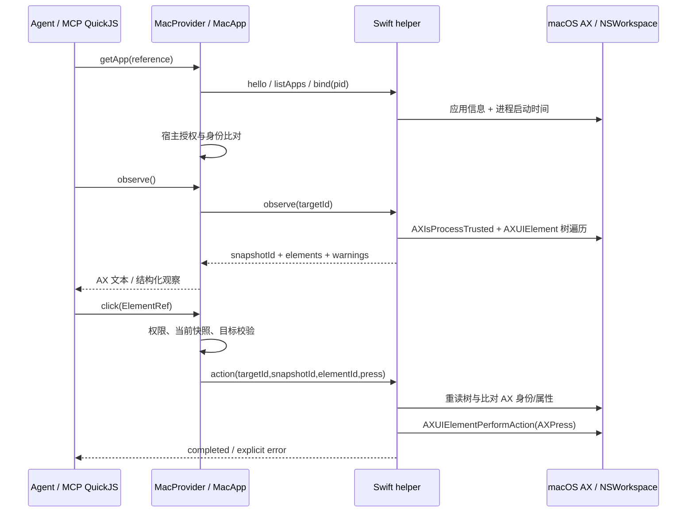

# macOS 原生后端：第一条独立链路

实现由 TypeScript Provider 和 Swift helper 组成，不调用 Sky 私有 IPC，也不复用 ChatGPT 内置可执行文件。构建要求 macOS 14+ 与 Swift 工具链。

```bash
npm run build:native
npm run build
```

SDK 配置 `nativeHelperPath` 为 `native/macos/.build/debug/cua-helper` 的绝对路径，并提供 `authorize`。可调用 `cua.listApps()`、`cua.getApp(bundleId | name | path | {pid})`。getApp 返回初始观察后的 MacApp；名称匹配有歧义必须指定 PID。直接使用 `MacProvider` 时，getApp 仅绑定，需显式 observe。

MCP 使用宿主环境变量：

```bash
export CUA_NATIVE_HELPER_PATH="$PWD/native/macos/.build/debug/cua-helper"
export CUA_ALLOWED_APPS='com.example.YourApp'
npm run mcp
```

当前 `MacApp` 支持 `observe/getAXState`、`click`（AXPress，不等价于坐标鼠标事件）、`setValue`（可写 AXValue）。新增 listWindows、captureScreenshot/getScreenshot 和 getAXStateAndScreenshot；截图实现尚待真实权限下验收。当前焦点 Unicode 输入、常用组合键、AX 文本选择及辅助动作已有实现，真实事件效果仍待验收；原生拖拽、滚动、右键、窗口管理仍未实现。

## 进程与协议



stdin/stdout 为逐行 JSON：`{id,method,params}` → `{id,result}` 或 `{id,error:{code,message}}`。hello 返回版本 1、平台、能力和当前权限。TS 持有私有子进程管道；不监听网络，不继承模型密钥。helper 串行处理；TS 对每个 target 排队，pending 请求限制 32。超时退休 helper，动作超时报告 ACTION_OUTCOME_UNKNOWN，不能自动重放。

helper 的目标绑定包含 NSRunningApplication 与 launchDate，防止 PID 重用。快照以随机版本编号，动作前重新遍历并比对 AX 元素身份/属性，状态变化拒绝执行。遍历最多 3000 节点、深度 80、约 5 秒预算；截断写 warnings，动作对不完整树拒绝执行。AX 调用自身也可能阻塞，时间预算不意味着实时保证。重读与动作之间仍有操作系统竞态，不宣称原子快照。

## 权限与本机验证

2026-11-03 实测：Swift helper 编译成功；hello 报 `accessibility=false`、`screenRecording=false`。应用发现、绑定、策略过滤、释放与权限拒绝测试通过。真实 AX 读取/动作 **未验收**；没有自动修改 TCC，也不弹权限请求。

macOS 系统设置 → 隐私与安全性 → 辅助功能，需要给实际运行 helper 的负责宿主授权（可能为 Terminal 或 Agent 宿主，具体由 TCC 判定）。授权后先重新启动进程确认 hello 的 accessibility=true，再运行：

```bash
npm run test:native
```

此命令构建专用 AppKit fixture，验证字段写入、AXPress、结果观察及旧引用拒绝。显式执行此验收命令但权限不足会 **失败**，不会跳过并误报成功。普通 `npm test` 不启动 GUI fixture；这项操作验收默认 skipped。屏幕录制授权不能代替辅助功能授权，原生截图已编译，但本机未授权，图像内容与缩放映射尚未验收。

仍需补齐：截图与坐标系实际验收、输入/滚动/拖拽、AXObserver 版本跟踪、授权 UI 整合、原生动作审计、进程崩溃/生命周期压力测试与完整兼容矩阵。


## ScreenCaptureKit 窗口截图增量

实现位于 `native/macos/Sources/CuaHelper/Capture.swift`。`SCShareableContent` 仅选择绑定进程的可见窗口，`SCContentFilter(desktopIndependentWindow:)` 限定单个窗口，`SCScreenshotManager.captureImage` 捕获并使用 ImageIO 编码 PNG。选择此过滤器依据 [Apple SCContentFilter 文档](https://developer.apple.com/documentation/screencapturekit/sccontentfilter)：它可限制捕获到指定窗口。

`listWindows()` 返回可捕获窗口 ID、标题和矩形。应用有多个窗口时，`captureScreenshot({windowId})` 必须明确 ID，不能自动截图其他窗口。每次截图返回 ID、PNG bytes、pixelWidth/pixelHeight、pointPixelScale、windowFrame、contentRect 和 capturedAt；坐标空间命名为 window-image-pixels，不能直接当成桌面全局点。截图前后再次确认进程与窗口矩形；移动/缩放/关闭拒绝为 STALE_OBSERVATION。

`getScreenshot` 只返回 PNG 字节；`captureScreenshot` 返回完整元数据。`observe({screenshot:true,windowId})` 在截图前后比对 AX 树，返回联合观察。SDK 通过 `MacProvider.getApp()` 只绑定时可独立使用截图；顶层 `Cua.getApp()` 会先做 AX 初始观察，因此仍要求辅助功能权限。

MCP 将原生 PNG 作为 image 内容发给调用端，metadata 作为 JSON 返回。图像最多 5 MiB，边长最多 8192、总像素最多 3200 万；超过预算显式错误。截图不显示鼠标、不包含窗口阴影。真实尺寸、颜色、遮挡与多显示器行为仍待授权后实际验收。

普通回归已验证无 Screen Recording 时 listWindows/captureScreenshot 明确拒绝；不会自动请求权限。获得辅助功能和屏幕录制权限后运行：

```bash
CUA_TEST_NATIVE_SCREENSHOT=1 npm run test:native
```

此模式在专用 fixture 上验证窗口 ID、PNG 魔数、尺寸及 AX+截图联合返回。当前未执行成功，因此不得把编译和权限拒绝测试当成截图功能验收。


## 原生输入增量

`Input.swift` 实现 typeText、pressKey、文本范围选择与辅助动作。每次原生输入都需要当前 AX 快照，helper 在发出动作前重新比对；selected text range 也纳入状态。输入后旧快照失效，调用者必须重新观察。

- `app.typeText(text)`：向绑定进程的当前焦点发送 Unicode CGEvent；每段不超过 20 个 UTF-16 单位，不能拆开代理对。
- `app.pressKey(chord)`：支持常用 US 虚拟键码与 Command/Control/Option/Shift 组合；super 映射 Command。非零 durationMs 当前显式不支持，等待可取消的原生输入调度。
- `app.selectText(element,text,{prefix?,suffix?})`：依据 AXValue 的 UTF-16 范围设置 AXSelectedTextRange，重复文本需消歧。
- `app.performSecondaryAction(element,name)`：仅接受元素公布的 AX action；额外支持 focus，通过 AXFocused 属性请求焦点。

键盘事件使用 CGEvent.postToPid，不切换成全局输入目标；返回 `outcome:dispatched` 与事件对数，不把投递视为应用已接受。需用新的 AX 观察确认内容。不同 App 可能忽略 Unicode 字符串，参见 [Apple keyboardSetUnicodeString 文档](https://developer.apple.com/documentation/coregraphics/cgevent/keyboardsetunicodestring%28stringlength%3Aunicodestring%3A%29)。背景 App 的行为没有在本机权限条件下得到验证。

Command Line Tools 环境没有 XCTest 模块，因此采用 helper 的 `--self-test` 检查纯编码逻辑；`tests/native.test.ts` 调用它，验证 emoji/中文重组与分段边界、组合键标志和未知键拒绝，不产生系统输入。真实 fixture gate 已扩展为 focus → 选择 Alice → 输入中文 emoji → Command+A → 替换，并等待观察证据；目前仍因辅助功能未授权而未验收。

最新全套：13 passed、1 native fixture skipped。此计数不能替代原生 App 行为验收。

## Clipboard backend increment

The helper now supplies private clipboardBegin/clipboardRestore leases for headed browser paste, with conditional change-count restoration. A permission-free named-pasteboard self-test is available with `cua-helper --clipboard-self-test`. Native App paste is now implemented with AXValue/selection verification, but live execution remains pending permission-gated validation. See [clipboard protocol and limits](CLIPBOARD.md).

## Native paste increment

`app.paste(text,{format?:'text'|'html'|'md',timeoutMs?:number})` uses the same process-wide clipboard queue as browser paste. Observe the focused editor first. The helper validates the snapshot/focus/selection before mutation and again before Command+V; it waits for the expected AXValue change. Result: `{outcome:'observed',verification:'AXValue',clipboardRestored:boolean}`. No observed matching change produces ACTION_OUTCOME_UNKNOWN. Secure or non-text AX editors are unsupported; arbitrary custom-editor paste and rich-format verification are not complete.

`cua-helper --paste-self-test` verifies UTF-16 replacement and invalid range handling without system input. The owned fixture gate now includes actual paste. Swift builds and the complete suite has 18 passing tests and one live native fixture skipped. Actual App paste is not verified on this machine without Accessibility.
