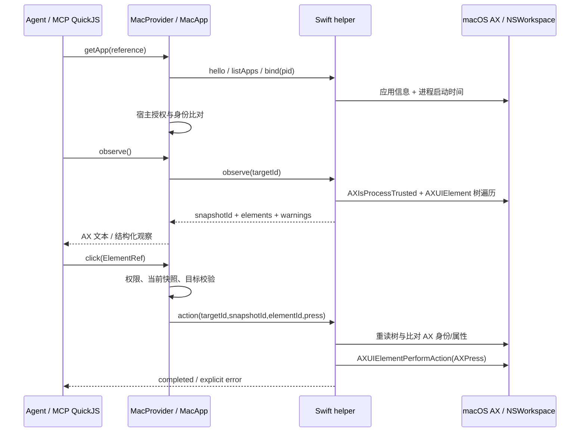

# macOS 原生后端：第一条独立链路

实现由 TypeScript Provider 和 Swift helper 组成，不调用 Sky 私有 IPC，也不复用 ChatGPT 内置可执行文件。构建要求 macOS 14+ 与 Swift 工具链。

```bash
npm run build:native
npm run build
```

SDK 配置 `nativeHelperPath` 为 `native/macos/.build/debug/cua-helper` 的绝对路径，并提供 `authorize`。可调用 `cua.listApps()`、`cua.getApp(bundleId | name | path | {pid})`。getApp 返回初始观察后的 MacApp；名称匹配有歧义必须指定 PID。直接使用 `MacProvider` 时，getApp 仅绑定，需显式 observe。

MCP 使用宿主环境变量：

```bash
export CUA_NATIVE_HELPER_PATH="$PWD/native/macos/.build/debug/cua-helper"
export CUA_ALLOWED_APPS='com.example.YourApp'
npm run mcp
```

当前 `MacApp` 支持 `observe/getAXState`、`click`（AXPress，不等价于坐标鼠标事件）、`setValue`（可写 AXValue）。未实现原生截图、键盘输入、拖拽、滚动、右键、窗口管理；不应将这些算作兼容完成。

## 进程与协议



stdin/stdout 为逐行 JSON：`{id,method,params}` → `{id,result}` 或 `{id,error:{code,message}}`。hello 返回版本 1、平台、能力和当前权限。TS 持有私有子进程管道；不监听网络，不继承模型密钥。helper 串行处理；TS 对每个 target 排队，pending 请求限制 32。超时退休 helper，动作超时报告 ACTION_OUTCOME_UNKNOWN，不能自动重放。

helper 的目标绑定包含 NSRunningApplication 与 launchDate，防止 PID 重用。快照以随机版本编号，动作前重新遍历并比对 AX 元素身份/属性，状态变化拒绝执行。遍历最多 3000 节点、深度 80、约 5 秒预算；截断写 warnings，动作对不完整树拒绝执行。AX 调用自身也可能阻塞，时间预算不意味着实时保证。重读与动作之间仍有操作系统竞态，不宣称原子快照。

## 权限与本机验证

2026-11-03 实测：Swift helper 编译成功；hello 报 `accessibility=false`、`screenRecording=false`。应用发现、绑定、策略过滤、释放与权限拒绝测试通过。真实 AX 读取/动作 **未验收**；没有自动修改 TCC，也不弹权限请求。

macOS 系统设置 → 隐私与安全性 → 辅助功能，需要给实际运行 helper 的负责宿主授权（可能为 Terminal 或 Agent 宿主，具体由 TCC 判定）。授权后先重新启动进程确认 hello 的 accessibility=true，再运行：

```bash
npm run test:native
```

此命令构建专用 AppKit fixture，验证字段写入、AXPress、结果观察及旧引用拒绝。显式执行此验收命令但权限不足会 **失败**，不会跳过并误报成功。普通 `npm test` 不启动 GUI fixture；这项操作验收默认 skipped。屏幕录制授权不能代替辅助功能授权，原生截图尚未实现。

仍需补齐：截图与坐标系契约、输入/滚动/拖拽、AXObserver 版本跟踪、授权 UI 整合、原生动作审计、进程崩溃/生命周期压力测试与完整兼容矩阵。
