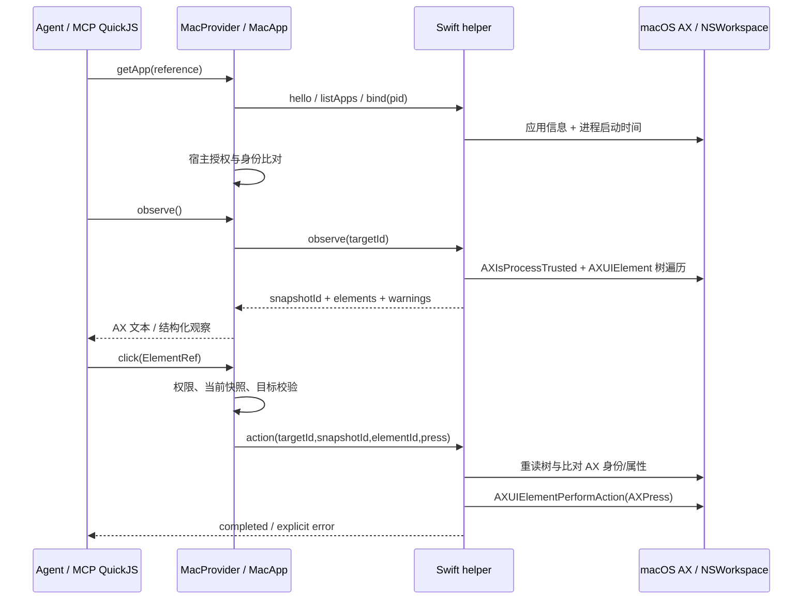

# macOS 原生后端：第一条独立链路

最新复核与未完成项见 [CURRENT-ACCEPTANCE.md](CURRENT-ACCEPTANCE.md)。本轮 helper 权限仍为 false；IPC 12 项与单独的 owned-App 启动 4 项通过。另确认 disableDiff 尚未接入原生观察实现。

## 当前能力与验收（2026-11-06 复核）

下面以 Rust 托管 Swift、使用原始 Sky IPC 的路径为准。本文后续按时间累积的记录包含早期“未实现”描述；对已被后续实现覆盖的能力，以本表和 `IMPLEMENTATION-STATUS.md` 为准，不能把历史状态当作当前状态。

| 能力 | 当前实现 | 当前验收边界 |
| --- | --- | --- |
| 应用发现、显式启动、状态读取时后台启动、复用已运行应用 | Swift `SkyIPC.swift` / `SkyAppState.swift`，原始 Sky 客户端调用 | 本轮四项真实 owned-App 测试通过：还原/安装包 JS 客户端 × 显式/状态读取启动；后台启动不抢前台、重复调用复用 PID、测试应用清理通过 |
| AX 状态与截图 | Swift 原生实现，Skyshot 返回 | 当前 helper 的 Accessibility 与 Screen Recording 均为 false；真实 UI 观察未验收。启动成功后观察返回权限错误不能算截图成功 |
| 键盘、鼠标点击、滚动、拖拽、AX 元素动作 | `SkyAppState.perform` 已分派到 Swift 原生输入实现 | 有协议/纯逻辑测试，真实系统输入效果仍待权限下验收；并非全部仍未实现 |
| 粘贴、格式处理与剪贴板恢复 | Swift 负责事务及原生动作，TS 保留调用绑定 | 原生逻辑/命名剪贴板测试已有覆盖，真实 App 粘贴效果未验收 |
| 音频录制 | `SkyIPC` 已分派 Start/Stop 到 `NativeAudioSession` | 不等于真实麦克风/系统音频和完整原版行为已验收 |

本轮复核命令：

```sh
npm run check:computer-permissions
CUA_TEST_NATIVE_APP_START=1 node --import tsx --test --test-name-pattern='owned App launch' reconstruction/native-sky-ipc.test.ts
```

启动验收使用临时专用 App，不操作用户应用。测试中的“installed”指安装包 JavaScript Sky 客户端连接我们的 Swift 服务，不是执行 ChatGPT 的原生服务。系统权限未被修改，也未弹出权限申请。`--check-computer` 的清单检查同样不能证明截图和输入可用。


## Existing adapter language migration

The legacy `@core/native-macos` adapter now forwards raw `text`/`format` to the Swift helper's `pasteFormatted` method. The TypeScript Markdown/HTML renderer has been removed. Swift renders, validates the observed editor, owns the clipboard transaction, verifies insertion and restores the clipboard. The old `pasteWithClipboard` wire method remains compatible for existing callers. This NDJSON method is an independent compatibility bridge, not a claim that the original Sky protocol includes it.

Validation: three restored-wrapper/adapter contract tests, native-macos TypeScript check, Swift build, native format bridge self-test and named-pasteboard transaction checks pass. Real App paste remains unaccepted pending OS permissions. Root `src/native/provider.ts` now also delegates paste formatting and transaction to Swift. The shared JS caller queue preserves browser/native ordering and rechecks abort before dispatch; it no longer acquires or restores native clipboard leases. See `LANGUAGE-MIGRATION-AUDIT.md` for remaining migration scope.


本文前半部分描述早期 TypeScript Provider + Swift helper 的 NDJSON 适配器，仍供现有调用方使用。后续新增了 Rust 托管 Swift 服务、接收原始 Sky 协议的迁移路径；当前能力与验收边界以 [IMPLEMENTATION-STATUS.md](IMPLEMENTATION-STATUS.md) 顶部汇总为准。原生原始函数体尚未恢复，不能将协议兼容当作完整还原。两条路径均不执行 ChatGPT 内置服务。构建要求 macOS 14+ 与 Swift 工具链。

当前 Rust/Swift 原生路径可直接选择：

```bash
npm run demo:deepseek -- --swift-computer --check-computer
```

该命令仅验收应用列表连接。截图、输入仍需单独验收，不能由预检成功推断。下方早期配置保留供旧适配器调用方参考。

```bash
npm run build:native
npm run build
```

SDK 配置 `nativeHelperPath` 为 `native/macos/.build/debug/cua-helper` 的绝对路径，并提供 `authorize`。可调用 `cua.listApps()`、`cua.getApp(bundleId | name | path | {pid})`。getApp 返回初始观察后的 MacApp；名称匹配有歧义必须指定 PID。直接使用 `MacProvider` 时，getApp 仅绑定，需显式 observe。

MCP 使用宿主环境变量：

```bash
export CUA_NATIVE_HELPER_PATH="$PWD/native/macos/.build/debug/cua-helper"
export CUA_ALLOWED_APPS='com.example.YourApp'
npm run mcp
```

当前 `MacApp` 支持 `observe/getAXState`、`click`（AXPress，不等价于坐标鼠标事件）、`setValue`（可写 AXValue）。新增 listWindows、captureScreenshot/getScreenshot 和 getAXStateAndScreenshot；截图实现尚待真实权限下验收。当前焦点 Unicode 输入、常用组合键、AX 文本选择及辅助动作已有实现，真实事件效果仍待验收；原生拖拽、滚动、右键、窗口管理仍未实现。

## 进程与协议



stdin/stdout 为逐行 JSON：`{id,method,params}` → `{id,result}` 或 `{id,error:{code,message}}`。hello 返回版本 1、平台、能力和当前权限。TS 持有私有子进程管道；不监听网络，不继承模型密钥。helper 串行处理；TS 对每个 target 排队，pending 请求限制 32。超时退休 helper，动作超时报告 ACTION_OUTCOME_UNKNOWN，不能自动重放。

helper 的目标绑定包含 NSRunningApplication 与 launchDate，防止 PID 重用。快照以随机版本编号，动作前重新遍历并比对 AX 元素身份/属性，状态变化拒绝执行。遍历最多 3000 节点、深度 80、约 5 秒预算；截断写 warnings，动作对不完整树拒绝执行。AX 调用自身也可能阻塞，时间预算不意味着实时保证。重读与动作之间仍有操作系统竞态，不宣称原子快照。

## 权限与本机验证

2026-11-03 实测：Swift helper 编译成功；hello 报 `accessibility=false`、`screenRecording=false`。应用发现、绑定、策略过滤、释放与权限拒绝测试通过。真实 AX 读取/动作 **未验收**；没有自动修改 TCC，也不弹权限请求。

macOS 系统设置 → 隐私与安全性 → 辅助功能，需要给实际运行 helper 的负责宿主授权（可能为 Terminal 或 Agent 宿主，具体由 TCC 判定）。授权后先重新启动进程确认 hello 的 accessibility=true，再运行：

```bash
npm run test:native
```

此命令构建专用 AppKit fixture，验证字段写入、AXPress、结果观察及旧引用拒绝。显式执行此验收命令但权限不足会 **失败**，不会跳过并误报成功。普通 `npm test` 不启动 GUI fixture；这项操作验收默认 skipped。屏幕录制授权不能代替辅助功能授权，原生截图已编译，但本机未授权，图像内容与缩放映射尚未验收。

仍需补齐：截图与坐标系实际验收、输入/滚动/拖拽、AXObserver 版本跟踪、授权 UI 整合、原生动作审计、进程崩溃/生命周期压力测试与完整兼容矩阵。


## ScreenCaptureKit 窗口截图增量

实现位于 `native/macos/Sources/CuaHelper/Capture.swift`。`SCShareableContent` 仅选择绑定进程的可见窗口，`SCContentFilter(desktopIndependentWindow:)` 限定单个窗口，`SCScreenshotManager.captureImage` 捕获并使用 ImageIO 编码 PNG。选择此过滤器依据 [Apple SCContentFilter 文档](https://developer.apple.com/documentation/screencapturekit/sccontentfilter)：它可限制捕获到指定窗口。

`listWindows()` 返回可捕获窗口 ID、标题和矩形。应用有多个窗口时，`captureScreenshot({windowId})` 必须明确 ID，不能自动截图其他窗口。每次截图返回 ID、PNG bytes、pixelWidth/pixelHeight、pointPixelScale、windowFrame、contentRect 和 capturedAt；坐标空间命名为 window-image-pixels，不能直接当成桌面全局点。截图前后再次确认进程与窗口矩形；移动/缩放/关闭拒绝为 STALE_OBSERVATION。

`getScreenshot` 只返回 PNG 字节；`captureScreenshot` 返回完整元数据。`observe({screenshot:true,windowId})` 在截图前后比对 AX 树，返回联合观察。SDK 通过 `MacProvider.getApp()` 只绑定时可独立使用截图；顶层 `Cua.getApp()` 会先做 AX 初始观察，因此仍要求辅助功能权限。

MCP 将原生 PNG 作为 image 内容发给调用端，metadata 作为 JSON 返回。图像最多 5 MiB，边长最多 8192、总像素最多 3200 万；超过预算显式错误。截图不显示鼠标、不包含窗口阴影。真实尺寸、颜色、遮挡与多显示器行为仍待授权后实际验收。

普通回归已验证无 Screen Recording 时 listWindows/captureScreenshot 明确拒绝；不会自动请求权限。获得辅助功能和屏幕录制权限后运行：

```bash
CUA_TEST_NATIVE_SCREENSHOT=1 npm run test:native
```

此模式在专用 fixture 上验证窗口 ID、PNG 魔数、尺寸及 AX+截图联合返回。当前未执行成功，因此不得把编译和权限拒绝测试当成截图功能验收。


## 原生输入增量

`Input.swift` 实现 typeText、pressKey、文本范围选择与辅助动作。每次原生输入都需要当前 AX 快照，helper 在发出动作前重新比对；selected text range 也纳入状态。输入后旧快照失效，调用者必须重新观察。

- `app.typeText(text)`：向绑定进程的当前焦点发送 Unicode CGEvent；每段不超过 20 个 UTF-16 单位，不能拆开代理对。
- `app.pressKey(chord)`：支持常用 US 虚拟键码与 Command/Control/Option/Shift 组合；super 映射 Command。非零 durationMs 当前显式不支持，等待可取消的原生输入调度。
- `app.selectText(element,text,{prefix?,suffix?})`：依据 AXValue 的 UTF-16 范围设置 AXSelectedTextRange，重复文本需消歧。
- `app.performSecondaryAction(element,name)`：仅接受元素公布的 AX action；额外支持 focus，通过 AXFocused 属性请求焦点。

键盘事件使用 CGEvent.postToPid，不切换成全局输入目标；返回 `outcome:dispatched` 与事件对数，不把投递视为应用已接受。需用新的 AX 观察确认内容。不同 App 可能忽略 Unicode 字符串，参见 [Apple keyboardSetUnicodeString 文档](https://developer.apple.com/documentation/coregraphics/cgevent/keyboardsetunicodestring%28stringlength%3Aunicodestring%3A%29)。背景 App 的行为没有在本机权限条件下得到验证。

Command Line Tools 环境没有 XCTest 模块，因此采用 helper 的 `--self-test` 检查纯编码逻辑；`tests/native.test.ts` 调用它，验证 emoji/中文重组与分段边界、组合键标志和未知键拒绝，不产生系统输入。真实 fixture gate 已扩展为 focus → 选择 Alice → 输入中文 emoji → Command+A → 替换，并等待观察证据；目前仍因辅助功能未授权而未验收。

最新全套：13 passed、1 native fixture skipped。此计数不能替代原生 App 行为验收。

## Clipboard backend increment

The helper now supplies private clipboardBegin/clipboardRestore leases for headed browser paste, with conditional change-count restoration. A permission-free named-pasteboard self-test is available with `cua-helper --clipboard-self-test`. Native App paste is now implemented with AXValue/selection verification, but live execution remains pending permission-gated validation. See [clipboard protocol and limits](CLIPBOARD.md).

## Native paste increment

`app.paste(text,{format?:'text'|'html'|'md',timeoutMs?:number})` uses the same process-wide clipboard queue as browser paste. Observe the focused editor first. The helper validates the snapshot/focus/selection before mutation and again before Command+V; it waits for the expected AXValue change. Result: `{outcome:'observed',verification:'AXValue',clipboardRestored:boolean}`. No observed matching change produces ACTION_OUTCOME_UNKNOWN. Secure or non-text AX editors are unsupported; arbitrary custom-editor paste and rich-format verification are not complete.

`cua-helper --paste-self-test` verifies UTF-16 replacement and invalid range handling without system input. The owned fixture gate now includes actual paste. Swift builds and the complete suite has 18 passing tests and one live native fixture skipped. Actual App paste is not verified on this machine without Accessibility.

## Native desktop language evidence and text migration (2026-11-06)

Static inspection located the bundled SkyComputerUseService executable under
@oai/sky/Codex Computer Use.app. It contains ComputerUse/ComputerUseIPCServer.swift,
service-specific Swift source paths and Swift runtime links. The reproducible
`audit-desktop-language.py` records the binary hash and restricted provenance in
`desktop-language-evidence.json`. This establishes native Swift participation,
not recovered native bodies or the language of every dependency.

The restored JS getAppState/window_result path receives native skyshot.text.
Our independent client previously rendered its own AX element text in TS. That
rendering, secure-value omission, warnings and missing-screenshot text now live in
Swift ObservationText.swift; the TS adapter validates and preserves native text.
Missing native text fails before enabling input state, so older helper binaries
must be rebuilt with `npm run build:native`. No guessed native-to-TS formatter
fallback remains. The formatter still expresses the independent helper contract,
not original text/diff parity.

Swift build and observation-text self-test pass (hierarchy/actions/selection,
escaping/Unicode, secure-value omission and warnings), as do 28 TS adapter tests
and native-macos typecheck. Rebuilding reconstructed packages passes. Read-only
permission status for this host remains accessibility=false, screenRecording=false;
no real App UI acceptance or TCC change is claimed. Native process ownership,
Swift service IPC alignment and Rust/App runtime composition remain open.

## Swift service using the original Sky wire contract (2026-11-06)

`SkyIPC.swift` adds an explicitly selected `--sky-socket <absolute path>` mode to
the independent Swift helper. It implements the observed four-byte little-endian
8 MiB-bounded JSON-RPC frames, CodexComputerUseIPC-5 ping/version exchange and
request envelope. It validates negotiation/deadline, rejects unknown operations,
and serves ComputerUseIPCListAppsRequest through NSWorkspace. No vendor service
is launched or impersonated. A private user-owned socket parent and same-user
peer are required. This is not the vendor's sender authentication/session policy.

Four live protocol cases pass: both the installed JS MacComputerUseClient and
restored TS client can ping/list apps; malformed ordering/version/deadline and
oversized frames fail; and actual restored CUA inventory traverses MCP, Rust's
sandboxed workers, the unchanged @core/sky/service, Rust native-pipe routing and
the Swift endpoint. Closing the Rust workers closes the connection, the owned
one-connection Swift process exits normally, and its socket is removed. App names
and machine inventory are not published in the acceptance report. 29 Rust tests,
28 adapter tests and the Swift text self-test also pass.

Run `npm run test:native-ipc` on this Mac to build prerequisites and enable these
otherwise skipped integration cases. The original-JS comparison requires the
installed ChatGPT app artifact. No model request, app launch, input, screenshot
or permission prompt is performed by this gate.

This is a protocol/ownership migration checkpoint, not full native App support.
Policy requests, app startup/state/action/audio dispatch and original formatting
still need native implementation; unsupported requests explicitly fail. The test
harness currently owns service launch. Production Rust service supervision,
launch-services integration, native sender/approval policy and replacing the old
TS helper-spawn adapter remain open. The default demo route is unchanged.


## Rust-owned Swift service lifecycle (2026-11-06)

The standalone Rust MCP configuration now accepts `native_service: {helper,
directory}`. Rust creates a private socket directory, starts the Swift helper,
awaits its readiness frame, injects the socket path into only the trusted worker
and adds that path to the native-pipe allowlist. `js_reset` and MCP shutdown retire
the workers and service and remove the owned directory; the next call starts a
fresh service. No test-side prelaunch is required. Foundation can normalize
/private/tmp to /tmp, so readiness compares canonical socket paths.

The four native IPC cases pass, including the installed original JS client. The
Rust-path case verifies three owned child PIDs, reset retirement, fresh replacement
PIDs and final cleanup. All 29 Rust regression tests also pass. This verifies app
inventory and lifecycle only: app policy/start/state/action dispatch, vendor sender
authentication and production launch-services integration remain open. The default
demo selection is unchanged. This is independent native reconstruction using
observed contracts, not recovery of unavailable original native function bodies.


## Native App policy dispatch (2026-11-06)

`ComputerUseIPCAppPolicyRequest` now dispatches to Swift `SkyAppPolicy`, resolving
an installed app name, bundle ID or path through the native LaunchServices adapter.
It returns the observed `decision`, `allowPersistentApproval` and target
`appPath/bundleIdentifier/displayName/risk/warningSubtitle` schema. Invalid app
references produce -10010; malformed request arguments produce -32602.

The source-derived policy boundary is preserved: native policy is evaluated first;
the restored Sky JS/TS `computer-use-policy` then performs MCP elicitation, rejects
decline/cancel, and substitutes the resolved app path before an operation. An
`allowed` policy is **not** approval. Denied/forbidden policies never elicit.

The original native policy database/default rules are unavailable. Standalone
rules are therefore explicit Rust-owned configuration, serialized to the Swift
service in CORE_CUA_APP_POLICY, not injected into the kernel or inferred from
model output. Example field inside `native_service`:

```json
{"app_policy":{"com.example.Target":{"decision":"allowed","risk":"high","allowPersistentApproval":false}}}
```

Supported decisions are allowed/denied/forbidden; risk is high/low; optional
warningSubtitle is preserved. Missing bundle IDs default to denied. This default
and storage mechanism are independent deployment choices, not claims about Codex
policy defaults. No vendor safety catalog, enterprise policy inheritance or sender
authentication has been reconstructed by this change.

Both the installed original JS client and the restored TS client pass native
policy tests for allowed/forbidden/unconfigured apps and invalid app paths. The
actual MCP/Rust/sandboxed-worker/Sky/Swift chain checks policy response metadata,
asks approval for an allowed fixture app, and verifies decline stops execution.
Forbidden/unconfigured fixtures fail before elicitation. Fixtures are temporary
.app metadata bundles: no application is launched and no UI permission requested.
The four IPC tests and 29 Rust regression tests pass. App start/skyshot/action
requests remain explicitly unsupported on this original-protocol service route.


## Native Sky app-state dispatch (2026-11-06)

`ComputerUseIPCAppGetSkyshotRequest` now dispatches to Swift `SkyAppState`.
The service re-evaluates native app policy, resolves a unique running app by bundle
ID plus canonical bundle path, checks Accessibility and Screen Recording without
prompting, and invokes the shared Swift AX/window-capture implementation. It
returns the original client schema: app bundle ID/PID and skyshot text plus PNG
data URL/mimeType. Requests for a non-running app fail explicitly; implicit app
startup has not been implemented or inferred from the client request name.

The existing observeWithScreenshot consistency check was extracted into
Target.observeWithScreenshot and is shared with the old NDJSON route. A failed
capture, changing AX tree, or expired reply invalidates the target observation.
The socket server now awaits MainActor dispatch so async ScreenCaptureKit work
can complete without keeping the main actor blocked in the socket read loop.

Protocol errors are separated from native failures: invalid application -10010,
native policy denial -10006, no running application -10007, ambiguous application
-10018, missing permissions -10009, and AX/capture failures -10008. These mappings
use the original error-code vocabulary; precise vendor failure classification is
not proven. disableDiff accepts only booleans; the independent renderer currently
returns a full snapshot for both values. Original incremental diff formatting,
app-specific instructions, native session policy and full source parity remain open.

Verification: four IPC cases pass, including original-installed/restored client
error behavior and real Rust/MCP approval followed by native app-state dispatch.
29 existing native adapter tests and the Swift observation-text self-test pass.
A separate real capture gate is available as `npm run test:native-skyshot`; it
packages and launches only the owned CuaFixture app and checks actual AX text and
PNG bytes with both installed and restored clients. Explicitly running that gate
currently fails both cases at the permission precheck (Accessibility=false,
ScreenRecording=false), before app launch. It is **not** a successful screenshot
acceptance; the normal protocol run skips those two opt-in cases. No permission
dialog or user-app operation was performed. Default DeepSeek demo routing remains
unchanged, and native start/action support and old adapter retirement remain open.


## Explicit native AppStart dispatch (2026-11-06)

`ComputerUseIPCAppStartRequest` now dispatches to Swift LaunchServices through
SkyAppState.start. It resolves and checks native policy, invalidates the target's
old observation, revalidates the resolved path/bundle before launch, and checks
the returned application identity. It reuses an existing application instance.
The reply contains app bundle ID/PID using the observed MacWindowAppState type's
optional-skyshot form. No fake screenshot is returned. A post-launch timeout
explicitly reports that the application may already be running.

Source evidence: a search of installed @oai JS/declarations found startApp and
ComputerUseIPCAppStartRequest only in the duplicated cua/sky mac client files.
The restored client envelope is already differentially compared with installed
JS. This establishes a distinct explicit start request, **not** proof that the
unavailable original native GetSkyshot implementation never launches an app.
Our read-state path still requires a running app; original implicit-start behavior
and precise AppStart response contents remain unresolved. No new CUA public method
or model-side automatic launch fallback has been invented.

Added `npm run test:native-app-start`: it builds a uniquely identified temporary
CuaFixture .app and calls startApp through both restored TS and installed original
JS clients. Both actual LaunchServices cases pass: the app is running at the
expected bundle path, a second start returns the same PID, and cleanup terminates
only that unique fixture and waits for its exit. In the current permission-denied
environment, both clients also receive -10009 for that running app's skyshot.
Four IPC cases and four original-client differential tests pass. Full screenshot
acceptance remains blocked by host permissions; input/action protocol dispatch
and production demo integration remain open. This live launch proof applies to
the explicit native client route, not an end-to-end DeepSeek getApp experience.

Native error handling now distinguishes malformed JSON (-32700) from unexpected
native errors (-10005), instead of labeling LaunchServices failures as invalid
JSON. Failed state refresh after identity resolution invalidates only the resolved
app's observation, and terminated app handles are pruned.


## Native element action dispatch (2026-11-06)

ComputerUseIPCAppPerformActionRequest now decodes the original client enum-shaped
setValue, selectText and performSecondaryAction payloads in Swift. The native
adapter maps elementID strings and text-selection fields to the shared Target AX
implementation. Native policy is rechecked; execution requires the resolved app's
current native snapshot and matching identity. Target.validateSnapshot rereads
and compares the AX tree before input. A completed or failed attempted operation
invalidates the snapshot; another action requires a fresh observation. A late
reply reports potential execution rather than silently retrying.

Four IPC tests pass with both original installed JS and restored TS clients,
including all three action envelopes, missing-observation errors, policy denial
and invalid selection mode. These cases verify protocol/guard behavior, not actual
input. The opt-in test:native-skyshot gate now additionally sets fixture text,
checks a second stale action is rejected, observes the actual new text, selects
a two-UTF16-unit emoji, and checks focus. Running it currently fails its two cases
at the permission precheck, before UI work. Actual input is therefore **unverified**.

The native ID allocator, snapshot-expiry policy and missing-observation mapping
to -10011 are independent implementation choices using the observed error/schema
vocabulary; original native semantics are not proven. Click, keyboard, scroll,
drag, paste and audio original-protocol dispatch remain unsupported. The existing
native engines for those operations remain available for subsequent migration;
no duplicate TS event implementation was introduced.


## Native keyboard request dispatch and selection correction (2026-11-06)

The original `type: {_0: text}` and `pressKey: {_0: chord, duration: seconds}`
action envelopes now dispatch through Swift Target.keyboardInput. The native
adapter converts seconds to the existing millisecond parameter and retains the
existing 0..30 second independent hold limit, Unicode chunking and held-key release
logic. Original PressKey.d.ts documents X keysym-style chords (e.g. Super_L+d),
not a guaranteed cmd alias; tests use Super+a. Keyboard requests require a current
observation and invalidate it after execution. Deadlines are checked after AX
validation and before each key-down; an already posted key is still released to
the original process on interruption. This is not a claim of hard real-time timing
or original native keyboard implementation parity.

Also fixed an actual mapping defect from the preceding element-dispatch change:
original selectText.text must populate the existing Swift helper's `value` field,
not `text`. `--sky-action-self-test` now exercises that mapping against the real
UTF-16 selection-range helper, verifies emoji length, Unicode payload preservation,
seconds-to-milliseconds conversion, and rejects bool/string/invalid durations.
The existing held-input self-test verifies release on interruption. Both pass;
Swift builds and all four IPC cases pass with original/restored keyboard request
envelopes, policy denial, missing observation and negative duration handling.

The live skyshot gate additionally selects all and types Unicode into its owned
fixture field, then checks actual observed text. That expanded UI case has not
been accepted: host TCC permissions blocked prior live runs. No passing protocol
or pure native self-test is counted as evidence of actual keyboard events.
Mouse/click/scroll/drag/paste/audio original-protocol dispatch, full native parity
and production demo replacement remain outstanding.


## Native click dispatch (2026-11-06)

Original Click.d.ts defines coordinates in the app-window screenshot and element
indices from the latest app-state text. The original client emits a click enum
with `at.elementID._0` or `at.coordinate._0`, numeric mouse button 0/1/2, count,
optional modifier chord and hold seconds. Swift now decodes both target variants,
checks numeric types/count/button/duration, and dispatches to Target.mouseInput.
The existing engine revalidates AX state; coordinate clicks additionally check
captured window identity/frame, capture geometry/scale and captured focus before
mapping screenshot pixels. Mouse-down is not begun after the request deadline;
release handling remains shared with held keyboard input.

Swift build, native action-mapping self-test, existing input/held-release self-tests
and four IPC tests pass. Both installed JS and restored TS clients exercise element
and coordinate click envelopes and reject fractional counts. The native decoder
self-test creates the expected middle-button down/up pairs for a double click.
The opt-in UI gate now clicks the fixture Save button and checks its visible saved
text after keyboard entry. That gate remains unaccepted; neither synthetic events
nor protocol guards prove real coordinate accuracy or real UI click effects.
Scroll/drag/paste/audio and production adapter retirement remain outstanding.


## Native scroll dispatch (2026-11-06)

The original scroll action's at.elementID/coordinate, direction and pages now
share pointer-target decoding with click and dispatch to Swift Target.scrollInput.
Both original and restored clients pass normalized direction/fractional page and
coordinate-envelope checks. Numeric booleans and nonpositive pages are rejected;
policy denial remains enforced. The native loop checks identity and deadline
before each wheel event and invalidates the snapshot after attempted input.

The existing viewport selection and page-distance engine is reused. One page is
an observed viewport extent in this independent implementation; the original
hidden native distance/acceleration policy is **not** known. A native self-test
passes a decoded half-page right scroll into real CGEvent construction and checks
pixel-delta axis/distance (point-delta fields, not line-delta fields). Swift build,
the action mapping/input self-tests, and all four IPC cases pass.

The owned live fixture now runs its scroll-area layout, and the skyshot gate asks
for a downward half-page scroll then checks the fixture's actual NSScrollView
bounds-change event. That UI case has not passed acceptance; it remains gated with
the screenshot/input tests that previously failed host permission prerequisites.
Protocol/self-test results are not proof of on-screen scrolling or native source
parity. Drag/paste/audio and production integration remain outstanding.


## Native drag dispatch (2026-11-06)

The original Drag.d.ts identifies both endpoints as app-window screenshot
coordinates. The original client emits drag.from/to arrays; Swift now validates
exactly two finite non-boolean coordinates per endpoint and maps them to the
existing Target.dragInput engine. Both endpoints are checked against the current
capture before mouse-down. The engine retains captured-window and snapshot checks,
PID identity checks and release at the last dispatched position on cooperative
interruption. Deadline checks happen before mouse-down and around each interpolation
wait; cleanup still uses identity-only validation so expiry does not suppress release.

Swift build, native payload mapping and drag/interrupted-release self-tests pass,
as do four IPC cases including both original and restored client drag envelopes.
The expanded owned live fixture gate computes points on its fixed gesture-pad
layout from PNG dimensions and waits for actual pad-up with drag movements. This
UI case has not passed acceptance and is not counted as verified coordinate input.
The existing 20-step interpolation/10ms pacing remains independently authored,
not recovered original native timing. Forced process termination cannot guarantee
cooperative release. Paste/audio and production demo migration remain open.


## Native paste dispatch and format processing (2026-11-06)

Original Paste.d.ts requires text/md/html insertion followed by clipboard restore.
The original Sky JS wrapper forwards text/format without conversion. That request
now decodes and renders in Swift, validates the focused AX editor before clipboard
mutation, and invokes the existing withNativeClipboard + pasteInput transaction.
Verification is bounded by the request deadline. Successful execution returns null
through the original void envelope; unobserved paste effects or failed restore
remain errors, never automatic retries.

Native format rendering reuses [Ink](https://github.com/JohnSundell/Ink) 0.6.0
(Markdown to HTML) and [SwiftSoup](https://github.com/scinfu/SwiftSoup) 2.9.6
(string HTML parsing/cleanup). Both are exact-pinned with Package.resolved. These
are independent native implementation dependencies, **not** recovered vendor
native dependencies. Raw Markdown remains the plain-editor fallback; cleaned HTML
is offered to rich editors. HTML input gets extracted plain text. Renderer dialect,
whitespace and sanitization can differ from the earlier marked/sanitize-html TS
adapter and from the unknown vendor renderer. No HTML resource loading is used.

Swift build, three native checks (formats, named-pasteboard transaction, UTF-16
replacement) and all four IPC cases pass. Named-board checks exercise text/md/html,
restore on success/error/cancellation, and preservation of external changes; they
do not touch the general clipboard. Original and restored clients exercise all
three format envelopes and invalid-format rejection. The live fixture gate now
pastes Unicode into its own field and checks the observed value; this UI case has
not passed acceptance. Rich-editor rendering remains unverified. Cooperative
restoration does not guarantee recovery after forced process termination; native
shutdown during an active paste is a remaining lifecycle gap.

The old packages/native-macos/src/paste-content.ts renderer is still used by its
legacy adapter; its callers must migrate before deletion. Audio, native policy/
session parity, production demo integration and whole-repository retirement work
remain open.


## Cooperative native termination cleanup (2026-11-06)

Swift Sky service launch now uses runNativeService: SIGTERM/SIGINT cancel the
service task instead of bypassing native defers. Signal dispatch does not itself
mutate the clipboard. Cancellation propagates through async paste/input and lets
withNativeClipboard restore its lease before exit. Socket accept/read/write waits
poll cancellation; accepted sockets are nonblocking so a partial frame or stalled
peer does not indefinitely prevent cooperative shutdown. Normal EOF also keeps
existing socket cleanup. Rust permits a 2-second service termination grace before
its existing process-group kill fallback (worker grace remains unchanged).

Nine IPC/lifecycle cases pass. Two actual subprocess cases send SIGTERM/SIGINT
while a transaction owns a **named** pasteboard, then require restored-content
evidence and exit code 0 (not signal death). Three other cases interrupt accept,
partial header and partial body waits and require normal exit/socket removal.
The original/restored client cases and actual Rust-worker reset/restart/close case
also pass. Swift and Rust release builds pass. No general clipboard was changed.

These prove cooperative signal cleanup for the tested transaction and I/O states,
not a real app paste under cancellation, forced SIGKILL recovery, crash recovery,
or completion of unresponsive native APIs. The 2-second fallback can still kill
an uncooperative service before cleanup; that limitation is not hidden by the
successful signal tests. Native App UI acceptance and production demo migration
remain open. The timeout and signal strategy are independently implemented rather
than recovered original supervisor/native function bodies.


## Opt-in Rust/Swift demo runtime and write-backpressure acceptance (2026-11-06)

The shared demo runtime factory now supports explicit computer surfaces through
Rust + the Swift native service, keeping the original @core/sky/service. Set
CORE_CUA_NATIVE_BACKEND=swift and CUA_RUNTIME_SUPERVISOR=rust. The factory owns
private runtime configuration, forwards explicit native policy only to the native
service, and keeps model credentials out of worker environments. Browser-only
callers retain the compatibility export. Mixed browser/computer assembly exists,
but the combined surface has not received full acceptance. The old TS native
adapter and installed default have not been retired.

A tested read-only entry (after build:reconstruction, build:native and
build:rust-runtime) is:

```bash
CUA_RUNTIME_SUPERVISOR=rust CORE_CUA_NATIVE_BACKEND=swift \
CUA_MCP_ENV='{"CUA_REPL_ENABLED_SURFACES":"computer"}' \
node --env-file=.env --import tsx packages/agent-loop/src/restored-demo.ts --check-computer
```

For a real model loop, add CUA_MODEL_PROVIDER=deepseek and replace --check-computer
with a prompt. One live DeepSeek run explicitly called js -> cua.listApps -> the
original Sky client -> Rust native pipe -> Swift, returned a fresh timestamp/count,
and produced a final answer. It used /nonexistent/vendor as the installed supervisor
path to verify that executable was unnecessary. No app names/window contents were
sent as tool output, and no application was started or operated. An earlier model
run answered from the host preflight count; that alone was not counted as proof of
a model-issued tool call. The model's extra prose on the second run inaccurately
suggested cua was absent, despite successful use; tool evidence is authoritative.

CORE_CUA_APP_POLICY is an explicit JSON bundle-ID rule map as documented above;
empty defaults deny app operations but permit inventory. App operations still
require original Sky elicitation and OS permissions. Computer-only mode ignores
unrelated browser endpoints inherited from .env, correcting a real CLI failure.
No .env or session logs are committed. The new route is opt-in and is not proof
that arbitrary natural-language app operations, screenshot/input, or audio work.

The native IPC acceptance now uses this production factory instead of a duplicate
hand-written runtime spec. Eleven IPC/lifecycle cases pass, including two added
real SIGTERM/SIGINT writer tests: a private socketpair is filled until EAGAIN,
the production writer waits against the unread receiver, then cancellation must
complete with exit code 0. The existing isolated Rust/CDP browser regression and
AgentLoop TypeScript check also pass. The CLI --check-computer and the real
DeepSeek loop exited successfully. Full UI acceptance and native parity remain open.


## Standard npm entry for Rust/Swift (2026-11-06)

The normal DeepSeek launcher now accepts `--swift-computer`:

```bash
npm run demo:deepseek -- --swift-computer --check-computer
npm run demo:deepseek -- --swift-computer "Call cua.listApps({emit:false}) and return only the application count."
```

The flag selects the Rust runtime and Swift native backend, builds the relevant
native/runtime prerequisites, and uses the original Sky service. Project .env is
loaded by the existing launcher. Explicit Swift selection overrides stale browser
surface/native-backend fields inside CUA_MCP_ENV while preserving other string
configuration; conflicting browser deployment/surface flags fail before build.
The existing --computer behavior is unchanged. Native app policy still defaults
to denied unless configured, and OS permissions/elicitation are still required
for app operations. This flag is not automatic approval or a browser fallback.

The exact npm --swift-computer --check-computer command passed against the real
Rust/Swift runtime and exited successfully with no model request or App action.
The launcher routing test passes normal browser/CDP cases, Swift prompt/check flag
orders, stale .env selection, and conflicts. The prior direct-entry DeepSeek tool
round trip remains the model-path evidence; this turn did not spend another model
request. Screenshot/input/audio and complete legacy retirement remain open.

### Root native paste migration validation

Root `MacApp.paste` now calls `pasteFormatted` with raw text/format, checks the native insertion/restoration result and invalidates the observation before dispatch. It does not parse HTML/Markdown or acquire/restore clipboard leases. The public low-level `NativeClipboard` binding remains for compatibility. Writer timeouts for both native paste transaction methods report `ACTION_OUTCOME_UNKNOWN` and retire the helper.

Root typecheck passes. Four mock-transport tests cover raw format forwarding, authorization/abort rejection, snapshot invalidation and incomplete restoration, plus browser/native queue ordering and cancellation while queued. Native timeout retirement tests and existing clipboard tests pass (including isolated browser paste). These do not prove real App insertion. Root imports/build remain the legacy NodeNext arrangement and need migration with public API retirement. Cross-process paste arbitration remains a gap; same-process caller queue is not a native interprocess lock. Legacy NDJSON now participates in cooperative signal cleanup as detailed below.

### Legacy NDJSON cooperative shutdown

`NativeStdio.swift` replaces blocking `readLine`/`print` with bounded nonblocking stdin/stdout and cancellation-aware polling. The compatibility service now runs under the same native SIGTERM/SIGINT cancellation runner as Sky sockets; cleanup attempts active clipboard restoration on EOF, failure or cooperative cancellation. Partial lines cannot indefinitely block shutdown, and unterminated input is bounded before JSON parsing. SIGPIPE becomes an output error so cleanup can run. This is an independently implemented compatibility transport, not original Sky wire protocol.

Verification: Swift build; six real stdio subprocess cases (SIGTERM/SIGINT idle and partial-line shutdown, fragmented/final-line EOF, oversized unterminated input); root writer timeout test; two existing named-pasteboard transaction SIGTERM/SIGINT cases. These prove transport cancellation and transaction cancellation separately, not real App input or a saturated stdio-output integration case. SIGKILL/crash/unresponsive OS calls remain outside cooperative cleanup guarantees.

### Native audio reconstruction: encoder stage only

Observed JS contract: `targets/mac/audio_recording.js` validates integer duration 100–300000 ms (default 60000), requests computer-audio approval before native start, and reads a local file URL returned by native stop. `types/window/StopAudioRecording.d.ts` specifies a 24 kHz stereo WAV. The JS wrapper remains TS; audio processing belongs to the native layer. Original native audio function bodies and capture implementation are unavailable.

`AudioWriter.swift` now uses Apple's AVAudioConverter/AVAudioFile to convert PCM into 24 kHz, stereo, 16-bit WAV. It limits output frames to the approved maximum duration, refuses existing output paths, creates mode-0600 files, rejects empty captures and records conversion failures. Callers must serialize access and supply a private output directory. This is independent native implementation, not a claim of vendor library or codec parity beyond the observed output contract.

Swift build and a synthetic native test pass: 48 kHz channel-separated tones are converted and read back to check RIFF/WAVE, rate, channels, bit depth, frame limit and channel energy. The test also verifies private permissions, refusal to overwrite, and rejection of empty output. No system audio or microphone is captured.

At this encoder-only checkpoint capture/routing were still missing. The subsequent native audio integration below supersedes this checkpoint; real capture acceptance remains incomplete.

### Native audio start/stop integration (not live-capture acceptance)

`AudioCapture.swift` uses ScreenCaptureKit audio output, copies PCM samples on a serial queue and feeds the native WAV encoder. It does not register a microphone output. Start validates the original duration contract, performs a non-prompting Screen Recording permission preflight, checks the request deadline around asynchronous startup, and refuses overlapping recordings. A duration timer finalizes the stream; explicit stop returns the original `{url: fileURL}` shape. The service closes recordings and removes its private audio directory on connection closure or cooperative cancellation. Empty or failed recordings return an error rather than fabricated audio. This independently authored native lifecycle is not recovered Swift source.

The Rust demo configuration now creates a dedicated private native-artifact directory. Only the trusted worker receives its read grant; the kernel does not. Original Sky JavaScript can read the returned file URL within the trusted service without granting access to the broader runtime/config directory. Real recorded-file consumption through this sandbox is still pending acceptance.

Current installed `audio_recording.js` has no automatic `attachComputerAudio` call. Removed the reconstruction's extra `SKY_AUDIO_ATTACHMENTS` branch to match that source. Corrected differential tests to resolve exported names from declarations instead of stale minified local names. Eight Mac wrapper/policy/telemetry differential tests pass, including approval before start and stop reading synthetic file bytes without extra host calls.

Verification: Swift build, synthetic WAV test, Sky and AgentLoop typechecks, 11 existing native IPC/lifecycle tests (4 real-App tests explicitly skipped). Installed and restored Sky clients both exercise stop-without-recording and invalid-duration failures without audio capture or files. The Rust sandbox integration also verifies trusted-only artifact directory configuration. No real system audio was recorded.

Synthetic lifecycle coverage has since been added as detailed below. Still required: real permission denial and explicitly authorized capture acceptance, large-recording transport against runtime response/frame limits. Native code is wired but those outcomes are not yet proved; do not describe audio as fully working.

### Native audio lifecycle evidence

The production `NativeAudioSession` now separates its native capture backend from session state. Default construction always uses ScreenCaptureKit; only internal constructor injection permits synthetic tests, with no request/environment override. Expired starts are rejected before creating a backend. If startup finishes after session close or caller cancellation, its capture is finalized/discarded and never installed as active. Failed finalization also explicitly discards backend artifacts.

`AudioLifecycleSelfTest.swift` runs the real session/timer/task implementation with a synthetic PCM backend and real native WAV encoder. It verifies: no recording/expired-start rejection, overlapping start rejection, automatic stop followed by explicit result retrieval, one finalization shared by concurrent stops, error propagation with subsequent restart, close stopping/discarding active capture and removing all files, late-start cleanup after close, and cancellation during startup. The resulting file is opened as 24 kHz stereo WAV. The test does not acquire system audio or invoke OS permission prompts.

Swift build and both native audio tests pass; installed/restored Sky client handshake and invalid-audio protocol regressions also pass. This demonstrates the independent native lifecycle, not vendor-native state-machine identity or real ScreenCaptureKit behavior. Real capture and long-recording transport remain outstanding; the subsequent synthetic integration below verifies output read-through.

### Synthetic audio through Rust, trusted Sky and sandbox

A real MCP integration now launches the Rust supervisor, sandboxed kernel/trusted workers, and the Swift service with an explicit synthetic-audio test helper. It calls the restored Sky start/stop methods, exercises model allowlist rejection and declined approval before native capture, then approves synthetic capture and reads the resulting native WAV through the trusted Sky worker. It verifies returned bytes/RIFF/WAVE against the on-disk file, confirms a direct kernel filesystem read fails with EPERM/EACCES, and checks that service closure removes the file. No system sound is captured.

This uncovered two runtime defects: the demo worker environment dropped `SKY_ENABLE_AUDIO`/`SKY_AUDIO_MODEL_ALLOWLIST`, and Foundation returned `/tmp/...` URLs while Seatbelt granted canonical `/private/tmp/...` paths. The factory now forwards the audio settings only to the trusted computer worker; Rust accepts these explicit environment keys. Native stop now returns a POSIX-realpath file URL. Read grants remain limited to the native artifact directory; the kernel does not receive this grant.

The normal `--sky-socket` entry still uses ScreenCaptureKit. `--synthetic-audio-socket` is an explicit operator-only test entry selected by a temporary helper wrapper; neither a wire request nor an environment flag changes the normal service's capture backend. Added the integration file to `npm run test:native-ipc` so this path remains covered.

Verification: native/Rust/reconstruction builds, AgentLoop typecheck, two native synthetic audio tests and the real Rust MCP synthetic-audio integration pass. The initial short-transfer checkpoint did not cover the 300000 ms contract. The full-duration transfer work below supersedes that limitation; live capture remains unverified.

### Full-duration audio transport and caller contracts

The integration now generates the full 300000 ms of synthetic PCM, not a short fixture labelled as long. It checks payload size against 24 kHz × stereo × 16-bit × duration, transfers the native WAV through trusted Sky into the kernel, then emits it via `nodeRepl.emitAudio` through Rust MCP to the production `McpToolClient`. Received audio bytes are compared with the native file. Both 100 ms and 300000 ms cases pass, including approval/model gates, kernel filesystem denial and service file cleanup. No real audio is captured and no five-minute wall-clock timing claim is made.

The pre-fix 300-second case reproduced `Worker JSONL frame exceeds limit`. After that limit was corrected, MCP emission exposed the upstream SDK's default 10 MiB read buffer. The caller now uses the SDK's existing `maxBufferSize` option (default 64 MiB; caller override preserved). Rust deployment limits are centralized: audio 32 MiB decoded / 44 MiB URL, worker frame 48 MiB, queued worker bytes 96 MiB, execution content 48 MiB with the existing 64-item count cap. Image limits remain 6 MiB decoded / 8 MiB URL. These are independently selected bounded capacities, not claimed original native constants.

`NODE_REPL_ENABLE_AUDIO=1` is explicitly propagated to the kernel to expose original `emitAudio`; `SKY_ENABLE_AUDIO=1` and the model allowlist stay in the trusted computer worker. Neither flag is enabled by default. Agent-neutral tool content now preserves audio, local debug logs omit its base64 payload, and terminal trace reports its MIME/length. The current demo ChatCompletions/DeepSeek adapter rejects audio input before any model request; an audio-capable model adapter is still needed to interpret recordings.

Validation: native/Rust builds, AgentLoop typecheck, two full MCP audio cases, 30 Rust tests (including accepted 300-second payload and oversized audio rejection) and eight caller/debug/model regression tests pass. Live ScreenCaptureKit permission/capture acceptance and complete original-native parity remain unfinished.

### Current installed CUA launcher contract

Re-read the installed `cua-repl/src/environment.js`, `instructions.js` and declarations. The environment builder is now restored under `src/environment.ts` with the original object argument `{env, instructions_directory, platform}`. Repository demo/integration callers were migrated and the old `launch_environment.ts` removed. This intentionally replaces the earlier convenience signature; outside callers using that old development API must pass the object form.

The loader accepts the instruction directory explicitly and restores `audio`, `title`, `task_completion` and `completion_summary` fields/assets. Audio guidance is selected by `SKY_ENABLE_AUDIO === "1"` plus `NODE_REPL_ENABLE_AUDIO === "1"`; the obsolete attachment flag is not the selector. Tool overrides include the title field description. `NODE_REPL_JS_COMPLETION_SUMMARY` contains the source-defined summary instructions when any surface is enabled and is undefined for empty surfaces. The obsolete audio-attachments asset was removed. Package scopes remain remapped to `@core/*` and TS imports remain extensionless.

Three differential suites pass against the installed original: instruction selection, actual launcher child environment/exit behavior, and direct environment construction across platforms, surfaces and audio switches. Reconstruction build and REPL/AgentLoop typechecks pass. The standard `npm run demo:deepseek -- --swift-computer --check-computer` entry passes inventory preflight without a model request or App action; isolated Rust/CDP browser input/navigation/screenshot regression passes. Initial checks overlapped a shared native rebuild and both workers exited; after builds finished, each passed separately. Do not run a shared native rebuild concurrently with acceptance processes loading those artifacts.

This proves the environment builder and tested entry behavior. Independent runtime consumption of every banner/tool-override/completion-summary field still needs its own parity audit; environment output alone does not establish that those features execute identically to the original supervisor.

### Banner consumption in the independent runtime

The runtime factory previously discarded `NODE_REPL_JS_BANNER` even though the environment builder produced it. It now forwards an explicitly supplied banner only to the kernel worker, and the Rust sandbox launcher accepts that host-controlled setting. It is not placed in the trusted worker or the untrusted environment allowlist. The restored kernel's existing source logic still owns banner execution and retry semantics; no TS substitute for native supervisor execution was added.

Two real Rust MCP tests verify behavior: the installed-source CUA banner makes `cua.getApp` available in the very first user cell without a manual bootstrap call; a synthetic banner that fails once is retried, then runs only once for that kernel, and runs fresh after `js_reset`. These tests are included in `npm run test:native-ipc`. Rust build and both tests pass. Tool/server instruction overrides and native completion-summary consumption remain separate outstanding work.

### Native MCP description override consumption

The runtime factory now serializes the source-generated `NODE_REPL_TOOL_OVERRIDES` object into the explicit Rust configuration. Rust applies server instructions to MCP initialize and tool/parameter descriptions to tools/list. The override shape matches the current CUA builder (`server_instructions`, `tools.*.description`, `field_descriptions`); execution validators and non-description schema fields are unchanged.

`tool_overrides.rs` owns parsing/application in the native supervisor. Unknown tool/field names, schema mutation fields and more than 1 MiB of description text are rejected; these validation choices are independently authored, not recovered original native behavior. Absent configuration preserves default descriptors; explicitly empty strings remain empty.

Two Rust tests verify exact description changes and unchanged tool contracts, as well as invalid/oversized overrides. A real Rust MCP test compares initialize instructions and tools/list descriptions against the original-shape environment output, and checks required arguments, types, title bounds, tool names and runtime rejection of unknown execution arguments. Both banner integration tests still pass. The metadata integration is included in `npm run test:native-ipc`.

The demo receives updated tool descriptions through its normal listTools path. Consumption of initialize-level server instructions by AgentLoop and native completion-summary execution still require separate work; wire publication alone does not prove those paths.


## macOS getApp cold-start alignment (2026-11-06)

The earlier “read-state requires a running app” checkpoint in earlier sections is superseded. Original installed CUA documentation promises background launch on macOS `getApp`; original JS sends only GetSkyshot. `SkyAppState.get` now owns that startup in Swift, using resolved identity and native policy before `NSWorkspace.openApplication` with activation disabled. Existing running instances are reused. Explicit AppStart retains its prior activation behavior.

Two original/restored-client cold-start tests verify real owned App launch, non-frontmost state and PID reuse, with cleanup. They do not certify screenshot/input: this runtime still lacks Accessibility and Screen Recording permissions. Permission-error ordering is independently implemented (startup, then observation permission check), not recovered original native source. See `reconstruction/mac-app-background-launch-evidence.json` for source evidence and its limits.


## Current DeepSeek desktop gate (2026-11-06)

`npm run test:native-deepseek` now tests Rust supervisor → original Sky TS binding → Swift IPC. It builds all three required artifacts and selects the DeepSeek provider explicitly. The acceptance task must cold-start its owned App, input a marker, click Save, observe saved text, emit a valid PNG and report completion once. An independent native helper checks AX/PNG results and cleans up only that owned identity.

`reconstruction/native-deepseek-runtime.test.ts` separately verifies the same deployment's actual MCP startup, source guidance, inventory and cleanup without requesting a model or app action; it is included in `test:native-ipc`. This preflight passes. Full DeepSeek desktop acceptance currently fails before any model request or launch because the executing environment reports both Accessibility and Screen Recording as false. These are distinct results. The helper verification transport is not the model's runtime backend.


## Current normal computer CLI route (2026-11-06)

`npm run demo:deepseek -- --computer "your prompt"` and token-free `--check-computer` now use Rust + restored original Sky binding + Swift IPC by default. `--swift-computer` is retained as an alias. These explicit computer selections override stale backend/surface configuration and build both native components. Earlier opt-in/unchanged-default descriptions above are historical. The real normal CLI inventory check passes; actual screenshot/input and DeepSeek App task acceptance remain separate and incomplete. Direct legacy adapter and root API consumers have not all been retired.

## 应用策略与持久授权边界复核（2026-11-07）

当前 `SkyAppPolicy.swift` 的 bundle-ID JSON 规则和“未列出即 denied”是独立宿主策略，
不能将它们描述为已恢复的原版默认规则。未修改现有授权配置，也未对被拒绝应用重试。

直接以安装包 `sky/dist/project/cua/sky_js/src/targets/mac/computer-use-policy.js`
为对照新增连续调用测试：同一应用前两次 native policy 返回 allowed，宿主均返回
`computer-use-persisted-state` / accept / always，第三次 native policy 改为 denied。
原版 JS 和可读 TS 均表现为：每次重新查策略；前两次分别调用 elicitation 并执行；
第三次在 elicitation 和操作之前拒绝。持久授权回复不会在这个 JS 包装器内建立跳过
策略检查的缓存，也不会重复记录 requested/resolved 交互事件。

因此“每次经过授权接口”不等于“每次必须弹窗”；是否使用已保存授权由宿主处理，
不是通过将 native policy 改成 allowed 来替代。上述测试为注入对照测试，没有真实
授权、网络模型请求、应用启动或页面操作。该测试文件共 6 项测试通过。

对 pinned SkyComputerUseService（SHA256
b64e219f30c655407e485d5fab47d354ea6398842fc49a6bad917810df54c862）的完整 nm
符号表进行静态检查，确认存在：

- `ComputerUseClient.AppApprovalStore` ObjC class，地址 0x1015b4858。
- 字段名 `storageURL`、`sessionApprovedBundleIdentifiers`、`persistentApprovals`、
  `persistentApprovalsModificationDate`。nm 中 ivar 标记值不作为对象字段偏移解释。
- `ComputerUseMCPServer.__allocating_init(appApprovalStorageURL:)`，0x100e4edd8。
- `ComputerUseRootCommand.appApprovalStorageURL` getter，0x100e67fb8。

这些符号证明该二进制有授权存储相关类型和入口；不能仅凭符号推断存储格式、默认
保存路径、失效策略，或断言此 MCPServer 就是当前 Codex JS 宿主使用的持久化后端。
原 native AppPolicy 判定实现及默认规则来源依然未定位，以上未被当作其替代证据。
