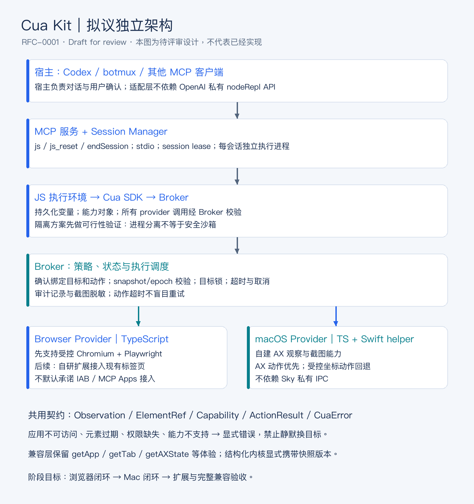
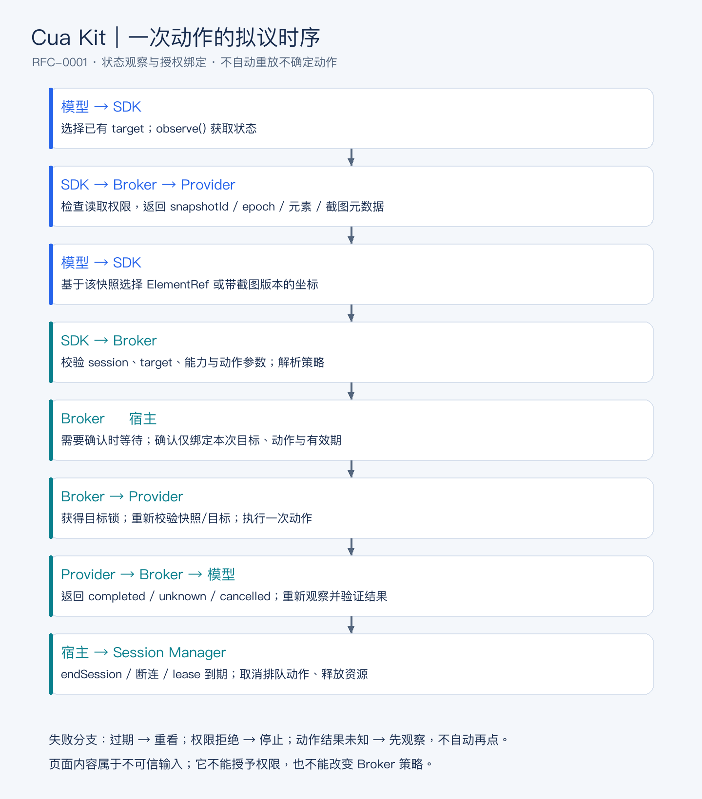

# Cua Kit 架构设计 RFC-0001

Status: Draft for review · 2026-11-03

> 历史方案：本文保留 2026-11-03 的提案与评审过程，不代表当前实现。2026-11-06 的实际架构、语言边界与验收缺口见[飞书当前摘要](https://my.feishu.cn/docx/YTspdmiproITEexFFNBcyHGtn2b#doxcn2cOz8MuLZR6O0hN43UuNCs)、[实现状态](IMPLEMENTATION-STATUS.md)和[语言迁移审计](LANGUAGE-MIGRATION-AUDIT.md)。现行方向是按原版源码/契约还原：JS → TS，原生职责按证据在 Rust/Swift 实现；不再以初始独立 façade 提案代替这一目标。项目仍未完成。

飞书评审版：https://my.feishu.cn/docx/YTspdmiproITEexFFNBcyHGtn2b

## 评审结论与本轮交付

状态：Draft for review，2026-11-03。评审人：陈庭威。仓库：https://github.com/vicksiyi/cua-kit（私有）。本轮只创建仓库、架构与接口提案；任何代码样例均为待实现契约，不是可运行 SDK，也没有承诺性能或完成日期。

推荐：用 TypeScript 建立独立 Cua SDK、MCP server 与 provider 契约；浏览器先用受控 Chromium + Playwright，Mac 后端用独立 Swift helper。目标是复现 unified-computer-use 的核心使用体验和观察—动作闭环，不复用 OpenAI 私有运行时作为生产依赖。

本次需要 review 的五项：①独立实现优先还是私有宿主桥接优先；②浏览器 MVP 后接 Mac，还是双后端同时做；③兼容 façade + 严格快照内核是否接受；④任意 JS 的隔离目标；⑤现有 Chrome 标签接管和 IAB 是否属于首发硬需求。推荐答案与影响见文末。

## 证据、边界与主要难点

已观察事实：本机 computer-use 1.0.1001631 缓存只有展示清单、图标及空 skills 目录；unified-computer-use 26.1021.31345 声明 cua_repl 与 Hooks。@oai/cua-repl 启动 node_repl，导入 tinyskyAlt；Mac 请求经可信 sky 服务、策略检查及本地 IPC 到原生服务。只读 cua.getState() 已成功；没有对原生输入做端到端验证。

证据位置：~/.codex/config.toml；两个插件的 .codex-plugin/plugin.json 与 unified 的 .mcp.json；ChatGPT.app 内 @oai/cua-repl/README.md、tinysky_alt/bind_mac_app.js、bind_tab.js，以及 sky 的 client.js、native-pipe.js、computer-use-policy.js。仅记录路径与行为，不把厂商代码或安装包复制进仓库。

关键区别：把压缩 JavaScript 整理为可读 TypeScript，只能恢复部分上层语义；不能还原原始类型、注释和作者意图，也不能补齐 nodeRepl.rpc、nativePipe、createElicitation、宿主 Hook、IAB 或 Sky 原生服务。原生应用状态稳定性、浏览器接管、权限与会话隔离才是主要工程成本。

未知：Sky 原生服务内部实现、不同 macOS 版本的后台操作一致性、应用 AX 覆盖、现有浏览器扩展的私有协议、宿主对插件生命周期通知的支持程度。后续通过独立 PoC 验证，不能把接口同名当作行为完全兼容。

## 目标、非目标与能力矩阵

目标：独立运行、可读 TS、持久化 JS 调用、统一浏览器与桌面发现、AX/DOM/截图观察、点击/输入/滚动、显式授权、取消、状态校验、可追踪错误、可验证的兼容矩阵。

第一阶段：受控 Chromium 的 getState/getBrowser/getTab/createBrowserTab、observe/getAXState/getScreenshot/click/typeText/pressKey/scroll；MCP js/js_reset 和基本 session 管理。第二阶段：Mac 应用发现、观察、截图和基本动作；第三阶段：现有 Chrome profile/标签接管、自研扩展与高级输入。

完整目标中的高级能力：drag/paste/selectText/setValue/performSecondaryAction、tab lifecycle、差量树、按需文档、session naming/visibility。逐项用 provider.capabilities 声明，未实现返回 UNSUPPORTED_CAPABILITY，不静默忽略参数。

首发非目标：Windows/Linux 原生控制、录音、云端远程桌面、ChatGPT IAB/MCP Apps 私有集成、与 Sky IPC 二进制兼容、像素完全相同的截图、任意应用无前台切换的保证。这些不是已解决问题；若 review 要求首发覆盖，应重估方案和里程碑。

## 方案比较与选择

方案 A：整理 @oai JS 并桥接现有宿主。优势是本机验证路径短；代价是依赖私有可信服务、版本变化和分发授权，无法独立部署。仅作为经许可的本地研究选项，不作为默认发布架构。

方案 B（推荐）：复用可观察的 API 概念，独立实现运行时和后端。优势是边界可控、可测试、可分发；代价是需重建授权、原生桥接与扩展，且不能第一天声称完整平替。

方案 C：只暴露一组结构化 MCP 动作。实现与审计较简单，但缺少持久化变量和 JS 批量编排体验。保留为调试/受限宿主模式，不能替代最终 JS 接口目标。

源码处理建议：先建立行为规范与测试用例，按模块记录输入、输出、副作用、错误和依赖，再写独立 TS。若未来确实需要逐文件反混淆，先确认适用许可与使用范围，在单独本地研究目录进行，不默认将派生代码发布。仓库暂不添加宣称可许可第三方内容的 LICENSE。

## 拟议架构与职责

架构图展示两条后端路径，共同经过 Broker。宿主负责对话与用户确认；MCP server 处理协议；Session Manager 管理执行生命周期；JS evaluator 只获得 cua 能力对象；Broker 是唯一能触达 provider 的动作入口。

packages/protocol：版本化 schema、Observation、Action、Error 和 capabilities；packages/sdk：用户侧 API 与兼容 façade；packages/runtime：会话、快照、目标锁、lease；packages/mcp：工具、资源与文档输出；packages/policy：权限策略及宿主确认适配。

packages/provider-browser：Playwright 后端；packages/provider-macos：TS IPC 客户端；native/macos-helper：Swift 服务；packages/compat：方法映射与兼容报告；tests/conformance：provider 契约测试。上述目录是计划，当前仓库不生成实现骨架。

所有扩展通过 Provider 接口接入：discover、resolveTarget、capabilities、observe、perform、cancel、dispose。共享数据契约，不强制所有 provider 支持完全相同动作。浏览器与桌面输入参数差异在 SDK façade 做映射。

## API、快照与动作契约

主接口拟保留 cua.getState/getApp/getBrowser/getTab/createBrowserTab，以及 target.getAXState/getScreenshot/getAXStateAndScreenshot、click/typeText/pressKey 等。SDK 返回数据；MCP 展示层负责向模型输出，避免 SDK 自身到处打印。兼容 façade 可以提供首次选择目标时自动输出状态的体验。

结构化内核 Observation = {targetId, sessionId, snapshotId, epoch, capturedAt, tree, screenshot, capabilities}。ElementRef = {targetId, snapshotId, elementId}；坐标动作附 screenshotId、坐标空间、缩放/窗口几何版本。元素编号仅是快照局部别名，不是跨轮稳定 ID。

兼容 click(number) 从当前 target 的最近完整快照解析；无法证明仍有效时抛 STALE_OBSERVATION。页面导航、窗口切换、重新绑定和 reset 都使旧引用失效。DOM-only 页面按 locator 解析；数字索引若无法可靠绑定则明确不支持，绝不猜测。

差量结果需 baseSnapshotId + snapshotId，客户端缺少基线则请求完整树。AX/截图尽可能在同一观察周期采集，并标注时间；不能保证原子快照时暴露偏差信息。坐标默认用截图像素，provider 转换到屏幕点，显式处理 Retina、多屏、缩放与滚动。

动作参数携带 requestId、sessionId、targetId、deadline、expectedEpoch 与权限上下文。ActionResult 状态为 completed/cancelled/failed/unknown；completed 仅表示动作执行返回，不代表业务成功。执行后模型或调用方必须再观察并验证业务条件。

错误码包括 TARGET_NOT_FOUND、AMBIGUOUS_TARGET、PERMISSION_DENIED、UNSUPPORTED_CAPABILITY、STALE_OBSERVATION、TIMEOUT、CANCELLED、ACTION_OUTCOME_UNKNOWN、PROVIDER_DISCONNECTED；错误需标明可重试性和恢复建议，不包含凭证或完整页面敏感内容。

## MCP、持久化执行与会话隔离

MCP 初期采用 stdio。提供 js、js_reset、endSession；turn_ended 可以作为宿主适配别名，但它不是所有 MCP 客户端都会调用的标准生命周期。没有 Hook 的宿主依靠断连与 lease 到期回收。stdout 只承载协议，日志写 stderr。

每会话独立执行环境，支持 top-level await 和跨调用变量；同会话 js 顺序执行。reset 清空执行上下文和 target binding，提升 epoch，使旧引用失效；默认不关闭用户原有标签或退出应用。会话创建的资源在显式 dispose/配置策略下清理。

不把 node:vm 或子进程本身当作安全边界。候选方案是受限 JS 引擎（例如 QuickJS 类嵌入式环境）加 broker RPC；原型必须验证异步桥接、超时中断和内存上限。禁止任意 require/import/process/fs/net 暴露；这些限制只有在隔离实现与逃逸测试通过后才能声明成立。

若受限引擎不满足持久化 JS 兼容要求，可评审降级为明确的 trusted-local 模式或结构化 MCP，而不是未经验证就宣称能安全执行任意模型代码。provider 与凭证留在 broker 侧，eval 侧只持有范围受限的句柄。

## 观察—确认—执行—验证流程

时序：选择目标 → observe → 模型依据快照规划 → 提交动作 → Broker 校验会话/目标/能力 → 必要时请求确认 → 获取目标锁并重新校验 → provider 执行 → 返回动作状态 → 再观察业务结果。确认期间页面可能变化，因此确认后仍需再检查快照。

授权绑定 session、目标应用/域名、动作类别、参数摘要和有效期；页面文字或外部内容不能给自己授权。宿主若不支持交互确认，则返回 APPROVAL_REQUIRED，由上层提供批准后重试入口，不自动放行。

同一 target 动作串行；涉及系统焦点/键盘/鼠标的桌面操作还需全局输入锁。独立标签可有限并行观察。若用户切换焦点或介入，停止后续输入，返回 INTERRUPTED_BY_USER。

取消会撤销排队动作并传递 AbortSignal/IPC cancel；已经提交给 OS 的动作可能无法撤销，标记 unknown 并观察恢复。不得自动重放支付、发送、提交等可能产生重复副作用的操作。requestId 去重只在确定响应状态和存储范围内生效，不宣称崩溃后的 exactly-once。

## 浏览器与 macOS 后端设计

浏览器首选由项目创建的隔离 Chromium context，通过 Playwright 处理 locator、自动等待和截图；不启动时默认接管用户常用 profile。对已有 Chrome 标签的支持单独实现扩展与 native messaging/本地桥接，限定标签授权和会话所有权，不把开启不受控调试端口作为默认方案。

观察层使用文档化 API 生成结构化页面视图；具体快照 API 和依赖版本在 PoC 时锁定。跨 frame、Shadow DOM、导航、canvas、下载与弹窗均需能力测试。IAB 和 MCP Apps 属于宿主专有 surface，没有公开桥接时返回不支持。

Mac 拟用 Swift helper，AXUIElement 负责可访问性查询与可用动作，ScreenCaptureKit 负责受控截图；按动作能力采用 AX 操作或受控输入事件。坐标回退需目标窗口校验；不保证所有应用支持后台输入。开发签名、TCC 权限、分发签名/notarization 分阶段验证。

helper 与 broker 用私有 Unix socket 和版本握手，校验本机调用方与短期会话令牌，限制 socket 权限。该协议为项目自有协议，不伪装 Sky 客户端，也不依赖 Codex 的签名或私有授权机制。

## 数据、可观测性与恢复

默认审计保存元数据：requestId、target 类型、动作名、开始/结束时间、结果码、snapshotId；不默认保存输入正文、完整 AX 文本或截图。调试 trace 显式启用、局部脱敏并设保留期；凭证不进入日志。

只读观察可有限退避重试；动作超时先查状态，不盲目重复。服务重启后失效所有旧句柄，恢复须重新发现目标、授权和观察。剪贴板恢复使用版本/变更检查，避免覆盖用户期间复制的新内容。

收集观察延迟、动作延迟、权限拒绝率、过期引用率、未知结果率和资源泄漏。先在指定测试环境建立基线，再设性能预算；本 RFC 不编造尚未测得的吞吐或成功率。

## 里程碑与验收门槛

P0：评审确认目标、接口、隔离与来源策略；验证 JS 执行环境和 Mac AX/截图最小可行性。产出依赖版本清单、差距清单和修订 RFC，再进入实现。

P1：浏览器闭环。验收：新建受控标签 → 读取结构/截图 → 定位输入框 → 输入并提交测试表单 → 观察确认结果；覆盖 stale 引用、目标歧义、取消与断连；不接触真实业务提交。

P2：Mac 闭环。使用自建 fixture app 验证读取 AX/截图、点击/输入/滚动、权限拒绝、多屏坐标、用户介入、helper 崩溃恢复；再选明确允许的系统应用做手动测试。

P3：兼容和接管。逐项执行兼容矩阵，验证现有 Chrome 标签授权、资源归属、diff 重建、文档按需输出、reset/endSession；不通过的能力保持显式 unsupported。

共同验收：两个会话不可互用句柄；eval 无法绕过 Broker；确认后目标变化要拒绝；超时动作不重复执行；关闭会话不误关用户页面；公开发布前运行凭证/来源检查。核心测试采用 mock provider + fixture UI + 真机集成，禁止只测实现镜像。

上线与回滚：先 opt-in 私有试用；停用 MCP 配置并结束项目进程可回滚运行时，保留用户应用。回滚不能撤销已完成业务动作；涉及写入的测试在可恢复 fixture 环境执行，并通过重新观察验证恢复。

## 待评审决定与建议

D1 推荐独立实现；若选择桥接原宿主，需接受版本绑定与不可独立分发边界。D2 推荐 browser-first 再 Mac；若 Mac 是首要业务场景，应将 P0 原生 PoC 前置并调整优先级。

D3 推荐兼容 façade + 严格结构化内核；不以“兼容”为由继续使用过期数字索引。D4 推荐受限 JS 引擎 PoC；在验证前不宣称安全沙箱。D5 建议 IAB/MCP Apps 不进首发；若要求完全同功能，必须先获得可用的宿主集成路径。

仓库名 cua-kit、私有可见性、未来开源许可、首发 macOS 最低版本与 Chromium 版本均为待确认的项目设置；本轮只采用私有仓库默认值。Review 完成后再开功能开发，不自动进入 P0/P1 编码。

## 参考与来源

OpenAI 现有实现：本机文件分析，版本和验证范围见“证据、边界与主要难点”；不作为项目可分发源码。

MCP stdio 官方文档：https://ts.sdk.modelcontextprotocol.io/v2/serving/stdio 。用于传输选型，具体 SDK 版本实施时锁定。

Playwright locators：https://playwright.dev/docs/locators 。用于浏览器定位/等待机制选型，不等同于原版 Chrome 扩展实现。

Apple ScreenCaptureKit：https://developer.apple.com/documentation/screencapturekit 。截图需系统授权；AXUIElement 方案需在 P0 用官方 SDK 与真机验证。

## 范围与实施顺序修订

[源码级补充](SOURCE-DEEP-DIVE.md) 展开实际 getTab/AX/click/screenshot 调用链，修订浏览器模块粒度与垂直链路优先的实施顺序。
