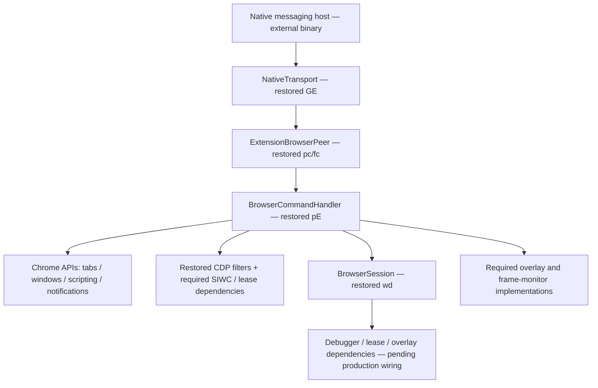

# @core/browser-extension

Readable reconstruction of selected code from the locally installed ChatGPT Chrome extension, version **1.26.1102.11740**, extension ID `hehggadaopoacecdllhhajmbjkdcmajg`. This is a different artifact from the `@oai/*` npm packages. `@core/browser-extension` is this project's package name; no original package with that name is asserted. It is also separate from the older independently authored `extensions/chrome` implementation.

The first restored component is the original `GE` native messaging transport and its errors/type decoder. It uses Chrome's nativeMessaging and alarms APIs plus standard timers; no third-party transport library is recreated. The inspected bundle separately includes Sentry 10.48.0, which is not copied into this component.

`NativeTransport` keeps the original constructor behavior: attach the alarm listener and immediately attempt a native host connection. The default host identity remains `com.openai.codexextension`; callers can supply the original string/list argument. `createNativeTransportClass` adds an explicit dependency boundary for tests while the default export uses actual Chrome APIs and standard timers. Do not construct the default transport in a non-extension process.

Preserved behavior includes native-host-prefixed request IDs, reply correlation, remote error types, timeout/post/disconnect rejection, late-reply suppression, stale-port suppression, explicit reconnect, missing-host-only candidate fallback, five-second retries and half-minute Chrome alarms. Status timestamps and retry counters retain the original transitions. This does not add an invented teardown method that the inspected class lacks.

Provenance and the pinned background.js hash are recorded in `reconstruction/extension-source.json`. The differential harness extracts only explicitly inspected top-level bindings; it does not execute extension startup. Set `CUA_EXTENSION_SOURCE_ROOT` to an installation of the recorded extension version to run the tests on another machine.

```sh
npm run build:reconstruction
npm run check:reconstruction
npx tsx --test reconstruction/extension-native-transport.test.ts
```

A loadable **independent native-control deployment** now exists at `dist/native-extension`. Its built background entry composes restored sessions, CDP events, popup/cursor/page-event messages, update handling and heartbeat. The full original ChatGPT website/sidebar/kernel startup is still unfinished. The original extension snapshot is newer than the recorded desktop application artifacts; cross-version production compatibility is not established by component differential tests.

## Browser RPC facade

The original `fc` bidirectional peer and `pc` extension facade are now restored. Their protocol methods match the browser-service `to` peer, so the implementation is shared through `@core/core/browserRpcPeer`; the browser service retains its existing re-export facade. This factoring is a project boundary, not a claim that the original extension imported that package.

The original bundles differ in transport field initialization order. The shared class factory preserves each variant and class-field descriptor/setter semantics. It retains method registration/binding, numeric request IDs, string rejection values, missing-handler errors, notification listeners and response suppression after closure. `ExtensionBrowserPeer` restores ping and the CDP/detach/download/page/tab-mention notifications, plus moveMouse/WebMCP event handling. Synchronous moveMouse throws remain synchronous failures; only rejected promises go to its error callback, matching the source.

Differential tests compare both original peers and the extension facade. A composed transport/peer test verifies `native-host:*` host requests and numeric browser requests do not collide, and an inbound browser request reaches the supplied handler and returns through native messaging. That transport test uses a fixture handler; later tests below also compose the restored dispatcher and session. Full production startup is not installed.

### Browser command handler

`createBrowserCommandHandlerClass(dependencies)` translates original `pE` in full,
including session resolution/activation, passive reads, CDP validation/filter calls,
capability dispatch, cursor arrival waiters, download events and child popup cleanup.
The original method list, field order, return/error values and dependency-call order
are compared with the pinned artifact. An RPC composition test routes requests
through `ExtensionBrowserPeer` into the handler.

The factory is an explicit reconstruction boundary, not an installed extension
entry point. Use `createBrowserCommandHandlerWithSession(handlerDependencies, sessionDependencies)`
to bind the restored `wd` session; the lower-level handler factory also accepts a
Session constructor. Use the restored tab lease manager for ownership; remaining required dependencies
include SIWC, overlay and frame monitors. The original persistent request-header policy
is constructed directly using the supplied Chrome API; CDP validation/filtering now
imports the restored security module directly. No
production defaults or permissive security substitutes are supplied. Parameter
payloads remain broadly typed while those contracts are being recovered; this is
readable TypeScript, not yet a fully specified public protocol. See
`reconstruction/extension-command-handler-dependencies.json` for every original
binding's readable dependency name. The tests' fake sessions are test-only.



### CDP security and event forwarding

`cdp_security.ts` restores original `Qp`, `Xp`, `Yp` and their helpers. The handler
uses validation before session activation and filters replies before returning to
RPC. The rules reject page-exposed debugger access and require flattened automatic
attachments (except when automatic attachment is explicitly disabled). Cookie and
header transformations specifically protect `__Host-siwc-browser-bootstrap` across
the original CDP result/event shapes. Unknown methods and arbitrary page values
retain original behavior; this is not a blanket secret scrubber.

`registerBrowserEventListeners` extracts six original `dR` subscriptions:
debugger detach/events, handler download changes, Chrome download creation/changes,
and navigation targets. CDP events are filtered before broadcasting, including
dropping `Target.receivedMessageFromTarget`. The original per-peer routing,
instance initialization, remaining runtime subscriptions, and startup lifetime
still need production composition. No teardown or additional catches are invented.
Differential tests execute only these six inspected original subscription calls,
not the original extension startup.

### Request-header templates and persisted policy

The installed browser service's `VC/u5` and extension's `cs/ls` implement the same
header-template parsing/expansion rules. Both now use `@core/core/requestHeaders`;
the browser re-exports its existing function names and the extension exposes
`parseRequestHeaders` and `resolveRequestHeaders`. This is a project-created shared
export, not a claim that the original package had this path. No third-party header
library appears in these inspected functions.

The handler directly constructs the restored original `uS` policy over Chrome
storage. `AGENT_REQUEST_HEADER_ENABLED` becomes sticky once true: a false decision
does not revoke an enabled policy. Failed persistence does not set the in-memory
flag. Header count/name/value/aggregate limits, reserved names, template substitution,
case-insensitive collisions and exact validation errors are compared with the
original extension. The restored session uses these headers during turn activation, and the restored
lease manager performs DNR reconciliation. Production startup remains to be wired.

### Browser session lifecycle

`createBrowserSessionClass` translates every original `wd` method. It retains the
serialized lifecycle queue, cached-context checks, header inheritance and explicit
clearing, handoff recovery, logical active tab, user/child/agent tab claiming,
CDP timeout cleanup, popup/header preparation and end-of-turn finalization order.
The session directly uses the shared original-derived header parser and resolver.
`createBrowserCommandHandlerWithSession` composes it with the restored dispatcher;
a test exercises RPC getTabs/executeCdp/turnEnded through both real classes.

The session factory still requires actual favicon/network/overlay
implementations; the lease manager is now restored, and debugger methods/state can now come from `createDebuggerRuntime`. Those collaborators are explicit fixtures in differential
tests, and the composition helper does not provide fake production defaults.
`reconstruction/extension-session-dependencies.json` maps the original closure.
Broad protocol payload types remain temporary until those contracts are restored.

### Chrome debugger runtime

`createDebuggerRuntime({chrome, setTimeout, clearTimeout})` restores the original
debugger closure and its state. Share **one runtime** across all sessions and use
its `initializeDebugger` in the dispatcher startup, matching the original global
lifetime. The returned fields/functions can be spread into session dependencies;
there are no fixture defaults. This factory does not connect a debugger until its
methods are called.

Restored behavior includes per-tab/per-target operation queues, idempotent attach,
original handling of "Another debugger" errors, viewport set/clear, finally-based
detach state removal, best-effort timeout detach, detach event bookkeeping,
Target.getTargets adaptation, targetId-only routing and timed CDP requests. The
request timeout is a Promise race; a late Chrome command is not canceled by this
module, matching the source. Viewport setup uses the original raw, untimed send.
The three differential tests cover state/error/queue behavior and timeouts; an
additional session composition test uses the restored runtime over fake Chrome
APIs. Actual installation and end-to-end production startup remain outstanding.

### Chrome tab/window operations

`createTabRuntime({chrome, now, setTimeout})` restores the direct `vE/yt/Id/Ad/za/bE`
tab/window helpers; `toBrowserTabInfo` restores `Jr`. The returned methods compose
with `BrowserSession` dependencies. Window selection prefers the requested window,
then a focused normal window, then the first normal window. A failed creation is
retried only when the selected preferred window changed on re-query. An empty
window list creates an unfocused normal window; tabs are created inactive.

Preparing a new-tab page uses the original `about:blank` update and polling path:
25ms polling, a 5000ms deadline, and the original order of read/timeout checks.
Tab ID validation deliberately keeps the source's undefined-only check. Tests
compare selection/retry/error and polling traces with the pinned artifact, then
compose the restored session with this runtime over isolated Chrome fixtures.
No user browser windows or tabs are opened by these tests.

### Request-header rules and persisted lease codecs

`createRequestHeaderRulesClass` restores original `vy` over Chrome
`declarativeNetRequest`. It groups matching session/header configurations, creates
paired main/sub/object-frame and other-resource rules, excludes extension initiators
for the latter, and only removes owned rule IDs 1000000–1004999. Forced sync queries
existing tabs; cached identical rules avoid redundant updates. Failures return an
Error to the caller, invalidate the cache and log only once until successful update.
This is the request-header coordinator, distinct from the Browser Use network-policy manager `ar` restored below.

`lease_codec.ts` restores viewport/lease/storage parsing and source-lease identity
comparison. It uses the restored header parser and keeps the original permissive
numeric checks and the distinction between missing and explicit-null viewport.
These helpers are used directly by the restored `st` lease manager, including
its storage mutation and rollback flow. Tests use isolated DNR/storage values;
no real browser rules are installed.

### Tab lease manager

`createTabLeaseManagerClass({chrome, instanceId, now, error})` restores all original
`st/wn` methods and its singleton. Share the returned class across the dispatcher,
sessions and other runtime components. It directly constructs the restored header
rule coordinator and parses storage through the restored lease codecs.

The manager preserves lazy/cached startup, claims and ownership, child-source
identity checks, handoff/resume, pending viewports, marks, stale-tab release,
replacement/removal listeners, serialized mutations, shallow rollback on mutation
or storage errors, DNR synchronization and active-ID change notifications. DNR
failure propagation remains method-specific, and DNR failure does not undo a
successfully persisted mutation. Rejected initialization remains cached as in the
original. These details are compared against the installed artifact.

A session composition test uses this real manager and real DNR coordinator over
isolated Chrome/storage fixtures to claim a tab, install header rules and release
both at turn end. Instance-ID sourcing and shared component assembly are provided
by the foundation below; full startup and favicon/overlay/auth
components are still required.

### Shared browser foundation and extension identity

`createExtensionInstanceIdReader` restores original `Be/Kg/gc/us`: it returns a
valid stored ID verbatim, shares a cached promise across callers and clears rejected
promises for retry. On missing/invalid identity it removes `nodeReplTunnel` from
session storage, removes `browserUseTunnels` from local storage, generates a UUID
and persists it, in that order. Validation uses the original 128 UTF-16-unit limit
and paired-surrogate checks, not UUID syntax. Merely creating the reader does not
read or mutate storage.

`createExtensionBrowserFoundation(host)` is project-authored assembly around the
restored components. Its `createHandlerClass(handlerDependencies, sessionDependencies)`
shares one identity reader, lease class/singleton, tab-group and favicon singletons, network-policy manager, debugger runtime and tab runtime
across dispatcher/sessions. Known restored dependencies override supplied residual
fields, so accidental extra fields cannot replace them. Remaining capabilities,
SIWC, overlay/monitor and application startup are still
required. This is not an installable extension or a claim that original `dR` has
been fully recovered.

The composition test exercises RPC createTab/attach/executeCdp/turnEnded through
these restored components with isolated Chrome APIs, asserting getInfo/lease ID
agreement, one UUID, one persistent debugger listener, policy rejection/rollback,
inspection-before-session-attach, and lease/rule/debugger cleanup. Policy and header
DNR ranges coexist and are cleaned independently. The policy compiler, predicate
and inspector are restored code; Chrome APIs remain fixtures. Identity
cleanup tests mutate only fixture storage, never the user's installed extension.

### Browser Use network policy manager

`createNetworkPolicyManagerClass` restores every original `ar/op` method. It owns
rules 2000000–2999999, separate from request-header rule IDs. Attach validates the
timeout/tab ID, checks all-sites permission and resource support, removes closed-tab
rules, allocates IDs, installs priority-ordered rules, verifies Chrome's returned
rules, then awaits active-page enforcement before recording the attached policy.
Cancellation and rollback preserve the original AggregateError when cleanup cannot
be verified. Detach removes only this manager's matching rules and checks removal.

The original `Vp` compiler and `Wp` URL predicate are restored and used by default.
They retain normalization/deduplication, allowlist intersections, deny rules,
document URLs, origin restrictions and all input/output/complexity budgets.
Host/origin parsing is shared with browser-service through `@core/core/originPatterns`.
Explicit compiler/predicate injection remains available for isolated tests.

The original `JS` active-page inspector is now restored in
`network_policy_enforcement.ts` and used by default. It temporarily attaches a
debugger, observes iframe targets/loading/context events, waits for a stable frame
tree, resolves HTTP(S) sources (including inherited blank/srcdoc and blob origins),
checks the predicate and detaches. It does not automatically reload the page.
Timeout cleanup preserves the original late-attachment behavior. Explicit injection
remains available for isolated tests.

Differential tests cover normal and rejected pages, iframe/navigation/context
changes, malformed responses, detach/attach failures and deadline races. Manager
composition tests use all three restored components with fixture Chrome APIs,
including rollback on an existing disallowed frame. Real installed-extension/DNR
and browser startup integration remain unverified.

### Managed tab groups

`createTabGroupManagerClass` restores all original bS/yn methods and title/color
helpers. The foundation supplies the same class/singleton to every session. It
retains legacy/current TAB_GROUPS storage, cached initialization (including
rejections), group reuse by related tabs, title updates, random original palette,
removal events and best-effort ungrouping. Per-method error behavior is preserved,
including state changes that precede failed persistence. It directly calls Chrome
APIs; no third-party group manager is copied or reimplemented.

Differential tests compare method inventory, traces, storage and in-memory state.
The foundation RPC fixture now also checks group creation/persistence and empty
group cleanup after closing tabs at turn end. Actual browser tab-group UI remains
to validate alongside production extension startup.

### Favicon resource reader

`favicon_resource.ts` restores original pS/mS/gS/_S. It builds the extension's
`/_favicon/` URL, requests size 32, omits credentials, aborts at 2000 ms, accepts
image MIME types (BMP fallback for the favicon endpoint), and caps both declared
and streamed bytes at 64 KiB. It retains cancellation and error/null behavior and
chunked base64 conversion. It uses fetch/Streams directly, without a third-party
image decoder. The Ma badge/cache/publication manager is restored below; its page-side
consumer is restored below; full content entrypoint remains pending. This helper alone does not
render a badge. Tests compare the pinned original with isolated response/stream fixtures.

### Favicon badge manager and content readiness

`createTabFaviconManagerClass` restores all original Ma/Kt methods and event
callbacks, using the restored resource reader and content readiness runtime. State
operations and publications use separate serialized queues. Active leases override
finalized badges; focused visible tabs clear finalized state. Cache identity and
post-fetch navigation checks, closing-tab suppression, bounded restore before close,
failed-close recovery, storage mutation/error ordering and disposal remain original.

`createContentRuntime` restores Mu/Ta/_y/de: ping first, share in-flight injection per
tab, inject `content-scripts/codex.js`, then ping again. Its timeout resolves null
and does not cancel the underlying operation. No third-party implementation is
needed in these inspected closures. Differential tests compare original method
inventory, traces, state/cache/storage and lifecycle errors, including real restored
resource/readiness orchestration over fixture Chrome/fetch. The shared foundation now supplies this manager to handler and sessions, using the
real restored lease-change subscription. The page consumer is restored below and tested against real Chromium DOM;
full installed-extension assembly remains pending.

The foundation composition test observes active-badge messages after a real restored
lease claim, then checks clear-badge publication before tab removal and cache/closing
state cleanup on removal events. Browser APIs and favicon responses are fixtures;
page-side message handling and DOM restoration have separate Chromium tests below.

### Page-side favicon DOM and message handling

`favicon_badge_dom.ts` restores the installed content script's Et/Rt and complete
SVG/DOM restoration closure, including tracked and pre-existing marked links,
page-authored changes, created-link removal, temporary apple-touch-icon rel and
deferred cleanup. SVG output preserves original shapes, colors, opacity and
attribute escaping. Shared badge URL recognition is reused.

`createContentMessageInitializer` restores Un/Fn/Gn/je with one listener and repeated
overlay readiness calls. Overlay setup Q is restored below; its renderer Dn is connected by createCodexContent.
The artifact is separately hash-pinned in extension-content-source.ts; unit tests extract selected closures; the content-entry integration test also
executes full startup in an isolated browser fixture. Real Chromium comparisons verify exact DOM
and SVG data URLs after badge changes/clear, preservation of page changes and
message acknowledgements. This is not yet a packaged replacement content script.

### Overlay root lifecycle

`createOverlayRoot` restores Q/T/Hn/ze: closed shadow root/style/container creation,
owned stale-root replacement, foreign ID collision handling, observer retargeting,
renderer disposal and suppression after site removal until documentElement changes.
The Dn controller and rn animation engine are restored below. Chromium
differential tests cover normal/stale/conflicting roots, reparenting, removal and
document replacement with exact lifecycle and DOM comparisons.

The content startup tail also contains `wxt:locationchange` and
`wxt:content-script-started` runtime signatures. The matching lifecycle is now reused from WXT 0.20.25, with the original historical
version still unproven. Content startup is assembled below; installed-extension
validation remains pending.

### Overlay state/message controller

`createOverlayController` restores Dn/Pn and qe/wn state validation. It creates the
aria-hidden overlay element, animates only in the top frame, tracks state-request
generations, sends cursor-arrival notifications, refreshes on pageshow/resize and
removes listeners/DOM on disposal. It now defaults to the restored rn animation
engine; a factory override remains available for host-boundary tests.

State validation and real Chromium top/iframe differential tests compare original
message, animator-boundary, DOM and cleanup traces, including stale replies after
new state/disposal. These tests use a tracing animator and do not verify animation.

### Cursor spring integration

`cursor_spring.ts` restores R/v/I/An/We and Ye/N. It preserves 1/240-second
integration, original stiffness/damping limits, accumulated script/simulation time,
long-frame catch-up, rest snapping and shortest-angle targets. The source's zero
target rest behavior is retained rather than corrected speculatively. Tests compare
every spring field over 9000 frame steps plus reset/retarget/rest/angle boundaries.
The surrounding motion state machine and rn DOM animator now consume this module.


### Cursor paths, motion and rendering

`cursor_path.ts` restores candidate construction/scoring, cubic path sampling and
path-based progress response. `cursor_motion.ts` restores scoot/bezier movement
(196px threshold), retargeting, arrival/reset, visual springs and thinking motion.
`createCursorAnimator` restores cursor DOM/styles, viewport clamping, frame/timer
scheduling, immediate movement/reveal, per-turn arrival deduplication and cleanup.
`createOverlayController` uses it by default.

Differential coverage includes 108 path cases, 4320 full motion frame states, and
real Chromium DOM traces with deterministic animation-frame/timer clocks. A separate
composition test uses the real default animator and checks exact controller DOM and
AGENT_CURSOR_ARRIVED messages against the original. No third-party library calls
were found in these inspected geometry/motion/rendering closures.

Content entrypoint/WXT reuse and root/controller assembly are implemented below.
Installed-extension startup and native-host packaging remain; this is not an
installed extension E2E.


### Bundled codex content entry and upstream WXT

`createCodexContent` composes the actual restored root, controller, animator and
favicon/message handlers. `codex_entry.ts` retains the original runtime registration,
document_start, matchAboutBlank and all-URL definition. It creates upstream WXT's
ContentScriptContext, then calls the original-style main which ignores that context.
In particular, reinjection does not clean up the old ping listener; tests preserve
this observed original behavior rather than introducing new cleanup semantics.

`npm run build:reconstruction` now also bundles
`packages/browser-extension/dist/content-scripts/codex.js` via esbuild, directly
using WXT 0.20.25 and its locked @wxt-dev/browser 0.1.43 dependency. ENTRYPOINT=codex
and MODE=production match the installed event namespace/logger behavior. This is
a tested compatible upstream version, not a proven original lockfile version.
See [provenance](../../reconstruction/extension-wxt-provenance.json) and
[WXT context documentation](https://wxt.dev/api/reference/wxt/utils/content-script-context/classes/contentscriptcontext).

The full hash-verified installed entry and the reconstructed bundle run in isolated
Chromium fixtures, comparing top/child-frame startup, closed-shadow content, badges,
cursor movement/arrival, runtime messages, repeated injection and root suppression.
Separate upstream-runtime tests compare abort/timer/navigation/polling semantics.
A real installed extension still needs its background entry, other content scripts,
manifest/assets/native host and end-to-end installation validation.


### Background overlay and observed tabs

`createOverlayManagerClass` restores aS's sessions, linked-tab priority, request
counts/abort, cursor state, control-activity notifications and bounded publication.
`createObservedTabsClass` restores oS: all windows' active tabs are observed, not
only tabs in the focused window. `createCursorMessageHandler` restores fR's state
read and arrival validation/dispatch.

Foundation supplies the same overlay to handler/sessions, and shares a content
readiness runtime with favicons to retain injection deduplication. Startup must call
`foundation.observedTabs.initialize()` and install the bound message router among
its handlers; full startup remains pending. Observed-tab audio handling is now
composed as described below.

Differential tests verify state/method/event behavior. A Chromium integration test
connects the manager to the actual content bundle and routes its arrival messages
back to real command waiters, verifying resolution before timeout, hiding on
observation loss and request abort on stop. The transport is an explicit fixture;
full installed-extension RPC/permissions/manifest/native-host validation is pending.


### Background-tab audio ownership and activation races

`createTabAudioController` restores Vu/lS/Wu/Ku and Ra/Oa. It mutes only inactive,
not-already-muted tabs, restores only muting owned by this extension, and preserves
best-effort handling for disappeared tabs or failed updates. The original observed
change handler republishes all changed overlays and restores newly observed audio
in parallel. If activation races a pending mute, restoration is repeated after
that mute completes; both tracking sets clear in finally.

Foundation installs this handler and supplies the same mute operation to session
create/child-claim paths. Differential tests compare ownership/active guards, error
paths and deferred-mute races with the original closure. The RPC foundation fixture
also verifies created tabs are muted then restored when observed. No new release-
time unmute was added: the inspected source restores on observation changes.


### Foreign-extension frame monitor

`foreign_frame_dom.ts` restores the shared background jy/content R closure as a
self-contained injectable function. It scans existing/added elements and open or
Chrome-exposed closed shadow roots, handles src mutations, leaves own-extension and
web frames intact, and blanks foreign-extension iframe content via srcdoc (legacy
FRAME uses about:blank). Presence/removal helpers retain original state guards.

`createForeignFrameMonitor` restores document-ID/lease caching, concurrent ensure
deduplication, navigation/debugger invalidation, per-document injection, all-frame
ping/file fallback, replacement/removal and waiting for bounded in-flight requests
before cleanup. The timeout bounds the wait, not cancellation of Chrome execution.
The build now also emits content-scripts/foreign-frame-monitor.js using the same
upstream WXT runtime with its own original entrypoint namespace.

Foundation creates one monitor when createHandlerClass supplies browser-family/
internal-URL helpers; handlers initialize it and sessions share track/ensure/remove.
The existing lease and content timeout runtime are reused. Differential tests cover
cache/events/leases/fallback and removal/retracking races. Chromium compares both
full content entries and serialized installers across shadow capabilities, dynamic
frames, cleanup and reinjection; Chrome's closed-shadow API is explicitly simulated.
The foundation RPC fixture checks injection on claim and removal at turn end.

Complete startup, popup interception, authentication, mentions, other scripts and
production manifest/assets/native-host installation remain pending.


### Popup interception across MAIN and isolated worlds

`popup_dom.ts` restores Ny/Uy/$y/Fy/By as self-contained Chrome-injected functions.
The isolated bridge handles string request events with one request per trusted
interaction; MAIN handles window.open, target/URL exclusions, noopener/noreferrer
return values and anchor clicks. Removal restores window.open only if its own
wrapper is still installed.

`createPopupInterceptor` restores preparation deduplication, ordered MAIN presence
check → isolated bridge → MAIN wrapper, navigation refresh and two-world cleanup
after pending work. `createPopupMessageHandler` restores the guarded dR listener
branch and delegates ownership/URL/tab creation to the existing restored command
handler. Foundation shares this implementation with session lifecycle methods.

Differential tests cover lifecycle, re-tracking races and the actual original
listener branch. Real Chromium MAIN and CDP-created isolated contexts compare
trusted clicks, request cancellation, targets, return values, anchor behavior and
cleanup. Browser APIs are explicit fixtures; user tabs are not modified. Foundation
RPC integration checks popup child creation/claim/navigation and turn cleanup.
Full background listener startup and installed-extension validation remain pending.

SIWC now includes the original-derived auth-session reader, account context hash and
origin recheck, browser grant parsing/issue, and runtime-shared serialized bootstrap
cookie installation with account-change rollback. Foundation wires the restored
service directly. Tests use fixture HTTP and CDP responses, not real authorization;
the broader authentication cache/lifecycle and installed-extension setup remain open.

The shared auth runtime now restores the original generation-based cached session
readers (independent waiter cancellation). Foundation also exposes the restored
ChatApi class with original HTTP errors, response handling, timeout and disposal.
These primitives do not yet constitute the complete authentication orchestrator.

Tab mentions now use the restored provider: validated search, stable generation and
provider tab IDs, recency ordering, four-way favicon warmup and candidate updates.
Foundation supplies it directly and exposes the original event invalidation observer.
The full startup notification fanout and side-chat messaging are still pending.

The tab mention runtime/port bridge now preserves sender authorization, strict search
messages, current-tab exclusion, streamed favicon updates and disconnect cleanup.
Foundation exposes host-bound router and invalidation helpers. Full startup listener
registration, peer fanout and side-chat content scripts are still pending.

The side-chat tab mention content script is now built with direct upstream WXT.
It restores trusted-interaction search allowance, parent capability handshake, streamed
candidate DOM events and cleanup. Eligible extension-parent handshake currently has
explicit host-fixture coverage; installed-extension integration is still pending.

The MAIN-world codex-work-preload entry is now built separately. It restores the
extension-parent marker and media-permission bridge before invoking native getUserMedia.
Full-script differential tests use explicit permission fixtures, not real media capture.

The ChatGPT website entry now restores status-port refresh/reconnect, browserContext
carry-forward, trusted click/custom actions, runtime ping/plugin notifications and
WXT invalidation. The build emits all five inspected content-script entrypoints;
this does not yet provide a fully installed extension or complete background wiring.

Website background status now has the restored incremental port handler and installer
state/show helpers. Foundation binds shared identity, overlay and installer status;
telemetry remains explicit. Full startup registration and installed transport are pending.

Foundation now exposes the restored client heartbeat registration, binding lease-header
reconciliation, overlay session stop and network-policy cleanup. Original ping/timeout
and debugger-detach ordering are retained. Actual startup registration with native and
tunnel peers still needs to be completed.

The update manager now restores persisted pending-version and busy-control deferral.
Foundation registration connects idle activity transitions to pending reload checks;
RPC session integration verifies deferral until turn completion using a reload fixture.

A shared lazy side-panel tab controller now restores temporary/persistent enablement,
Edge defaults, storage recovery, tab events and removal cleanup. Full side-panel opening
and startup registration remain separate outstanding work.

Window-level side-panel opening/toggling now composes with the tab controller,
preserving concurrent enable/open, failure rollback, close-finally state updates,
Edge targeting and the global/tab open-state union. Action entrypoints and real
installed panel integration remain pending.

Side-panel website requests and context-menu selection routing are restored, including
source checks, original prompt limits and post-open prefill persistence. Foundation
binds them to its shared window controller; startup still must register the handlers.

Toolbar/shortcut entrypoints now compose the shared side-panel window and menu handlers,
including the original icon-only fallback and already-open icon behavior. They remain
explicitly registered by the future complete startup path.

Action callout and profile badges now use the restored serialized queue, normalization,
color hash and initials logic. Foundation shares one callout across its side-panel
entrypoints and window controller, replacing externally supplied show/clear callbacks.
Complete startup registration and real toolbar behavior remain unverified.

Toolbar-state reporting now preserves the original serial queue, UTC-day snapshot
suppression, changed-state override and six-hour alarm registration. Side-panel identity
and load-event handlers preserve exact extension-page sender gates and reply behavior.
Foundation binds these factories to shared Chrome APIs, clock and instance-ID reader;
metric transport and full startup registration remain explicit integration work.

Side-panel authentication now restores the original queued operation manager, login/
logout/open tab reuse, exact sender gate, state completion, expiry and removal handling.
Foundation binds Chrome and its clock; auth-refresh callback remains explicit. This is
not a real sign-in verification or full background lifecycle integration.

Website bridge refresh now restores per-document handshake deduplication, timed version
ping, injection and repeat handshake, active-document failure metrics and independent
plugin-change notifications. Foundation reuses the restored content-runtime timeout;
startup/lifecycle registration remains pending.

Extension lifecycle registration restores install/startup/activation/navigation ordering,
onboarding-page behavior, toolbar/menu hooks and listener cleanup. Foundation connects
website bridging and the shared cached-auth reader. Browser-family detection, auth
refresh, installation service and metric transport remain explicit startup dependencies.

Browser-plugin setup now restores the canonical-app/ensure/link request chain and the
per-account positive/negative session cache. Cache loads are shared and retained after
clear or read failure; negative outcomes expire after thirty minutes. Foundation exposes
the installer function and bound cache factory. Gate/retry orchestration remains pending.

Installation orchestration now composes the restored request/cache with account changes,
auth cancellation, gate subscription, retry-after/jitter and stop cleanup. Foundation
binds ChatApi, SIWC readers, storage and timers. Gate transport and auth-refresh service
remain explicit dependencies; production startup and live account verification are pending.

Feature-service orchestration is restored: stable/auth identity, refresh, gate/config
access, subscriptions and serialized telemetry. It defaults to ExtensionStatsigClient;
Client injection remains optional for explicit alternative implementations and tests.
Foundation createFeatureService uses the same default. The installed SDK reports Statsig
3.33.4 but adds live refresh absent from public npm 3.33.4, so the public constructor alone
is not a compatible substitute.

The restored SDK assembly reuses pinned upstream code where inspected behavior matches:
- ExtensionStatsigNetworkCore retains upstream encoding/compression, limiting and fallback
  support, restoring headers and initialization tracking boundaries.
- ExtensionStatsigNetwork shares that transport for ordinary/delta and live-overlay calls.
- ExtensionStatsigEvaluationStore reuses ordinary helpers and V1/V2 containers, restoring
  live/retained lookup, config-list union, cursor handling and loadedAt details.
- The live scheduler preserves response staleness, overlap suppression, replacement and
  server behavior. Stop clears the interval but does not cancel in-flight responses.
- ExtensionStatsigDiagnostics shares upstream marker storage and adds bundled syncType
  and connectivity fields. statsigClientLifecycle restores initialization, user updates
  and in-place refresh with their distinct status and error behavior.
- ExtensionStatsigClient assembles these before plugin binding. ExtensionStatsigDataAdapter
  preserves the shared extended network instead of silently constructing a public one.

Constructed-client and default-service tests use mock fetch and cover initialization,
identity changes, evaluation, subscriptions, metric flush and shutdown. No external Statsig
service is contacted. Production extension startup, installed browser/native integration
and actual model end-to-end verification remain pending.

createBackgroundMessageRouter restores dR runtime message precedence, settings refresh,
popup replies and leased page-event forwarding. Foundation binds runtime identity and
the lease manager. Full production listener registration/startup is still pending.

registerBackgroundRuntime now registers runtime connections/messages and existing browser
event listeners, including lease recovery reporting and the original instance-ID init
position. Foundation supplies lease and identity resources; full dR startup still needs
transport/session/handler composition and its remaining prerequisites.

Kernel transport now restores scoped kernel-host Port admission, replacement, close
semantics and browser/control multiplexing. Foundation exposes registerKernelConnections;
actual host-page/control execution and full startup composition are still pending.

createKernelScopeRegistry and createKernelOutputWriter restore execution admission,
cancellation/disposal and shared text/image output semantics. They are not yet assembled
with the remaining control RPC methods and actual kernel execution entrypoint.

createKernelFetchController restores scoped site-status routing, ordinary fetch,
request cancellation/disposal and binary response encoding. Duplicate-ID cleanup follows
the original race behavior. Remaining control methods and RPC assembly are pending.

createKernelElicitation restores the control-side schema/default/metadata/signal bridge.
Its guards match the bundled limited envelope checks; the Agent host owns UI and user
decisions. Complete control RPC and actual kernel integration are still pending.

Cloud requirements/settings clients now preserve original caching and queued request
semantics. CloudRequirementsClient now uses parseCloudRequirements with pinned smol-toml 1.5.2;
the exact original package version is unproven. Complete control/startup remains pending.

Requirements parsing validates each enterprise layer before reverse-precedence merge,
then normalizes browser/network/features rules. It reuses smol-toml and request-header
validation; actual bundled-parser differential coverage is recorded in reconstruction.

## Independent Chrome installation

From the repository root on macOS, run `npm run install:chrome`. The command builds
all reconstructed packages, registers `com.core.cua`, and sets the private host
directory in the ignored project `.env`. In Chrome's extensions page enable
Developer mode, choose Load unpacked and select
`packages/browser-extension/dist/native-extension`. The manifest contains a fixed
public key, giving the stable extension ID `pdgdbipblkgokfdkgapaleonbognbjhm`.
No vendor extension ID, host registration or signing identity is reused.

The complete MCP integration test now loads this exact built artifact and runs
its real installer twice in an isolated profile to verify repeatability. It does
not inject a test-only background script. For isolated installations the bundled
installer accepts `--root /absolute/private/root --profile /absolute/user-data-dir`
and leaves the project `.env` untouched. The installer keeps existing registrations
unless they match this installation; incompatible ones fail instead of overwriting.

The background deployment logs diagnostics to the extension console. It does not
substitute fake ChatGPT auth, feature flags, sidebar services or standalone kernels;
those broader startup integrations remain separate unfinished work.

### Native tab-mention invalidation wiring

The native controller now constructs the same lazy-observed tab-mention provider
used by the original `dR` startup. On its first mention query, it subscribes to
Chrome tab changes and provider invalidations. The restored fanout sends native
peer notification and extension runtime message before current kernel-peer
notifications. The standalone helper supports a changing kernel-peer collection;
the native-only deployment currently has none. A caller-supplied provider is
preserved rather than overwritten.

`extension-background-mentions.test.ts` compares this closure directly with the
installed `dR` initializer, including missing native peer, registration order and
kernel membership changes. The real packaged-extension integration test queries
mentions, changes an actual tab title, receives `onBrowserTabMentionsInvalidated`
over Native Messaging, and verifies the updated query result before continuing
the existing MCP navigation/click/screenshot test. This completes that notification
path, not the full ChatGPT sidebar/website/kernel startup.

The native background now also registers the restored tab-mention `runtime.onMessage`
and `runtime.onConnect` routes. They use the same provider as the native RPC handler,
retain original sender validation, and exclude the requesting tab from candidates.
The packaged-browser test uses an actual isolated-world content script on a local
page accepted by the original `dev` channel policy: both one-shot messages and a
Port query return the real second tab, excluding the sender. No sender fields are
injected or mocked. Existing original/restored message tests cover denied senders,
incognito, validation, streaming and disconnect handling.

The website status port is still not enabled by the independent native deployment:
its original capability report includes website actions and sidebar features whose
full assembly is unfinished. Its implementation remains available separately; it
must not be advertised as a completed deployment capability.

## Full original background orchestration

`startExtensionBackground` restores the complete `dR` startup sequence as readable
TypeScript, composing the existing kernel gate, lazy mention invalidation, message
router and runtime registration. Native and kernel peers share the same browser
handler. Updates precede native transport construction; side-panel registration
preserves the original short-circuit order. Lifecycle registration precedes awaited
telemetry initialization, then native and kernel heartbeat callbacks are installed.
Kernel membership changes are observed dynamically, and turn-end fallback remains
unchanged.

`BackgroundStartupHost` requires real service implementations at the original
boundaries; there are no fabricated auth/gate/kernel defaults. This entry is not
yet selected by the independent native deployment. Binding all production services,
website/side-panel assets and standalone kernel execution remains unfinished.

The full installed `dR` function (from the hash-checked local bundle) is executed
with explicit service fixtures and compared with this entry across normal startup,
disabled side panel, missing side-panel API, lease recovery failure, gate failure,
turn-end fallback failure and telemetry startup failure. These are orchestration
differential tests, not live website/account acceptance.

### WebMCP registration boundary

`webMcpContentScripts`, `createWebMcpRegistration` and `createWebMcpGate` restore
Wf/zk/Kf/Zf/Vk/Wk. Foundation now provides `createWebMcpConfig`, binding real Chrome
scripting APIs to the caller's feature subscription. Registration adds only missing
IDs, uses separate MAIN/ISOLATED document-start scripts and does not persist across
browser sessions. The queue skips obsolete desired values, distinguishes requested
from applied state, attempts disabling after an application failure, and waits for
a stable queue before reporting enabled.

Differential tests execute the installed definitions across empty/partial/complete
registrations, rapid changes, changes during an in-flight apply, registration and
cleanup failures, and subscription failure. The inspected extension build references
`content-scripts/webmcp.js` and `content-scripts/webmcp-bridge.js`, but neither file is
present in that installed build. Available @oai WebMCP documentation does not replace
those assets. No substitute scripts were invented, and this capability remains
unavailable/unverified in the independent deployment.

## Binding full startup to restored services

`createExtensionBackground(options)` now constructs the foundation, real feature/auth
service, browser handler, native transport, kernel control and peer implementations,
then supplies `startExtensionBackground` with concrete message, side-panel, website,
lease, update, lifecycle and heartbeat bindings. `start()` runs that orchestration;
construction alone does not claim authentication or start a browser connection.
The lifecycle's install handler creates the context-menu item rather than registering
its click listener again.

The environment still must provide Chrome APIs, channel/native-host identity, feature
SDK configuration, an active kernel scope/PDF runtime, turn-end registration, and
telemetry initialization/error reporting. These are explicit requirements rather than
success stubs. The full manifest/entry/resource deployment is not selected by the
native-only installer yet, and the missing WebMCP assets remain unresolved.

The original `tR` route was identified as YouTube timestamp seeking, not website
status (`vk`). Its restored handler validates the five-field request, tab/window/video
ownership, and then rechecks the actual page URL and video element inside the injected
function. It reuses the restored timeout helper and URL parser; timeout yields the
original `ok: true, didSeek: false` result. The router dependency is now correctly named
`youtubeTimestamp`. Original-code differential tests cover URL variants, duplicate
query parameters, invalid numbers, ownership mismatch, missing video, setter errors,
script failure and timeout. No live YouTube playback was performed.

The full-factory test uses actual restored control RPC, scope registry and storage
logic with explicit Chrome fixtures. It verifies output delivery, session config,
disconnect cancellation, lifecycle registration/cleanup and context-menu creation.
It is not evidence of live ChatGPT authentication or deployed sidebar functionality.


### Tunnel coordinator and assembled lifecycle (2026-11-05)

Restored original `S_` and `m_` as `startTunnelCoordinator` and
`createTunnelSetupReporter`: serialized refresh, stale-generation cancellation,
60-second setup timeout, 30-second unauthorized cooldown, matching-account token
recovery, retry/health alarms, navigation refresh and explicit cleanup.
`startAssembledBrowserTunnel` now connects the real restored setup, activity,
polling manager and kernel HTTP runtime. Invocation starts authentication/setup;
the caller still owns the original feature-gated startup decision.

Source-differential coordinator tests cover ten scenarios. Assembly tests exercise
registration → session storage notification → polling → MCP ping response delivery,
and auth-401 → no network polling, using explicit Chrome/auth/HTTP fixtures. They
verify shutdown aborts the pending poll and removes alarms/listeners. These are not
production authentication or daily-Chrome operation tests. Extension TypeScript
check, reconstruction build and nine tests across five related test files pass.
The native-only installer still does not deploy the full tunnel/sidebar stack;
the daily Chrome connection check currently reports no running independent host.


### Background-owned tunnel bindings (2026-11-05)

`createExtensionBackground` now accepts a kernel-binding factory receiving its
actual foundation. `createTunnelKernelBindings` uses that foundation's ChatApi
and auth/activity services, shares a single kernel scope/offscreen registry with
control RPC, and binds the restored PDF capture/upload/deletion lifecycle. Pass
it as `kernel: foundation => createTunnelKernelBindings({ ...environment, foundation })`;
the explicit options include Chrome APIs, kernel host, HTTP environment, telemetry,
site-status URL, allowed-page defaults and interval functions. Construction does
not authenticate or poll. The unchanged `chrome-standalone-js-kernel` observer
activates tunnel registration once, when enabled.

Integration tests now exercise both direct assembly and background bindings. The
bound route delivers a real restored MCP tools/call through the runtime to an
explicit offscreen execution fixture and returns both shared-scope and kernel
output. Tests assert no network before gate activation, single activation, auth
401 rejection, pending-poll cancellation and listener/alarm cleanup. Foundation
identity is also checked at the background factory boundary. Type check, build
and 12 related tests pass. This does not deploy the full extension, prove a real
offscreen JS engine, or change daily-Chrome/search acceptance status.


### Real offscreen kernel execution (2026-11-05)

`extension-kernel-live-browser.test.ts` builds and loads a temporary MV3 extension
in real headless Chromium. The actual restored MCP dispatcher, kernel runtime,
control RPC, offscreen document, frame host, sandbox iframe, Blob Worker and
MessagePort transports execute JavaScript. Explicit test auth/account, feature
configuration and local test consent are used; external network requests throw.
The test verifies outputs 42/43 across calls, session-scope isolation, retention
of prior successful variables after a thrown script, discarding failed new
bindings, and clearing variables on session termination. No execution result
is synthesized by an offscreen fixture. The manifest uses the installed source's
sandbox CSP and a fresh temporary profile, which is removed after the test.

Standalone `build-reconstructed-kernel.mjs` now regenerates the worker bundle
from current TypeScript before bundling the frame entries, preventing a stale
embedded worker when this build script is invoked independently.

This proves real JS execution and transport for the temporary kernel deployment.
It does not prove browser getTab/click/screenshot operations through this kernel,
production authentication/tunnel networking, the full sidebar deployment, or
daily Chrome and DeepSeek search acceptance.


### Real kernel browser operations (2026-11-05)

The live Chromium test now binds the actual foundation's browser handler and
ExtensionBrowserPeer alongside the real control RPC. Through MCP JS it lists the
Chrome browser, enumerates user tabs, claims the exact local fixture tab via
`browser.user.claimTab`, reads its URL, captures a JPEG (signature and nonempty
bytes checked), and clicks its button through `tab.cua.click`. Playwright only
launches the temporary browser, serves/opens the local fixture and independently
checks that the button text changed to `Clicked`; it does not perform the tested
click or screenshot. Original browser security stays enabled. Auth and browser
settings/site-status responses are explicit fixtures permitting only the local
page's origin; no real external backend fetch is made. Worker-global timers are
bound to globalThis, as in the native production entry. Temporary diagnostic
instrumentation was removed before the passing run.

The live test and five related offscreen/assembly tests pass. This supersedes the
previous limitation on kernel screenshot/click verification for this local page.
It remains separate from daily-profile Chrome connectivity, DeepSeek model-driven
search, production authentication, and full extension/sidebar deployment.


### Side-panel selection observer source restoration (2026-11-05)

Deployment audit found that `codex-work-sidepanel.html` references the distinct
`codex-work-sidepanel-Cy6MdlEo.js` page entry, not the restored background side-panel
handlers. That entry still needs reconstruction before full deployment can be
claimed. Its actual `Ee`/`et` selection observer is now readable TypeScript in
`side_panel_selection.ts`. The function remains self-contained for Chrome script
serialization. It preserves exact-URL/observer identity checks, 80,000-character
selection bounds, revision/capture generations, stale recovery rejection, event
and polling recovery modes, iframe subscriptions, debounce and scoped cleanup.

Source SHA256: `3c34166181949c77a2123425bb7dc95d913af693b319c5559cc02416e965ad7b`.
A hash-checked test extracts the original two functions with Acorn and compares
six explicit DOM/timer/message fixture scenarios against serialized restored
functions. Type check, reconstruction build and differential test pass. This is
not yet integrated with the complete side-panel page, Google Workspace recovery
helper, microphone permission page or production deployment.


### Workspace selection recovery composition (2026-11-05)

Restored the installed `google-workspace-B6IvXzEl.js` helper chunk. Identical
URL parsing and export filename logic are reused from `@core/browser/tabReading`;
export formats/URL and inline-data-reference stripping preserve source behavior.
The self-contained MAIN-world capture uses native DataTransfer/ClipboardEvent
to invoke the page's copy handler, with origin/URL checks, active iframe realm
selection and length bounds. It does not access the system clipboard.

Restored sidepanel `pe` as `createSidePanelSelectionCapture`, exposed through
`foundation.captureSidePanelSelection`: observe in the selected tab, recover only
when requested, pin the two subsequent injections to the observed documentId,
recheck caller generation before/after recovery, and reconcile the original
captureGeneration. The original lack of a final generation recheck is retained.

Hash-checked differential tests compare the actual helper chunk (SHA256
`a3fabfffeec68d0dceb204c9ad0efe244e93f3b99edcce0a8edb170266ff7dc0`) and sidepanel
function against restored helpers, seven serialized capture scenarios and ten
orchestration scenarios. Type check, build and five related tests pass. DOM,
Chrome injection and clipboard-event data are explicit fixtures; real Google
Docs/Sheets/Slides interaction and complete sidebar deployment remain unverified.


### Side-panel page routing and Edge window lifecycle (2026-11-05)

Restored sidepanel `ne/D/it/rt` as persisted-conversation URL normalization,
iframe construction, Edge window-scoped page management and page startup routing.
The URL validator preserves the exact query-key allowlist and surface rules; the
iframe retains the original explicit allow/sandbox attributes. Edge keeps one
page per tab, hides/reactivates existing pages, suppresses stale tab queries,
handles removed/detached/replaced tabs and disposes pending pages on pagehide.
Startup retains root validation and no-API/no-tab/error fallback ordering.

`SidePanelPageFactory` is an explicit dependency for the original `ge` per-tab
auth/message/selection controller, which is not implemented yet. These modules
are not presented as a working complete sidebar. Hash-checked installed-source
differential tests cover URL/frame policy, four window lifecycle scenarios and
seven startup scenarios with explicit DOM/Chrome/page fixtures. Type check, build
and seven related tests pass. No live sidebar or authentication was exercised.


### Side-panel frame protocol dependencies (2026-11-05)

Restored the shared `src-BsTzWBmo.js` frame protocol guards for auth changes,
open-in-browser, prompt prefill, context/tab-context requests, location changes,
media-permission requests, browser context and capabilities requests, plus exact
message/capability constants. The per-tab controller's auth-revalidation and
readable-tab guards and GET_EXTENSION_INSTANCE_ID reader are also restored.
Instance-id/UTF-16 validation reuses the existing restored implementation.

Original shared chunk SHA256 is
`2284e7e24f4fc756e5af9e00d652914415a238128e5dcf4ab02bb0388c130dd0`.
Hash-checked differential tests cover valid/invalid and inherited/array fields,
prompt/selection/request-id bounds, tab URL/id/incognito boundaries and instance
request failures. Type check, build and six related tests pass. These are protocol
prerequisites, not a completed `ge` controller or deployed sidebar. Message shape
validation does not replace the controller's required origin/source checks.


### Complete per-tab side-panel controller composition (2026-11-05)

Restored original sidepanel `ge` as `createSidePanelPageController`, with named
state/callbacks for frame lifetime, toolbar status, invocation delivery, selection
generations/polling, owner-tab invalidation, context/capability messages, auth
revalidation, load telemetry/retry UI, media permission helper tabs and disposal.
The original origin plus frame-source admission checks, tab/window binding,
async generation checks and message ordering remain intact.
`startAssembledSidePanelPage` now composes rt/it with this actual per-tab controller
and the restored browser-family detector; ge is no longer a missing factory
dependency for callers using this entry. Browser environment/timers are explicit.

A hash-checked original ge differential test compares ten scenarios: context,
wrong origin/source, auth, prefill, timeout retry, revalidation, media callbacks,
owner removal and detached root. It uses explicit DOM/Chrome/timer/permission
fixtures and compares posted messages, storage, UI, script calls and cleanup.
Type check, build and eleven related tests pass. No actual microphone/camera
permission or production auth was requested. The permission page, packaged page
resources/telemetry and complete extension deployment still need integration and
live acceptance; daily Chrome/DeepSeek search status is unchanged.


## Full restored extension package

`npm run build:full-extension -- /absolute/path/deployment.json` builds the
actual full background, sidebar/media pages, content scripts and sandboxed
offscreen kernel into `packages/browser-extension/dist/full-extension`. An
optional second argument selects the output directory. It does not install or
reload Chrome. Requires the hash-checked installed extension snapshot, optionally
selected through `CUA_EXTENSION_SOURCE_ROOT`.

Use `reconstruction/full-extension-config.example.json` as the field reference.
The example feature endpoint/key are placeholders, not a working service. Supply
your deployment's public feature SDK key/API, native host names, channel and
policy endpoints. Configuration is embedded in public extension JavaScript:
never put DeepSeek tokens or other private credentials here. Unknown fields are
rejected. Empty `telemetryDsn` disables delivery. Authentication and feature gates
are preserved; this builder does not make production backend access available.

The manifest retains installed permissions, commands, content-script injection
worlds, sandbox and resource declarations. Explicit endpoint origins are added
to connect-src; Chrome minimum is 120 to match the build target. Name and key use
the Core deployment identity, and the vendor update URL is removed. Images and
page styles come from the installed snapshot; JS comes from reconstructed TS.
The full and independent native builds use the same Core extension key, so treat
them as alternative installations, not simultaneous independent extensions.

`extension-full-package.test.ts` builds this exact entry and loads it in a fresh
offline Chromium profile, verifies resource paths, heartbeat, real sidebar DOM
and instance messaging, and confirms no offscreen kernel is created without
authentication/gate activation. This is package/startup acceptance, not signed-in
ChatGPT or daily Chrome + DeepSeek acceptance. Optional missing WebMCP assets and
the independent native supervisor implementation remain separate open items.
