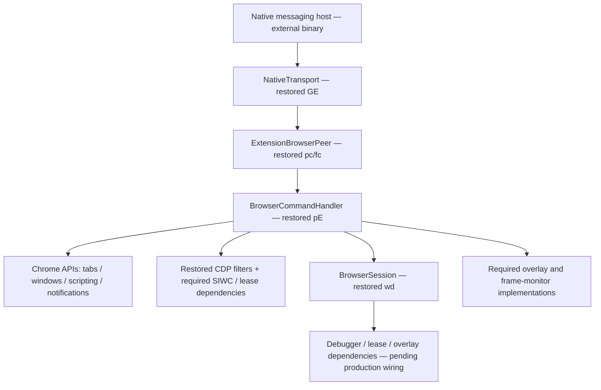

# @core/browser-extension

Readable reconstruction of selected code from the locally installed ChatGPT Chrome extension, version **1.26.1102.11740**, extension ID `hehggadaopoacecdllhhajmbjkdcmajg`. This is a different artifact from the `@oai/*` npm packages. `@core/browser-extension` is this project's package name; no original package with that name is asserted. It is also separate from the older independently authored `extensions/chrome` implementation.

The first restored component is the original `GE` native messaging transport and its errors/type decoder. It uses Chrome's nativeMessaging and alarms APIs plus standard timers; no third-party transport library is recreated. The inspected bundle separately includes Sentry 10.48.0, which is not copied into this component.

`NativeTransport` keeps the original constructor behavior: attach the alarm listener and immediately attempt a native host connection. The default host identity remains `com.openai.codexextension`; callers can supply the original string/list argument. `createNativeTransportClass` adds an explicit dependency boundary for tests while the default export uses actual Chrome APIs and standard timers. Do not construct the default transport in a non-extension process.

Preserved behavior includes native-host-prefixed request IDs, reply correlation, remote error types, timeout/post/disconnect rejection, late-reply suppression, stale-port suppression, explicit reconnect, missing-host-only candidate fallback, five-second retries and half-minute Chrome alarms. Status timestamps and retry counters retain the original transitions. This does not add an invented teardown method that the inspected class lacks.

Provenance and the pinned background.js hash are recorded in `reconstruction/extension-source.json`. The differential harness extracts only explicitly inspected top-level bindings; it does not execute extension startup. Set `CUA_EXTENSION_SOURCE_ROOT` to an installation of the recorded extension version to run the tests on another machine.

```sh
npm run build:reconstruction
npm run check:reconstruction
npx tsx --test reconstruction/extension-native-transport.test.ts
```

This is **not yet an installable extension**. The dispatcher and session classes are restored, but lower-level favicon/overlay/auth implementations, shared lease/debugger/full startup, manifest/build wiring and native messaging host remain outstanding. The original extension snapshot is newer than the recorded desktop application artifacts; cross-version production compatibility is not established by component differential tests.

## Browser RPC facade

The original `fc` bidirectional peer and `pc` extension facade are now restored. Their protocol methods match the browser-service `to` peer, so the implementation is shared through `@core/core/browserRpcPeer`; the browser service retains its existing re-export facade. This factoring is a project boundary, not a claim that the original extension imported that package.

The original bundles differ in transport field initialization order. The shared class factory preserves each variant and class-field descriptor/setter semantics. It retains method registration/binding, numeric request IDs, string rejection values, missing-handler errors, notification listeners and response suppression after closure. `ExtensionBrowserPeer` restores ping and the CDP/detach/download/page/tab-mention notifications, plus moveMouse/WebMCP event handling. Synchronous moveMouse throws remain synchronous failures; only rejected promises go to its error callback, matching the source.

Differential tests compare both original peers and the extension facade. A composed transport/peer test verifies `native-host:*` host requests and numeric browser requests do not collide, and an inbound browser request reaches the supplied handler and returns through native messaging. That transport test uses a fixture handler; later tests below also compose the restored dispatcher and session. Full production startup is not installed.

### Browser command handler

`createBrowserCommandHandlerClass(dependencies)` translates original `pE` in full,
including session resolution/activation, passive reads, CDP validation/filter calls,
capability dispatch, cursor arrival waiters, download events and child popup cleanup.
The original method list, field order, return/error values and dependency-call order
are compared with the pinned artifact. An RPC composition test routes requests
through `ExtensionBrowserPeer` into the handler.

The factory is an explicit reconstruction boundary, not an installed extension
entry point. Use `createBrowserCommandHandlerWithSession(handlerDependencies, sessionDependencies)`
to bind the restored `wd` session; the lower-level handler factory also accepts a
Session constructor. Use the restored tab lease manager for ownership; remaining required dependencies
include SIWC, overlay and frame monitors. The original persistent request-header policy
is constructed directly using the supplied Chrome API; CDP validation/filtering now
imports the restored security module directly. No
production defaults or permissive security substitutes are supplied. Parameter
payloads remain broadly typed while those contracts are being recovered; this is
readable TypeScript, not yet a fully specified public protocol. See
`reconstruction/extension-command-handler-dependencies.json` for every original
binding's readable dependency name. The tests' fake sessions are test-only.



### CDP security and event forwarding

`cdp_security.ts` restores original `Qp`, `Xp`, `Yp` and their helpers. The handler
uses validation before session activation and filters replies before returning to
RPC. The rules reject page-exposed debugger access and require flattened automatic
attachments (except when automatic attachment is explicitly disabled). Cookie and
header transformations specifically protect `__Host-siwc-browser-bootstrap` across
the original CDP result/event shapes. Unknown methods and arbitrary page values
retain original behavior; this is not a blanket secret scrubber.

`registerBrowserEventListeners` extracts six original `dR` subscriptions:
debugger detach/events, handler download changes, Chrome download creation/changes,
and navigation targets. CDP events are filtered before broadcasting, including
dropping `Target.receivedMessageFromTarget`. The original per-peer routing,
instance initialization, remaining runtime subscriptions, and startup lifetime
still need production composition. No teardown or additional catches are invented.
Differential tests execute only these six inspected original subscription calls,
not the original extension startup.

### Request-header templates and persisted policy

The installed browser service's `VC/u5` and extension's `cs/ls` implement the same
header-template parsing/expansion rules. Both now use `@core/core/requestHeaders`;
the browser re-exports its existing function names and the extension exposes
`parseRequestHeaders` and `resolveRequestHeaders`. This is a project-created shared
export, not a claim that the original package had this path. No third-party header
library appears in these inspected functions.

The handler directly constructs the restored original `uS` policy over Chrome
storage. `AGENT_REQUEST_HEADER_ENABLED` becomes sticky once true: a false decision
does not revoke an enabled policy. Failed persistence does not set the in-memory
flag. Header count/name/value/aggregate limits, reserved names, template substitution,
case-insensitive collisions and exact validation errors are compared with the
original extension. The restored session uses these headers during turn activation, and the restored
lease manager performs DNR reconciliation. Production startup remains to be wired.

### Browser session lifecycle

`createBrowserSessionClass` translates every original `wd` method. It retains the
serialized lifecycle queue, cached-context checks, header inheritance and explicit
clearing, handoff recovery, logical active tab, user/child/agent tab claiming,
CDP timeout cleanup, popup/header preparation and end-of-turn finalization order.
The session directly uses the shared original-derived header parser and resolver.
`createBrowserCommandHandlerWithSession` composes it with the restored dispatcher;
a test exercises RPC getTabs/executeCdp/turnEnded through both real classes.

The session factory still requires actual favicon/network/overlay
implementations; the lease manager is now restored, and debugger methods/state can now come from `createDebuggerRuntime`. Those collaborators are explicit fixtures in differential
tests, and the composition helper does not provide fake production defaults.
`reconstruction/extension-session-dependencies.json` maps the original closure.
Broad protocol payload types remain temporary until those contracts are restored.

### Chrome debugger runtime

`createDebuggerRuntime({chrome, setTimeout, clearTimeout})` restores the original
debugger closure and its state. Share **one runtime** across all sessions and use
its `initializeDebugger` in the dispatcher startup, matching the original global
lifetime. The returned fields/functions can be spread into session dependencies;
there are no fixture defaults. This factory does not connect a debugger until its
methods are called.

Restored behavior includes per-tab/per-target operation queues, idempotent attach,
original handling of "Another debugger" errors, viewport set/clear, finally-based
detach state removal, best-effort timeout detach, detach event bookkeeping,
Target.getTargets adaptation, targetId-only routing and timed CDP requests. The
request timeout is a Promise race; a late Chrome command is not canceled by this
module, matching the source. Viewport setup uses the original raw, untimed send.
The three differential tests cover state/error/queue behavior and timeouts; an
additional session composition test uses the restored runtime over fake Chrome
APIs. Actual installation and end-to-end production startup remain outstanding.

### Chrome tab/window operations

`createTabRuntime({chrome, now, setTimeout})` restores the direct `vE/yt/Id/Ad/za/bE`
tab/window helpers; `toBrowserTabInfo` restores `Jr`. The returned methods compose
with `BrowserSession` dependencies. Window selection prefers the requested window,
then a focused normal window, then the first normal window. A failed creation is
retried only when the selected preferred window changed on re-query. An empty
window list creates an unfocused normal window; tabs are created inactive.

Preparing a new-tab page uses the original `about:blank` update and polling path:
25ms polling, a 5000ms deadline, and the original order of read/timeout checks.
Tab ID validation deliberately keeps the source's undefined-only check. Tests
compare selection/retry/error and polling traces with the pinned artifact, then
compose the restored session with this runtime over isolated Chrome fixtures.
No user browser windows or tabs are opened by these tests.

### Request-header rules and persisted lease codecs

`createRequestHeaderRulesClass` restores original `vy` over Chrome
`declarativeNetRequest`. It groups matching session/header configurations, creates
paired main/sub/object-frame and other-resource rules, excludes extension initiators
for the latter, and only removes owned rule IDs 1000000–1004999. Forced sync queries
existing tabs; cached identical rules avoid redundant updates. Failures return an
Error to the caller, invalidate the cache and log only once until successful update.
This is the request-header coordinator, distinct from the Browser Use network-policy manager `ar` restored below.

`lease_codec.ts` restores viewport/lease/storage parsing and source-lease identity
comparison. It uses the restored header parser and keeps the original permissive
numeric checks and the distinction between missing and explicit-null viewport.
These helpers are used directly by the restored `st` lease manager, including
its storage mutation and rollback flow. Tests use isolated DNR/storage values;
no real browser rules are installed.

### Tab lease manager

`createTabLeaseManagerClass({chrome, instanceId, now, error})` restores all original
`st/wn` methods and its singleton. Share the returned class across the dispatcher,
sessions and other runtime components. It directly constructs the restored header
rule coordinator and parses storage through the restored lease codecs.

The manager preserves lazy/cached startup, claims and ownership, child-source
identity checks, handoff/resume, pending viewports, marks, stale-tab release,
replacement/removal listeners, serialized mutations, shallow rollback on mutation
or storage errors, DNR synchronization and active-ID change notifications. DNR
failure propagation remains method-specific, and DNR failure does not undo a
successfully persisted mutation. Rejected initialization remains cached as in the
original. These details are compared against the installed artifact.

A session composition test uses this real manager and real DNR coordinator over
isolated Chrome/storage fixtures to claim a tab, install header rules and release
both at turn end. Instance-ID sourcing and shared component assembly are provided
by the foundation below; full startup and favicon/overlay/auth
components are still required.

### Shared browser foundation and extension identity

`createExtensionInstanceIdReader` restores original `Be/Kg/gc/us`: it returns a
valid stored ID verbatim, shares a cached promise across callers and clears rejected
promises for retry. On missing/invalid identity it removes `nodeReplTunnel` from
session storage, removes `browserUseTunnels` from local storage, generates a UUID
and persists it, in that order. Validation uses the original 128 UTF-16-unit limit
and paired-surrogate checks, not UUID syntax. Merely creating the reader does not
read or mutate storage.

`createExtensionBrowserFoundation(host)` is project-authored assembly around the
restored components. Its `createHandlerClass(handlerDependencies, sessionDependencies)`
shares one identity reader, lease class/singleton, tab-group and favicon singletons, network-policy manager, debugger runtime and tab runtime
across dispatcher/sessions. Known restored dependencies override supplied residual
fields, so accidental extra fields cannot replace them. Remaining capabilities,
SIWC, overlay/monitor and application startup are still
required. This is not an installable extension or a claim that original `dR` has
been fully recovered.

The composition test exercises RPC createTab/attach/executeCdp/turnEnded through
these restored components with isolated Chrome APIs, asserting getInfo/lease ID
agreement, one UUID, one persistent debugger listener, policy rejection/rollback,
inspection-before-session-attach, and lease/rule/debugger cleanup. Policy and header
DNR ranges coexist and are cleaned independently. The policy compiler, predicate
and inspector are restored code; Chrome APIs remain fixtures. Identity
cleanup tests mutate only fixture storage, never the user's installed extension.

### Browser Use network policy manager

`createNetworkPolicyManagerClass` restores every original `ar/op` method. It owns
rules 2000000–2999999, separate from request-header rule IDs. Attach validates the
timeout/tab ID, checks all-sites permission and resource support, removes closed-tab
rules, allocates IDs, installs priority-ordered rules, verifies Chrome's returned
rules, then awaits active-page enforcement before recording the attached policy.
Cancellation and rollback preserve the original AggregateError when cleanup cannot
be verified. Detach removes only this manager's matching rules and checks removal.

The original `Vp` compiler and `Wp` URL predicate are restored and used by default.
They retain normalization/deduplication, allowlist intersections, deny rules,
document URLs, origin restrictions and all input/output/complexity budgets.
Host/origin parsing is shared with browser-service through `@core/core/originPatterns`.
Explicit compiler/predicate injection remains available for isolated tests.

The original `JS` active-page inspector is now restored in
`network_policy_enforcement.ts` and used by default. It temporarily attaches a
debugger, observes iframe targets/loading/context events, waits for a stable frame
tree, resolves HTTP(S) sources (including inherited blank/srcdoc and blob origins),
checks the predicate and detaches. It does not automatically reload the page.
Timeout cleanup preserves the original late-attachment behavior. Explicit injection
remains available for isolated tests.

Differential tests cover normal and rejected pages, iframe/navigation/context
changes, malformed responses, detach/attach failures and deadline races. Manager
composition tests use all three restored components with fixture Chrome APIs,
including rollback on an existing disallowed frame. Real installed-extension/DNR
and browser startup integration remain unverified.

### Managed tab groups

`createTabGroupManagerClass` restores all original bS/yn methods and title/color
helpers. The foundation supplies the same class/singleton to every session. It
retains legacy/current TAB_GROUPS storage, cached initialization (including
rejections), group reuse by related tabs, title updates, random original palette,
removal events and best-effort ungrouping. Per-method error behavior is preserved,
including state changes that precede failed persistence. It directly calls Chrome
APIs; no third-party group manager is copied or reimplemented.

Differential tests compare method inventory, traces, storage and in-memory state.
The foundation RPC fixture now also checks group creation/persistence and empty
group cleanup after closing tabs at turn end. Actual browser tab-group UI remains
to validate alongside production extension startup.

### Favicon resource reader

`favicon_resource.ts` restores original pS/mS/gS/_S. It builds the extension's
`/_favicon/` URL, requests size 32, omits credentials, aborts at 2000 ms, accepts
image MIME types (BMP fallback for the favicon endpoint), and caps both declared
and streamed bytes at 64 KiB. It retains cancellation and error/null behavior and
chunked base64 conversion. It uses fetch/Streams directly, without a third-party
image decoder. The Ma badge/cache/publication manager is restored below; its page-side
consumer remains pending. This helper alone does not
render a badge. Tests compare the pinned original with isolated response/stream fixtures.

### Favicon badge manager and content readiness

`createTabFaviconManagerClass` restores all original Ma/Kt methods and event
callbacks, using the restored resource reader and content readiness runtime. State
operations and publications use separate serialized queues. Active leases override
finalized badges; focused visible tabs clear finalized state. Cache identity and
post-fetch navigation checks, closing-tab suppression, bounded restore before close,
failed-close recovery, storage mutation/error ordering and disposal remain original.

`createContentRuntime` restores Mu/Ta/_y/de: ping first, share in-flight injection per
tab, inject `content-scripts/codex.js`, then ping again. Its timeout resolves null
and does not cancel the underlying operation. No third-party implementation is
needed in these inspected closures. Differential tests compare original method
inventory, traces, state/cache/storage and lifecycle errors, including real restored
resource/readiness orchestration over fixture Chrome/fetch. The shared foundation now supplies this manager to handler and sessions, using the
real restored lease-change subscription. The actual page consumer remains pending,
so visible favicon UI is not verified.

The foundation composition test observes active-badge messages after a real restored
lease claim, then checks clear-badge publication before tab removal and cache/closing
state cleanup on removal events. Browser APIs and favicon responses are fixtures;
page-side message handling and DOM rendering are not inferred from these assertions.
