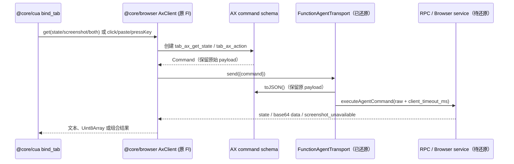
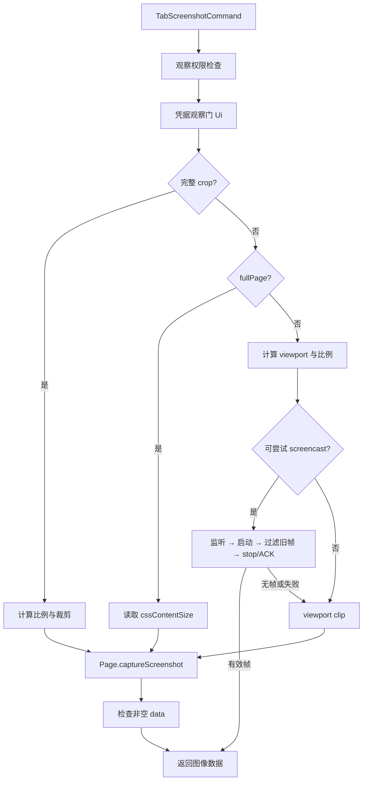

# Source reconstruction / 源码还原

当前目标是读取本机混淆 JavaScript 与声明文件，将原来的代码结构、调用顺序、分支、错误与参数转发还原成可读 TypeScript。原先 `src/` 的独立实现保留作历史参考，不能作为“原代码还原”的交付。

用户指定：TS 源码相对 import 不带 `.js`；保留分包关系，命名空间从 `@oai` 改为 `@core`。原始包名与路径记录在 `source-map.json`。

| 原始包 | 当前 workspace | 当前状态 |
|---|---|---|
| @oai/cua 0.2.6 | @core/cua | CUA 与 core 共 21 个运行模块已还原 |
| @oai/cua-repl 0.1.2 | @core/cua-repl | 包边界已建立，尚未还原实现 |
| @oai/sky 0.7.13 | @core/sky | 包边界已建立，尚未还原实现 |
| @oai/browser-desktop 0.1.1 | @core/browser-desktop | 包边界已建立，尚未还原实现 |
| @oai/browser | @core/browser | 在原声明文件中明确引用，运行代码内嵌；独立 manifest/版本与完整声明尚未定位 |

第一批还原：`create_browser_api`、`bind_tab`、`tab_reference`、`duration_seconds`、`get_browser_tabs`、`core/display`。原始对外 exports 已归档；未完成的 package entrypoint 不提前声明为可运行，当前并非完整可安装替代品。

**最新状态：** `@core/browser` 根入口现在导出 `setupBrowserRuntime`，与安装包 browser-client.js 的实际导出一致。178 项验证通过；需要可信宿主的 `nodeRepl.rpc`，不代表已经实现独立浏览器后端。以下增量章节记录各阶段历史状态，以末尾最新章节为准。

## 验证

```bash
npm ci
npm run check:reconstruction
npm run test:reconstruction
```

构建使用 TypeScript 的 Bundler 解析模式；源代码保持无扩展名。构建脚本仅为输出 ESM 的相对路径补 `.js`，跨包引用保留 `@core/xxx`。差分测试执行**构建后的 JS**，与安装包原 JS 使用相同 mock provider 输入，比较调用顺序、参数、返回值和异常，包括同步抛错/异步拒绝区别。

原包位置默认 `/Applications/ChatGPT.app/Contents/Resources/cua_node/lib/node_modules/@oai`；可设置 `CUA_VENDOR_ROOT`。来源 SHA-256 用于标识本次研究版本。测试覆盖多组 browser API 场景，以及 AX 与 DOM fallback 两条 bind_tab 路径；不是完整语义等价证明，也未完成真实宿主端到端验证。

原 `@oai/browser` / `@oai/sky` 的完整依赖类型未装配。保留原 `.d.ts` 并仅改 namespace；少数外部边界暂用明确注释的 `any`/结构类型，`skipLibCheck` 开启。当前类型检查通过不代表所有依赖类型已还原。最终须恢复这些类型与完整 package exports，再验证宿主链路。

## 后续顺序

1. `create_tinysky_alt` / bootstrap / documentation / setup_browser，接通原 public exports。
2. browser-client 命令和 browser-service 内部 AX tree、element ID、frame、hit test、输入、截图的逐模块还原；保持原后端调用契约。
3. cua-repl 与 sky 的执行、传输和原生宿主边界；无法从 JS 获得的二进制实现明确列出。
4. 在还原后的原协议上接入 MCP client + AgentLoop demo，调用侧仍作为独立应用，不侵入核心包。

不会为了通过测试把未读到的原逻辑替换为自写后端。若需宿主替代实现，另行标识为替代实现，不能称为原代码还原。

## 初始化与文档增量

新增还原 `create_bootstrap_emitter`、`create_documentation`、`read_documentation`、`setup_browser`、`get_browsers`，累计 11 个运行模块。文档资源按原字节复制到 @core/cua/docs，并记录原文件哈希。初始化总入口及 native binders 仍未完成，因此 public exports 仍未接通。

当前 8 项验证通过，包括 browser facade 差分、bootstrap 串行/重试/请求身份缓存差分、环境/确认策略选择差分、实际文档读取字节对比、runtime 装配参数及部分 inventory 失败处理、来源哈希。仍不是所有行为的形式化等价证明。

## 三平台绑定层增量

新增 `bind_mac_app`、`bind_linux_app`、`bind_windows_app` 与 `screenshot_bytes`、`positive_pixels`、`one_screenshot`、`require_plain_text`，累计 18 个运行模块。还原的是原始 Sky 调用适配器，不是旧目录下自写的 Swift helper。

保留原行为差异：macOS durationMs 转秒，Linux 时间原样传毫秒；Linux 观察始终使用原始 window 并跟随 modal，动作使用最近返回的 window；Windows 观察更新 window、清空/更新截图区域，按区域 ID 校验坐标输入；Windows 截图由 Sky 输出而非重复 emitImage，并拒绝截图 emit:false。

当前 12 项测试通过。三个平台均对原 JS 比较单图、多图、缺图、观察失败、参数映射、同步/异步错误；截图字节测试比较 data URL、实际临时文件 URL 和失败路径。测试使用原模块配合同一 mock computer，不代表 Windows/Linux 原生系统运行已验收，也不代表底层 Sky 已还原。

## 联合清单与跨包依赖增量

新增原 `get_apps`、`get_state` 和 `oai_js_core/src/UnreachableCaseError` 的可读 TS，累计 21 个运行模块。原生/浏览器请求并行执行，Promise.allSettled 保留可用的一侧，并按原顺序汇总错误；Linux App 字段转换保留原逻辑。

原构建产物以相对目录引用独立的 `oai_js_core`，没有找到它的独立 package manifest。此目录显式映射为 workspace `@core/core`，并记录该命名是本项目映射而非已核实的原 npm 包名。CUA 通过 `@core/core/UnreachableCaseError` 引用，构建先生成 core，再生成 cua；不把跨模块 helper 复制回 CUA 包。

当前 14 项验证通过；新增原生平台清单、未知平台错误、11 种联合清单配置/故障组合的差分验证。完整初始化入口和原浏览器/Sky 实现仍未接通。

## 浏览器 AX 客户端与命令协议增量

已下探实际导入的 `oai_js_browser/dist/skill/scripts/browser-client.js`，还原 bundle 内的 `Fl` 为 `@core/browser/ax` 的 AxClient，并还原 Command（原 `_`）和 AX state/action schema。新增 3 个业务模块，累计 24 个；第三方校验器不计入还原模块数量。



命令构造本身不提前 parse，toJSON 保留原 payload，FunctionAgentTransport 本身不 parse（此前图示的 parse 箭头已依据原 xm 源码修正）；AX get 不展示，write 才调用 display。截图使用原 atob 路径解码，保持缺图、非法 base64 与 both 分支的错误语义。

校验库是原 bundle 内的第三方 Zod 实现。为避免用不同 npm 版本改变验证行为，以 `scripts/extract-bundled-validator.mjs` 提取原实现、仅格式化并添加导出，保留在 vendor；该文件使用 ts-nocheck，未冒称已完成其类型还原。业务 AxClient/schema/Command 是手工可读 TS。`browser-bundle-segments.json` 记录 Acorn UTF-16 位置及原符号，source-map 记录原 bundle SHA-256。

当前 17 项验证通过。测试给原 bundle 增加仅用于测试的导出，直接调用原 Fl 及原 schema，与构建后代码比较 capture 模式、返回缺失、显示顺序、base64 错误、18 类动作/参数场景、验证错误及原始/已解析 payload。此处仍仅是客户端协议层；真实 AX 收集、几何命中、CDP 点击与截图服务端尚待还原，没有把 RPC 编码误称为底层功能完成。

## Transport、展示与集合增量

新增 6 个可读 TS 模块：FunctionAgentTransport、display、Agent/Browsers/Documentation、Tabs，以及 browser inventory / tabs 命令 schema；累计 30 个业务文件。文件数量是本项目拆分计数，不代表原 bundle 内隐藏的源文件数量或完整度比例。包边界保持 @core/browser；bundle 内类的原文件路径不可得，文件分组在来源映射中明确标为推定。

- FunctionAgentTransport（xm）只调用 command.toJSON，不调用 parse；client_timeout_ms 始终覆盖 payload 同名字段，非正数变 undefined，Infinity 按原实现保留。空响应只拒绝 null/undefined。
- 返回带合法 string[] side_effects 时逐条 await 展示，再去掉该字段；数组类型不合法时原样返回，不擅自丢弃字段或抛错。展示失败停止后续副作用与返回。
- display（u/h/m）处理图片、原始值、包装对象、JSON fallback 和 UTF-16 字符截断。图片输出失败转为 error value；displayValue 失败直接传播，保持原 catch 边界。
- Browsers/Agent（il/nl）保留原 factory 注入、onBrowserUsed 时机和 transport 身份；此 Agent 是浏览器 API 容器，不是调用侧 LLM AgentLoop。
- Tabs（ol）的 new/get/selected/list 不额外解析结果。content 会主动 parse，且校验发生在空 urls 返回 [] 之前；空列表带无效 contentType/timeout 仍抛错。

25 项差分测试全部通过，新增链路直接串起还原的 AxClient、FunctionAgentTransport、display，再与原 bundle 三者组合比较；collection factory、raw payload、schema 错误、通知次序也直接比较原实现。RPC 仍为 fixture，**没有验证真实浏览器动作**。

当前下一层是 jm（manifest 过滤/实例包装）、fm/jh（Browser/Tab）和 Im（nodeRepl RPC、恢复错误），之后进入 browser-service。setupBrowserRuntime 和完整包入口尚未接通；不把已还原的 transport 回调误称为独立可用的浏览器后端。

构建后语义补充：原本只在 constructor 中赋值的 Command、FunctionAgentTransport、Agent 字段使用 TS declare，避免 TypeScript 额外生成 class field 定义而绕过继承的 setter；新增与原构造器的差分测试。

## Manifest 代理与 recovery 协议增量

新增 4 个业务文件，累计 34 个：`runtime/api_view`、`errors/browser_security_error`、`errors/credential_recovery_error`、`runtime/browser_service_executor`。对应原 jm/pl、r/a/i/s/n/o/c、d/l、Im 的具体逻辑。不是完整 jm/Im 入口已经完成：api_view 的原词法依赖 p（类型注册表）与 jh（Tab）暂作为显式内部参数，executor 是从 Im 提取的执行闭包，尚待完整 Browser/Tab 装配。

代理保留跨 view 的 proxy→raw WeakMap 和每次 view 新建的 raw→proxy WeakMap；方法包装缓存按属性键保存，已包装的方法即使原属性替换仍沿用旧函数。返回的数组和 Promise 递归包装，但普通结果对象不递归包装；输入参数中的普通对象/数组递归解包。原对象作为 Reflect.get/Reflect.apply 的 receiver，保持 private field/getter 的 this。禁用成员同时影响 get/has/ownKeys/descriptor；不增加 delete/set trap，不修复原有 Proxy invariant 异常。Tab 在缓存建立后装饰。browser override 可以覆盖默认 unsupportedByDefaultIn，但不能恢复全局 disabledMemberIds。

错误协议保留 16 种 security reason 的原消息、decisionSource、retryable、cause；recovery 解析验证 command/phase/reason/next_action/security_reason 的组合，非法输入返回 undefined，输出只保留协议字段。Error 的 details 冻结，但构造器本身不强制先解析。executor 严格以版本数字 1 选择 executeWithRecovery，否则沿用 execute；只接受 ok===true 或 ok===false 的对应包络。Orbit 的消息文本替换也逐字保留，不改变原 error 身份和冻结 details。

**当前 33 项差分测试通过。** 代理使用原 jm 和原类 prototype 比较缓存、属性描述符、装饰、禁用与异常；recovery 遍历 reason/action/security 组合。executor 与原 setupBrowserRuntime 实际调用后的 RPC 选择、返回和错误直接比较，RPC 使用 fixture；尚未接入真实服务或 credential 流程。

下一步完成 Browser/Tab 与能力注册表，然后让完整 runtime 入口使用这些已还原模块，再逐层下探 browser-service。全量类型、原 public exports、cua-repl/Sky 和独立调用 demo 仍是未完成项。

## Browser 能力、用户标签页与 Tab 服务增量

新增 10 个业务文件，累计 44 个（项目拆分文件数，不表示全量完成比例）：能力基类/定义/集合、management/visibility/viewport 与注册表、BrowserUser、内容导出/剪贴板/日志 API、相应 schema，以及共用的原 dl base64 解码。现有 AxClient 改为引用同一个原解码 helper，未改变解码规则。

- Gl/Hl/Ql/Yl/Xl 保留原 info 引用、文档路径与定义工厂的静态 info 覆盖顺序。集合保留普通对象属性查找，未改成 Map 或自有属性限定。
- Management 的 windows/tabs/tabGroups/bookmarks 是动态 Proxy；排除 then、toJSON、Object.prototype 成员和 symbol，方法不缓存。invoke/getAuditTrail 保留原返回 schema 校验和字段裁剪。Visibility/Viewport 也保留返回校验；Viewport 的参数展开顺序允许原有 browser_id 覆盖行为。
- BrowserUser 保留字符串 id 与对象 id 的不同处理：空字符串抛错，对象中的空 id 原样传递。getTabContext 解析 library_file/text/document 三种结果，document 用 atob 转 Uint8Array；openTabs/claimTab 不增添结果解析。
- ContentAPI、TabClipboardAPI、TabDevAPI 沿用原 client 层协议。剪贴板 read/write 只做原字段转换和顶层检查，不把 schema 校验提前；text/base64 恰有一个的要求保留在原 schema。日志 warning→warn、字段省略、正整数 limit 和错误顺序与原代码比较。

**当前 44 项差分测试通过。** 新增浏览器能力、用户标签页和 Tab 服务验证；覆盖注册描述/引用身份、命名空间、参数覆盖、audit schema、文档解码、剪贴板双数据字段与空项、日志错误。测试使用原 bundle 与相同 fixture transport，没有实际操作用户浏览器、系统剪贴板或导出文件。

Browser 层三种能力注册表已还原；Tab 的其他能力注册表、CUA/DOM-CUA/Playwright、Tab/Browser 完整实例与 runtime 装配仍未完成。之后还需 browser-service、Sky/cua-repl、完整类型/exports 和独立 MCP/AgentLoop demo。

## 坐标/DOM 输入、对话框与 Tab 开发能力增量

新增 8 个业务文件，累计 52 个：CUAAPI、DomCUAAPI、对话框对象、CDP/botDetection 能力及 schema、输入与 Tab 控制 schema。其中特别区分 2 个 schema 文件由原 AST 表达式提取、展开词法名称并添加推定 payload 类型，其余为手工还原；不是把格式化的整个 bundle 冒称为 TypeScript 业务还原。

`node scripts/reconstruct-input-schemas.mjs` 可重建输入与 Tab 控制 schema。原 validator 表达式、字段顺序、错误消息和共享 schema 身份不变，生成文件是可读 namespace/字段名而非原混淆标识符。`source-map.json` 为这两个文件记录独立的生成状态与脚本，完整 source hash 仍验证安装包版本。

- CUAAPI（Bl）保留 typeof 坐标检查、keys/keypress 的不同参数映射、空键/空拖拽路径错误；媒体下载同时转发服务端 timeout_ms 和 transport timeoutMs。
- DomCUAAPI（ql/Dl/Ll）保留 node_id 原 schema 的首条错误、必填/可选节点差异，以及 scroll/type 的参数解构行为。get_visible_dom 原样返回，不新增结果解析。
- 对话框（vh/xh/kh/Sh/Th）保留 dismiss、Confirm.accept、Prompt.accept 和字符串校验；不擅自给 Alert/BeforeUnload 添加 accept。导航、截图裁剪、handoff 与 dialog schema 已还原，完整 Tab 方法装配仍待完成。
- CDP（Su/ju/Iu）保留 target 字段转换、原始命令返回、事件结果校验；正数事件等待的客户端 timeout 为原值+2000ms，0/未指定不加客户端 timeout。botDetection（cu）发送前 parse，覆盖调用参数中的 browser_id/tab_id，并按原 schema 校验结果。

**当前 52 项差分测试通过，类型检查通过。** 新增输入映射/校验、DOM 错误、下载 timeout、对话框操作、25 种输入/Tab 控制命令 schema，以及 CDP/报告能力的组合验证。所有比较执行原 bundle 对应类/命令；transport 是 fixture，没有实际点击、下载、CDP 调试或用户接管。

剩余主要客户端依赖：Playwright、browserAuth/pageAssets/webMCP 三类 Tab 能力，然后完成 Tab/Browser/完整 runtime 入口。之后仍需 browser-service、Sky/cua-repl、类型/exports、调用侧 demo 与真实端到端验收。

## 页面资产、WebMCP、认证 schema 与 Playwright helper 增量

新增 7 个手工还原业务文件，累计 59 个（含此前 2 个 AST schema 生成文件）：pageAssets/webMCP 客户端和命令 schema、browserAuth 完整命令与诊断 schema、对象判定和 Playwright evaluate/error helper。api_view 现在复用原 pl 的独立还原，保持同一套普通对象判定。

PageAssets 保留 bundle 参数展开后覆盖 target id、list/bundle 返回解析；没有增加客户端 payload 校验。WebMCP 保留 descriptor 投影、原 description JSON 排列、同 call_name 后项覆盖、冻结工具快照、工具别名 trim、旧快照的 registration_id 和调用参数省略规则。调用只发送原有字段，未擅自把 schema 中的 tool_origin 加进客户端命令。

browserAuth 的 schema 已完整还原（字段/选项/密码专用请求约束、诊断与事件上下限），但 BrowserAuthTabCapability.request 和 locator 身份校验尚未接通：原 Vu 依赖真正的 PlaywrightLocator（kl）及它的私有 selector 访问器，不能用形似对象代替。Playwright 的普通对象/RegExp/错误判断、参数序列化、脚本构造、动作错误分类和坐标校验已还原，为完整 locator 做准备。

**当前 61 项差分测试通过。** 覆盖页面资产、工具快照/描述/调用、认证 schema，以及跨 realm RegExp、getter/proxy 失败、JSON 序列化顺序、evaluate 脚本与错误分类。业务自定义错误逐字比较；源变量重命名会改变 V8 自动生成的 TypeError 中的变量标签及 stack 位置。测试对两处已知标签差异（point/t 与 name/e.trim）做精确归一化，不把任意错误文字忽略掉，也不宣称 stack 字节等价。

这些仍是客户端层验证，未执行实际认证、网页工具或文件下载。下一步完成 PlaywrightLocator / FrameLocator / API，再接 browserAuth 和五类 Tab 能力注册表，完成 Tab/Browser/runtime 装配；底层 service、Sky/cua-repl、完整类型/exports 与独立 demo 仍需推进。

## Playwright 选择器与集合读取缓存

新增 3 个手工还原模块（累计 62 个业务文件，含 2 个 AST schema 文件）：selectors、CollectionReadCache 和 PlaywrightLocatorReadAll 命令/schema。对应原 Tl/jl/Il/Cl/Rl/Pl/El/Al/Ml、Sl、Yc。

选择器保留文本与属性不同的转义、正则 unicode/unicodeSets 分支、跨 realm RegExp 判断、exact 标记及原来的有限参数校验。集合缓存按 relativeSelector 共享 Promise；index 和 timeout 不进入 key，首次调用的 timeout 控制共享请求。失败删除 key，clear 不取消在途请求；旧请求失败会删除 clear 后同 key 的新缓存，忠实保留原竞态。结果不隐式执行 schema.parse。

**65 项差分测试通过，类型检查通过。** 新增选择器、并发共享/超时、失败重试、clear 与在途失败竞态、命令/结果 schema 验证。未接入真实浏览器；完整 PlaywrightLocator、FrameLocator、API 与 browserAuth 装配仍待完成。上述文件是实际依赖的还原，不代表完整 Playwright 已交付。

## Playwright 客户端与 browserAuth 接通

本轮新增 9 个业务文件：PlaywrightLocator、FrameLocator、PlaywrightAPI、Download、FileChooser、BrowserAuthTabCapability、五类 Tab 能力注册表，以及 locator/page 两个命令 schema 文件。累计 71 个业务文件，其中 4 个 schema 文件由原 AST 提取并补充可读名称与推定类型；其余为逐方法还原。新增 schema 同样由 `scripts/reconstruct-input-schemas.mjs` 再生成。

Locator 保留点击/输入/selectOption/check/等待/下载、单项与集合读取、evaluate、链式定位、and/or/filter、目标身份检查及 collection cache 传播。动作成功清缓存，waitFor 不清缓存；直接过滤集合根与过滤相对子选择器采用不同缓存规则。动作失败后请求 1000ms DOM 诊断，诊断失败退回原上下文错误。

Page API 保留 URL/load 等待、timeout+2000、download 默认 120000ms、waitForEvent 内部 rejection handler，以及 expectNavigation 先启动等待、再以 Promise.then 调用 action 的顺序。下载与文件选择对象保留原字段映射、参数检查和异常包装；elementScreenshot 保留原 atob 字节解码。FrameLocator 逐层插入 enter-frame 选择器。

browserAuth 现在使用真实 PlaywrightLocator 的私有 selector 访问器，拒绝形似对象及跨 browser/tab 的 locator，保留字段省略与 serialize → command.parse → send → result.parse 顺序。CDP、botDetection、browserAuth、pageAssets、webMCP 按原顺序注册。

**80 项测试通过，类型检查通过。** 新测试直接实例化原 bundle 类作差分比较，覆盖动作/读取/缓存/链式选择、局部错误、认证参数与身份、页面/事件/导航时序、27 组命令 schema、公开方法顺序和 arity。诊断回调经可读 TS 重写后，Function.toString 的文本会改变；对此执行两份实际脚本并比较 DOM 诊断结果与最终错误，不宣称其序列化脚本文本相同。自定义错误逐字比较，原生 TypeError 变量名称与 stack 位置差异仍适用此前说明。

本轮是完整 Playwright 客户端类的还原，不是底层 Playwright 服务已交付。尚未进行真实认证、网页输入、下载或文件上传。下一步装配 Tab/Browser 与完整 create/setup runtime，再继续 browser-service、Sky/cua-repl、声明与 exports、独立 MCP/AgentLoop demo 和真实端到端验证。

## Tab 与 Browser 装配

新增 Tab、Browser 和 browser_session 命令/schema，累计 74 个业务文件（4 个 AST schema 文件）。Tab 按原顺序创建 Playwright、DOM/CUA、AX、Content、Clipboard、Dev 与 capability 对象；Browser 创建 Documentation、browser capabilities、Tabs 和 BrowserUser，两个 tab 工厂入口共用原配置。

保留了原实现的目标身份差异：Tab 自身方法读取当前 public id，已经构造的子 API 固定为初始 id；Browser.history 使用私有初始 id，而 documentation/nameSession 读取 public browserId。构造器仍为赋值语义，继承 setter 会被触发；未改成 TS emitted public field definitions。

截图 clip 仅检查 typeof number（保留 NaN/Infinity 的原行为），数据按 atob 解码；对话框按实际 type 创建，未知/缺失返回 undefined。handoff、导航和读取保留各自 transport 检查位置。history 保留 options→queries→limit→from→to 的验证顺序、日期转换与可选字段省略，session name 按原 trim。

**86 项差分测试与类型检查通过。** 新增 Tab 路由、子 API 绑定、截图/对话框、构造/transport 错误优先级、Browser 工厂与能力装配、history、继承 setter/成员顺序、3 类命令 schema 对比。测试执行原 bundle 的 jh/fm；仍使用 fixture transport，没有真实浏览器操作。

下一步还原完整 runtime registry、jm 工厂与 setupBrowserRuntime 接线，再导出可运行客户端入口。当前尚未完成完整 runtime，也未完成底层 service、Sky/cua-repl、完整类型/exports、独立 MCP/AgentLoop demo 或端到端验收。


## Runtime 注册表、工厂与根入口

新增 7 个文件（累计 81 个业务文件）：原 p/b 的运行类型和命令注册表、RuntimeConfig schema、generateRequestId、BrowserRuntimeFactory（jm）、setupBrowserRuntime（Im）和根导出。注册表保留 key 顺序、普通对象原型及不可配置的只读 getter；AX 命令补齐原命名空间的 schema/type 元数据。

工厂接通已还原的 API proxy：manifest 决定 runtime class，按浏览器类型和 overrides 过滤成员，global disabled 不能被 override 重新开启；Tab 装饰、方法缓存、跨 view 参数解包沿用原实现。createBrowser 保留实例箭头字段绑定，createAgent 使用真实 FunctionAgentTransport。此处 Agent 是浏览器 API 容器，不是 LLM AgentLoop。

setupBrowserRuntime 检查可信 nodeRepl.rpc，提取方法后以原 receiver 语义发出 browser setup/execute/executeWithRecovery。仅 credentialRecoveryErrorVersion 严格等于 1 时走恢复 envelope；Orbit 环境只改变指定错误后缀，不修改 setup 请求中的显式 environment。显示桥使用 host.emitImage 和 console.log，截断阈值 100000。

构建后可使用 `import { setupBrowserRuntime } from "@core/browser"`，包根仅导出安装包实际导出的运行时函数。原包完整声明与其它 workspace 的 public exports 尚未完成；不把客户端入口接通等同于全套独立产品已可用。

**94 项差分测试与类型检查通过。** 新增注册表键/descriptor/构造类型可用性、ID 格式、工厂过滤与装饰、setup→Browser→Tab→AX→browserAuth 的组合调用、Locator proxy 解包、严格恢复分支、Orbit 错误映射、宿主失败及包根导出。组合测试中的宿主 RPC 是明确的 fixture，没有实际点击、认证或观察用户桌面。

接下来进入 browser-service 的协议入口和命令分发，继续读取其实际实现；还需完成 CUA 初始化、Sky/cua-repl、完整类型/exports、独立调用 demo 与真实端到端验证。不会把旧独立后端接到这里冒充原实现。

## browser-service RPC 与错误边界

开始读取实际嵌入的 `browser-service.mjs`（1578397 字节，SHA-256 `bc9f10f913da912bd0cd17a22432a605526c5d3a01d6be43eea0ac2e0284bfb0`）。新增 5 个还原模块：RPC dispatcher、内部/公开错误分类、服务端 security/recovery/locator 错误类。service 错误类保留独立身份，不复用 client 类；即使 name/details 相同，也不能改变原 instanceof 捕获范围。

原 handleRpc 通过 own property descriptor 查找方法，拒绝继承方法；setup 仅允许四种环境，并立即替换共享 runtime Promise。并发 setup 各自返回已开始的初始化结果，后续 execute 使用最新 Promise。初始化失败不会自动恢复旧 runtime。executeWithRecovery 只捕获服务端 xs 类，其他错误按原身份抛出。

dispatcher 的 createHostRuntime / initializeRuntime / withSpan 明确对应尚待还原的 mH / p6 / mn；这是实际分发状态机的依赖边界，不是已实现后端或生产 fallback。目前没有导出伪装可用的 `@core/browser/service` 入口。源码显示 p6 内部还包含 context/session 生命周期、文档门禁、按 browser API 缓存执行上下文、Tab reclaim、下载 setup 同步、认证边界、AX WASM 初始化及实际命令表分发；这些仍待逐项还原。

**98 项验证通过。** 服务测试从原 bundle AST 提取指定表达式并执行，避免导入完整服务时启动无关原生/遥测依赖。覆盖四环境、拒绝非自身方法、初始化并发/失败、错误类别与身份、恢复 envelope；另将已还原客户端连到 dispatcher fixture，验证服务端错误经序列化后成为不同身份的客户端恢复错误。没有执行真实服务命令或网页操作。

`node scripts/extract-browser-service-segments.mjs` 生成 `browser-service-segments.json`，记录源哈希与 UTF-16 位置（不是字节 offset），用于导航与溯源；生产代码不读取安装包。下一步进入 p6 调度和其具体依赖，完整 backend、Sky/cua-repl 与调用 demo 仍未交付。

## 服务端清单命令与实际截图算法

新增六类全局清单/文档处理器（xx/Ex/Tx/Cx/Ax/Px 与 c6）、环境能力过滤、浏览器 metadata 投影，以及 F 命令注册器、W tab ID 转换和完整截图分支（XD/Ui/pJ/KD/Q_/mJ/fJ/hJ/gJ/bJ）。清单命令按原顺序 refresh/get，文档读取不添加 refresh；禁用列表为空时保留数组引用。CDP 且有效 browserAuth 能力存在时，才启用两个用户接管 override。

截图是服务端实际算法的还原，不只是转发壳：先观察授权，再进入 credentialObservationGate；CSS 模式读取 devicePixelRatio，错误/无效值回退比例 1；crop/整页/viewport 各自采用原布局指标和 clip。viewport 可尝试 screencast，先监听再启动、以 timestamp 丢弃旧帧、ACK 和 stop 保持原顺序；失败回退 Page.captureScreenshot。保留 2000/5000ms 分支、JPEG quality 80、空 data 错误及 finally 清理。



**104 项差分验证通过，类型检查通过。** 新测试从原 service 提取并执行真实函数，比较能力/投影/命令顺序及截图的 CDP 调用、参数、数据与清理：包括 crop/fullPage、缩放、布局异常、旧帧、visibility、start/stop/ACK 失败、保护门拒绝。尚未运行真实 CDP 传输，withInternalScreencast/CDP manager、权限与凭据门的内部实现仍待还原；不能把 fixture 中的图像数据视为真实截图验收。

下一步继续服务端执行上下文和 CDP/screencast 传输管理，接通实际截图调用。p6 总调度、其他命令、Sky/cua-repl 与独立 demo 仍是未完成工作。

## CDP 事件等待与 screencast 所有权

还原 qh.waitForEvent 与六个 screencast 方法，保留 qh 原字段/owner 关系。当前作为显式 owner 的方法组存在，等待完整 qh 构造/传输层接入，未冒称完整 CDP manager。事件等待保留 Number+finite 校验、tab 过滤、首次结算、initialCheck/action 次序、abort、predicate 错误转换及 finally 移除 listener/timer/abort listener。

screencast 按 tab 维护 Promise 队列：同 tab 串行、不同 tab 独立，失败后释放；raw screencast 占用时不启动内部截图。内部帧先由事件入口登记 session ID，再由当前会话 matcher 接受。退休 ID 保留 10000ms、最多 32 项，避免延迟帧进入下一次截图；child session/target 事件不属于根 screencast。

**109 项验证通过，类型检查通过。** 新增事件等待、并发锁、失败清理、会话隔离、过期/容量与组合截图测试。组合测试使用真实还原的 wait/ownership 方法，只有底层 CDP call 和事件输入仍为 fixture；直接对照原 qh 对应方法与原截图函数。没有真实浏览器截图或传输验收。

来源索引现在包含 qh 类及各方法的精确 UTF-16 位置。下一步仍需 executeTargetCdp、attach/事件桥、权限和凭据内部边界、完整 qh/p6 装配，以及剩余浏览器命令、Sky/cua-repl 和独立 demo。

## CDP 发送、deadline 与 attach 状态机

新增 deadline/telemetry 辅助、execute 方法组和 attach 方法组。发送路径保留 JS dialog 前置检查、attachment 等待、prepareDispatch、beforeDispatch、document target 覆盖、缓存表达式分支、原始参数和超时字段。Debugger 未附着只在原条件下重试一次；nested target 与 attach setup 不重复重试。只在附着 Promise 仍是同一实例时清理旧状态，避免误删新的 attachment。

Deadline 保留截止前检查、剩余时间下限 1ms、Promise.race 与超时 timer 清理；race 不取消底层操作。raw CDP 限定 session/target 属于当前 tab，强制 preserveDebuggerOnTimeout，并在 start/stop screencast 成功后更新 raw 所有权；没有另加未授权直连通道。

attach 共享每 tab Promise，按 network policy → provider.attach → focus emulation → tabAttached → attach handlers 执行。setup Symbol 贯穿回调，允许内部 Page.enable 等初始化命令重入而不等待自身。回调使用 allSettled，仅重新抛出首个 deadline 类失败；普通失败按原行为忽略。OOPIF 自动附着先带 iframe filter，非 deadline 错误才尝试无 filter 回退。

**118 项差分测试、类型与来源哈希检查通过。** 新增 dispatch 重试/错误/telemetry、target/cache、deadline、并发 attach、失效 Promise、focus 与 handler 错误、OOPIF 回退，并组合真实重建的 dispatch/attach 方法验证初始化重入。provider.api 仍为 fixture；完整 qh 构造、事件桥、forget/detach、安全依赖及真实服务尚待装配。

下一步继续 qh 生命周期与事件入口，随后将截图和命令执行接到完整 manager；仍需完成 p6、其余服务命令、Sky/cua-repl、类型/exports 和独立 demo，不能将这些方法组视为独立可运行后端。

### CDP detach and frame/session lifecycle

Reconstructed nine original qh methods in service/cdp/lifecycle_methods.ts: event-source tab routing, detachTab, forgetAttachedTab, frame/target alias maintenance, and child-target cleanup. Numeric tabId takes precedence over session/target without fallback. During initialization, forget only clears the attached flag; remaining cleanup is deferred to attachment finalization. Child target sets are removed before allSettled cleanup. Source fields that are not cleared remain unchanged.

121 tests pass, with type checking. New differential tests execute the exact original AST methods and cover routing precedence, alias migration, delayed/forced cleanup, detach reasons, provider failure, in-flight attachment and partially failing child cleanup. Full manager construction/event bridge, raw-event storage and native provider integration remain incomplete; these method groups are not a complete runnable service.

### CDP target/frame events and frame initialization

Reconstructed qh target attach/detach, frame navigation/detach, and shared frame initialization, plus Uh/HN/GN/VN predicates. Root frame navigation records frame ID and URL before discarding raw events when securityOrigin changes. Same-document navigation intentionally ignores targetId but excludes sessionId, as in the source. A session already associated with a different frame ID is not reassigned by frameNavigated.

Initialization shares a WeakMap promise, runs Page.enable, Runtime.enable and Page.getFrameTree in order, then checks session identity before updating the frame index. Rejected shared work can be retried by a waiter. A stale session can still become initialized in the WeakSet even when its frame index update is skipped; this source behavior is preserved.

125 differential tests pass; type checking passes. Tests execute original AST methods and reconstructed methods with lifecycle indices, checking event ordering, identity, same-origin retention, concurrent initialization, retry and deadlines. Provider input remains a fixture. The full manager constructor/event bridge and real backend remain incomplete.

### CDP JavaScript dialog state and event handling

Reconstructed ten qh methods plus Ite/kte for dialog IDs, lookup, prompt mutation, target-specific removal, automatic beforeunload acceptance, and the CDP command guard. Protected authentication tabs auto-accept alerts and reject other dialog types without recording/replacing dialog state. The source's protected-tab predicate remains an explicit dependency, not a placeholder authentication implementation. Session-target matching intentionally compares sessionId only.

128 differential tests pass with type checking. New tests execute original AST methods alongside the reconstructed methods and lifecycle session routing, covering rejected provider calls, stored-state retention, defaults, sequential IDs, frame-detach cleanup, prompt mutation, stale IDs and error ordering. Full manager event subscription, authentication state and real provider integration remain pending.

### CDP raw event buffer and long polling

Reconstructed seven qh methods for raw event storage, filtering, pagination, cursor sequencing, discard and long polling. Retention is 1000 events per tab. Params are shallow copied on recording, while source and nested parameter references are retained. Tracked target ID is captured at record time but omitted from public results. Discard preserves monotonically increasing sequence and eviction watermark.

A timeout option causes the default cursor to be captured before attachment; without it, the default cursor is captured after attachment. Polling settles on matching data, truncation, same-tab detach or timeout, and removes both event listeners. Zero-limit and empty-filter behavior follow the source without added validation.

132 differential tests pass, with type and provenance checking. Tests run original AST methods and reconstructed methods to check reference identity, target capture, retention, pagination, attach-time events and listener cleanup. Full manager constructor/event bridge, authentication state and real provider integration remain pending.

### CDP constructor event bridge

Reconstructed qh constructor event registrations as registerCdpEventBridge with an explicit owner. Raw events are recorded before source.tabId normalization; target/frame handling precedes event emission, whose registered listener handles dialogs. Internal screencast and authentication-protected events still reach normalized event handling but are excluded from the raw buffer. Detach falls back to pending numeric tab attachment only when normal source resolution fails.

Attach wiring calls Page.enable before OOPIF setup; cleanup wiring detaches remembered child targets. Reconstructed enableOopifAutoAttach preserves its post-attachment set recheck and successful-configuration marker.

134 differential tests pass with type checking. The exact original constructor is executed against an instrumented base owner and compared with reconstructed registration using the reconstructed raw event buffer and session lookup. This does not yet instantiate the complete qh manager: remaining state/methods, authentication and provider dependencies must be restored before full assembly.

### CDP credential protection and worker configuration

Reconstructed ten qh methods for raw-event suppression reference counts, persistent credential diagnostics protection, new-target protection leases, service-worker start protection and serialized worker bypass configuration. New-target provider results require literal true. A lease release invokes the provider each time, while raw suppression release decrements only once. Worker lease repeated release still triggers configuration, as in the source.

Worker start configuration serializes pending work, ignores prior rejection and rechecks attached state; final release restores OOPIF auto-attach. Bypass configuration tracks state identity so replaced state cannot modify a new lease. Acquisition failures roll back counts using the source's original error precedence.

139 differential tests pass with type checking. Tests compare exact original AST methods for concurrent leases, repeated release, failed provider calls, strict provider results and stale bypass state. The privileged browserAuthNewTargetProtection provider itself is not implemented here. Full manager assembly and real backend verification remain pending.

### CDP frame target resolution and attachment

Reconstructed targetForFrame, targetIdForFrame, targetForFrameOrAttach and attachDebuggerFrameTarget with xte/Ete predicates. Existing sessions are initialized and reused; otherwise target listing prefers an exact frame target ID, then a unique URL match. An unscoped URL match requires DOM.getFrameOwner validation against the selected parent target. Ambiguous matches and cross-tab parents return null.

Attachment preserves provider-created sessions or creates target-prefixed synthetic session IDs, updates frame/target aliases, records cleanup targets and initializes the session. Provider failures are converted to null only where the source does so, with explicit deadline checks preserved.

142 differential tests pass with type checking. Tests compare original AST methods and reconstructed lifecycle indices for exact/URL/ambiguous matches, ownership checks, existing and provider-created sessions, cross-tab rejection, unsupported providers and failures. Complete manager assembly and real provider integration remain pending.

### CDP document state and tab close operations

Reconstructed seven remaining qh methods for JavaScript evaluation, document state, committed/current URL, closeTab, detachAllTabs and file chooser cleanup, plus Ste error formatting. Runtime.evaluate forwards only the original timeout/telemetry options; document state failures return undefined. Committed URL conversion intentionally permits nonfinite keys at the provider boundary, while currentTopLevelUrl requires finite input.

closeTab selects the first strictly matching numeric tab target, runs cleanup and sends Target.closeTarget or Page.close; forget occurs in finally only after attachment succeeded. detachAllTabs snapshots attachment-promise keys and settles all detach operations.

146 differential tests pass with type checking. Tests verify exception message precedence, option omission, URL cache behavior, cleanup/finally boundaries and partial detach failures. Source-method inventory now leaves waitForPageLoadEvent before full qh method coverage; method coverage alone is not proof of complete manager equivalence or provider integration.

### CDP page-load classification and original event emitter

Reconstructed waitForPageLoadEvent and navigation helpers, plus the original Za emitter. The initial classification timer switches to the load timer only once. Same-document events are ignored for frame IDs already seen navigating; BFCache restoration has separate scope checks. Navigation blocking preserves service security errors and redacts credentials/query/hash from displayed URLs.

The original emitter uses a plain object, removes the last duplicate listener, snapshots listeners for dispatch and binds callbacks to the emitter. It must not be silently replaced with Node EventEmitter during full manager assembly.

150 differential tests pass with type checking, including deterministic timer-transition traces. All qh methods now have reconstruction entries, but full class field/prototype assembly and provider integration are still required. Method inventory is not proof of a runnable complete backend.

### Complete CDP manager class assembly

createCdpManagerClass now assembles all reconstructed qh methods on the original Za-derived prototype with the original field initialization order and four constructor arguments. The lexical telemetry reporter is supplied to the class factory; provider operations are required dependencies, with no fallback backend. Method property order, descriptors, names and arities match the original qh prototype (the readable constructor name differs).

152 tests pass with type checking. New differential tests instantiate the exact original class and the reconstructed class, compare own field order/types and prototype descriptors, then exercise attachment, dispatch, document state, dialog blocking/mutation, raw events and detach through the complete manager. All underlying browser I/O remains an explicit fixture in these tests.

This completes the manager assembly milestone, not the overall service: p6 runtime/context/command handlers, privileged provider, native/Sky/cua-repl integration and independent MCP/AgentLoop demo remain pending. Current tests demonstrate exercised behavior, not exhaustive equivalence of every runtime interaction.

### Execution context tab inventory, lifecycle and UI dependencies

Reconstructed gg, Tg and bg as ServiceTabs, TabLifecycle and BrowserUi. Tab lookup retains strict ID matching, first-active selection, detailed missing-tab errors and provider return identity. Lifecycle state is scoped by session; acquisition refreshes per-turn claims without duplicating acquired events, creation records every event, and takeEvents drains the queue. UI mouse movement retains explicit false wait projection and catches synchronous/asynchronous provider failures.

155 differential tests pass with type checking. Tests compare the original classes for arguments, state identity, session/turn changes, null-turn behavior, event draining and awaited versus detached mouse movement. These are actual ob dependencies; the full execution-context constructor, remaining security/input/observation components and privileged provider still require reconstruction.

### Execution context developer logs

Reconstructed dg and console/exception conversion helpers as BrowserDev. Attach ensures Runtime.enable with shared pending promises; detach clears logs and runtime state. Authentication-protected events are excluded. Console values, warning aliases, first-stack-frame URL and exception text precedence match the source, with receipt-time ISO timestamps. Storage retains 500 entries and logs applies source filter/levels/slice behavior, including zero limit.

158 differential tests pass with type checking. Tests compare source helpers/class for value conversion, filtering, retention, protection and concurrent Runtime.enable. The original detach/in-flight race is preserved: an old enable can mark the tab enabled and delete a replacement pending entry; this reconstruction does not silently repair source behavior. Full execution context and real provider remain incomplete.

### Execution context clipboard store

Reconstructed Eg and yie/wie/_ie/vie validation/copy helpers. The store copies projected entries on write and read, serializes operations through a rejection-recovering tail, caches one bridge per CDP identity and retains original Promise.all cleanup/disposal behavior. Failed disposal leaves remaining maps/items intact after disposed is set. Validation preserves atob acceptance and exact field/error ordering.

161 differential tests pass with type checking. The original lexical xg page bridge remains an explicit constructor dependency; this is not yet a complete browser clipboard integration. Next restore xg installation, binding calls and injected page scripts before execution-context assembly.

### Page clipboard host bridge

Reconstructed xg and DL/OL/kL/BL for per-target installation caching, binding requests, installation verification and cleanup. CDP binding and new-document script installation preserve source ordering and rollback boundaries. Detach invalidates matching tab installations; ensure cleans and reinstalls invalidated state. Disposal reuses its pending promise and removes listeners/cleanup handlers.

164 differential tests pass with type checking. Tests compose the reconstructed clipboard store with original/reconstructed bridges and compare CDP traces for shared installation, read/write/error responses, partial installation failures, invalidation and idempotent disposal. UUIDs are normalized only in trace comparisons. The injected IL/bie page installation body remains an explicit dependency and is the next reconstruction step; real page clipboard integration is not yet verified.

### Page clipboard script and assembled clipboard stack

Reconstructed bie/IL as self-contained readable TS: text/binary serialization, ClipboardItem fallback, binding request promises, receiver/argument checks, own/prototype patching, guarded restoration, frame cleanup messages and pending-request rejection. BrowserClipboard now assembles the real reconstructed store, host bridge and page installer.

167 differential tests pass with type checking. VM comparisons execute both original and reconstructed scripts for read/write, binary blobs, illegal receivers, own/prototype restoration and pending cleanup. Serialized function text differs due to readable names; runtime behavior is compared rather than claiming byte identity.

Additionally, `npx tsx reconstruction/clipboard-browser-smoke.ts` passed in isolated real headless Chromium: page write/read, reload reinjection, cleanup and absence after another reload. This uses a small CDP test adapter, not the production provider or complete MCP/AgentLoop stack. The test closes its isolated browser and does not access the system clipboard.

### Service browser user and authorized tab context

Reconstructed lg and LF/FF with validation, Workspace URL/format/name helpers and YouTube selection/transcript rules. PDF library capture is preferred; otherwise the provider reads the authorized page and its URL/title/text/truncation are validated before specialized reads. Workspace tries document-type export formats in source order, preserves changed-tab/oversized failures and skips redirects/errors where specified. YouTube selection and transcript branches retain original ordering and wrapper text.

169 differential tests pass with type checking. Tests execute original source classes/helpers and reconstructed code for URL mismatch, plain pages, export fallback/errors, selection/transcript and library-capture property projection. Actual provider executeTabRead and PDF capture remain external dependencies; no live Workspace or YouTube access was performed.

### Response site-instruction cache

Reconstructed mg/WF as SiteInstructions. Capture first clears matching-frame state, consumes all matching headers even with proxy disabled, then applies original protocol/hostname checks and percent decoding. Invalid URL/encoding deletes the tab entry; a disallowed URL returns without deleting a different-frame entry. Peek compares stored URL to the requested URL without its fragment; take always deletes even on mismatch.

171 differential tests pass with type checking. Tests cover header mutation/order, proxy state, loopback/link-local hostname cases, malformed decoding, frame isolation, fragment behavior and destructive take. This is a response-cache component, not a standalone authority or security policy engine. Execution-context assembly and document-response capture are still pending.

## Document response capture and request interception (Xh)

Reconstructed `service/context/document_responses.ts` from Xh/Mc/su/Yre. Preserves shared setup promises, serialized Fetch reconfiguration, descending interceptor priority, snapshot processing and drain-on-remove. Request exceptions block; handled requests remain owned by their interceptor. Document response ownership is released only after successful CDP continuation/failure; response listeners trigger header overrides only when the array identity changes. Session/target events are ignored as in the installed implementation, and detach clears all per-tab state.

174 differential tests pass with type checking. New tests execute the installed AST class and readable class against matching CDP fixtures, covering headers, ownership, target filtering, priority, handled/block/exception outcomes, draining, setup/configuration retry and retained ownership on CDP failure. Production provider and full execution-context assembly remain pending.

## Download ownership, authorization and completion (pg)

Reconstructed `service/context/downloads.ts` from pg and its URL/header helpers. Preserves per-tab exclusion, source authorization, HTTP paused-response claims, frame/redirect request tracking, blob origin/session checks, host completion correlation and filename caching. The original timer is cleared during cross-origin authorization and rearmed with its previously computed remaining budget; this is preserved rather than replaced by a generic timeout wrapper. Disable deletes state before asynchronous cleanup and always stops request tracking in finally.

178 tests and type checks pass. Four new differential tests execute the installed class/helpers and readable code against host/security/response fixtures: classification and overrides, HTTP completion for cdp/iab/extension, session and download ID filtering, redirect chains, blob origin rejection/completion, nested actions, cancellation and timeout cleanup. No live download, production authorization backend or end-to-end agent completion is claimed.
