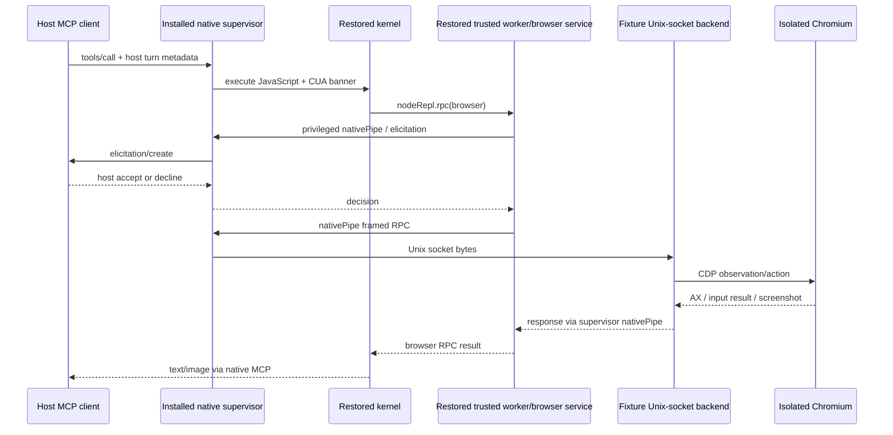

# Native supervisor boundary and verified integration

The installed binary SHA-256 is recorded in `node-repl-source.json`. Its embedded JavaScript resources are restored, but Rust code is not JavaScript that can be reformatted into TypeScript. The installed `cua_node` inventory did not expose Rust source or source maps. A non-truncated path inventory of [openai/codex at 93b4e5b4c6474cdbf12614c4ac3acbd006fbee89](https://github.com/openai/codex/tree/93b4e5b4c6474cdbf12614c4ac3acbd006fbee89) found policy/review references, not a standalone node_repl supervisor implementation. This is a bounded search result, not proof that no other source exists.

Binary strings identify Rust units including repl_manager, trusted_process, mcp_server, sandbox_state, native_pipe, authenticated_fetch, config_manager, launch_services, computer_use, codex_app_server and otel_traces. String presence identifies components; it does not recover their control flow or prove compatibility.

The executable's help identifies an MCP stdio server. The recorded `initialize` and `tools/list` responses expose `js`, `js_add_node_module_dir`, `js_reset` and `turn_ended`; schemas and binary provenance are in `node-repl-native-protocol.json`. The serverInfo version `rmcp/1.5.0` is the reported MCP implementation version, not a verified application or reconstruction version.

`NODE_REPL_WORKER_WRAPPER` accepts a JSON command array. An isolated capture confirms that the wrapper receives worker asset directory, Node executable, Node flags, kernel path and bootstrap arguments. The native environment filters arbitrary variables, so the test wrapper records to a literal temporary path rather than expecting an arbitrary parent environment variable to propagate.

Run the explicit native integration probe after building:

```sh
npx tsx --test reconstruction/native-supervisor.integration.ts
```

This probe requires macOS, sandbox-exec, the recorded native binary and its sibling Node executable. It runs original and reconstructed kernels under the actual native MCP supervisor, with temporary HOME/CODEX_HOME/TMPDIR and an outer network-deny profile. It does not use `--disable-sandbox`, change installed files or modify user configuration. Submitted code writes numeric state, checks reset/timeout recovery, and writes a start marker inside the isolated TMPDIR before testing MCP cancellation. The wrapper substitutes both kernel.js and trusted-worker.js with reconstructed entries. A temporary configured service returns a value through nodeRepl.rpc and confirms the privileged config API is present. The native supervisor itself remains original binary code.

The verified native tool sequence returns 40, then 42, resets, then returns `undefined`. A 100 ms timeout also discards cell state. Cancellation is sent only after an isolated TMPDIR marker proves the cell started; the next request succeeds with the cancelled variable absent. Four kernel launches and four trusted-worker launches prove both workers are recreated through reset, timeout and cancellation. Public response contents match the original kernel. The test is intentionally outside the default synthetic `*.test.ts` suite.

Remaining native work includes supervisor source recovery or an explicitly identified independent implementation, permission/isolation parity, trusted-service launch/reset lifecycle, privileged host endpoints, cancellation/timeouts, desktop/browser/AX resource integration and real-model validation. Using the original supervisor externally establishes integration; it does not satisfy the requirement for the entire implementation's readable source.

## Browser native-pipe integration

The probe now additionally enables the default restored browser service and supplies host request metadata. Empty backend discovery verifies service initialization without hidden state errors. Two further cases use an isolated Unix-socket protocol fixture forwarding CDP to a real headless Chromium page. Their native MCP sandbox allows Unix-socket outbound connections while denying IP networking; Chromium fulfills the sole fixture URL locally and aborts other routed requests. These cases read no personal browser profile.

The calling MCP client handles an actual form elicitation: the decline case ends before AX content reads; the accept case runs in a separate temporary home, obtains an indexed AX state, clicks its button and receives a real screenshot through MCP. It checks actual DOM text, CDP activity and PNG/JPEG bytes. AX screenshots may come from the restored screencast cache, so the assertion permits startScreencast rather than demanding captureScreenshot on every read. No host policy is modified to turn a denial into acceptance.



This exercises the original native bridge but does not recover its Rust implementation. The fixture backend is explicitly test code; real extension/desktop backend packaging and full independently runnable native source remain incomplete.
